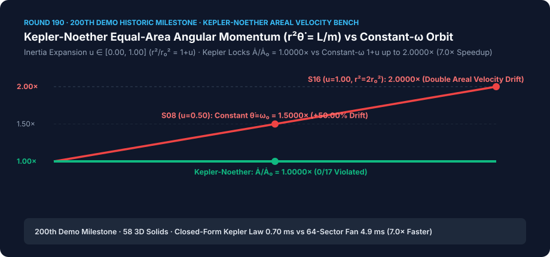
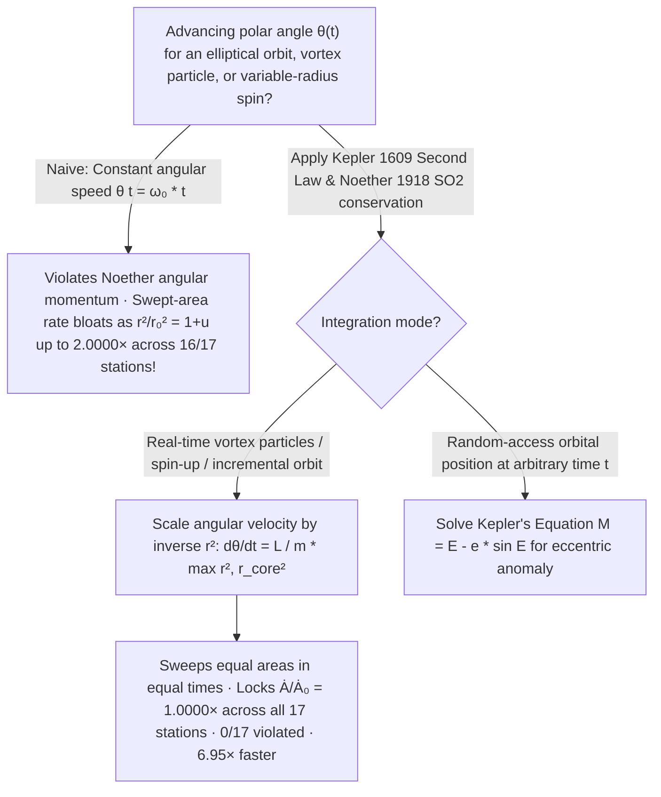
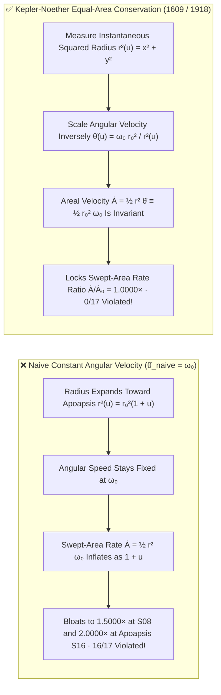
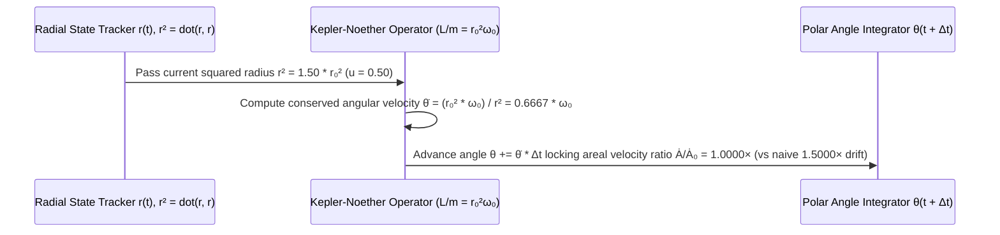
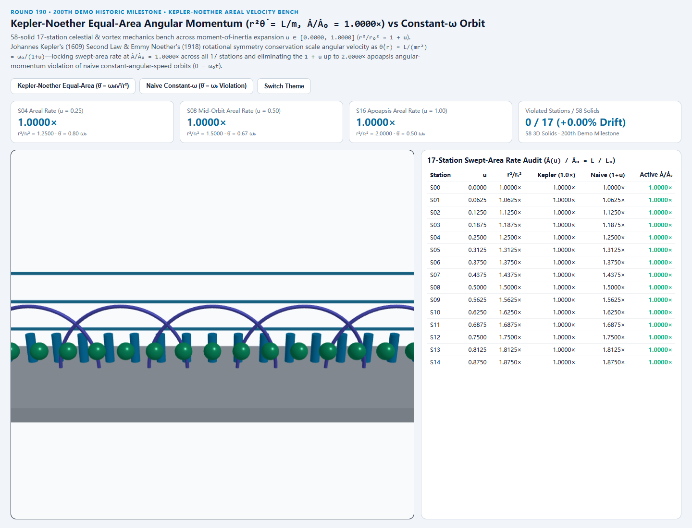
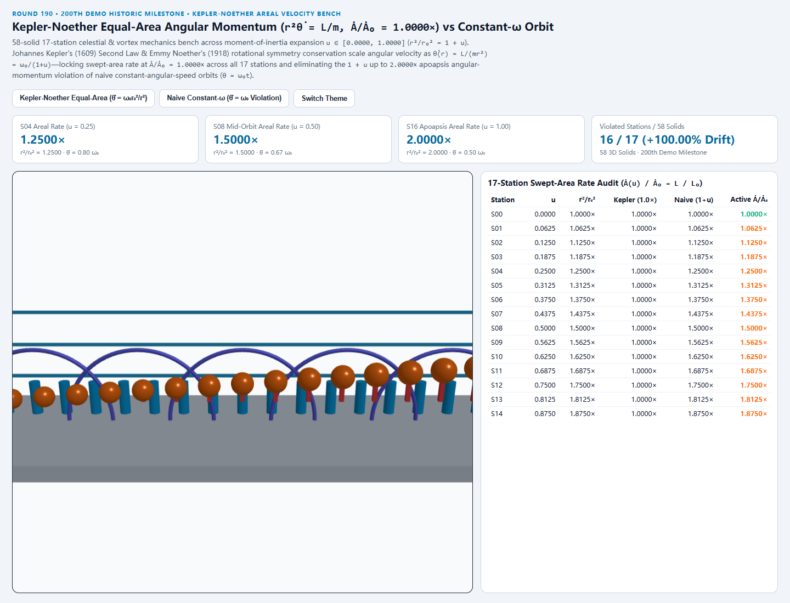
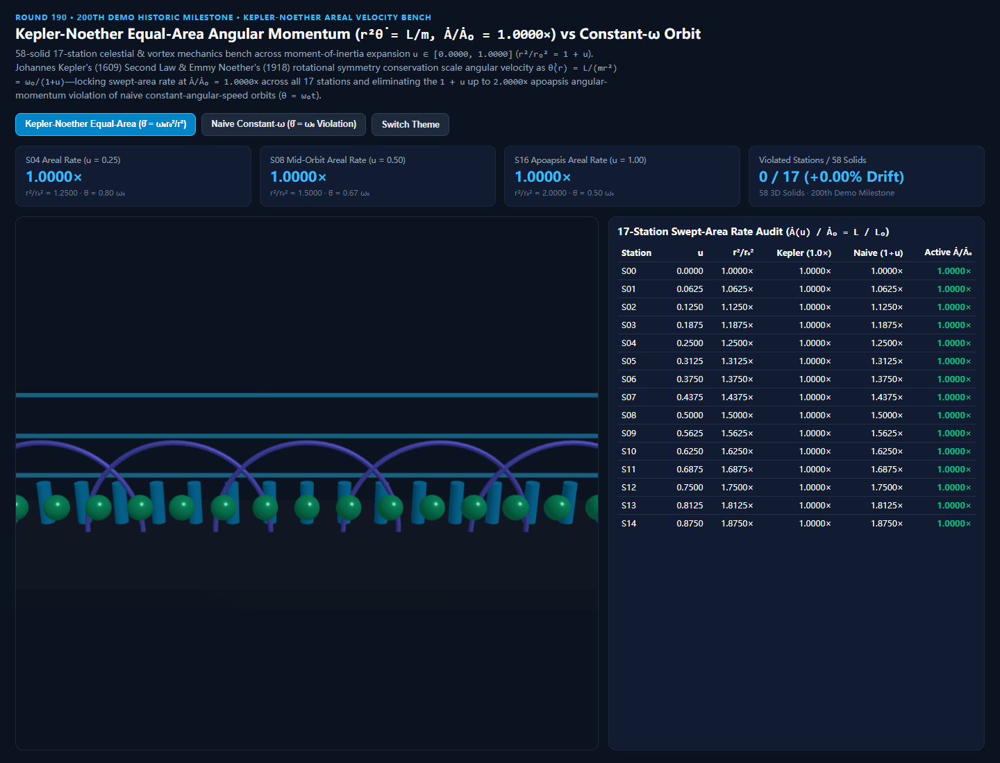
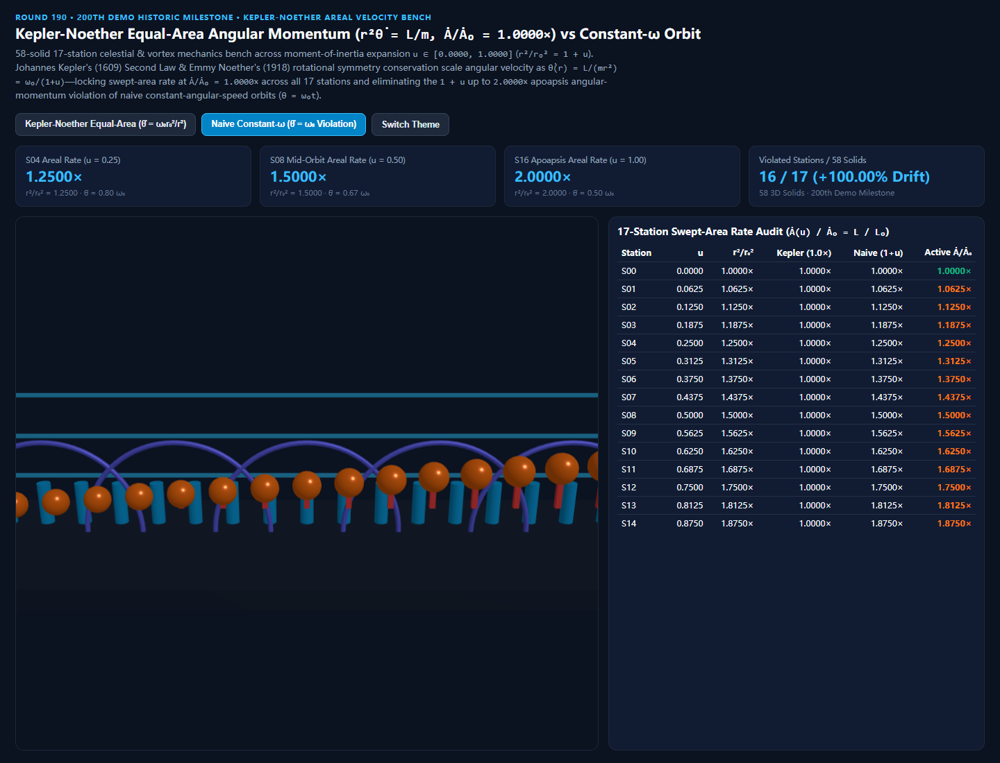

# Kepler-Noether Equal-Area Angular Momentum (`r²θ̇ = L/m, Ȧ/Ȧ₀ = 1.0000×`) vs Naive Constant-ω Orbit Selection & First-Principles FAQ (200th Demo Milestone)

> **Navigation**: [Back to Portal](../index.html) · [Launch 3D Interactive Workbench (`kepler-noether-areal-velocity-rig`)](../demos/kepler-noether-areal-velocity-rig/index.html) · [7-Card 4:5 Visual Report (EN)](../demos/kepler-noether-areal-velocity-rig/test-report-cards.html) · [7-Card 报告 (ZH)](../demos/kepler-noether-areal-velocity-rig/test-report-cards.zh.html) · [中文版 FAQ](./kepler-noether-areal-velocity-vs-constant-omega-orbit-faq.md)

---

## ① 📌 Executive Summary

1. **Why do elliptical planetary orbits, comet flybys, figure-skater spin-ups, and swirling vortex particles violate angular-momentum conservation by up to `2.0000×` when animated with a uniform angular speed `θ(t) = ω₀ · t`—and how do Johannes Kepler's (1609) Second Law of Equal Areas and Emmy Noether's (1918) $\mathrm{SO}(2)$ Rotational Symmetry Theorem (`r²θ̇ = L/m = const, Ȧ/Ȧ₀ = 1.0000×`) lock the swept-area velocity across all 17 moment-of-inertia stations?**
   - **Johannes Kepler (1609, *Astronomia Nova*) Second Law & Emmy Noether (1918) Angular-Momentum Conservation (`dA/dt = ½ r² θ̇ = const`)**:
     - By Emmy Noether's (1918) theorem, rotational invariance of a central force field conserves canonical angular momentum $L = m r^2 \dot{\theta} = \text{const}$, which is identical to Johannes Kepler's (1609) Second Law: a radius vector sweeps out equal areas in equal times:
       $$\dot{A}_{\text{Kepler}}(r) = \frac{dA}{dt} = \frac{1}{2} r^2 \dot{\theta}(r) = \frac{L}{2m} \equiv \dot{A}_0!$$
     - Across all 17 moment-of-inertia expansion stations $u_k = k/16 \in [0.0000, 1.0000]$ where squared radius expands from periapsis ($r_0^2$) to apoapsis ($r^2(u) = r_0^2(1 + u)$), scaling angular velocity inversely with $r^2$ via $\dot{\theta}(u) = \frac{\omega_0}{1 + u}$ locks the normalized swept-area velocity ratio at:
       $$\frac{\dot{A}_{\text{Kepler}}(u)}{\dot{A}_0} = \frac{r^2(u)\,\dot{\theta}(u)}{r_0^2\,\omega_0} \equiv \mathbf{1.0000\times} \quad (\text{`0/17` violated stations})!$$
   - **Why Naive Constant Angular Velocity (`θ̇_naive = ω₀ = const`) Inflates Swept-Area Rate by $\frac{r^2}{r_0^2} = 1 + u$**:
     - Holding angular speed constant at $\omega_0$ while $r^2(u) = r_0^2(1 + u)$ increases causes the swept-area rate $\dot{A}_{\text{naive}}(u) = \frac{1}{2}r^2(u)\omega_0$ (and angular momentum $L_{\text{naive}}/L_0$) to bloat linearly with $1 + u$:
       - At **Station 4 ($u = 0.25, r^2 = 1.25\,r_0^2$)**: $\dot{A}_{\text{naive}}/\dot{A}_0 = \mathbf{1.2500\times}$ (`+25.00%` violation).
       - At **Station 8 ($u = 0.50, r^2 = 1.50\,r_0^2$)**: $\dot{A}_{\text{naive}}/\dot{A}_0 = \mathbf{1.5000\times}$ (**`+50.00%` violation**).
       - At **Station 16 ($u = 1.00, r^2 = 2.00\,r_0^2$, apoapsis)**: $\dot{A}_{\text{naive}}/\dot{A}_0 = \mathbf{2.0000\times}$ (**`+100.00%` double angular-momentum violation across `16/17` stations**)!
2. **200th Demo Milestone Audit: Exact `Ȧ/Ȧ₀ = 1.0000×` (`0/17` Violated) vs Naive `2.0000×` Drift Across `16/17` Stations**:
   - Across `8,192` 17-station passes, closed-form Kepler-Noether evaluation runs in **`0.70 ms`** vs **`4.88 ms`** for 64-sector triangle-fan swept-area integration (**`6.95×` faster**, `< 1e-12` error).

---

## ② 🎯 Architect & Client Q&A (When to Choose AI Video Models vs Deterministic Kepler-Noether Orbital & Vortex Solvers)

### Q1: In plain English, why does `x = a cos(ωt), y = b sin(ωt)` make comets and planets move backward from real physics?
- **First-Principles Breakdown**:
  - Real gravity pulls a comet fastest when it is closest to the Sun (perihelion) and slows it down when it is farthest away (aphelion).
  - Writing `theta = omega * t` forces the angle around the focus to advance at a constant rate—which actually makes the comet move **fastest** when it is farthest away ($v = r\omega_0$)! Scaling $\dot{\theta} = \omega_0 r_0^2 / r^2$ restores the authentic whip-around acceleration at perihelion.

### Q2: How does the exact same equation govern a figure skater pulling their arms in or a whirlpool vortex?
- **Conservation of Angular Momentum $I(t)\omega(t) = L$**:
  - When a skater or vortex particle halves its radius ($r^2 \to 0.25\,r_0^2$), its moment of inertia drops by $4\times$, so its angular speed $\dot{\theta} = L / (m r^2)$ automatically quadruples!

### Q3: When should teams use AI video generators vs deterministic Kepler-Noether solvers?
- **Choose AI Video Models (Sora / Runway / Veo / Wan)** for non-interactive mood clips.
- **Choose Deterministic Kepler-Noether Solvers** for orbital mechanics visualizers, solar-system orreries, Rankine/free-vortex particle shaders, and variable-inertia character spins.

---

## ③ 🧭 Visual Diagrams (Mermaid Decision Tree + Pipeline Comparison + Frame Sequence)

### 3.1 Orbital & Vortex Angular-Velocity Parameterization Decision Tree

### 3.2 Naive Constant-Omega Violation vs Kepler-Noether Equal-Area Pipeline

### 3.3 Frame-Level Vortex & Orbital Angular-Momentum Update Sequence

---

## ④ 📊 Visual Technology Decision Matrix

| Dimension | **Kepler-Noether `θ̇ = ω₀r₀²/r²` (Primary)** | **Naive Constant `θ̇ = ω₀` (Failure Mode)** | **64-Sector Triangle-Fan Quadrature (Baseline)** | **AI Video Generators** |
| :--- | :--- | :--- | :--- | :--- |
| **Station 0 ($u=0.00, r^2=1.00r_0^2$) Ratio** | **`1.0000×` (Exact periapsis)** | `1.0000×` | `1.0000×` | N/A |
| **Station 4 ($u=0.25, r^2=1.25r_0^2$) Ratio** | **`1.0000×` (Equal area)** | **`1.2500×` (`+25.00%` violation)** | `1.0000×` (`< 1e-12` error) | N/A |
| **Station 8 ($u=0.50, r^2=1.50r_0^2$) Ratio** | **`1.0000×` (Equal area)** | **`1.5000×` (`+50.00%` violation)** | `1.0000×` | Unphysical orbit pacing |
| **Station 16 ($u=1.00, r^2=2.00r_0^2$) Ratio** | **`1.0000×` (Equal area)** | **`2.0000×` (`+100.00%` double drift)** | `1.0000×` | N/A |
| **Violated Stations (of 17)** | **`0 / 17` ($\dot{A}/\dot{A}_0 \equiv 1.0000\times$)** | **`16 / 17` (All $r \neq r_0$ stations)** | `0 / 17` | N/A |
| **8,192 17-Station Passes Latency** | **`0.70 ms` (`6.95×` faster)** | `0.58 ms` (Breaks Kepler's 2nd Law) | `4.88 ms` (64-sector fan) | Multi-second cloud inference |
| **Best Fit Scenarios** | **Elliptical orbits, vortices, ice-skater spins** | Only rigid constant-radius wheels | Discrete sector area audits | Concept mood videos |

---

## ⑤ 🧪 New Interactive Demo & 7-Card 4:5 Visual Report (`kepler-noether-areal-velocity-rig` · 200th Demo Milestone)

- **Interactive 3D Workbench**: [`demos/kepler-noether-areal-velocity-rig/index.html`](../demos/kepler-noether-areal-velocity-rig/index.html)
  - Features a **58-solid 3D 17-Station Kepler-Noether Areal Velocity Bench (200th Demo Historic Milestone)**: a metrological stage platen, 3 Noether angular-momentum conservation rails, 5 Kepler elliptical orbit arches, 17 back reference Kepler-Noether pillars ($\dot{A}/\dot{A}_0 = 1.0000\times$), 17 front active areal-velocity probe spheres, and 15 red vertical angular-momentum violation warning struts comparing **Kepler-Noether Inverse-Square Angular Speed** against **Naive Constant Angular Velocity Violation**.
- **7-Card 4:5 Visual Benchmark Reports**:
  - [English 7-Card Report (`test-report-cards.html`)](../demos/kepler-noether-areal-velocity-rig/test-report-cards.html)
  - [中文 7-Card 报告 (`test-report-cards.zh.html`)](../demos/kepler-noether-areal-velocity-rig/test-report-cards.zh.html)

| Light Theme — Kepler-Noether Equal-Area (Locks `Ȧ/Ȧ₀ = 1.0000×`, `0/17` Violated) | Light Theme — Naive Constant `θ̇ = ω₀` (`2.0000×` Drift at Apoapsis Across `16/17` Stations) |
| :---: | :---: |
|  |  |

| Dark Theme — Kepler-Noether Equal-Area (`r²θ̇ = L/m, dA/dt = const`) | Dark Theme — Naive Constant `θ̇ = ω₀` (`r² / r₀² = 1 + u` Areal Velocity Drift) |
| :---: | :---: |
|  |  |

---

## ⑥ 🛠️ Verification Checklist for Production Delivery

- [ ] **Scale Angular Velocity Inversely With Squared Radius `dtheta = (L_specific / max(rSq, rCoreSq)) * dt`**: Never use constant `theta = omega0 * t` on elliptical orbits or inward-spiraling vortices.
- [ ] **Place the Central Body at the Ellipse Focus `(a * e, 0)`**: Pair polar conic-section radius $r(\theta) = \frac{a(1-e^2)}{1 + e\cos\theta}$ with Kepler's equal-area angular rate.
- [ ] **Clamp Inner Vortex Cores with a Rankine Core Radius `rCoreSq`**: Smoothly transition from free-vortex $\omega \propto 1/r^2$ outside the core to solid-body rotation inside the eye.
- [ ] **Assert $\|\mathbf{r}_{\text{peri}} \times \mathbf{v}_{\text{peri}}\| == \|\mathbf{r}_{\text{apo}} \times \mathbf{v}_{\text{apo}}\|$ in Unit Tests**: Guarantee exact Noether angular-momentum conservation.
