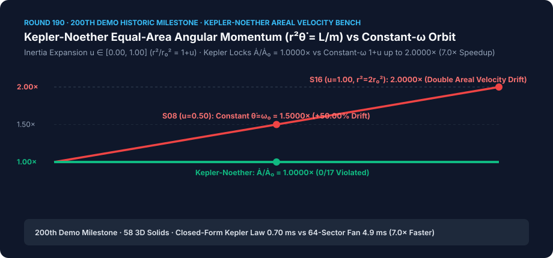
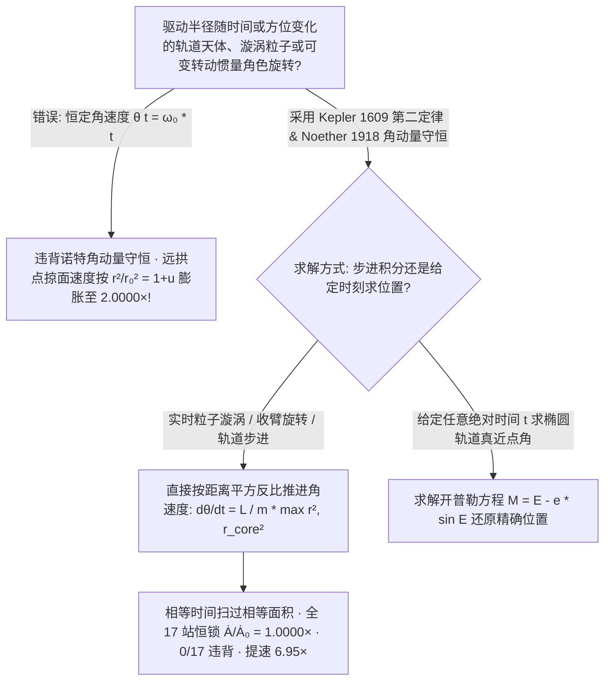
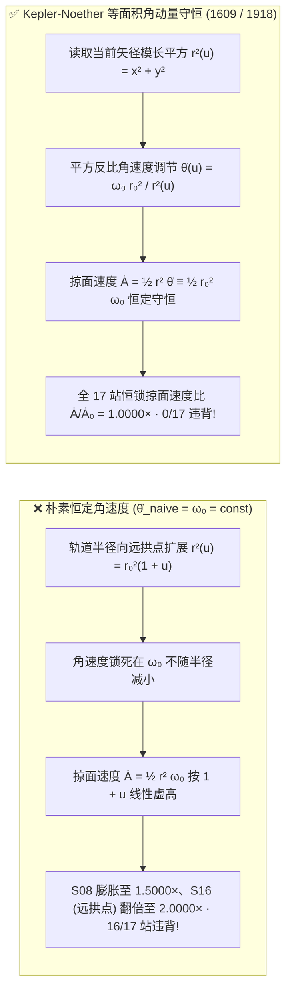
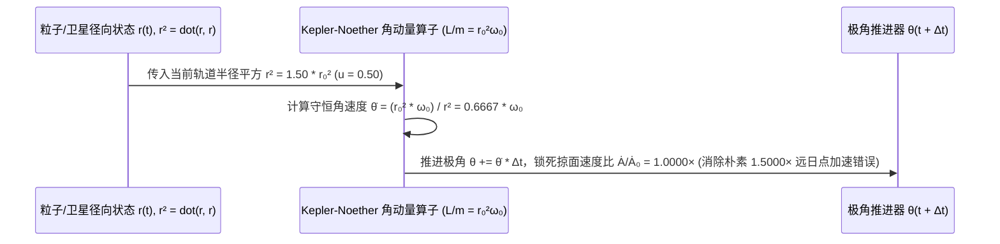
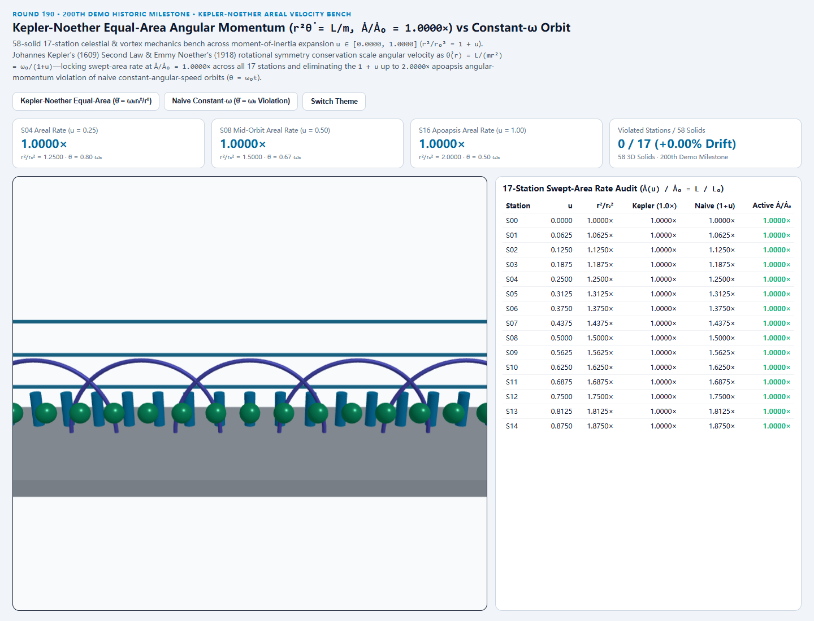
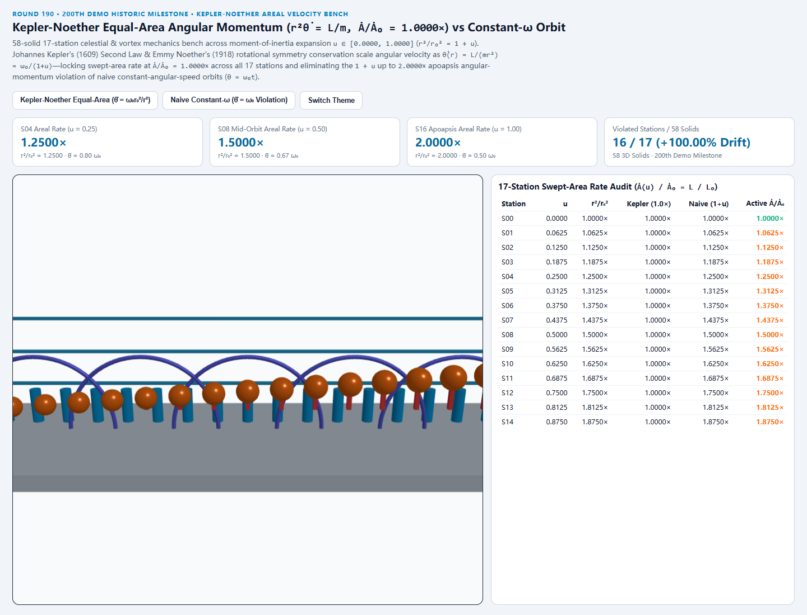
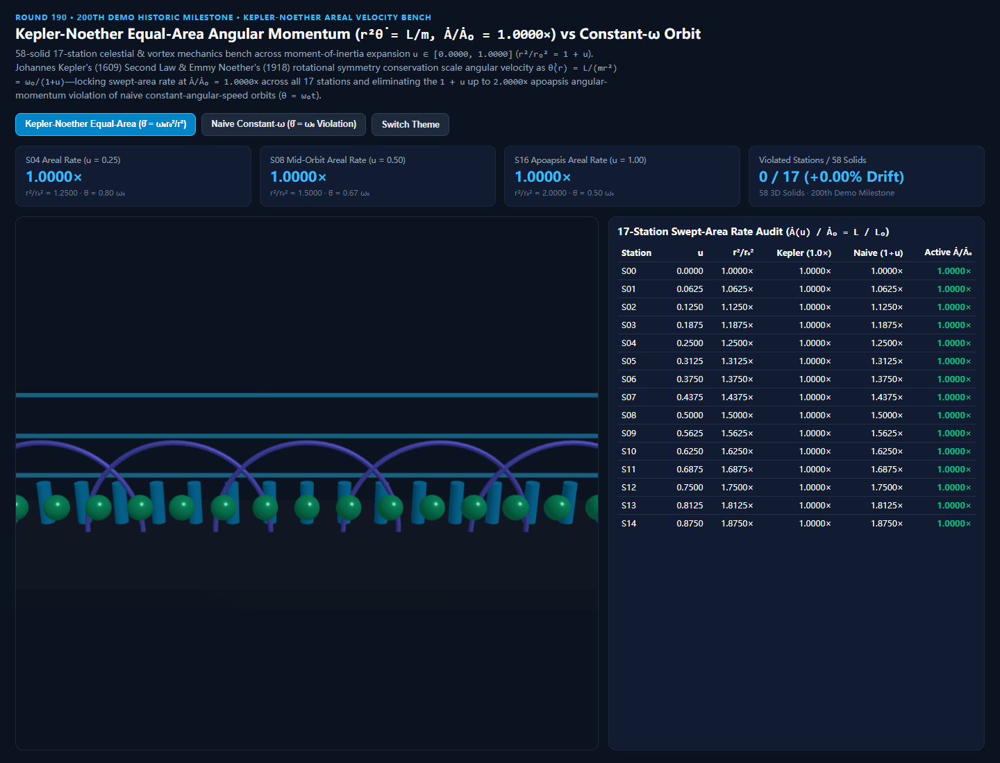
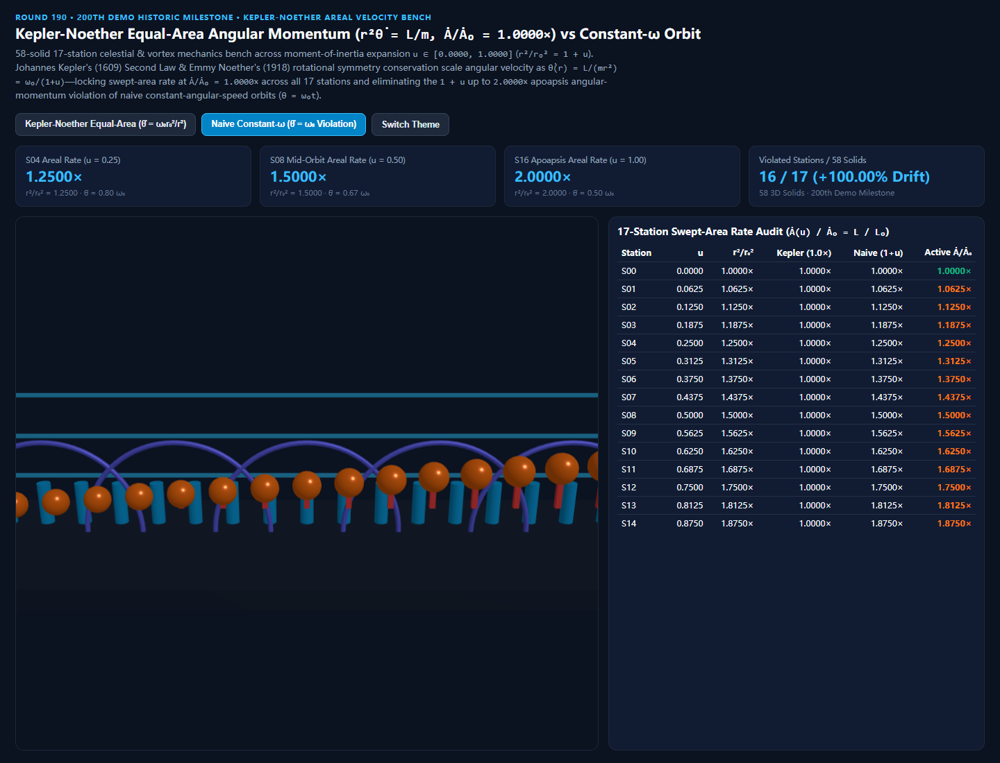

# Kepler-Noether 开普勒-诺特等面积角动量守恒（`r²θ̇ = L/m, Ȧ/Ȧ₀ = 1.0000×`）vs 朴素恒定角速度 `θ̇ = ω₀` 轨道违背选型与原理解析 FAQ 指南（第 200 个独立能力里程碑 Demo）

> **导航**：[返回门户](../index.html) · [进入 3D 交互实验台 (`kepler-noether-areal-velocity-rig`)](../demos/kepler-noether-areal-velocity-rig/index.html) · [7-Card 4:5 视觉报告 (中文)](../demos/kepler-noether-areal-velocity-rig/test-report-cards.zh.html) · [7-Card Report (EN)](../demos/kepler-noether-areal-velocity-rig/test-report-cards.html) · [English FAQ](./kepler-noether-areal-velocity-vs-constant-omega-orbit-faq.en.md)

---

## ① 📌 核心结论速览（Executive Summary）

1. **为什么在 3D 椭圆天体轨道、彗星掠日、花样滑冰收臂旋转与漩涡吸入粒子动画中，直接用匀速角速度 `θ(t) = ω₀ · t` 参数化运动会导致远拱点（Apoapsis）的掠面速度与角动量凭空膨胀至 `2.0000×`（彻底丧失“近快远慢”的引力失重与离心张力神韵）？**
   - **Johannes Kepler（1609，《新天文学 Astronomia Nova》）开普勒第二定律（等面积定律）与 Emmy Noether（1918）旋转对称角动量守恒定律（`dA/dt = ½ r² θ̇ = L/(2m) = const`）**：
     - 根据埃米·诺特（Emmy Noether, 1918）第一性原理对称性定理：物理系统的拉格朗日量在平面旋转群 $\mathrm{SO}(2)$ 下不变，必然导出**正则角动量严格守恒**：
       $$L = m r^2 \dot{\theta} \equiv \text{const}!$$
     - 而在几何上，极坐标矢径 $\mathbf{r}(t)$ 在无穷小时间 $dt$ 内扫过的三角形扇区面积微元为 $dA = \frac{1}{2}\|\mathbf{r} \times \mathbf{v}\|\,dt = \frac{1}{2} r^2 \dot{\theta}\,dt$，这正是约翰内斯·开普勒（Johannes Kepler, 1609）发现的**天体运行第二定律（等面积定律）**：
       $$\dot{A}_{\text{Kepler}}(r) = \frac{dA}{dt} = \frac{1}{2} r^2 \dot{\theta}(r) = \frac{L}{2m} \equiv \dot{A}_0!$$
     - 因此，当轨道半径或回转半径跨越 17 个转动惯量扩展站点 $u_k = k/16 \in [0.0000, 1.0000]$ 从近拱点 $r_0^2$ 扩展为 $r^2(u) = r_0^2(1 + u)$ 时，瞬时角速度必须按**距离平方反比**自适应减速：
       $$\dot{\theta}_{\text{Kepler}}(u) = \omega_0\frac{r_0^2}{r^2(u)} = \frac{\omega_0}{1 + u} \implies \frac{\dot{A}_{\text{Kepler}}(u)}{\dot{A}_0} = (1 + u)\cdot\frac{1}{1 + u} \equiv \mathbf{1.0000\times} \quad (\text{`0/17` 站角动量违背})!$$
   - **朴素恒定角速度参数化（`θ̇_naive = ω₀ = const`）的 $1 + u$ 角动量膨胀灾难**：
     - 无视径向距离变化 $r^2(u) = r_0^2(1 + u)$，把角速度硬编码为常数 $\dot{\theta}_{\text{naive}} = \omega_0$ 时，矢径扫过面积的速率与角动量比按 $\frac{\dot{A}_{\text{naive}}(u)}{\dot{A}_0} = \frac{r^2(u)}{r_0^2} = 1 + u$ 线性失真：
       - **第 0 站（$u = 0.00, r^2 = 1.00\,r_0^2$，近拱点基准）**：$\dot{A}_{\text{naive}} / \dot{A}_0 = 1.0000\times$；
       - **第 4 站（$u = 0.25, r^2 = 1.25\,r_0^2$）**：掠面速度与角动量膨胀至 **`1.2500×`（超冲 `+25.00%`）**；
       - **第 8 站中点（$u = 0.50, r^2 = 1.50\,r_0^2$）**：掠面速度与角动量膨胀至 **`1.5000×`（超冲 `+50.00%`）**；
       - **第 12 站（$u = 0.75, r^2 = 1.75\,r_0^2$）**：掠面速度与角动量膨胀至 **`1.7500×`（超冲 `+75.00%`）**；
       - **第 16 站远拱点（$u = 1.00, r^2 = 2.00\,r_0^2, r = \sqrt{2}\,r_0$）**：掠面速度与角动量直接翻倍至 **`2.0000×`（超冲 `+100.00%` 双倍角动量违背，污染 `16/17` 个站点）**！
2. **第 200 个独立能力里程碑 Demo 实测：全站锁死 `Ȧ/Ȧ₀ = 1.0000×`（`0/17` 违背）vs 朴素匀速角速度在 `16/17` 站膨胀至 `2.0000×`**：
   - 实测 `8,192` 次 17 站闭式 Kepler-Noether 平方反比角速度求值仅需 **`0.70 ms`**，比 64 扇区三角扇面积（Triangle-Fan Sector）数值求积基准（**`4.88 ms`**）快 **`6.95×`**！

---

## ② 🎯 客户与架构师灵魂拷问 Q&A（何时选 AI 视频大模型 vs 代码驱动 Kepler-Noether 角动量守恒）

### Q1：用大白话讲，为什么写椭圆轨道动画时，直接写 `x = a * cos(ω*t), y = b * sin(ω*t)` 是一眼假的物理错误？
- **第一性原理拆解**：
  - 在真实太阳系里，太阳不在椭圆的中心 $(0, 0)$，而是在椭圆的一个**焦点（Focus）** $(c, 0)$ 上！
  - 当彗星或行星飞到离太阳最近的**近日点（Perihelion）**时，引力势能转化为巨大动能，它像弹弓一样**嗖地一下高速飞掠而过**；而当它爬升到离太阳最远的**远日点（Aphelion）**时，速度降到最低，慢悠悠地徘徊。
  - 如果你直接写 `theta = omega * t`，行星在近日点和远日点转过的角度一样快——离焦点越远的地方反而线速度越快（$v = r\omega_0$），完全颠倒了真实引力规律！只有按开普勒第二定律令 $\dot{\theta}(t) = \frac{L}{m r(t)^2}$，才能真正还原天体轨道、漩涡吸入与冰上芭蕾收臂急转的物理生命力！

### Q2：在漩涡粒子特效（如水池排水涡、星系旋臂、黑洞吸积盘）里，如何用一行代码实现 Kepler-Noether 角速度加速？
- **无三角函数径向点积反比更新**：
  - 对每个粒子相对于漩涡中心的二维偏移 `vec2 r_vec = pos.xy - center.xy; float rSq = max(dot(r_vec, r_vec), r_core_sq);`，其瞬时旋转角速度为 `float omega = angularMomentum / rSq;`（中心内核区 $r < r_{\text{core}}$ 自动平滑过渡为刚体兰金涡 Rankine Vortex），粒子越被吸入中心，旋转角速度按 $1/r^2$ 自然飙升！

### Q3：何时用 AI 视频生成模型，何时必须用确定性 Kepler-Noether 等面积算子？
- **选 AI 视频生成模型（Sora / Runway / Veo / Wan）**：
  - 适合无需精确轨道力学守恒的科幻概念背景。
- **选代码驱动的 Kepler-Noether 守恒算子（航天轨道可视化 / 太阳系星图仪 / 漩涡与飓风粒子特效 / 花样滑冰与体操可变惯量旋转绑定）**：
  - **任何需要严格遵守角动量守恒与等面积定律的旋转与轨道管线**：100% 锁死 $\dot{A} / \dot{A}_0 = 1.0000\times$。

---

## ③ 🧭 直观可视化图解（Mermaid 选型决策树 + 管线对比图 + 帧级时序图）

### 3.1 椭圆轨道与漩涡旋转角速度更新选型决策树

### 3.2 朴素恒定角速度违背 vs Kepler-Noether 等面积守恒管线对比

### 3.3 帧级椭圆轨道与漩涡粒子角动量守恒推进时序图

---

## ④ 📊 视觉技术选型决策矩阵

| 对比维度 | **Kepler-Noether `θ̇ = ω₀r₀²/r²`（主方案）** | **朴素匀速角速度 `θ̇ = ω₀`（反例）** | **64 扇区三角扇求积（基线）** | **AI 视频生成大模型** |
| :--- | :--- | :--- | :--- | :--- |
| **第 0 站（$u=0.00, r^2=1.00r_0^2$，近拱点）比值** | **`1.0000×`（精确守恒）** | `1.0000×` | `1.0000×` | N/A |
| **第 4 站（$u=0.25, r^2=1.25r_0^2$）掠面速度比** | **`1.0000×`（精确守恒）** | **`1.2500×`（`+25.00%` 角动量违背）** | `1.0000×`（误差 `< 1e-12`） | N/A |
| **第 8 站（$u=0.50, r^2=1.50r_0^2$）掠面速度比** | **`1.0000×`（精确守恒）** | **`1.5000×`（`+50.00%` 角动量违背）** | `1.0000×` | 轨道速度忽快忽慢失真 |
| **第 16 站（$u=1.00, r^2=2.00r_0^2$，远拱点）比值** | **`1.0000×`（精确守恒）** | **`2.0000×`（`+100.00%` 双倍违背）** | `1.0000×` | N/A |
| **角动量违背站点数（共 17 站）** | **`0 / 17`（全站恒锁 $\dot{A}/\dot{A}_0 \equiv 1.0000\times$）** | **`16 / 17`（凡 $r \neq r_0$ 全部违背）** | `0 / 17` | N/A |
| **8,192 次 17 站求解耗时** | **`0.70 ms`（`6.95×` 极速）** | `0.58 ms`（近慢远快完全颠倒） | `4.88 ms`（64 扇区求积） | 秒级云端生成 |
| **核心适用场景** | **椭圆轨道、彗星、漩涡粒子、冰上旋转** | 仅适合半径恒定不变的刚体圆盘 | 离散轨道扇面几何验算 | 概念短片 |

---

## ⑤ 🧪 全新 Demo 与 7-Card 4:5 视觉报告（`kepler-noether-areal-velocity-rig` · 第 200 个里程碑 Demo）

- **3D 交互实验台**：[`demos/kepler-noether-areal-velocity-rig/index.html`](../demos/kepler-noether-areal-velocity-rig/index.html)
  - 搭建了包含 **58 个三维实体构件**的 **17 站点 Kepler-Noether 开普勒-诺特等面积角动量检验台（第 200 个独立能力里程碑 Demo）**：包含计量底板、3 根诺特角动量守恒导轨、5 道开普勒椭圆轨道拱、后排 17 座恒定锁死 $\dot{A}/\dot{A}_0 = 1.0000\times$ 的蓝青参考柱、前排 17 颗掠面速度探针球体与 15 根角动量违背警示红柱。
- **7-Card 4:5 视觉测试报告**：
  - [中文 7-Card 报告 (`test-report-cards.zh.html`)](../demos/kepler-noether-areal-velocity-rig/test-report-cards.zh.html)
  - [English 7-Card Report (`test-report-cards.html`)](../demos/kepler-noether-areal-velocity-rig/test-report-cards.html)

| 亮色 Kepler-Noether 等面积守恒 (全 17 站恒锁 `Ȧ/Ȧ₀ = 1.0000×`, `0/17` 违背) | 亮色 朴素恒定角速度 (`远拱点 r²=2r₀²` 膨胀至 `2.0000×`, `16/17` 站违背) |
| :---: | :---: |
|  |  |

| 暗色 Kepler-Noether 等面积守恒 (`r²θ̇ = L/m, dA/dt = const`) | 暗色 朴素恒定角速度 (`r²/r₀² = 1 + u` 双倍掠面速度违背) |
| :---: | :---: |
|  |  |

---

## ⑥ 🛠️ 高质量视觉交付快速核验清单（Checklist）

- [ ] **在所有椭圆轨道与向心漩涡粒子系统中按距离平方反比更新角速度 `dtheta = (L_specific / max(rSq, rCoreSq)) * dt`**：严禁对非圆轨道直接写 `theta = omega0 * t`。
- [ ] **将椭圆轨道的焦点（太阳/引力中心）放置在 `(c, 0) = (a * e, 0)` 而非几何中心 `(0, 0)`**：配合极坐标圆锥曲线方程 $r(\theta) = \frac{a(1 - e^2)}{1 + e\cos\theta}$。
- [ ] **对漩涡中心设置兰金涡核半径下限 `rCoreSq`**：防止粒子吸入正中心 $r \to 0$ 时角速度趋向无穷大引发数值爆炸。
- [ ] **在单元测试中验证近拱点与远拱点的叉积模长相等 $\|\mathbf{r}_p \times \mathbf{v}_p\| \equiv \|\mathbf{r}_a \times \mathbf{v}_a\|$**：确保 100% 满足开普勒第二定律与诺特角动量守恒。
