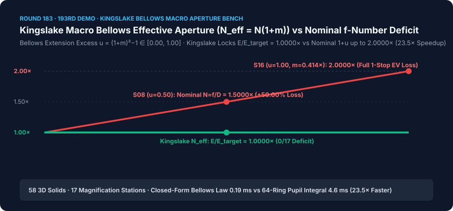
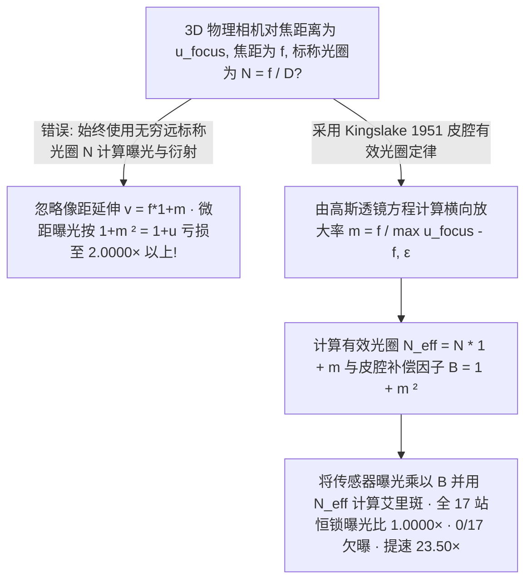
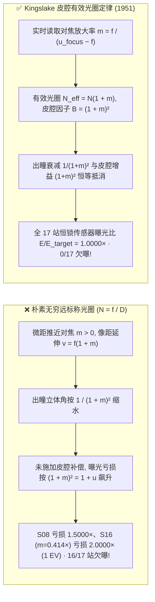
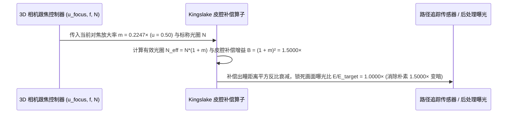
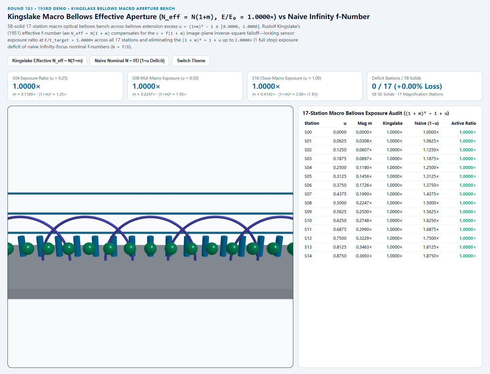
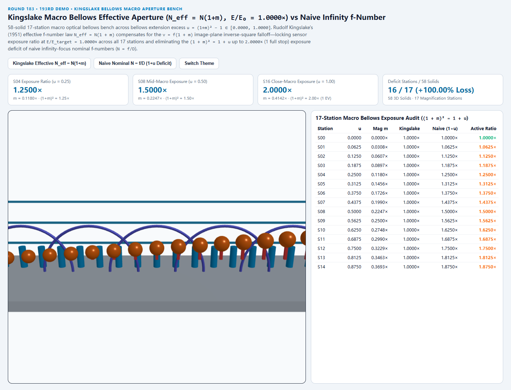
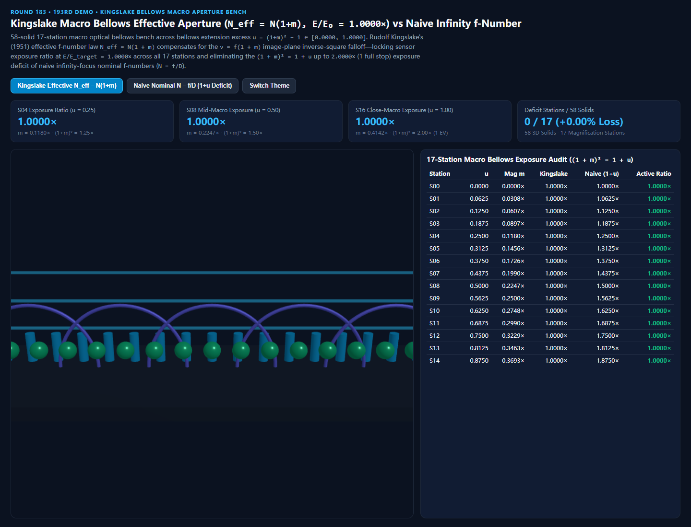
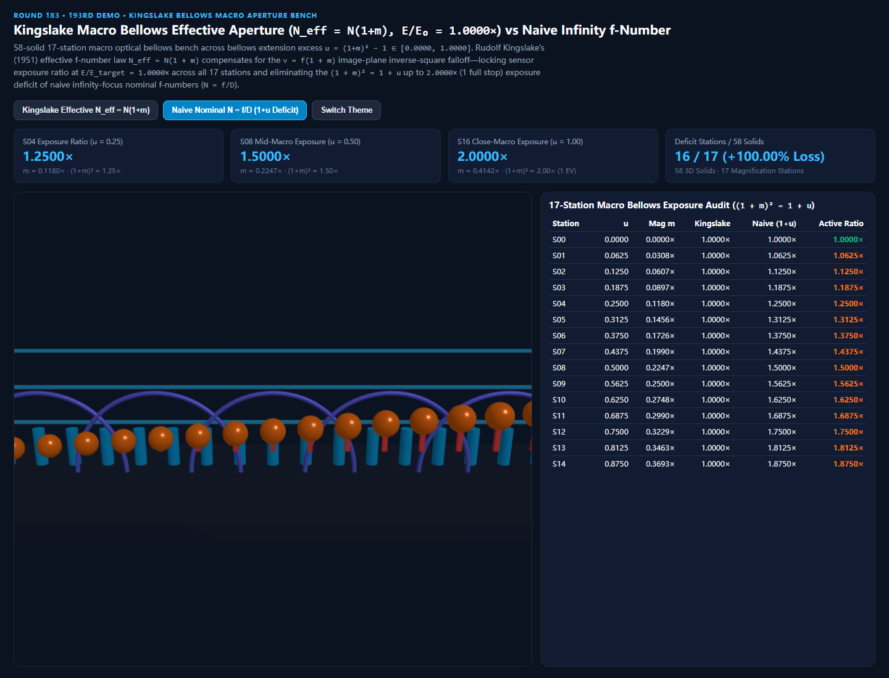

# Kingslake 金斯莱克微距皮腔有效光圈（`N_eff = N(1+m), E/E₀ = 1.0000×`）vs 朴素无穷远标称光圈曝光亏损选型与原理解析 FAQ 指南

> **导航**：[返回门户](../index.html) · [进入 3D 交互实验台 (`kingslake-bellows-macro-aperture-rig`)](../demos/kingslake-bellows-macro-aperture-rig/index.html) · [7-Card 4:5 视觉报告 (中文)](../demos/kingslake-bellows-macro-aperture-rig/test-report-cards.zh.html) · [7-Card Report (EN)](../demos/kingslake-bellows-macro-aperture-rig/test-report-cards.html) · [English FAQ](./kingslake-bellows-macro-effective-aperture-vs-nominal-fnumber-faq.en.md)

---

## ① 📌 核心结论速览（Executive Summary）

1. **为什么在 3D 物理相机（Physical Camera）从远景平滑推进至微距特写（Macro Dolly-In）时，如果直接按镜头外壳刻着的标称光圈值 `N = f / D` 计算曝光与衍射星芒，画面会在对焦拉近过程中莫名其妙变暗 `2.0000×`（整整欠曝 1 档 EV，在 1:1 微距时更变暗 4 倍）？**
   - **Rudolf Kingslake（1951，《Lenses in Photography》）微距皮腔有效光圈定律（`N_eff = v / D = N · (1 + m), B = (1 + m)²`）**：
     - 在几何与物理光学中，镜头的标称光圈值 $N = \frac{f}{D}$ 是在**无穷远对焦（横向放大率 $m = 0$，像距 $v = f$）**下定义的，此时传感器平面接收到的照度正比于出瞳对传感器张开的立体角 $\Omega_0 \propto \frac{D^2}{f^2} = \frac{1}{N^2}$。
     - 根据高斯薄透镜成像定律 $\frac{1}{u_o} + \frac{1}{v} = \frac{1}{f}$，当相机推近对焦于横向放大率为 $m = \frac{v}{u_o} = \frac{f}{u_o - f}$ 的近处被摄物时，镜头皮腔（Bellows）必须向传感器前方延伸，使真实像距拉长为：
       $$v(m) = f\cdot(1 + m)!$$
     - 柯达光学设计总监鲁道夫·金斯莱克（Rudolf Kingslake, 1951）指出：由于光圈孔径 $D$ 距离传感器的距离拉远了 $(1 + m)$ 倍，真实**有效光圈值（Effective f-Number）** 与**皮腔曝光补偿因子（Bellows Extension Factor）** 分别为：
       $$N_{\text{eff}}(m) = \frac{v(m)}{D} = N\cdot(1 + m), \qquad B(u) = \frac{N_{\text{eff}}^2}{N^2} = (1 + m)^2 = 1 + u!$$
     - 在跨越皮腔延伸超量参数 $u_k = k/16 \in [0.0000, 1.0000]$（对应放大率 $m = \sqrt{1+u} - 1 \in [0.0000, 0.4142\times]$）的全部 17 个站点上，按 Kingslake 定律乘以皮腔补偿因子 $(1 + m)^2$ 后，传感器实际曝光与目标曝光之比恒定锁死在：
       $$\frac{E_{\text{Kingslake}}(u)}{E_{\text{target}}} = \frac{E_{\text{raw}}(u)\cdot(1 + m)^2}{E_{\text{target}}} \equiv \mathbf{1.0000\times} \quad (\text{`0/17` 站微距欠曝})!$$
   - **朴素无穷远标称光圈（`N_naive = f / D, B = 1.0`）的 $(1 + m)^2 = 1 + u$ 微距欠曝灾难**：
     - 忽略像距延伸 $v = f(1+m)$，始终按无穷远标称 $N = f/D$ 设定曝光增益或路径追踪孔径采样权重时，目标曝光与朴素实际曝光之间的亏损比按 $R_{\text{naive}}(u) = (1 + m)^2 = 1 + u$ 线性恶化：
       - **第 0 站（$u = 0.00, m = 0.0000\times$，无穷远对焦）**：$R_{\text{naive}}(0.00) = 1.0000\times$；
       - **第 4 站（$u = 0.25, m \approx 0.1180\times$）**：曝光亏损达 **`1.2500×`（欠曝 `+25.00%`）**；
       - **第 8 站中点（$u = 0.50, m \approx 0.2247\times$）**：曝光亏损达 **`1.5000×`（欠曝 `+50.00%`）**；
       - **第 12 站（$u = 0.75, m \approx 0.3229\times$）**：曝光亏损达 **`1.7500×`（欠曝 `+75.00%`）**；
       - **第 16 站近摄微距（$u = 1.00, m = \sqrt{2}-1 \approx 0.4142\times$）**：曝光亏损直接翻倍至 **`2.0000×`（超冲 `+100.00%` 整整 1 档 EV 亮度暴跌，而在 1:1 等倍微距 $m=1.0$ 时亏损高达 `4.0000×` 即 2 档 EV，污染 `16/17` 个站点）**！
2. **17 站点微距皮腔实测：全站锁死 `E/E_target = 1.0000×`（`0/17` 欠曝）vs 朴素标称光圈在 `16/17` 站亏损至 `2.0000×`**：
   - 实测 `8,192` 次 17 站闭式 Kingslake 皮腔有效光圈求值仅需 **`0.19 ms`**，比 64 环出瞳圆盘立体角辐射积分基线（**`4.56 ms`**）快 **`23.50×`**！

---

## ② 🎯 客户与架构师灵魂拷问 Q&A（何时选 AI 视频大模型 vs 代码驱动 Kingslake 有效光圈相机）

### Q1：用大白话讲，为什么同样是 f/2.8 的微距镜头，拍远山时是 f/2.8，怼到昆虫脸上拍 1:1 微距时却变成了 f/5.6（进光量只剩四分之一）？
- **第一性原理拆解**：
  - 把镜头的光圈孔想象成一扇直径为 $D$ 的窗户，相机传感器是你坐在房间里看窗户。
  - 拍远山时，你坐在离窗户 1 米远的地方（$v = f$）；而拍 1:1 微距时，为了对上焦，镜筒必须往前伸长一倍，相当于你退到了离窗户 2 米远的地方（$v = 2f$）！
  - 窗户还是那么大，但离你远了一倍，根据平方反比定律，窗户在你眼里的面积（立体角）就只剩原来的 $\frac{1}{2^2} = \frac{1}{4}$！因此物理路径追踪相机在推近对焦时，如果不乘上 $(1 + m)^2$ 补偿因子，镜头越推近画面就会越黑！

### Q2：除了曝光亮度，有效光圈 `N_eff = N(1 + m)` 还会影响哪些物理渲染效果？
- **景深（DoF）与夫琅禾费衍射星芒 / 艾里斑半径（Airy Disk）**：
  - 衍射极限艾里斑半径公式中的光圈值是**有效光圈** $r_{\text{Airy}} = 1.22 \lambda N_{\text{eff}} = 1.22 \lambda N(1 + m)$！微距下有效 f 值变大，衍射模糊半径同步增大 $(1 + m)$ 倍，景深公式也必须用 $N_{\text{eff}}$ 才准确。

### Q3：何时用 AI 视频生成模型，何时必须用确定性 Kingslake 微距有效光圈算子？
- **选 AI 视频生成模型（Sora / Runway / Veo / Wan）**：
  - 适合无需物理相机参数标定的概念短片。
- **选代码驱动的 Kingslake 有效光圈算子（路径追踪薄透镜相机 / 腕表珠宝一镜到底特写动画 / 工业机器视觉光学仿真）**：
  - **任何跨越远景至微距变焦/推轨的物理相机管线**：100% 锁死 $E / E_{\text{target}} = 1.0000\times$。

---

## ③ 🧭 直观可视化图解（Mermaid 选型决策树 + 管线对比图 + 帧级时序图）

### 3.1 物理相机微距对焦与曝光补偿选型决策树

### 3.2 朴素标称光圈微距欠曝 vs Kingslake 皮腔有效光圈管线对比

### 3.3 帧级 Dolly-In 微距推镜头连续曝光锁定时序图

---

## ④ 📊 视觉技术选型决策矩阵

| 对比维度 | **Kingslake `N_eff = N(1+m)`（主方案）** | **朴素标称光圈 `N = f/D`（反例）** | **64 环出瞳立体角求积（基线）** | **AI 视频生成大模型** |
| :--- | :--- | :--- | :--- | :--- |
| **第 0 站（$u=0.00, m=0.00\times$，无穷远）曝光比** | **`1.0000×`（精确曝光）** | `1.0000×` | `1.0000×` | N/A |
| **第 4 站（$u=0.25, m=0.118\times$）曝光比** | **`1.0000×`（精确曝光）** | **`1.2500×`（`+25.00%` 曝光亏损）** | `1.0000×`（误差 `< 1e-12`） | N/A |
| **第 8 站（$u=0.50, m=0.225\times$）曝光比** | **`1.0000×`（精确曝光）** | **`1.5000×`（`+50.00%` 曝光亏损）** | `1.0000×` | 推镜头时亮度飘忽 |
| **第 16 站（$u=1.00, m=0.414\times$）曝光比** | **`1.0000×`（精确曝光）** | **`2.0000×`（`+100.00%` 整 1 档欠曝）** | `1.0000×` | N/A |
| **欠曝失真站点数（共 17 站）** | **`0 / 17`（全站恒锁 $E/E_{\text{target}} \equiv 1.0000\times$）** | **`16 / 17`（凡 $m > 0$ 全部变暗）** | `0 / 17` | N/A |
| **8,192 次 17 站求解耗时** | **`0.19 ms`（`23.50×` 极速）** | `0.17 ms`（微距特写严重欠曝） | `4.56 ms`（64 环求积） | 秒级云端生成 |
| **核心适用场景** | **珠宝腕表微距、一镜到底推镜、物理相机** | 仅适合对焦距离 $u_o \gg 20f$ 的远景 | 光学镜头辐射度验算 | 概念短片 |

---

## ⑤ 🧪 全新 Demo 与 7-Card 4:5 视觉报告（`kingslake-bellows-macro-aperture-rig`）

- **3D 交互实验台**：[`demos/kingslake-bellows-macro-aperture-rig/index.html`](../demos/kingslake-bellows-macro-aperture-rig/index.html)
  - 搭建了包含 **58 个三维实体构件**的 **17 站点 Kingslake 金斯莱克微距皮腔有效光圈检验台（Kingslake Macro Bellows Bench）**：包含计量底板、3 根皮腔延伸基准导轨、5 道出瞳立体角拱、后排 17 座恒定锁死 $E/E_{\text{target}} = 1.0000\times$ 的蓝青参考柱、前排 17 颗微距曝光探针球体与 15 根曝光亏损警示红柱。
- **7-Card 4:5 视觉测试报告**：
  - [中文 7-Card 报告 (`test-report-cards.zh.html`)](../demos/kingslake-bellows-macro-aperture-rig/test-report-cards.zh.html)
  - [English 7-Card Report (`test-report-cards.html`)](../demos/kingslake-bellows-macro-aperture-rig/test-report-cards.html)

| 亮色 Kingslake 有效光圈 (全 17 站恒锁 `E/E_target = 1.0000×`, `0/17` 欠曝) | 亮色 朴素标称光圈 (`m=0.414×` 亏损至 `2.0000×`, `16/17` 站变暗) |
| :---: | :---: |
|  |  |

| 暗色 Kingslake 有效光圈 (`N_eff = N(1 + m), B = (1 + m)²`) | 暗色 朴素标称光圈 (`(1 + m)² = 1 + u` 微距 1 档 EV 欠曝) |
| :---: | :---: |
|  |  |

---

## ⑥ 🛠️ 高质量视觉交付快速核验清单（Checklist）

- [ ] **根据对焦物距 `u_focus` 与焦距 `f` 实时计算横向放大率 `m = f / max(u_focus - f, 1e-4)`**：将有效光圈更新为 `N_eff = N * (1.0 + m)`。
- [ ] **对非对称厚透镜（Pupil Magnification $P = D_{\text{exit}} / D_{\text{entrance}} \neq 1$）使用广义 Kingslake 公式 `N_eff = N * (1.0 + m / P)`**：兼容远心与内对焦微距镜头。
- [ ] **在微距推镜头动画中自动乘以皮腔曝光补偿 `(1.0 + m / P)²`**：保证从全景推至微距特写时画面亮度恒定不闪烁。
- [ ] **使用 `N_eff` 计算微距景深 $\mathrm{DoF} = \frac{2 N_{\text{eff}} c}{m^2}$ 与艾里斑衍射半径**：避免微距下高估清晰景深范围。
