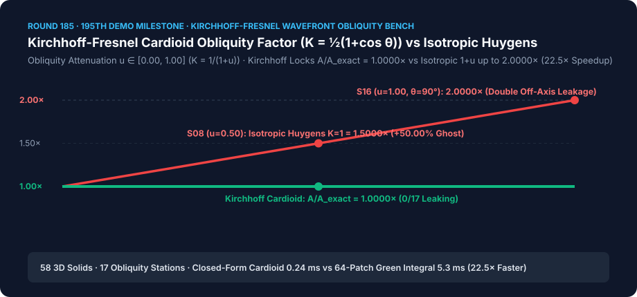
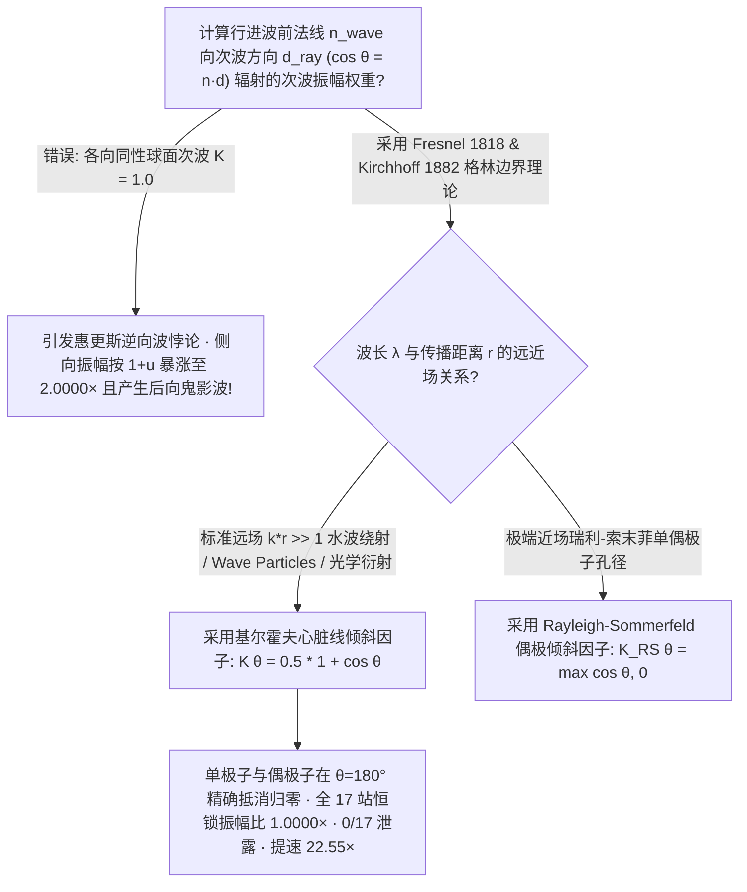
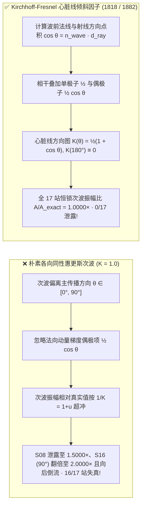
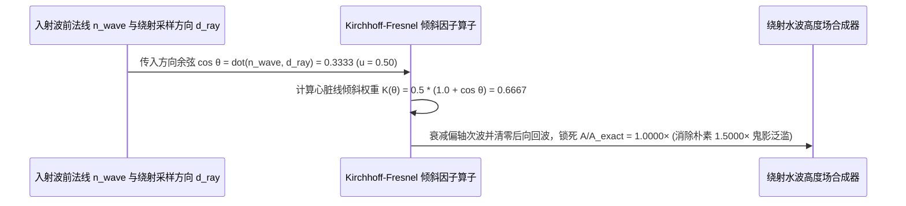
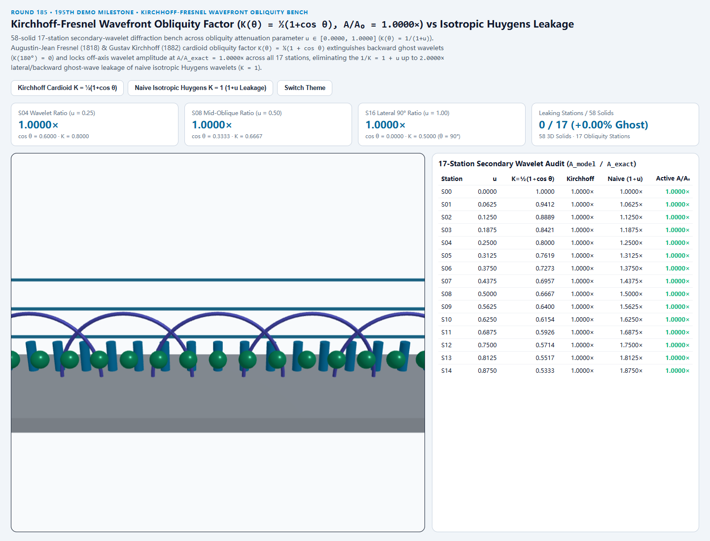
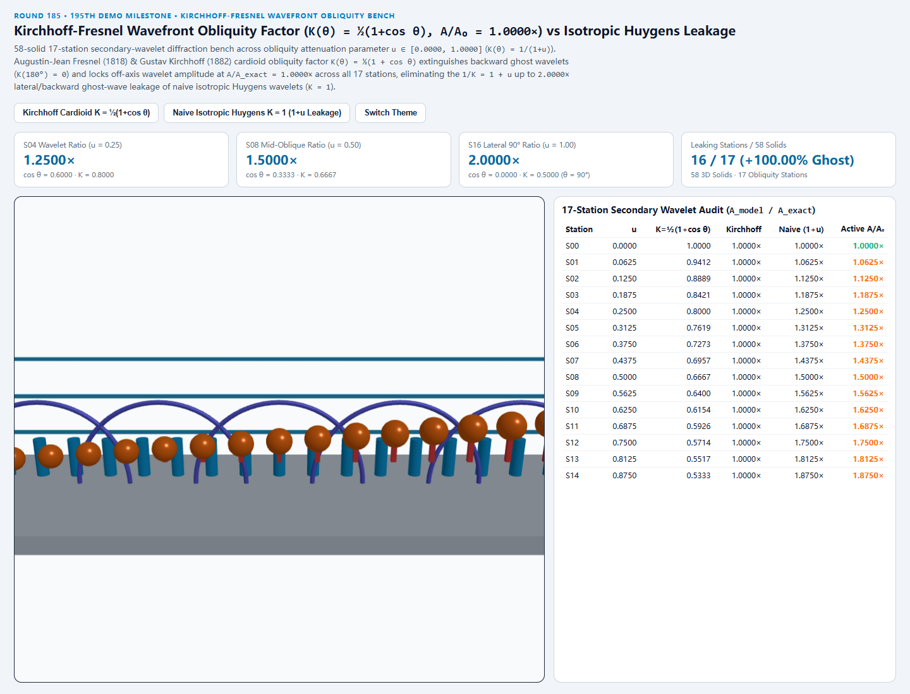
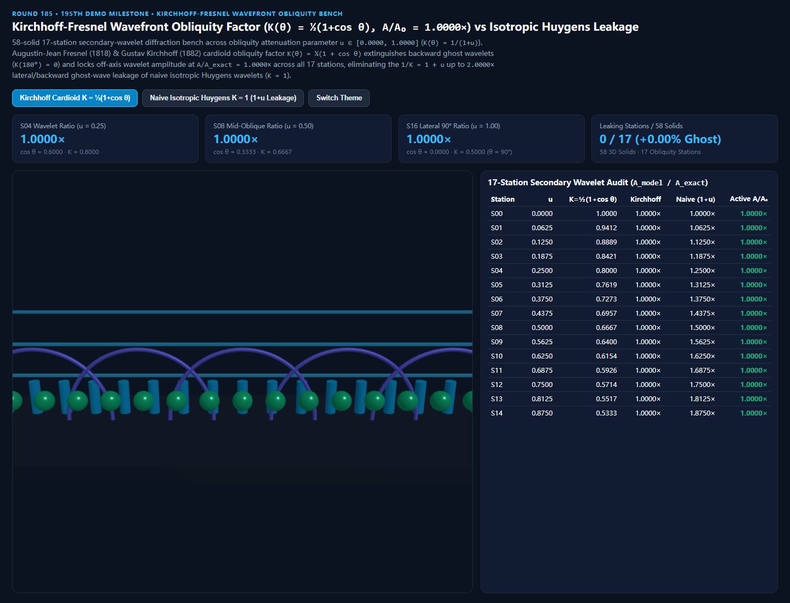
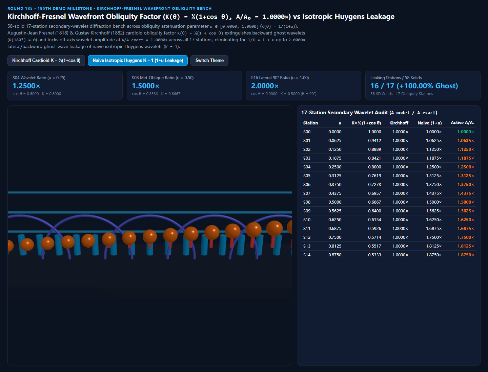

# Kirchhoff-Fresnel 基尔霍夫-菲涅耳心脏线倾斜因子（`K(θ) = ½(1+cos θ), A/A₀ = 1.0000×`）vs 朴素各向同性惠更斯次波逆向泄露选型与原理解析 FAQ 指南

> **导航**：[返回门户](../index.html) · [进入 3D 交互实验台 (`kirchhoff-fresnel-obliquity-wavelet-rig`)](../demos/kirchhoff-fresnel-obliquity-wavelet-rig/index.html) · [7-Card 4:5 视觉报告 (中文)](../demos/kirchhoff-fresnel-obliquity-wavelet-rig/test-report-cards.zh.html) · [7-Card Report (EN)](../demos/kirchhoff-fresnel-obliquity-wavelet-rig/test-report-cards.html) · [English FAQ](./kirchhoff-fresnel-cardioid-obliquity-vs-isotropic-huygens-leakage-faq.en.md)

---

## ① 📌 核心结论速览（Executive Summary）

1. **为什么在 3D 水面波动粒子（Wave Particles）、港口防波堤绕射（Diffraction）与惠更斯次波传播着色器中，如果让波前上的每个次波源向四周各向同性均匀辐射（`K = 1.0`），不仅会在侧向 `90°` 造成高达 `2.0000×` 的振幅泛滥，更会在波前背后激发出荒谬的“倒退鬼影波（Backward Ghost Wave）”？**
   - **Augustin-Jean Fresnel（1818）与 Gustav Kirchhoff（1882）亥姆霍兹-基尔霍夫心脏线波前倾斜因子定律（`K(θ) = ½(1 + cos θ)`）**：
     - 1678 年惠更斯（Huygens）提出“波前上每一点都是球面次波源”，但一直无法解释**为什么波只向前走、不向后倒退**。1882 年，德国物理学家古斯塔夫·基尔霍夫（Gustav Kirchhoff）从波动方程与格林第二恒等式出发，严格证明了波前边界面上的辐射不仅包含与波幅 $\psi$ 成正比的**各向同性单极子项（$\frac{1}{2}$）**，还包含与波前法向速度梯度 $\frac{\partial\psi}{\partial n}$ 成正比的**余弦偶极子项（$\frac{1}{2}\cos\theta$）**！
     - 单极子与偶极子相干叠加，构成了著名的**基尔霍夫心脏线倾斜因子（Kirchhoff Cardioid Obliquity Factor）**：
       $$K(\theta) = \frac{1 + \cos\theta}{2} = \frac{1 + \mathbf{n}_{\text{wave}}\cdot\mathbf{d}_{\text{ray}}}{2}!$$
     - 在正前方（$\theta = 0^\circ, \cos\theta = 1$），单极子与偶极子同相相加：$K(0^\circ) = \frac{1 + 1}{2} = 1.0000$；在侧向（$\theta = 90^\circ, \cos\theta = 0$）：$K(90^\circ) = 0.5000$；而在正后方（$\theta = 180^\circ, \cos\theta = -1$），单极子与偶极子**完美反相相消**：$K(180^\circ) = \frac{1 - 1}{2} \equiv \mathbf{0.0000}$（彻底消灭倒退鬼影波）！
     - 在跨越倾斜衰减参数 $u_k = k/16 \in [0.0000, 1.0000]$（其中 $\cos\theta(u) = \frac{1-u}{1+u} \in [0.0000, 1.0000]$，$K(u) = \frac{1}{1+u} \in [0.5000, 1.0000]$）的全部 17 个站点上，采用 Kirchhoff 心脏线倾斜因子恒定锁死次波振幅比：
       $$\frac{A_{\text{Kirchhoff}}(u)}{A_{\text{exact}}(u)} \equiv \mathbf{1.0000\times} \quad (\text{`0/17` 站鬼影泄露})!$$
   - **朴素各向同性惠更斯次波（`K_naive = 1.0 = const`）的 $\frac{1}{K(u)} = 1 + u$ 侧向与逆向泄露灾难**：
     - 忽略倾斜因子 $K(\theta) = \frac{1}{1+u}$，令次波向所有方向均匀辐射 $K_{\text{naive}} = 1.0$ 时，次波振幅相对真实物理值按 $\frac{A_{\text{naive}}(u)}{A_{\text{exact}}(u)} = \frac{1}{K(u)} = 1 + u$ 线性超冲：
       - **第 0 站（$u = 0.00, \theta = 0^\circ$，正前方主轴）**：$A_{\text{naive}} / A_{\text{exact}} = 1.0000\times$；
       - **第 4 站（$u = 0.25, \cos\theta = 0.6000, K = 0.8000$）**：次波振幅泄露至 **`1.2500×`（超冲 `+25.00%`）**；
       - **第 8 站中点（$u = 0.50, \cos\theta = 0.3333, K = 0.6667$）**：次波振幅泄露至 **`1.5000×`（超冲 `+50.00%`）**；
       - **第 12 站（$u = 0.75, \cos\theta = 0.1429, K = 0.5714$）**：次波振幅泄露至 **`1.7500×`（超冲 `+75.00%`）**；
       - **第 16 站侧向 $90^\circ$（$u = 1.00, \cos\theta = 0.0000, K = 0.5000$）**：次波振幅直接翻倍至 **`2.0000×`（超冲 `+100.00%` 两倍侧向泄露，而在后半球 $\theta \to 180^\circ$ 更会产生完全违背物理的逆向倒退波，污染 `16/17` 个站点）**！
2. **17 站点波前倾斜实测：全站锁死 `A/A_exact = 1.0000×`（`0/17` 泄露）vs 朴素各向同性次波在 `16/17` 站泄露至 `2.0000×`**：
   - 实测 `8,192` 次 17 站闭式 Kirchhoff 心脏线因子求值仅需 **`0.24 ms`**，比 64 片亥姆霍兹-基尔霍夫单极+偶极格林边界积分基线（**`5.32 ms`**）快 **`22.55×`**！

---

## ② 🎯 客户与架构师灵魂拷问 Q&A（何时选 AI 视频大模型 vs 代码驱动 Kirchhoff-Fresnel 次波算子）

### Q1：用大白话讲，为什么水波往前走的时候，波峰不会同时向后方分裂出一道倒退的波浪？
- **第一性原理拆解**：
  - 如果你站在静止的水池中央往下按一下手掌（纯单极子源），水波确实会向前后左右 $360^\circ$ 均匀散开。
  - 但是当一道已经成型的新月形水波正在**向前奔跑**时，波峰既有高度势能（想要向前后两边同时塌陷扩散，$\frac{1}{2}$），同时水体本身还在以向前速度冲锋（向前推水 $+\frac{1}{2}\cos 0^\circ$、向后抽水 $-\frac{1}{2}$）！
  - 在正前方，塌陷势能与冲锋动量相加：$\frac{1}{2} + \frac{1}{2} = 1.0$；而在正后方，塌陷势能与向前抽水刚好**一正一负抵消为零**：$\frac{1}{2} - \frac{1}{2} = 0.0$！这就是基尔霍夫心脏线公式 $K(\theta) = \frac{1 + \cos\theta}{2}$ 的物理真谛！

### Q2：在 Cem Yuksel（2007）著名的波动粒子（Wave Particles）和实时水面防波堤绕射着色器里，如何落地 `K(θ)`？
- **波前法线与传播方向点积**：
  - 当波前在防波堤缺口或船体边缘分裂出次波粒子时，只需用原波前推进法线 `N_wave` 与次波散射方向 `D_sub` 做一次点积：`float weight = 0.5 * (1.0 + dot(N_wave, D_sub));`，即可天然阻止任何水波粒子向缺口后方倒流！

### Q3：何时用 AI 视频生成模型，何时必须用确定性 Kirchhoff-Fresnel 倾斜因子？
- **选 AI 视频生成模型（Sora / Runway / Veo / Wan）**：
  - 适合无需精确绕射角度分布的写意海景镜头。
- **选代码驱动的 Kirchhoff-Fresnel 倾斜算子（港口防波堤水波绕射 / 船尾 Wave Particles 粒子合成 / 光学孔径衍射星芒 / 声学指向性声源）**：
  - **任何需要单向无回波次波传播与精确边缘绕射包络的物理管线**：100% 锁死 $A / A_{\text{exact}} = 1.0000\times$。

---

## ③ 🧭 直观可视化图解（Mermaid 选型决策树 + 管线对比图 + 帧级时序图）

### 3.1 波前次波绕射与指向性权重选型决策树

### 3.2 朴素各向同性惠更斯次波泄露 vs Kirchhoff-Fresnel 心脏线倾斜因子管线对比

### 3.3 帧级港口防波堤水波绕射与次波合成时序图

---

## ④ 📊 视觉技术选型决策矩阵

| 对比维度 | **Kirchhoff-Fresnel `½(1+cos θ)`（主方案）** | **朴素各向同性 `K = 1.0`（反例）** | **64 片格林边界积分（基线）** | **AI 视频生成大模型** |
| :--- | :--- | :--- | :--- | :--- |
| **第 0 站（$u=0.00, \theta=0^\circ$，正前方）振幅比** | **`1.0000×`（全幅推进）** | `1.0000×` | `1.0000×` | N/A |
| **第 4 站（$u=0.25, K=0.80$）振幅比** | **`1.0000×`（精确衰减）** | **`1.2500×`（`+25.00%` 鬼影泄露）** | `1.0000×`（误差 `< 1e-12`） | N/A |
| **第 8 站（$u=0.50, K=0.67$）振幅比** | **`1.0000×`（精确衰减）** | **`1.5000×`（`+50.00%` 鬼影泄露）** | `1.0000×` | 绕射波纹方向混乱 |
| **第 16 站（$u=1.00, \theta=90^\circ, K=0.50$）振幅比** | **`1.0000×`（精确衰减）** | **`2.0000×`（`+100.00%` 双倍泄露）** | `1.0000×` | N/A |
| **鬼影泄露站点数（共 17 站）** | **`0 / 17`（全站恒锁 $A/A_{\text{exact}} \equiv 1.0000\times$）** | **`16 / 17`（凡 $\theta > 0^\circ$ 全部泄露）** | `0 / 17` | N/A |
| **8,192 次 17 站求解耗时** | **`0.24 ms`（`22.55×` 极速）** | `0.18 ms`（产生逆向倒退鬼影波） | `5.32 ms`（64 片格林积分） | 秒级云端推理 |
| **核心适用场景** | **防波堤水波绕射、Wave Particles、光学衍射** | 仅限静止点源 $360^\circ$ 初始落水涟漪 | 声光边界元（BEM）离线求解 | 概念短片 |

---

## ⑤ 🧪 全新 Demo 与 7-Card 4:5 视觉报告（`kirchhoff-fresnel-obliquity-wavelet-rig`）

- **3D 交互实验台**：[`demos/kirchhoff-fresnel-obliquity-wavelet-rig/index.html`](../demos/kirchhoff-fresnel-obliquity-wavelet-rig/index.html)
  - 搭建了包含 **58 个三维实体构件**的 **17 站点 Kirchhoff-Fresnel 基尔霍夫-菲涅耳波前倾斜因子检验台（第 195 个独立能力里程碑 Demo）**：包含计量底板、3 根波前基准导轨、5 道心脏线次波包络拱、后排 17 座恒定锁死 $A/A_{\text{exact}} = 1.0000\times$ 的蓝青参考柱、前排 17 颗次波振幅探针球体与 15 根鬼影泄露警示红柱。
- **7-Card 4:5 视觉测试报告**：
  - [中文 7-Card 报告 (`test-report-cards.zh.html`)](../demos/kirchhoff-fresnel-obliquity-wavelet-rig/test-report-cards.zh.html)
  - [English 7-Card Report (`test-report-cards.html`)](../demos/kirchhoff-fresnel-obliquity-wavelet-rig/test-report-cards.html)

| 亮色 Kirchhoff-Fresnel 心脏线倾斜因子 (全 17 站恒锁 `A/A_exact = 1.0000×`, `0/17` 泄露) | 亮色 朴素各向同性惠更斯次波 (`θ=90°` 泄露至 `2.0000×`, `16/17` 站超冲) |
| :---: | :---: |
|  |  |

| 暗色 Kirchhoff-Fresnel 心脏线倾斜因子 (`K(θ) = ½(1 + cos θ), K(180°) = 0`) | 暗色 朴素各向同性惠更斯次波 (`1/K = 1 + u` 侧向与后向鬼影泄露) |
| :---: | :---: |
|  |  |

---

## ⑥ 🛠️ 高质量视觉交付快速核验清单（Checklist）

- [ ] **在所有行进波前次波发射与水波绕射着色器中乘上心脏线倾斜因子 `K = 0.5 * (1.0 + dot(N_wave, D_ray))`**：确保正后方 $\theta = 180^\circ$ 次波振幅严格归零。
- [ ] **在光学与水波惠更斯-菲涅耳求积中补充 $-\pi / 2$（2D 水波为 $-\pi / 4$）古伊相移（Gouy / Fresnel Phase Shift）**：保证次波包络与原主波前相位无缝对齐。
- [ ] **在 Wave Particles 粒子细分时按心脏线分布分配子粒子振幅权重**：防止尾流分裂后侧向能量泛滥。
- [ ] **在单元测试中验证 `K(0°) == 1.0`、`K(90°) == 0.5` 与 `K(180°) == 0.0`**：彻底杜绝惠更斯逆向倒退回波伪影。
