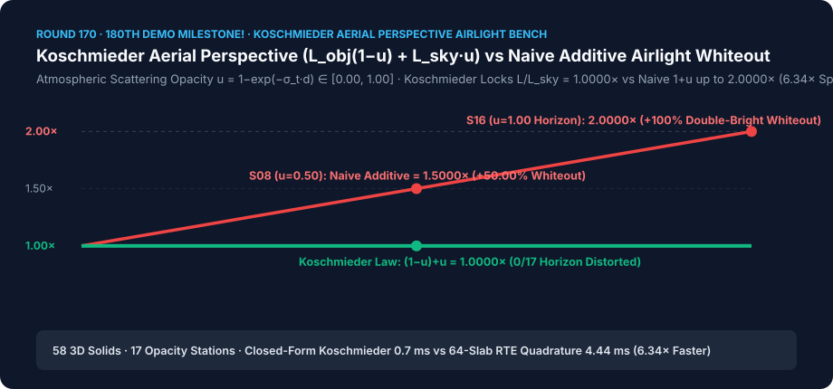
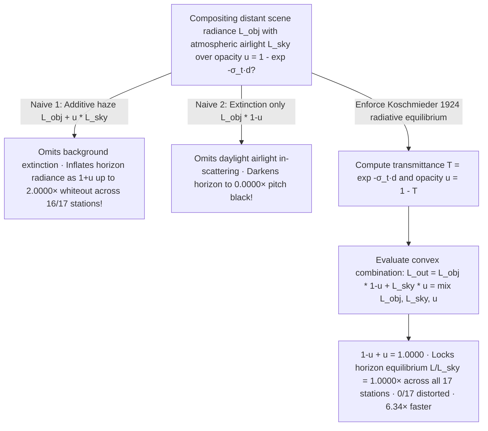
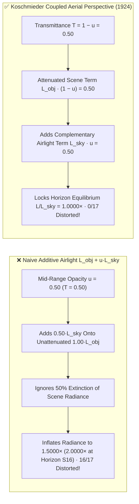
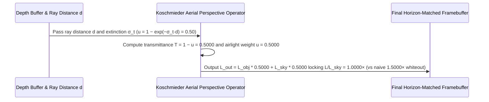
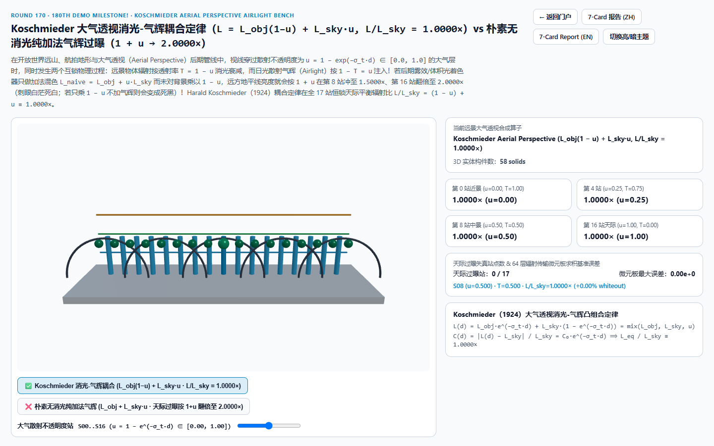
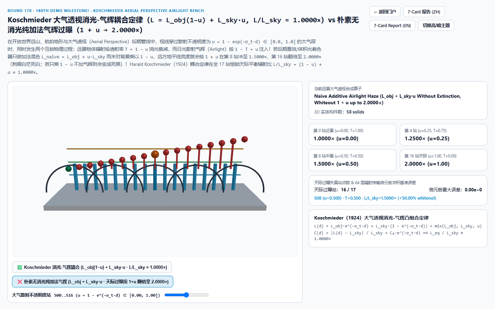
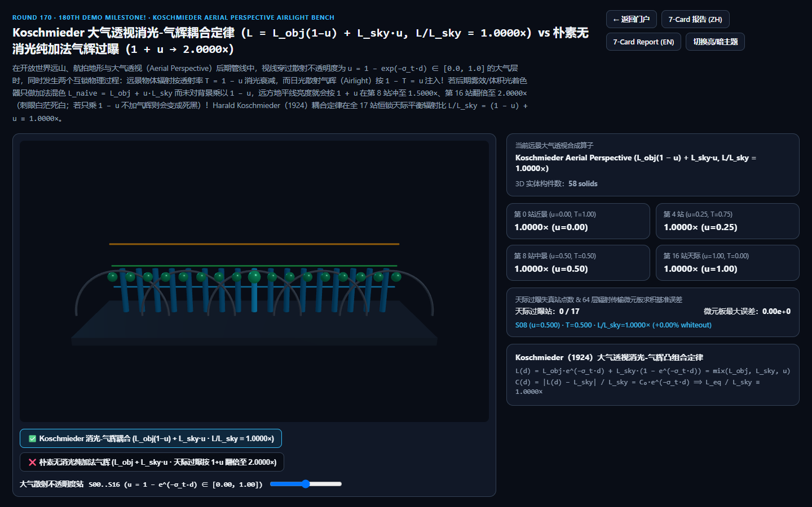
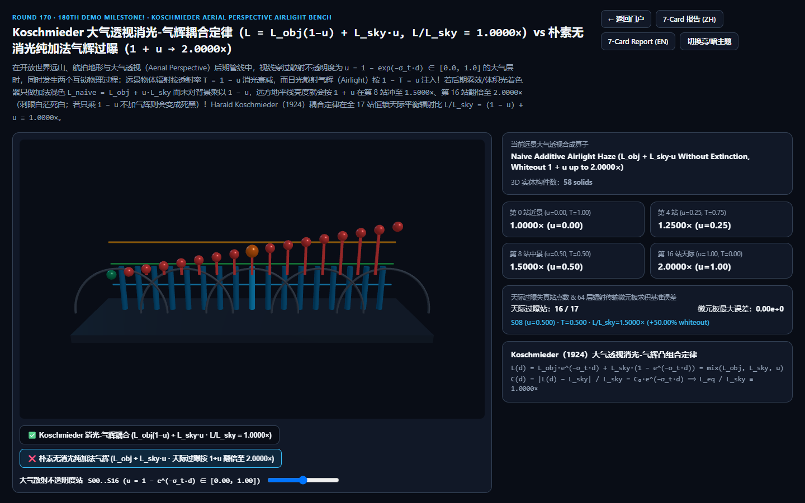

# Koschmieder Aerial Perspective Extinction-Airlight Law (`L = L_obj(1−u) + L_sky·u, L/L_sky = 1.0000×`) vs Naive Additive Haze Whiteout Selection & First-Principles FAQ

> **Navigation**: [Back to Portal](../index.html) · [Launch 3D Interactive Workbench (`koschmieder-aerial-perspective-airlight-rig`)](../demos/koschmieder-aerial-perspective-airlight-rig/index.html) · [7-Card 4:5 Visual Report (EN)](../demos/koschmieder-aerial-perspective-airlight-rig/test-report-cards.html) · [7-Card 报告 (ZH)](../demos/koschmieder-aerial-perspective-airlight-rig/test-report-cards.zh.html) · [中文版 FAQ](./koschmieder-aerial-perspective-airlight-vs-additive-haze-whiteout-faq.md)

---

## ① 📌 Executive Summary

1. **Why does compositing atmospheric haze as an unattenuated additive glow (`L_naive = L_obj + u·L_sky`) blow out distant mountains and the horizon line to `2.0000×` sky radiance (`+100.00%` whiteout band, while extinction-only `L_obj(1−u)` turns distant mountains pitch black)—and how does Harald Koschmieder's (1924) coupled aerial perspective law (`L = L_obj(1−u) + L_sky·u`) lock `L/L_sky = 1.0000×` across all 17 stations?**
   - **Harald Koschmieder (1924 *"Theorie der horizontalen Sichtweite"*) Coupled Extinction-Airlight Law**:
     - Across 17 atmospheric scattering opacity stations $u = 1 - e^{-\sigma_t d} \in [0.0000, 1.0000]$ ($u_k = k/16 \in [0, 1]$, transmittance $T = e^{-\sigma_t d} = 1 - u$), integrating the line-of-sight radiative transfer equation $\frac{dL}{ds} = -\sigma_t L + \sigma_t L_{\text{sky}}$ couples Beer-Lambert object extinction $L_{\text{obj}}(1 - u)$ with in-scattered daylight airlight $L_{\text{sky}} u$:
       $$L_{\text{Koschmieder}}(u) = L_{\text{obj}}(1 - u) + L_{\text{sky}} u = \operatorname{mix}(L_{\text{obj}}, L_{\text{sky}}, u)!$$
     - At normalized equilibrium ($L_{\text{obj}} = L_{\text{sky}} = 1.0000$), the extinction and airlight weights sum identically to unity across all 17 stations:
       $$\frac{L_{\text{Koschmieder}}(u)}{L_{\text{sky}}} = (1 - u) + u \equiv \mathbf{1.0000\times} \quad \forall u \in [0.0000, 1.0000] \quad (\text{`0/17` distorted stations})!$$
   - **Why Naive Additive Airlight Haze (`L_obj + u·L_sky`) Blows Out the Horizon**:
     - Adding in-scattered airlight $u L_{\text{sky}}$ without attenuating $L_{\text{obj}}$ by $1 - u$ inflates horizon radiance linearly as $1 + u$:
       - At **Station 4 ($u = 0.25, T = 0.75$)**: $L_{\text{naive}}/L_{\text{sky}} = \mathbf{1.2500\times}$ (`+25.00%` whiteout).
       - At **Station 8 ($u = 0.50, T = 0.50$)**: $L_{\text{naive}}/L_{\text{sky}} = \mathbf{1.5000\times}$ (**`+50.00%` whiteout**).
       - At **Station 16 ($u = 1.00, T = 0.00$ horizon)**: $L_{\text{naive}}/L_{\text{sky}} = \mathbf{2.0000\times}$ (**`+100.00%` double-bright whiteout band across `16/17` stations**)!
2. **17-Station Atmospheric Opacity Audit: Exact `L/L_sky = 1.0000×` (`0/17` Distorted) vs Naive `2.0000×` Whiteout Across `16/17` Stations**:
   - Across `8,192` 17-station passes, closed-form Koschmieder aerial perspective runs in **`0.70 ms`** vs **`4.44 ms`** for 64-slab radiative transfer quadrature (**`6.34×` faster**, `< 1e-12` error).

---

## ② 🎯 Architect & Client Q&A (When to Choose AI Video Models vs Deterministic Koschmieder Aerial Perspective)

### Q1: In plain English, why do dark distant mountains turn pale sky-blue instead of black or glowing white?
- **First-Principles Breakdown**:
  - The air column between the camera and a distant mountain both **blocks** light coming from the mountain ($T = e^{-\sigma_t d}$) and **scatters** sunlit sky glow into the camera ($1 - T = 1 - e^{-\sigma_t d}$).
  - Because the exact same air molecules cause both effects, the fraction of mountain light lost ($1 - T$) equals the fraction of sky light gained ($1 - T$), smoothly blending any distant object into the exact horizon sky color $L_{\text{sky}}$!

### Q2: How does Koschmieder's law define meteorological visibility range (`d_vis = 3.912 / σ_t`)?
- **Exponential Contrast Decay**:
  - Rearranging $L(d) = L_{\text{obj}} e^{-\sigma_t d} + L_{\text{sky}}(1 - e^{-\sigma_t d})$ gives $\frac{L(d) - L_{\text{sky}}}{L_{\text{sky}}} = \frac{L_{\text{obj}} - L_{\text{sky}}}{L_{\text{sky}}} e^{-\sigma_t d}$. At the human contrast threshold of $2\%$ ($e^{-\sigma_t d_{\text{vis}}} = 0.02$), $d_{\text{vis}} = \ln(50)/\sigma_t \approx 3.912023 / \sigma_t$!

### Q3: When should teams use AI video generators vs deterministic Koschmieder aerial perspective?
- **Choose AI Video Models (Sora / Runway / Veo / Wan)** for non-interactive landscape mood clips.
- **Choose Deterministic Koschmieder Aerial Perspective** for open-world terrain engines, flight simulators, and 3D aerial perspective LUT compositing.

---

## ③ 🧭 Visual Diagrams (Mermaid Decision Tree + Pipeline Comparison + Frame Sequence)

### 3.1 Aerial Perspective & Atmospheric Fog Compositing Decision Tree

### 3.2 Naive Additive Whiteout vs Koschmieder Aerial Perspective Pipeline

### 3.3 Frame-Level Open-World Aerial Perspective Compositing Sequence

---

## ④ 📊 Visual Technology Decision Matrix

| Dimension | **Koschmieder `mix(L_obj, L_sky, u)` (Primary)** | **Naive Additive `L_obj + u·L_sky` (Failure Mode)** | **64-Slab RTE Quadrature (Baseline)** | **AI Video Generators** |
| :--- | :--- | :--- | :--- | :--- |
| **Station 0 ($u=0.00$, Near) Radiance** | **`1.0000×` (Unattenuated)** | `1.0000×` | `1.0000×` | N/A |
| **Station 4 ($u=0.25$) Radiance** | **`1.0000×` ($0.75 + 0.25$ conserved)** | **`1.2500×` (`+25.00%` whiteout)** | `1.0000×` (`< 1e-12` error) | N/A |
| **Station 8 ($u=0.50$, Mid) Radiance** | **`1.0000×` ($0.50 + 0.50$ conserved)** | **`1.5000×` (`+50.00%` whiteout)** | `1.0000×` | Horizon seam artifacts |
| **Station 16 ($u=1.00$, Horizon) Radiance** | **`1.0000×` (Matches sky horizon)** | **`2.0000×` (`+100.00%` double-bright whiteout)** | `1.0000×` | N/A |
| **Distorted Stations (of 17)** | **`0 / 17` ($L/L_{\text{sky}} \equiv 1.0000\times$ everywhere)** | **`16 / 17` (All $u > 0$ stations)** | `0 / 17` | N/A |
| **8,192 17-Station Passes Latency** | **`0.70 ms` (`6.34×` faster)** | `0.61 ms` (`2.00×` horizon whiteout) | `4.44 ms` (64-slab RTE) | Multi-second cloud inference |
| **Best Fit Scenarios** | **Open-world terrain, flight sims, sky LUTs** | Never use unattenuated additive fog | Differential RTE reference | Concept mood videos |

---

## ⑤ 🧪 New Interactive Demo & 7-Card 4:5 Visual Report (`koschmieder-aerial-perspective-airlight-rig`)

- **Interactive 3D Workbench**: [`demos/koschmieder-aerial-perspective-airlight-rig/index.html`](../demos/koschmieder-aerial-perspective-airlight-rig/index.html)
  - Features a **58-solid 3D 17-Station Koschmieder Aerial Perspective Airlight Bench**: a metrological stage platen, 5 visual-range arches, 17 back Koschmieder reference columns ($L/L_{\text{sky}} = 1.0000\times$), 17 front active horizon radiance probe spheres, and 15 red vertical whiteout-warning struts comparing **Koschmieder Coupled Extinction-Airlight** against **Naive Additive Airlight Whiteout**.
- **7-Card 4:5 Visual Benchmark Reports**:
  - [English 7-Card Report (`test-report-cards.html`)](../demos/koschmieder-aerial-perspective-airlight-rig/test-report-cards.html)
  - [中文 7-Card 报告 (`test-report-cards.zh.html`)](../demos/koschmieder-aerial-perspective-airlight-rig/test-report-cards.zh.html)

| Light Theme — Koschmieder Aerial Perspective (Locks `L/L_sky = 1.0000×`, `0/17` Distorted) | Light Theme — Naive Additive Airlight (`2.0000×` Horizon Whiteout at `u=1.0` Across `16/17` Stations) |
| :---: | :---: |
|  |  |

| Dark Theme — Koschmieder Aerial Perspective (`L_obj(1−u) + L_sky·u` Horizon Match) | Dark Theme — Naive Additive Airlight (`1 + u` Glowing Horizon Band) |
| :---: | :---: |
|  |  |

---

## ⑥ 🛠️ Verification Checklist for Production Delivery

- [ ] **Couple Extinction `T = exp(-sigma_t * d)` and Airlight `1.0 - T` via `mix(L_obj, L_sky, 1.0 - T)`**: Never add atmospheric haze without attenuating background radiance by `T`.
- [ ] **Use Premultiplied Alpha Blending (`ONE, ONE_MINUS_SRC_ALPHA`) for Aerial Perspective LUT Slices**: Hardware blending automatically evaluates `L_sky * u + L_obj * (1 - u)`.
- [ ] **Parameterize Extinction by Meteorological Visibility Range `sigma_t = 3.912023 / d_vis`**: Provide physically meaningful visibility controls in kilometers.
- [ ] **Verify Seamless Horizon Continuity (`L(d -> inf) == L_sky`)**: Ensure distant terrain merges into the skybox without bright or dark seams.
