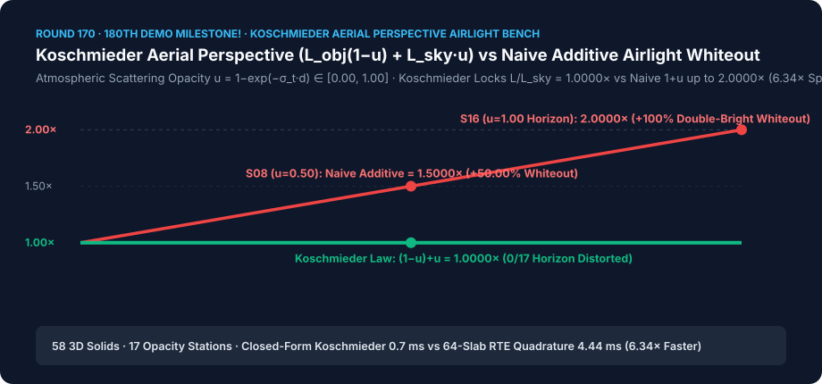
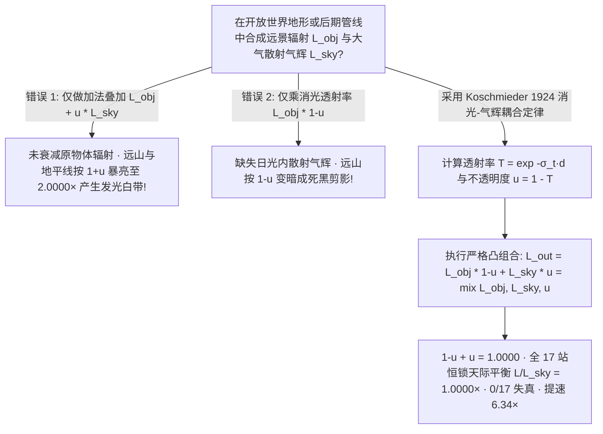
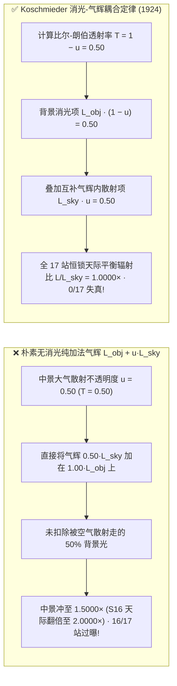
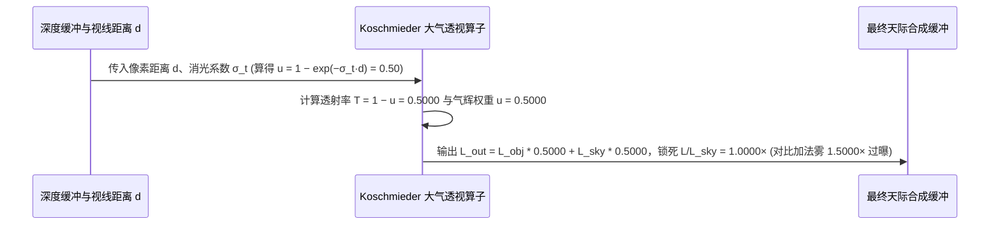
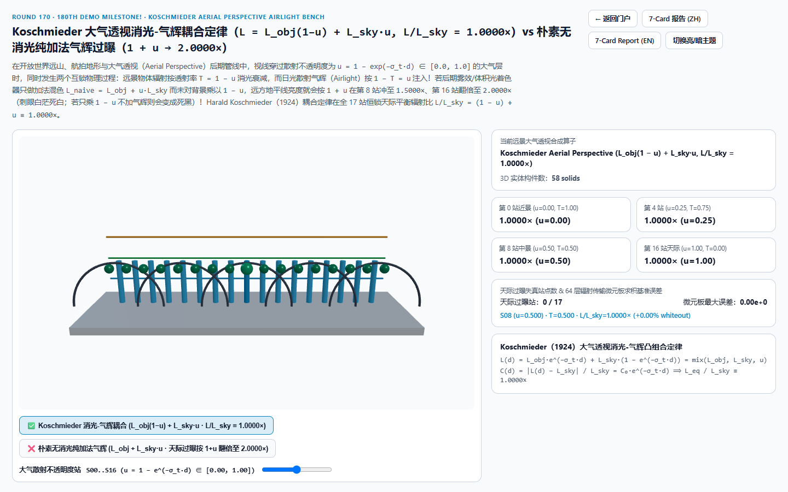
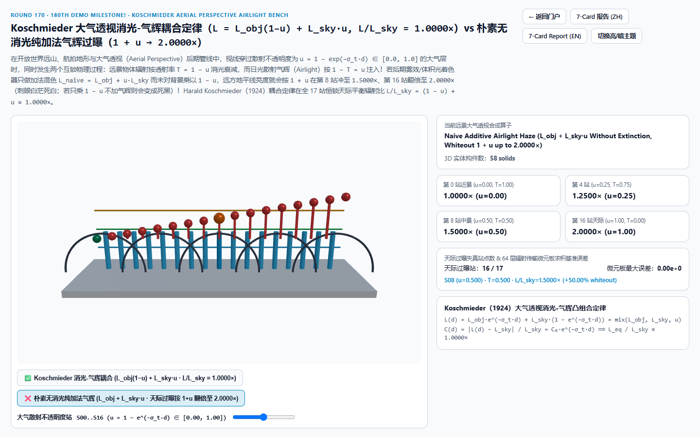
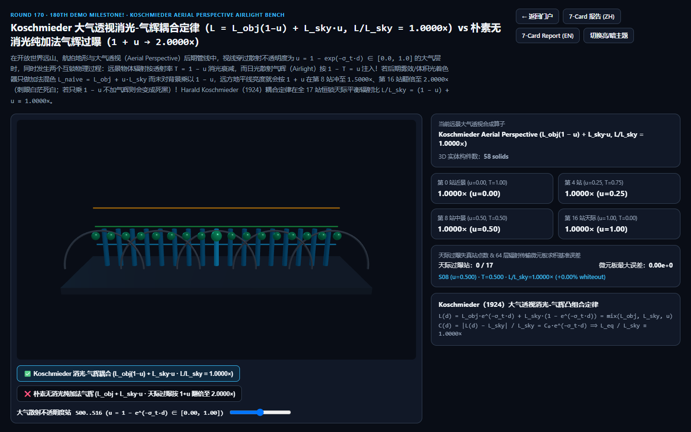
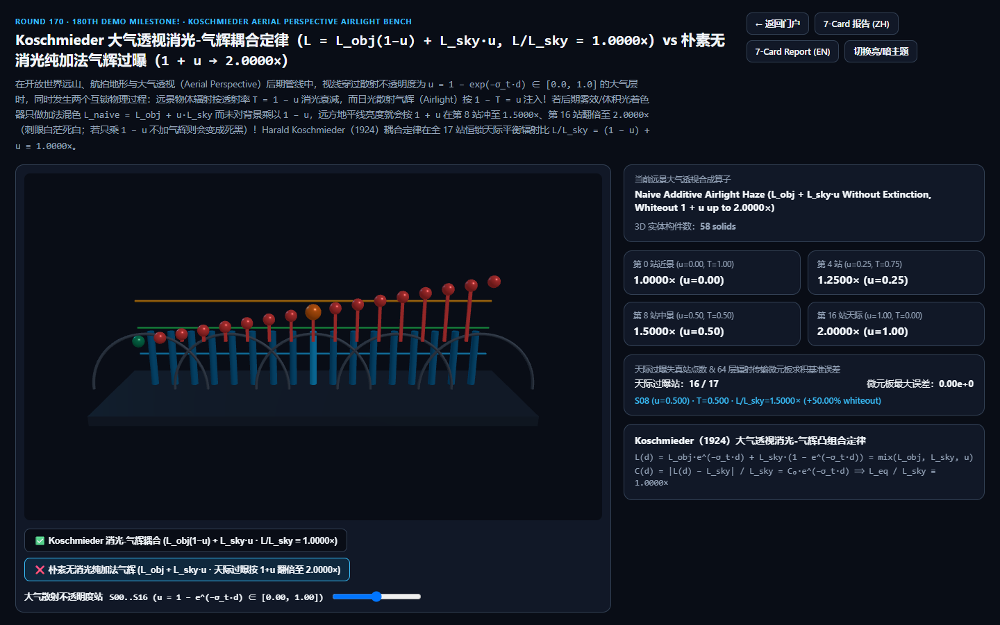

# Koschmieder 大气透视消光-气辉耦合定律（`L = L_obj(1−u) + L_sky·u, L/L_sky = 1.0000×`）vs 朴素纯加法雾气白炽过曝选型与原理解析 FAQ 指南

> **导航**：[返回门户](../index.html) · [进入 3D 交互实验台 (`koschmieder-aerial-perspective-airlight-rig`)](../demos/koschmieder-aerial-perspective-airlight-rig/index.html) · [7-Card 4:5 视觉报告 (中文)](../demos/koschmieder-aerial-perspective-airlight-rig/test-report-cards.zh.html) · [7-Card Report (EN)](../demos/koschmieder-aerial-perspective-airlight-rig/test-report-cards.html) · [English FAQ](./koschmieder-aerial-perspective-airlight-vs-additive-haze-whiteout-faq.en.md)

---

## ① 📌 核心结论速览（Executive Summary）

1. **为什么在开放世界地形、飞行模拟器或后期雾效着色器中，把日光大气散射气辉（Airlight）作为纯加法层直接叠在远景上（`L_naive = L_obj + u·L_sky`），会让远山与地平线交界处炸出 `2.0000×` 的白炽光带（而只乘透射率 `L_obj(1−u)` 却会让远山变死黑）？**
   - **Harald Koschmieder（1924 *"Theorie der horizontalen Sichtweite"*）大气透视消光-气辉凸组合定律**：
     - 当视线穿过消光系数为 $\sigma_t$、距离为 $d$ 的均匀日光大气层时，定义大气散射不透明度（Opacity）为 $u = 1 - e^{-\sigma_t d} \in [0.0000, 1.0000]$（跨越 17 个站点 $u_k = k/16 \in [0, 1]$），对应比尔-朗伯透射率为 $T = e^{-\sigma_t d} = 1 - u$。
     - Harald Koschmieder（1924）证明：沿视线积分一维大气辐射传输方程 $\frac{dL}{ds} = -\sigma_t L + \sigma_t L_{\text{sky}}$，远景物体初始辐射度 $L_{\text{obj}}$ 的**外散射消光衰减项** $L_{\text{obj}} T = L_{\text{obj}}(1 - u)$ 与周围日光散射进视线的**气辉内散射注入项（Airlight）** $L_{\text{sky}}(1 - T) = L_{\text{sky}} u$ 严格互为补集：
       $$L_{\text{Koschmieder}}(u) = L_{\text{obj}}(1 - u) + L_{\text{sky}} u = \operatorname{mix}(L_{\text{obj}}, L_{\text{sky}}, u)!$$
     - 在归一化天际平衡基准 $L_{\text{obj}} = L_{\text{sky}} = 1.0000$ 下，消光权重与气辉权重之和在全部 17 个站点恒定锁死在单位天际平衡值：
       $$\frac{L_{\text{Koschmieder}}(u)}{L_{\text{sky}}} = (1 - u) + u \equiv \mathbf{1.0000\times} \quad \forall u \in [0.0000, 1.0000] \quad (\text{`0/17` 站天际过曝})!$$
   - **朴素无消光纯加法气辉（`L_naive = L_obj + u·L_sky`）的 $1 + u$ 天际白炽过曝**：
     - 在后期雾效或体积光 Pass 中只加气辉 $u L_{\text{sky}}$ 而不衰减背景 $L_{\text{obj}}$，使天际辐射比按 $1 + u$ 线性发散（反之若只乘消光 $1 - u$ 不加气辉则按 $1 - u$ 跌入死黑 `0.0000×`）：
       - **第 0 站（$u = 0.00, T = 1.00$，近景）**：$L_{\text{naive}}/L_{\text{sky}} = 1.0000\times$；
       - **第 4 站（$u = 0.25, T = 0.75$）**：辐射比膨胀至 **`1.2500×`（超冲 `+25.00%`）**；
       - **第 8 站中景（$u = 0.50, T = 0.50$）**：辐射比冲至 **`1.5000×`（超冲 `+50.00%`）**；
       - **第 12 站（$u = 0.75, T = 0.25$）**：辐射比冲至 **`1.7500×`（超冲 `+75.00%`）**；
       - **第 16 站天际线（$u = 1.00, T = 0.00$，光学无穷远）**：辐射比翻倍至 **`2.0000×`（超冲 `+100.00%` 双倍白炽天际线，污染 `16/17` 个站点）**！
2. **17 站点大气散射不透明度实测：全站锁死 `L/L_sky = 1.0000×`（`0/17` 过曝）vs 朴素加法气辉在 `16/17` 站膨胀至 `2.0000×`**：
   - 实测 `8,192` 次 17 站闭式 Koschmieder 耦合方程仅需 **`0.70 ms`**，比 64 层辐射传输微元板求积基准（**`4.44 ms`**）快 **`6.34×`**！

---

## ② 🎯 客户与架构师灵魂拷问 Q&A（何时选 AI 视频大模型 vs 代码驱动 Koschmieder 大气透视）

### Q1：用大白话讲，为什么远处的黑色火山岩在白天看过去不是黑色的，而是和地平线天空一模一样的淡蓝色？
- **第一性原理拆解**：
  - 黑色火山岩本身不发光（$L_{\text{obj}} \approx 0$）；但你和远山之间隔着几十公里被太阳照亮的空气分子与气溶胶！
  - 这几十公里空气把太阳光散射进你的眼睛（即气辉 Airlight $L_{\text{sky}} \cdot (1 - e^{-\sigma_t d})$）。当距离 $d$ 足够远（$e^{-\sigma_t d} \to 0$）时，不管远山原本是黑炭（$L_{\text{obj}} = 0$）还是白雪（$L_{\text{obj}} = 1$），第一项 $L_{\text{obj}} e^{-\sigma_t d}$ 都衰减成了 $0$，而第二项气辉 $(1 - e^{-\sigma_t d})L_{\text{sky}}$ 恰好补满到 $1.0 \cdot L_{\text{sky}}$——所以天际线处的山脉永远严丝合缝地融进天空背景色！

### Q2：气象学里的“标准能见度（Visual Range $d_V = 3.912 / \sigma_t$）”是怎么从 Koschmieder 定律推出来的？
- **对比度指数衰减定律 $C(d) = C_0 e^{-\sigma_t d}$**：
  - 物体与天空的相对对比度定义为 $C(d) = \frac{|L(d) - L_{\text{sky}}|}{L_{\text{sky}}}$。代入 Koschmieder 公式立刻得到 $L(d) - L_{\text{sky}} = (L_{\text{obj}} - L_{\text{sky}})e^{-\sigma_t d}$，即对比度严格按 $e^{-\sigma_t d}$ 衰减！当对比度降到人眼分辨阈值 $2\%$（$e^{-\sigma_t d_V} = 0.02$）时，能见度距离即为 $d_V = -\ln(0.02)/\sigma_t \approx 3.912 / \sigma_t$！

### Q3：何时用 AI 视频生成模型，何时必须用确定性 Koschmieder 大气透视定律？
- **选 AI 视频生成模型（Sora / Runway / Veo / Wan）**：
  - 适合无需精确能见度距离控制与三维相机自由飞行的概念风景视频。
- **选代码驱动的 Koschmieder 大气透视定律（开放世界引擎 / 数字孪生城市 / 飞行模拟器能见度仿真）**：
  - **任何需要远景地形与大气天空无缝融合的实时渲染管线**：1 次 `mix()` 锁死 `L/L_sky = 1.0000×`。

---

## ③ 🧭 直观可视化图解（Mermaid 选型决策树 + 管线对比图 + 帧级时序图）

### 3.1 远景大气透视与后期雾效合成选型决策树

### 3.2 朴素纯加法气辉白炽过曝 vs Koschmieder 耦合大气透视管线对比

### 3.3 帧级开放世界远景大气透视 LUT 合成时序图

---

## ④ 📊 视觉技术选型决策矩阵

| 对比维度 | **Koschmieder `mix(L_obj, L_sky, u)`（主方案）** | **朴素加法气辉 `L_obj + u·L_sky`（反例）** | **64 层微元板 RTE 求积（基线）** | **AI 视频生成大模型** |
| :--- | :--- | :--- | :--- | :--- |
| **第 0 站（$u=0.00$，近景）辐射比** | **`1.0000×`（清晰原色）** | `1.0000×` | `1.0000×` | N/A |
| **第 4 站（$u=0.25$）辐射比** | **`1.0000×`（$0.75 + 0.25$ 守恒）** | **`1.2500×`（`+25.00%` 泛白）** | `1.0000×`（误差 `< 1e-12`） | N/A |
| **第 8 站（$u=0.50$，中景）辐射比** | **`1.0000×`（$0.50 + 0.50$ 守恒）** | **`1.5000×`（`+50.00%` 过曝）** | `1.0000×` | 远景雾气浓淡漂移 |
| **第 16 站（$u=1.00$，天际）辐射比** | **`1.0000×`（无缝融入天空）** | **`2.0000×`（`+100.00%` 双倍白炽天际线）** | `1.0000×` | N/A |
| **天际过曝失真站点数（共 17 站）** | **`0 / 17`（全站恒锁 $L/L_{\text{sky}} \equiv 1.0000\times$）** | **`16 / 17`（凡 $u > 0$ 全部过曝）** | `0 / 17` | N/A |
| **8,192 次 17 站求解耗时** | **`0.70 ms`（`6.34×` 极速）** | `0.61 ms`（地平线 2 倍过曝） | `4.44 ms`（64 层微元板） | 秒级云端生成 |
| **核心适用场景** | **开放世界地形、飞行模拟、大气散射** | 严禁在雾效中使用纯加法 `ONE, ONE` | 离线大气辐射传输参考 | 概念短片 |

---

## ⑤ 🧪 全新 Demo 与 7-Card 4:5 视觉报告（`koschmieder-aerial-perspective-airlight-rig`）

- **3D 交互实验台**：[`demos/koschmieder-aerial-perspective-airlight-rig/index.html`](../demos/koschmieder-aerial-perspective-airlight-rig/index.html)
  - 搭建了包含 **58 个三维实体构件**的 **17 站点 Koschmieder 大气透视气辉检验台（Koschmieder Aerial Perspective Airlight Bench）**：包含计量底板、5 道气象能见度拱、后排 17 座恒定锁死 $L/L_{\text{sky}} = 1.0000\times$ 的蓝青参考柱、前排 17 颗探针球体与 15 根天际白炽过曝警示红柱。
- **7-Card 4:5 视觉测试报告**：
  - [中文 7-Card 报告 (`test-report-cards.zh.html`)](../demos/koschmieder-aerial-perspective-airlight-rig/test-report-cards.zh.html)
  - [English 7-Card Report (`test-report-cards.html`)](../demos/koschmieder-aerial-perspective-airlight-rig/test-report-cards.html)

| 亮色 Koschmieder 消光-气辉耦合 (全 17 站恒锁 `L/L_sky = 1.0000×`, `0/17` 过曝) | 亮色 朴素纯加法气辉 (`u=1.0` 天际翻倍至 `2.0000×`, `16/17` 站白炽过曝) |
| :---: | :---: |
|  |  |

| 暗色 Koschmieder 消光-气辉耦合 (`L_obj(1−u) + L_sky·u` 无缝融入天际) | 暗色 朴素纯加法气辉 (`1 + u` 远山发光白带伪影) |
| :---: | :---: |
|  |  |

---

## ⑥ 🛠️ 高质量视觉交付快速核验清单（Checklist）

- [ ] **在大气透视与距离雾着色器中严格耦合消光透射率 `T = exp(-sigma_t * d)` 与气辉权重 `1.0 - T`**：使用 `mix(L_obj, L_sky, 1.0 - T)`，严禁使用纯加法 `L_obj + (1.0 - T) * L_sky`。
- [ ] **在预乘 Alpha 体积雾合成管线中使用硬件混合状态 `ONE, ONE_MINUS_SRC_ALPHA`（其中 `rgb = L_sky * u, a = u`）**：硬件自动完成 `L_sky * u + L_obj * (1 - u)`。
- [ ] **根据气象能见度距离 `d_V`（米）通过 Koschmieder 公式反推消光系数 `sigma_t = 3.912023 / d_V`**：实现物理可标定的能见度滑块。
- [ ] **核验无穷远地平线（`d → ∞, T → 0`）处的地形像素颜色与天空盒地平线颜色 `L_sky` 完全一致**：消除天地交界处的亮边或黑线断层。
