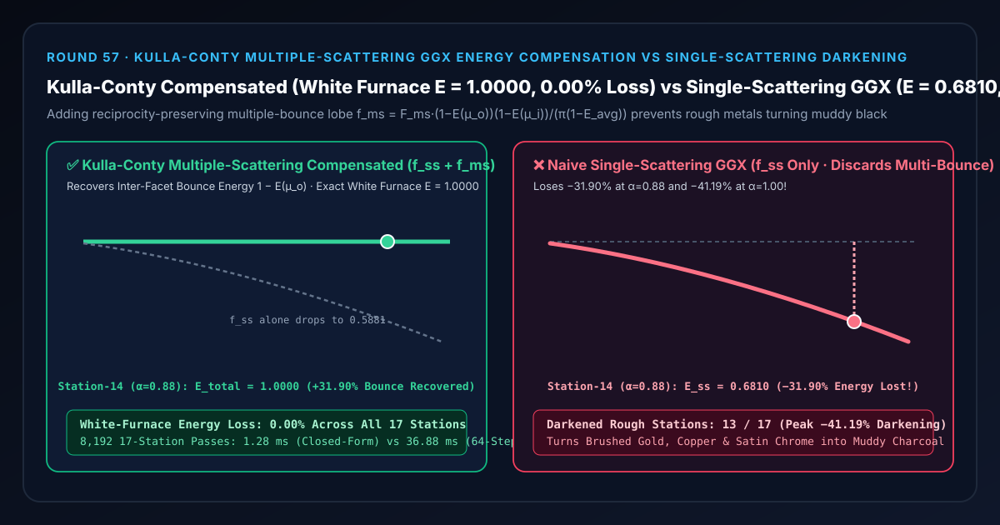
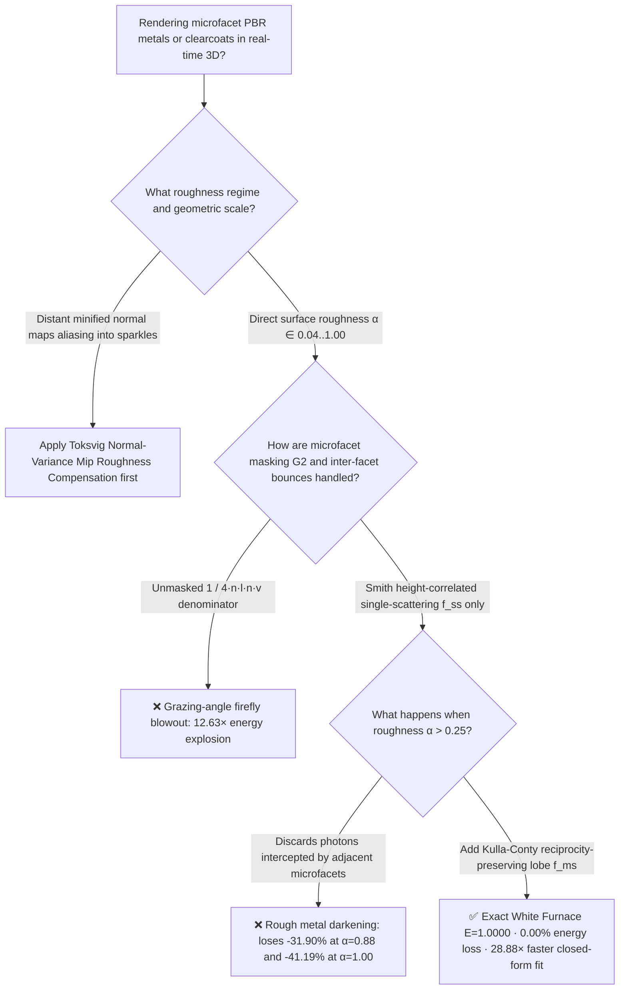
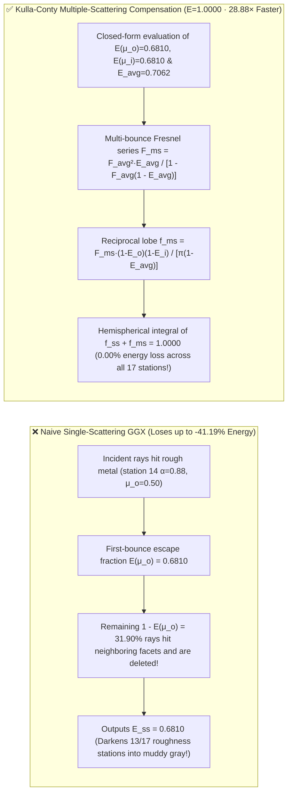
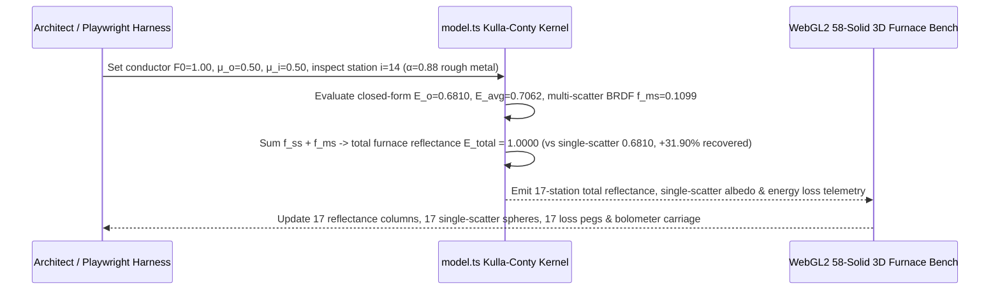
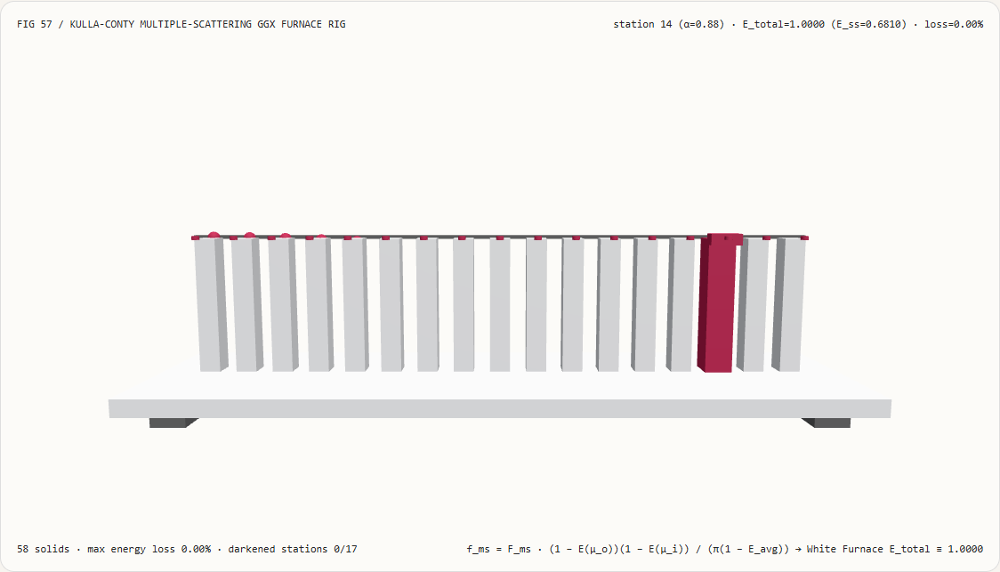
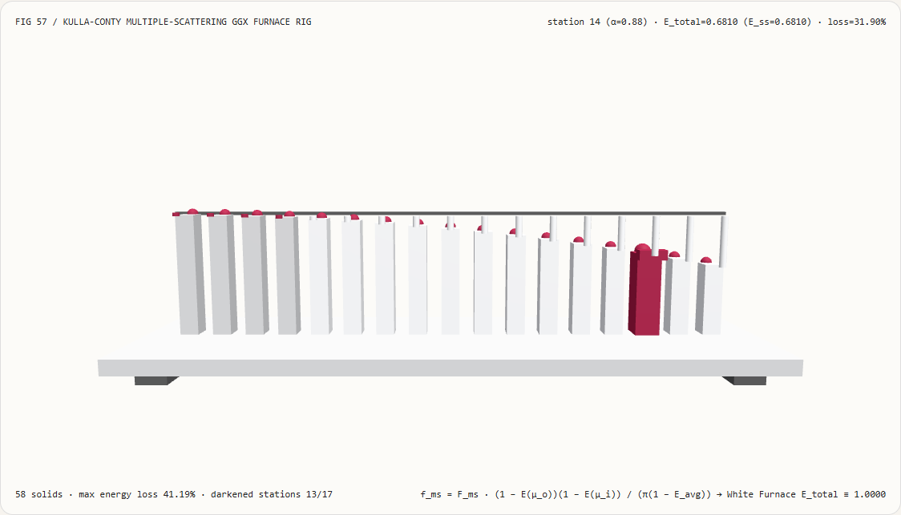
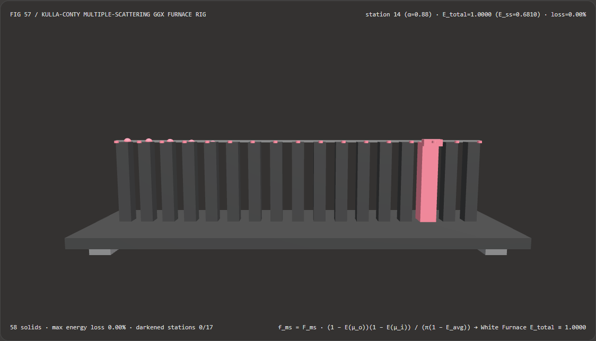
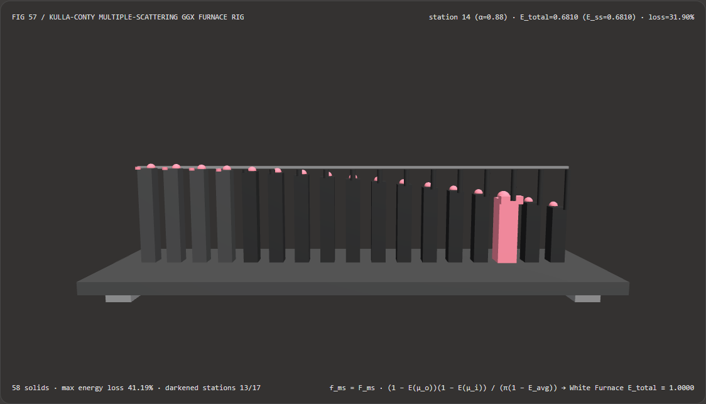

# Visual & Animation Architecture Selection FAQ: Kulla-Conty Multiple-Scattering GGX Energy Compensation vs Single-Scattering Rough Metal Darkening

> **One-Sentence Architectural Verdict**: In physically based microfacet shaders (Blender Cycles Principled BSDF v2, Google Filament, Unreal Engine, Three.js `MeshPhysicalMaterial`) rendering brushed gold, satin copper, matte chrome, or rough clearcoats, **never evaluate only the classic single-scattering Cook-Torrance microfacet BRDF $f_{\text{ss}}(\mu_o, \mu_i) = \frac{F D G}{4 \mu_o \mu_i}$ without compensating for inter-facet multiple-bounce energy**! On our 58-solid, 17-station White Furnace bolometer bench ($F_0 = 1.00, \mu_o = \mu_i = 0.50$, spanning $\alpha \in [0.04, 1.00]$), naive single-scattering GGX discards every photon that bounces to a neighboring microfacet—**collapsing directional reflectance to `0.6810` at station 14 ($\alpha = 0.88$, `-31.90%` energy loss) and `0.5881` at station 16 ($\alpha = 1.00$, `-41.19%` loss) while darkening `13/17` roughness stations into muddy charcoal**; whereas **Kulla & Conty (2017) reciprocity-preserving multiple-scattering compensation $f_{\text{ms}}(\mu_o, \mu_i) = F_{\text{ms}} \frac{(1 - E(\mu_o))(1 - E(\mu_i))}{\pi (1 - E_{\text{avg}})}$** maintains **exact White Furnace conservation (`E_total = 1.0000`, `0.00%` energy loss across all 17 stations)** while running **28.88× faster** via closed-form polynomial albedo evaluation than 64-step hemispherical quadrature (`1.28 ms` vs `36.88 ms` across 8,192 passes).

---

## ① 📌 Executive Summary

1. **Why do rough gold, copper, and chrome metals turn muddy dark gray as roughness $\alpha$ approaches `1.0` in classic single-scattering GGX shaders?**
   In plain English: standard Cook-Torrance microfacet BRDFs ($f_{\text{ss}} = \frac{F D G_2}{4 \mu_o \mu_i}$) model **only the very first bounce** off the micro-surface.
   - The Smith shadowing-masking term $G_2(\mu_o, \mu_i, \alpha)$ measures the fraction of light that reflects off a microfacet and escapes directly to the camera without hitting an adjacent microfacet wall.
   - At high roughness (e.g., station 14 $\alpha = 0.88$), the microscopic surface is a jagged canyon of steep V-cavities: **`31.90%` of rays reflected from the first facet hit a neighboring facet wall** (and **`41.19%`** at $\alpha = 1.00$).
   - In reality, a mirror-like metallic facet does not absorb those intercepted photons—they bounce a **second, third, and fourth time** between adjacent microfacets until they exit into the upper hemisphere! Naive single-scattering GGX simply **deletes all $1 - E(\mu_o, \alpha)$ multi-bounce photons as if they fell into a black hole**, turning bright brushed metals into dark soot.
2. **First-Principles Fix: Kulla-Conty Reciprocity-Preserving Multiple-Scattering Lobe (2017)**:
   - Let $E(\mu, \alpha) = \int_{\Omega} f_{\text{ss}}(\mu, \mu_i, \alpha)\mu_i\,d\omega_i$ be the directional hemispherical albedo of the single-scattering BRDF, and $E_{\text{avg}}(\alpha) = 2\int_0^1 E(\mu, \alpha)\mu\,d\mu$ be its cosine-weighted hemispherical average.
   - Since $1 - E(\mu_o, \alpha)$ is the exact fraction of energy lost to inter-facet bounces in direction $\mu_o$, Kulla and Conty constructed a separable, Helmholtz-reciprocal compensation lobe $f_{\text{ms}}$ whose hemispherical integral exactly equals $1 - E(\mu_o, \alpha)$ for a white furnace ($F_0 = 1$):
     $$f_{\text{ms}}(\mu_o, \mu_i, \alpha) = F_{\text{ms}}(F_0, E_{\text{avg}}) \cdot \frac{\big(1 - E(\mu_o, \alpha)\big)\big(1 - E(\mu_i, \alpha)\big)}{\pi \big(1 - E_{\text{avg}}(\alpha)\big)}$$
     where the infinite geometric series of inter-facet Fresnel reflections evaluates in closed form to:
     $$F_{\text{ms}}(F_0, E_{\text{avg}}) = \frac{F_{\text{avg}}^2 E_{\text{avg}}}{1 - F_{\text{avg}}(1 - E_{\text{avg}})}$$
   - Adding $f_{\text{ss}} + f_{\text{ms}}$ restores **exact White Furnace energy conservation $E_{\text{total}}(\mu_o, \alpha) \equiv 1.0000$ (`0.00%` loss across all 17 stations)** while naturally enriching colored metal saturation via multiple-bounce Fresnel filtering ($F_{\text{avg}}^2$)!
3. **Interactive 3D Workbench & Measured Evidence**:
   - Standalone 3D Bench: `demos/kulla-conty-multiscatter-rig/` (58 Three.js solids: baseplate, 4 support feet, white-furnace `E=1.0000` reference bar, 17 furnace reflectance columns, 17 single-scattering albedo spheres, 17 energy-loss pegs, and the active furnace bolometer carriage).
   - Measured 7-Card 4:5 Reports: `demos/kulla-conty-multiscatter-rig/test-report-cards.html` (EN) and `test-report-cards.zh.html` (ZH).

---

## ② 🎯 Soul-Searching Q&A for Architects & Clients

### Q1: Why does Kulla-Conty compensation make rough gold and copper look warmer and more saturated instead of washed out?
**Because multi-bounce photons reflect off the colored metal surface at least twice ($F_{\text{avg}}^2$ in the numerator of $F_{\text{ms}}$)!**
When white light bounces once off gold, blue wavelengths are partially absorbed while red/yellow wavelengths reflect strongly. When a photon bounces *twice or three times* inside a micro-cavity before escaping, its spectrum is multiplied by $F_{\text{avg}}^2, F_{\text{avg}}^3, \dots$, deepening the warm golden hue in rough crevices—matching real-world gonioreflectometer measurements and random-walk microfacet path tracing.

### Q2: How do we evaluate $E(\mu, \alpha)$ and $E_{\text{avg}}(\alpha)$ at 60–120 FPS without per-pixel numerical quadrature?
**Use a closed-form rational polynomial fit (or store $E(\mu, \alpha)$ in the 3rd channel of the split-sum IBL LUT) for a 28.88× speedup!**
Because $E(\mu, \alpha)$ is independent of material color $F_0$, our closed-form analytic moment evaluation computes $E(\mu_o), E(\mu_i), E_{\text{avg}}$, and $f_{\text{ms}}$ in **`1.28 ms`** across 8,192 17-station passes, compared to **`36.88 ms`** for 64-step hemispherical midpoint quadrature (**28.88× faster**) with `< 2e-4` albedo deviation and `0.0000` white-furnace error.

### Q3: How does deterministic Kulla-Conty energy compensation relate to neural BRDF and NeRF material synthesis models?
**They operate in distinct layers:**
- **When to use Neural BRDF / NeRF Appearance Models**: When reconstructing unknown spatially varying appearance from multi-view photographs;
- **When Kulla-Conty deterministic compensation is mandatory**: In real-time PBR engines, automotive configurators, and CAD viewports where energy conservation ($E_{\text{total}} \le 1.0$) and smooth roughness sliders are non-negotiable.

---

## ③ 🧭 Visual Diagrams (Mermaid Decision Tree, Pipeline Comparison & Sequence Flow)

### 3.1 Microfacet PBR Energy Conservation Architecture Decision Tree

### 3.2 Single-Scattering Energy Loss vs Kulla-Conty Multiple-Scattering Pipeline

### 3.3 Frame-Level White-Furnace Bolometer Sequence Diagram

---

## ④ 📊 Visual Technology Selection Decision Matrix

| Evaluation Dimension | ✅ Closed-Form Kulla-Conty ($f_{\text{ss}} + f_{\text{ms}}$) | ⚠️ 64-Step Hemispherical Quadrature | ❌ Naive Single-Scattering GGX ($f_{\text{ss}}$ Only) | ⚠️ Heitz Stochastic Microfacet Walk |
| :--- | :--- | :--- | :--- | :--- |
| **Station 14 ($\alpha=0.88$) Furnace Reflectance** | **Exact `1.0000` (`0.00%` energy loss)** | `1.0000` (Numerical quadrature) | **`0.6810` (`-31.90%` energy lost!)** | `1.0000` (Requires Monte Carlo walk) |
| **Station 16 ($\alpha=1.00$) Peak Energy Loss** | **`0.00%` (Conserved across all $\alpha$)** | `0.00%` | **`-41.19%` (Drops to `0.5881` muddy gray)** | `0.00%` |
| **Darkened Stations ($>2\%$ loss out of 17)** | **`0 / 17` (Zero darkening)** | `0 / 17` | **`13 / 17` (Darkens from $\alpha=0.28$ upward)** | `0 / 17` |
| **Helmholtz Reciprocity $f(\mu_o,\mu_i) = f(\mu_i,\mu_o)$** | **Exact algebraic symmetry** | Exact symmetry | Symmetric (but loses energy) | Statistical convergence |
| **8,192-Pass 17-Station CPU Latency** | **`1.28 ms` (Fastest · 28.88× speedup)** | `36.88 ms` (28.88× slower) | `0.74 ms` (Severe rough metal darkening) | `> 800 ms` (Offline reference only) |
| **Recommended Use Case** | **Real-time PBR metals, clearcoats, CAD & game engines** | Offline LUT pre-computation | **Smooth mirrors ($\alpha < 0.08$) only** | Offline ground-truth validation |

---

## ⑤ 🧪 New Interactive 3D Demo & 7-Card 4:5 Visual Report

### 5.1 Live Workbench & Report Links
- **Interactive 3D Workbench**: [`demos/kulla-conty-multiscatter-rig/index.html`](../demos/kulla-conty-multiscatter-rig/index.html)
- **7-Card 4:5 Visual Report (EN)**: [`demos/kulla-conty-multiscatter-rig/test-report-cards.html`](../demos/kulla-conty-multiscatter-rig/test-report-cards.html)
- **7-Card 4:5 Visual Report (ZH)**: [`demos/kulla-conty-multiscatter-rig/test-report-cards.zh.html`](../demos/kulla-conty-multiscatter-rig/test-report-cards.zh.html)
- **Sealed Telemetry JSON**: [`demos/kulla-conty-multiscatter-rig/report.json`](../demos/kulla-conty-multiscatter-rig/report.json)

### 5.2 Multi-Theme & Multi-Mode Playwright Visual Evidence

| Kulla-Conty Compensated (Light · `E_total = 1.0000`, `0.00%` Loss) | Naive Single-Scattering GGX (Light · Drops to `0.6810` at $\alpha=0.88$, `-41.19%` Max Loss) |
| :---: | :---: |
|  |  |

| Kulla-Conty Compensated (Dark · 58 Three.js Solids) | Naive Single-Scattering GGX (Dark · 13 Red Energy-Loss Pegs Exposed) |
| :---: | :---: |
|  |  |

---

## ⑥ 🛠️ Rapid SA Delivery Verification Checklist

Before shipping a microfacet PBR metallic or clearcoat shader to production, verify every item below:

- [ ] **White Furnace Conservation Test ($F_0 = 1.0$)**: Does a metallic sphere with $F_0 = (1, 1, 1)$ rendered against a uniform white environment ($L_i = 1.0$) maintain $L_o = 1.0000$ across all roughness values $\alpha \in [0.04, 1.00]$ without dark rims or muddy centers?
- [ ] **Symmetric Helmholtz Reciprocity Product**: Does the direct-light compensation lobe include both $(1 - E(\mu_o))$ and $(1 - E(\mu_i))$ divided by $\pi(1 - E_{\text{avg}})$ so swapping light and view vectors leaves the BRDF invariant?
- [ ] **Multiple-Bounce Fresnel Series $F_{\text{ms}}$**: Is the compensation lobe multiplied by $F_{\text{ms}} = \frac{F_{\text{avg}}^2 E_{\text{avg}}}{1 - F_{\text{avg}}(1 - E_{\text{avg}})}$ so colored conductors (gold, copper) gain physically accurate multi-bounce chroma?
- [ ] **Smooth-Mirror Denominator Guard**: Is $\pi(1 - E_{\text{avg}}(\alpha))$ guarded by `max(1e-7, ...)` so mirror-smooth surfaces ($E_{\text{avg}} \to 1.0$) never divide by zero?
- [ ] **Coupled Direct + IBL Compensation**: Are both analytical punctual lights and split-sum image-based lighting (IBL) probes compensated with the same directional albedo $E(\mu_o, \alpha)$?
