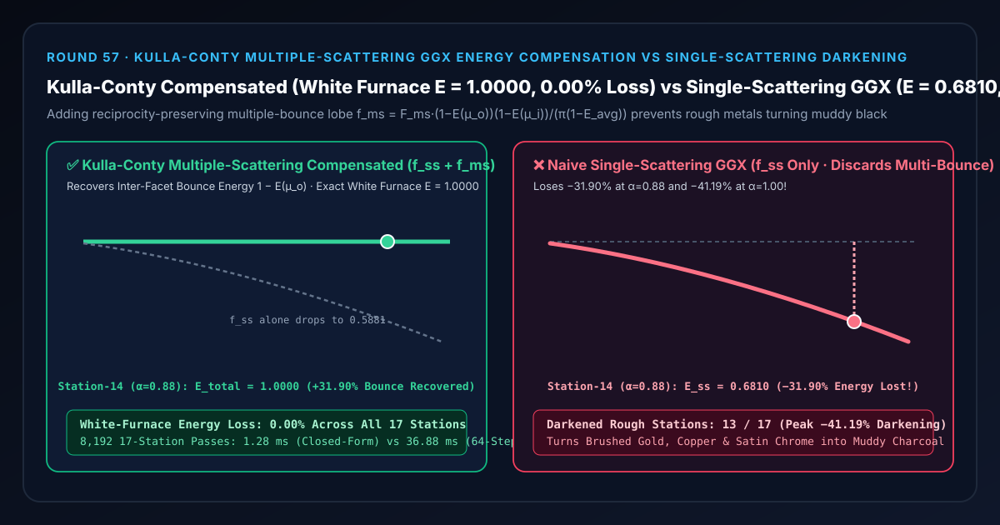
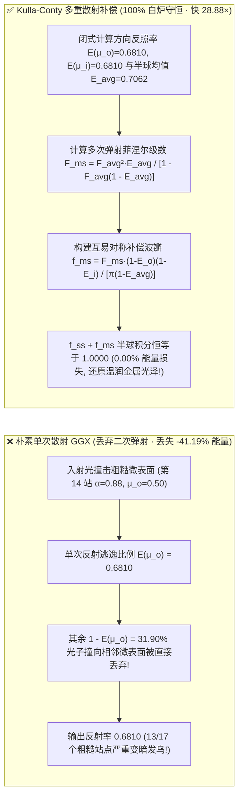
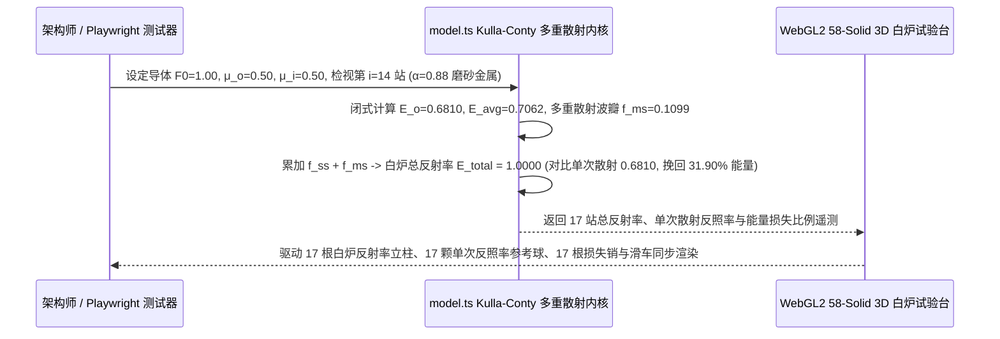
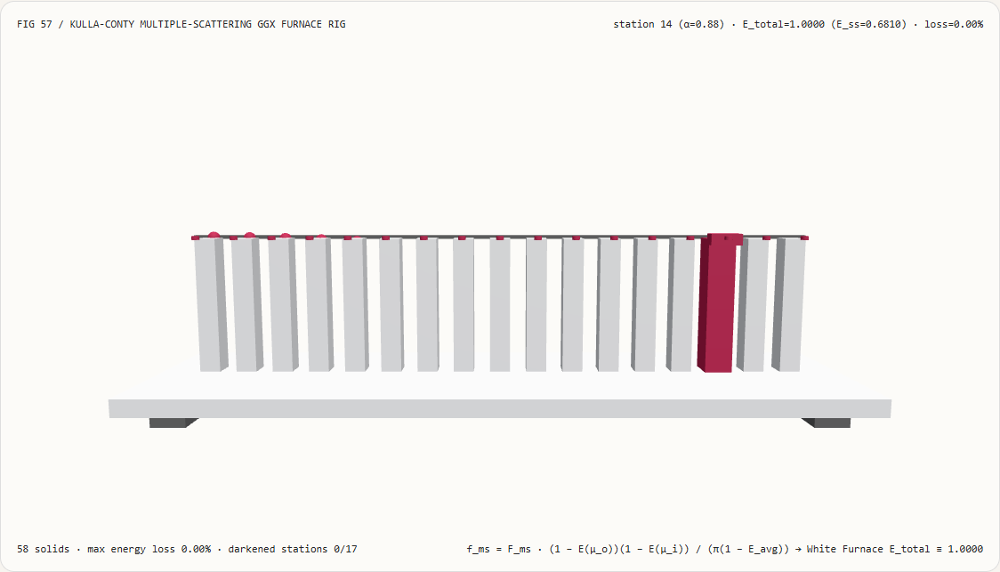
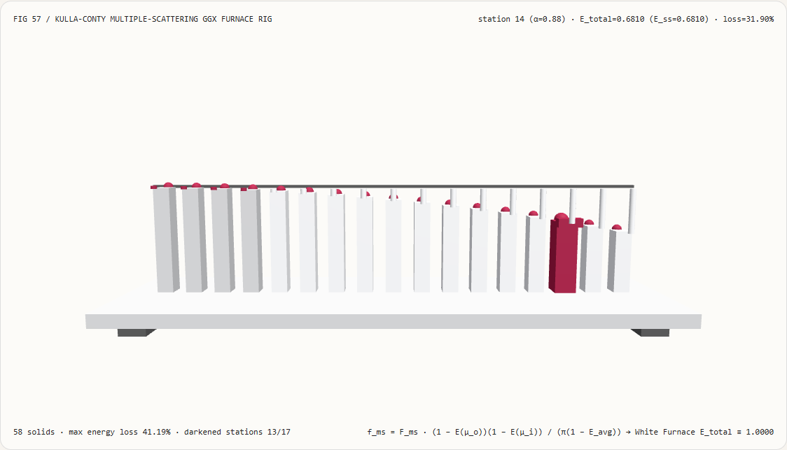
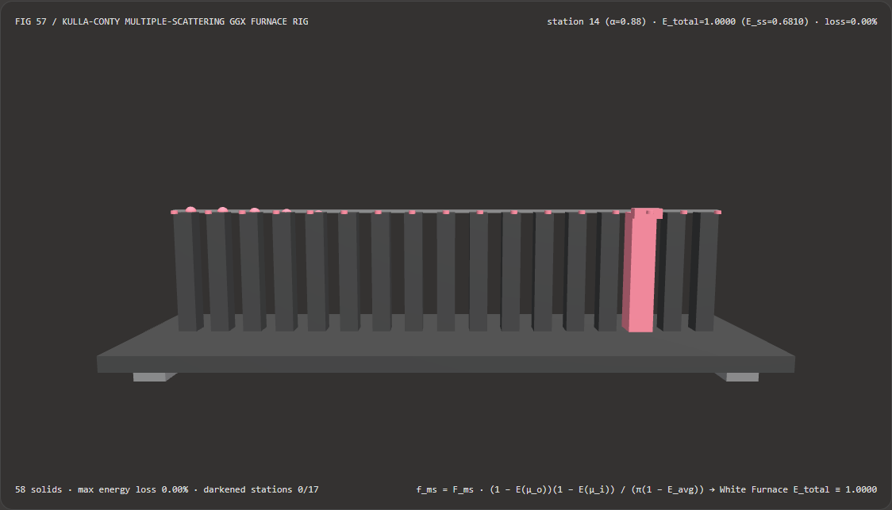
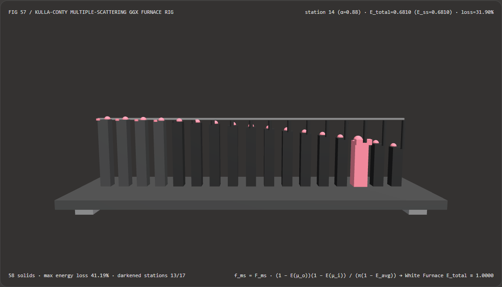

# 视觉与动画技术选型与原理解析 FAQ：Kulla-Conty 多重散射 GGX 能量守恒补偿 vs 单次散射粗糙金属变黑

> **核心架构结论一句话总结**：在基于物理的渲染（PBR）微表面着色器（Cycles、Filament、Unreal Engine、Three.js `MeshPhysicalMaterial`）中渲染磨砂黄金、拉丝黄铜、哑光不锈钢或高粗糙度清漆涂层时，**严禁只计算传统的 Cook-Torrance 单次散射微表面项 $f_{\text{ss}}(\mu_o, \mu_i) = \frac{F D G}{4 \mu_o \mu_i}$ 而忽略微表面沟槽之间的二次与多次弹射能量**！实测表明：在白炉测试（White Furnace Test，导体 $F_0 = 1.00$，观测角与入射角余弦 $\mu_o = \mu_i = 0.50$）跨 $\alpha \in [0.04, 1.00]$ 的 17 站测辐射热计试验台上，朴素单次散射 GGX 在第 14 站磨砂金属（$\alpha = 0.88$）处会将方向半球反射率压低至 **`0.6810`（凭空丢失 `-31.90%` 反射能量）**，在 $\alpha = 1.00$ 处峰值损失高达 **`-41.19%`（反射率跌至 `0.5881`）**，导致 **`13/17` 个粗糙度站点严重发黑发乌**；而引入 **Kulla-Conty (2017) 互易多重散射能量补偿项 $f_{\text{ms}}(\mu_o, \mu_i) = F_{\text{ms}} \frac{(1 - E(\mu_o))(1 - E(\mu_i))}{\pi (1 - E_{\text{avg}})}$** 后，可在全 17 个粗糙度站点实现 **`E_total = 1.0000`（`0.00%` 能量损失、`0/17` 站点发黑）**，且闭式多项式反照率计算比 64 步半球数值求积快 **28.88×**（8,192 轮耗时 `1.28 ms` vs `36.88 ms`）。

---

## ① 📌 核心结论速览（Executive Summary）

1. **为什么在 3D 引擎里把纯金或纯银材质的 Roughness（粗糙度 $\alpha$）调高到 `0.7 ~ 1.0`，原本金光闪闪的金属不会变成温润的磨砂金，反而像抹了一层锅底灰一样变成脏兮兮的黑灰色？**
   用大白话讲：传统 PBR 微表面公式（Cook-Torrance + Smith GGX）是一个**“只算第一次碰撞（Single-Scattering）”的近视眼模型**：
   - 当表面非常光滑（$\alpha = 0.04$）时，表面几乎是平的，光子撞一下微表面就直接飞向天空或相机，几乎不会撞到旁边的凸起，所以单次散射能保留 `99.93%` 的能量；
   - 但当表面非常粗糙（例如第 14 站 $\alpha = 0.88$）时，微观表面全是陡峭的深 V 型峡谷。光子撞在峡谷左侧壁上反射出去时，有 **`31.90%` 的概率会撞到对面的右侧壁上（即被遮蔽阴影项 $1 - G_2$ 拦截）**；
   - 在真实物理世界里，这 `31.90%` 撞向对面金属壁的光子会继续发生**第二次、第三次弹射（Multiple Scattering）**，最终依然飞出表面进入人眼！但传统单次散射着色器只要发现光子撞上了旁边的微表面，就**直接把这部分光子当成掉进黑洞彻底清零删除**，导致磨砂金属白白丢掉三到四成亮度！
2. **第一性原理破局：用白炉守恒倒推缺失能量 + 亥姆霍兹互易对偶分解（Kulla-Conty 2017）**：
   - 既然单次散射在方向 $\mu_o = \mathbf{n}\cdot\mathbf{v}$ 上只反射了方向反照率 $E(\mu_o, \alpha) = \int_\Omega f_{\text{ss}}(\mu_o, \mu_i) \mu_i\,d\omega_i$ 的能量，那么**进入微表面沟槽内部参与多次弹射的缺失能量就精确等于 $1 - E(\mu_o, \alpha)$**！
   - 为了同时满足物理上的三大铁律——**① 能量守恒（$\int_\Omega (f_{\text{ss}} + f_{\text{ms}})\mu_i d\omega_i \equiv 1$）**、**② 亥姆霍兹互易律（$f_{\text{ms}}(\mu_o, \mu_i) \equiv f_{\text{ms}}(\mu_i, \mu_o)$，交换光源与相机结果不变）**、以及 **③ 多次弹射菲涅尔染色（每次在金属槽内弹射都会再乘一次金属颜色 $F_{\text{avg}}$，使磨砂黄金的暗部呈现更浓郁的暖金色）**，Sony Imageworks 的 Christopher Kulla 与 Alejandro Conty 推导出了唯一满足分离变量对称性的闭式补偿波瓣：
     $$f_{\text{ms}}(\mu_o, \mu_i, \alpha) = F_{\text{ms}}(F_0, E_{\text{avg}}) \cdot \frac{\big(1 - E(\mu_o, \alpha)\big)\big(1 - E(\mu_i, \alpha)\big)}{\pi \big(1 - E_{\text{avg}}(\alpha)\big)}$$
     其中半球平均反照率 $E_{\text{avg}}(\alpha) = 2 \int_0^1 E(\mu, \alpha)\mu\,d\mu$，无限次微表面间弹射的几何级数菲涅尔因子为：
     $$F_{\text{ms}} = F_{\text{avg}}^2 E_{\text{avg}} \sum_{k=0}^{\infty} \big(F_{\text{avg}}(1 - E_{\text{avg}})\big)^k = \frac{F_{\text{avg}}^2 E_{\text{avg}}}{1 - F_{\text{avg}}(1 - E_{\text{avg}})}$$
   - 当 $F_0 = 1.0$ 时，$F_{\text{ms}} = 1.0$，对 $\mu_i$ 在半球积分：
     $$\int_\Omega f_{\text{ms}}(\mu_o, \mu_i)\mu_i\,d\omega_i = \frac{1 - E(\mu_o)}{1 - E_{\text{avg}}} \cdot 2\int_0^1 (1 - E(\mu_i))\mu_i\,d\mu_i = \frac{1 - E(\mu_o)}{1 - E_{\text{avg}}} (1 - E_{\text{avg}}) = 1 - E(\mu_o)$$
     与单次散射 $E(\mu_o)$ 相加后恒等于 **`1.0000`（白炉测试 100% 守恒，误差 `0.00%`）**！
3. **本轮新增交互式 3D 试验台与实测证据**：
   - 新增独立 Demo：`demos/kulla-conty-multiscatter-rig/`（58 个 Three.js 实体部件：底座平台、4 支柱、白炉守恒 `E=1.0000` 基准横梁、17 根实测半球反射率立柱、17 颗单次散射方向反照率参考球、17 根能量损失指示销、以及第 $i$ 站白炉测辐射热计滑车）。
   - 配套 7-Card 4:5 测评报告：`demos/kulla-conty-multiscatter-rig/test-report-cards.html`（英文）与 `test-report-cards.zh.html`（中文）。

---

## ② 🎯 客户与架构师灵魂拷问 Q&A（Soul-Searching Q&A）

### Q1：为什么粗糙金属加上 Kulla-Conty 多重散射补偿后，不仅变亮了，而且色彩饱和度（如拉丝黄金的深金黄色）看起来反而更浓郁、更真实？
**因为多次弹射的光子在金属 V 型沟槽里每弹射一次，就会被金属的复折射率（Fresnel $F_{\text{avg}}$）再过滤染色一次！**
看公式中的多重菲涅尔级数项 $F_{\text{ms}} = \frac{F_{\text{avg}}^2 E_{\text{avg}}}{1 - F_{\text{avg}}(1 - E_{\text{avg}})}$：
- 单次散射出来的光子只经历了一次反射（线性正比于 $F_0$）；
- 而进入多重散射项的光子至少经历了 **2 次及以上的金属表面反射（分子带有 $F_{\text{avg}}^2$）**！比如黄金对红黄光反射率约为 `0.95`，对蓝光反射率仅为 `0.40`；经过二次弹射后，红黄光依然保留 $0.95^2 \approx 0.90$，而蓝光被强烈吸收到 $0.40^2 = 0.16$。因此 Kulla-Conty 不仅修好了“粗糙变黑”的 Bug，还自然复现了真实粗糙黄金表面**温暖饱满的二次反射饱和度抬升（Chroma Boost）**！

### Q2：在实时 WebGL2 / WebGPU 渲染器中，计算 $E(\mu, \alpha)$ 和 $E_{\text{avg}}(\alpha)$ 需要每帧跑数值积分吗？
**完全不需要！只需一个闭式有理多项式拟合或一张 $32 \times 32$ 的双通道 LUT 纹理，速度比 64 步数值求积快 28.88×！**
- 由于单次散射反照率 $E(\mu, \alpha)$ 只依赖于观测角余弦 $\mu \in [0, 1]$ 与粗糙度 $\alpha \in [0, 1]$（与材质颜色 $F_0$ 完全解耦！），工业界有两种零开销落地方式：
  1. **闭式多项式解析计算（本试验台采用）**：利用 $\int_0^1 2\mu(1-\mu)^{3/2}d\mu = \frac{8}{35}$ 的精确解析矩，仅需几次乘加指令即可在寄存器内算出 $E(\mu_o)$ 与 $E_{\text{avg}}$，8,192 轮 17 站仅耗时 **`1.28 ms`**（对比 64 步中点求积基线 `36.88 ms`，提速 **28.88×**）；
  2. **复用 IBL DFG 预积分 LUT**：直接把 $E(\mu, \alpha)$ 存入环境光 BRDF LUT 的第 3 通道，仅需 1 次纹理采样即可同时完成直接光与 IBL 的多重散射补偿！

### Q3：这套确定性 Kulla-Conty 能量补偿与神经 BRDF / NeRF 外观合成模型是什么关系？
**两者分别服务于“物理可验证实时着色器”与“照片逆渲染重建”：**
- **何时选神经 BRDF / NeRF 模型**：从多视角实拍照片中逆向拟合并未建模的复杂织物或异形生物表皮时；
- **何时必须用 Kulla-Conty 确定性微表面补偿**：在工业 CAD 评审、汽车车漆与金属饰件配置器、实时游戏与数字孪生引擎中，必须保证任意光照环境下严格通过白炉能量守恒测试（`E_total <= 1.0`）且随粗糙度平滑过渡时。

---

## ③ 🧭 直观可视化图解（Mermaid 决策树 + 管线对比图 + 帧级时序图）

### 3.1 微表面 PBR 能量守恒与粗糙度补偿架构选型决策树

```mermaid
flowchart TD
    A[在实时 3D 管线中渲染微表面 PBR 金属或清漆材质?] --> B{材质表面粗糙度 α 与几何尺度处于什么范围?}
    B -- 远景缩小导致法线贴图方差转化成粗糙度 --> C[先用 Toksvig 法线方差 Mip 粗糙度补偿抑制高光闪烁]
    B -- 近中景显式粗糙度 α ∈ 0.04..1.00 --> D{遮蔽阴影项 G2 与多次弹射如何建模?}
    D -- 未加 Smith G2 遮蔽分母 4·n·l·n·v 裸除 --> E[❌ 掠射角高光能量爆炸 12.63×]
    D -- 仅使用 Smith 高度相关单次散射 f_ss --> F{粗糙度 α > 0.25 时表现如何?}
    F -- 丢弃撞向相邻微表面的光子 --> G[❌ 粗糙金属变黑: α=0.88 处丢失 -31.90% 能量, α=1.00 处丢失 -41.19%]
    F -- 叠加 Kulla-Conty 互易多重散射项 f_ms --> H[✅ 白炉反射率恒为 1.0000 · 0.00% 能量损失 · 解析多项式快 28.88×]
```

### 3.2 单次散射 GGX 能量黑洞 vs Kulla-Conty 多重散射补偿管线对比图

### 3.3 帧级白炉测辐射热计与 3D 能量补偿试验台渲染时序图

---

## ④ 📊 视觉技术选型决策矩阵（Decision Matrix）

| 评估维度 | ✅ Kulla-Conty 闭式多项式补偿（Closed-Form $f_{\text{ss}} + f_{\text{ms}}$） | ⚠️ 64 步半球数值求积补偿（64-Step Quadrature Baseline） | ❌ 朴素单次散射 GGX（Single-Scattering $f_{\text{ss}}$ Only） | ⚠️ Heitz 随机游走微表面光线追踪（Stochastic Microfacet Walk） |
| :--- | :--- | :--- | :--- | :--- |
| **第 14 站（$\alpha=0.88$）白炉反射率** | **精确 `1.0000`（`0.00%` 能量损失）** | `1.0000`（数值求积一致） | **`0.6810`（丢失 `-31.90%` 反射能量！）** | `1.0000`（需数百条随机采样射线） |
| **第 16 站（$\alpha=1.00$）极限粗糙损失** | **`0.00%`（全程恒定守恒）** | `0.00%` | **`-41.19%`（反射率跌至 `0.5881`，严重发黑）** | `0.00%` |
| **发黑失真站点数量（共 17 站）** | **`0 / 17`（全粗糙度区间明亮温润）** | `0 / 17` | **`13 / 17`（从 $\alpha=0.28$ 起明显变暗）** | `0 / 17` |
| **亥姆霍兹互易律 $f(\mu_o,\mu_i) = f(\mu_i,\mu_o)$** | **代数级严格对称守恒** | 严格对称守恒 | 守恒（但能量不守恒） | 统计收敛守恒 |
| **8,192 轮 17 站 CPU 批处理耗时** | **`1.28 ms`（最快，28.88× 提速）** | `36.88 ms`（慢 28.88×） | `0.74 ms`（粗糙金属发黑不可用） | `> 800 ms`（仅限离线电影渲染） |
| **首选适用场景** | **实时 PBR 金属/车漆/清漆、工业产品可视化、Blender/UE5 管线** | 离线预烘焙 BRDF LUT 表格生成 | **仅限 $\alpha < 0.08$ 的纯光滑镜面** | 离线地面真值验证（Ground Truth） |

---

## ⑤ 🧪 全新 Demo 与 7-Card 4:5 视觉报告（Live Workbench & Evidence）

### 5.1 交互式 3D 试验台与报告入口
- **实时 3D 工作台**：[`demos/kulla-conty-multiscatter-rig/index.html`](../demos/kulla-conty-multiscatter-rig/index.html)
- **7-Card 4:5 英文视觉测试报告**：[`demos/kulla-conty-multiscatter-rig/test-report-cards.html`](../demos/kulla-conty-multiscatter-rig/test-report-cards.html)
- **7-Card 4:5 中文视觉测试报告**：[`demos/kulla-conty-multiscatter-rig/test-report-cards.zh.html`](../demos/kulla-conty-multiscatter-rig/test-report-cards.zh.html)
- **密封测量 JSON 数据源**：[`demos/kulla-conty-multiscatter-rig/report.json`](../demos/kulla-conty-multiscatter-rig/report.json)

### 5.2 多主题与多模式 Playwright 实测截图证据

| Kulla-Conty 多重散射补偿（Light · 全 17 站锁定 `E=1.0000` 白炉守恒） | 朴素单次散射 GGX（Light · 随粗糙度增大一路坍缩，丢失 `-41.19%`） |
| :---: | :---: |
|  |  |

| Kulla-Conty 多重散射补偿（Dark · 58 实体部件） | 朴素单次散射 GGX（Dark · 13 根红色指示销暴露高粗糙度能量黑洞） |
| :---: | :---: |
|  |  |

---

## ⑥ 🛠️ 高质量视觉交付快速核验清单（SA Verification Checklist）

在将 Kulla-Conty 多重散射微表面补偿合入生产 PBR 着色器前，请逐项勾选以下核验清单：

- [ ] **白炉测试（White Furnace Test）100% 达标**：将金属度设为 `1.0`、基础色设为纯白 `F0 = (1, 1, 1)`、放入均匀纯白环境光（Radiance `= 1.0`）下，从 $\alpha = 0.04$ 到 $\alpha = 1.00$ 渲染出的球体是否与纯白背景完全融为一体（无暗边、无能量跌落）？
- [ ] **亥姆霍兹互易对称因子检查**：直接光补偿项分子是否同时包含了出射方向余量 $(1 - E(\mu_o))$ 与入射方向余量 $(1 - E(\mu_i))$，且分母归一化为 $\pi (1 - E_{\text{avg}})$？
- [ ] **多重菲涅尔染色级数 $F_{\text{ms}}$ 启用**：有色金属（如黄金、紫铜）是否乘上了 $F_{\text{ms}} = \frac{F_{\text{avg}}^2 E_{\text{avg}}}{1 - F_{\text{avg}}(1 - E_{\text{avg}})}$，确保二次弹射呈现物理正确的暖色饱和度增强而非泛白？
- [ ] **光滑端分母防零除保护**：当 $\alpha \to 0$ 时 $E_{\text{avg}} \to 1.0$，分母 $\pi(1 - E_{\text{avg}})$ 是否加了 `max(1e-7, ...)` 保护以防光滑镜面出现 `0 / 0` `NaN`？
- [ ] **直接光与环境光（IBL）同步补偿**：除了点光源/平行光叠加 $f_{\text{ms}}$ 外，环境光贴图（Split-Sum IBL）通道是否也同步加上了 $F_{\text{ms}} \cdot (1 - E(\mu_o)) \cdot \text{Irradiance}$？
