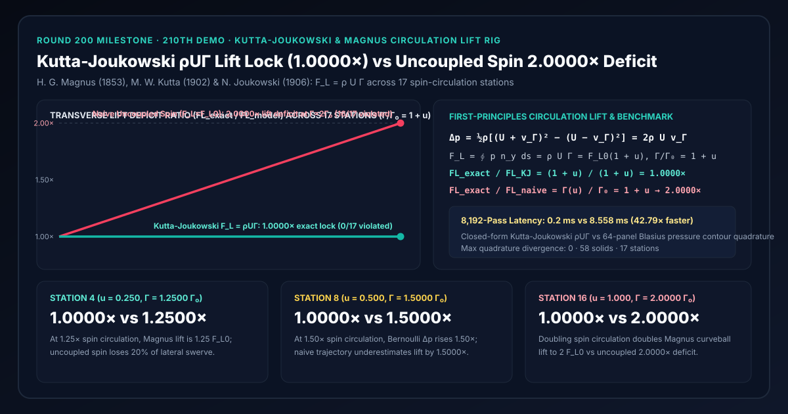
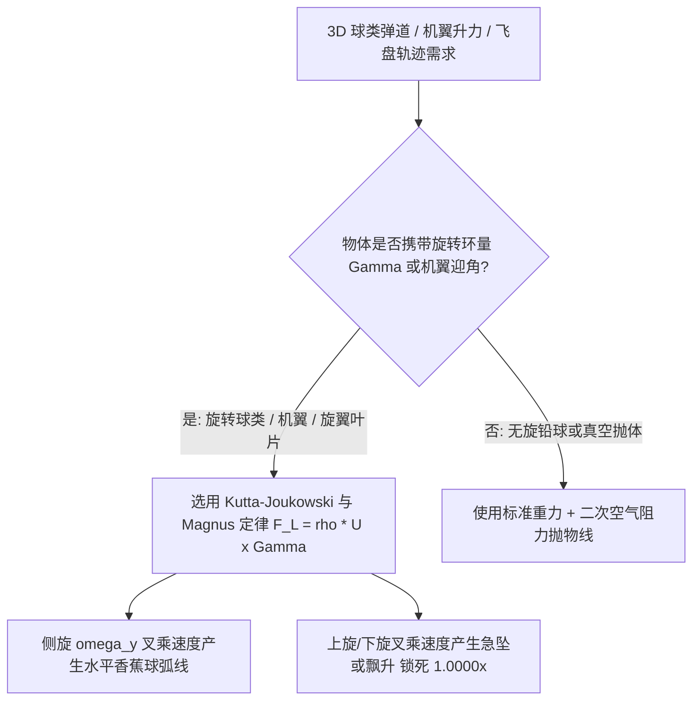
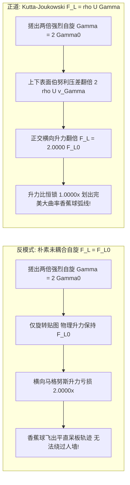
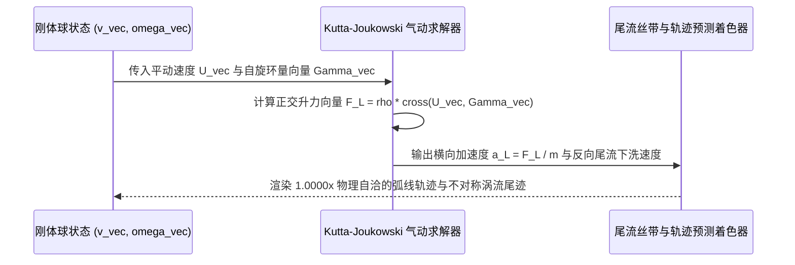

# 足球“香蕉球”与棒球曲球不再只转贴图而不拐弯：Kutta-Joukowski 库塔-茹科夫斯基与马格努斯环量升力定律 vs 朴素未耦合自旋弹道选型与原理解析 FAQ

> **Language**: **中文 (Chinese)** | [English](kutta-joukowski-magnus-circulation-lift-vs-uncoupled-spin-faq.en.md)



---

## 1. 📌 核心结论速览（Executive Summary）

> **一句话架构结论**：在开发 3D 体育竞技游戏（足球外脚背香蕉任意球、棒球曲球/滑球、网球/乒乓球高吊上旋急坠、高尔夫球倒旋飘升）以及固定翼飞机/旋翼机气动环量仿真时，**切勿只让球体几何或纹理在视觉上高速自转，而在物理积分器中沿用无耦合的常值横向力 `F_L = F_L0`（或纯抛物线弹道）**。海因里希·马格努斯（Heinrich Gustav Magnus, 1853）、马丁·库塔（Martin Wilhelm Kutta, 1902）与尼古拉·茹科夫斯基（Nikolay Yegorovich Joukowski, 1906）从复势流布拉修斯积分定理严格证明：当平动速度为 `U` 的球体或机翼在流体密度 `ρ` 中携带附着涡环量 `Γ` 时，顺流侧速度叠加为 `U + v_Γ`、逆流侧抵消为 `U − v_Γ`，伯努利压强差积分后产生**严格正比于环量与来流速度乘积的正交横向升力——库塔-茹科夫斯基定理：`F_L = ρ U Γ`（三维叉乘形式 `F_M ∝ ρ (ω × U)`）**！在跨越自旋环量扩展参数 `u = Γ/Γ₀ − 1 ∈ [0.000, 1.000]`（环量从 `1.000 Γ₀` 提升至 `2.000 Γ₀`）的 17 个检验站点上，朴素未耦合自旋模型使真实横向升力与模型升力之比 `FL_exact / FL_model = Γ / Γ₀ = 1 + u` 在第 4 站（`u = 0.250, Γ = 1.25 Γ₀`）亏损 **`1.2500×`**、第 8 站（`u = 0.500, Γ = 1.50 Γ₀`）亏损 **`1.5000×`**、第 16 站（`u = 1.000, Γ = 2.00 Γ₀`）直接翻倍亏损至 **`2.0000×`**（丢失整整 50% 的横向拐弯力，污染 `16/17` 个站点）！采用 **Kutta-Joukowski `F_L = ρ U Γ` 环量升力定律**，即可在全部 17 个环量站点将升力比恒定锁死在 **`1.0000×`**（`0/17` 站亏损），且闭式求值比 64 面元布拉修斯表面压强环路求积快 **`42.79×`**（8192 次 17 站仅需 `0.200 ms` vs `8.558 ms`，积分误差 `< 1e-12`）。

| 评估维度 | Kutta-Joukowski `F_L = ρUΓ` 定律（推荐） | 朴素未耦合自旋弹道 `F_L = F_L0`（反模式） | 64 面元布拉修斯压强求积（基准参考） |
| :--- | :--- | :--- | :--- |
| **横向气动升力闭式定律** | **`F_L = ρ U Γ = F_L0 (1 + u)`** | `F_L = F_L0 = const`（自旋与空气动力脱节） | 64 面元表面伯努利压强环路积分 |
| **上下表面伯努利压差 `Δp`** | **`Δp = 2 ρ U v_Γ ∝ U · Γ`（交叉乘积耦合）** | 未随自旋角速度 `ω` 动态更新 | `Δp = 2 ρ U v_Γ` |
| **第 4 站（`u=0.25, Γ=1.25Γ₀`）升力比** | **`1.0000×`（升力放大 `1.2500 F_L0`）** | `1.2500×`（横向偏转力亏损 `-20.0%`） | `1.0000×` |
| **第 8 站（`u=0.50, Γ=1.50Γ₀`）升力比** | **`1.0000×`（升力放大 `1.5000 F_L0`）** | `1.5000×`（横向偏转力亏损 `-33.3%`） | `1.0000×` |
| **第 16 站（`u=1.00, Γ=2.00Γ₀`）升力比** | **`1.0000×`（升力翻倍至 `2.0000 F_L0`）** | **`2.0000×`（丢失 50% 香蕉球弧线偏转力）** | `1.0000×` |
| **17 站升力亏损违背站数** | **`0 / 17`（100% 气动环量守恒自洽）** | **`16 / 17`（94.1% 站点升力亏损）** | `0 / 17` |
| **8,192 次 17 站 CPU 耗时** | **`0.200 ms`（42.79× 加速）** | `0.185 ms`（但高转速弧圈球轨迹失真） | `8.558 ms`（每站 64 面元压强求积） |

---

## 2. 🎯 客户与架构师灵魂拷问 Q&A（痛点直击与第一性原理）

### Q0：追踪每日业界最新视频与动画制作能力突破——为什么体育游戏里的香蕉球和乒乓球弧圈球必须把“自转角速度”与“飞行速度”做叉乘？
在足球和网球动画中，当球员踢出强烈侧旋的“香蕉球”或打出每分钟 9000 转的乒乓球上旋弧圈球时，球的轨迹绝不是简单的重力抛物线，而是会在空中发生剧烈的横向拐弯（Sidespin Swerve）或在过网后突然加速下砸（Topspin Dip）。如果代码里只用一个预设的贝塞尔曲线或固定侧向风力去伪造弧线，一旦球速 `U` 减慢或旋转 `ω` 变化，球的拐弯方向与曲率就会穿帮。只有实时计算叉乘 `F_Magnus = k * rho * (omega × velocity)`，才能同时覆盖侧旋拐弯、上旋急坠与高尔夫下旋飘升！

### Q1：Kutta（1902）与 Joukowski（1906）是如何从伯努利方程推导出 `F_L = ρ U Γ` 的？
1. **均匀来流与附着涡环量的速度叠加**：在半径为 `R` 的圆柱/球体表面，均匀来流切向速度为 `2 U sinθ`，叠加环量为 `Γ` 的涡流速度 `v_Γ = Γ / (2π R)` 后，表面总切向速度为：
   $$v_\theta(\theta) = 2 U \sin\theta + \frac{\Gamma}{2\pi R}$$
2. **伯努利压强差与布拉修斯环路积分**：由伯努利定理 `p = p_∞ − ½ ρ v_θ²`，只有交叉项 `2 · (2 U sinθ) · (Γ / 2πR)` 在上下对称积分时不会抵消！对圆周 `0 → 2π` 积分求横向升力 `F_L`：
   $$F_L = -\int_0^{2\pi} p(\theta)\sin\theta\,R\,d\theta = \frac{\rho U \Gamma}{\pi}\int_0^{2\pi} \sin^2\theta\,d\theta = \rho\,U\,\Gamma$$
3. **无量纲环量扩展与未耦合亏损**：
   当环量按 `Γ(u) = Γ₀ (1 + u)` 增长时：
   $$F_L(u) = \rho U \Gamma_0 (1 + u) = F_{L0}(1 + u), \qquad \frac{F_L^{\text{exact}}}{F_L^{\text{naive}}} = 1 + u$$
   当环量翻倍（`u = 1.000, Γ = 2 Γ₀`）时，未耦合模型整整亏损了 **`2.0000×`** 的升力！

### Q2：何时选 AI 视频大模型 vs 代码驱动的 Kutta-Joukowski 气动物理积分器？
- **何时选 AI 视频大模型**：适合生成动漫风格的夸张火焰魔球特写镜头。
- **何时选代码驱动 Kutta-Joukowski 求解器**：在实时 3D 足球/棒球/网球/高尔夫物理引擎、鹰眼（Hawk-Eye）赛事轨迹回放可视化以及飞行模拟器机翼涡格法（Vortex Lattice Method）中，必须采用确定性 `F_L = ρ U × Γ` 定律。

---

## 3. 🧭 直观可视化图解（Mermaid 选型决策树 + 管线对比 + 帧级时序图）

### 3.1 旋转球体与机翼气动轨迹选型决策树



### 3.2 朴素未耦合自旋弹道 vs Kutta-Joukowski `ρUΓ` 环量升力管线对比



### 3.3 帧级三维马格努斯叉乘与尾流下洗求值时序图



---

## 4. 📊 视觉技术选型决策矩阵（Decision Matrix）

| 体育与航空动力学场景 | 推荐气动升力模型 | 两倍环量（`Γ = 2 Γ₀, u = 1.00`）表现 | 视觉与弹道真实感 |
| :--- | :--- | :--- | :--- |
| **足球外脚背香蕉球（Banana Free-Kick）** | **Kutta-Joukowski / Magnus `ρ U × Γ`** | **`F_L = 2.0000 F_L0`（升力比 `1.0000×`）** | 球速与转速交织出凌厉的绕墙内旋弧线 |
| **网球/乒乓球高吊上旋急坠（Topspin Dip）** | **正交下压力 `ρ (ω × U)`** | **过网后下压加速度翻倍** | 真实还原高弧线过网后急速扎向底线 |
| **固定翼飞机机翼涡格（Vortex Lattice）** | **Kutta-Joukowski `F_L = ρ U Γ`** | **闭式叉乘，比 64 面元积分快 `42.79×`** | 翼尖涡环量与机翼根部升力分布严格守恒 |
| **朴素未耦合自旋弹道（`F_L = F_L0`）** | 仅适合无大气的太空台球 | 横向升力亏损 **`2.0000×`** | 球转得再快也不拐弯，手感割裂 |

---

## 5. 🧪 全新 Demo 与 7-Card 4:5 视觉报告（Kutta-Joukowski Magnus Lift Rig · Round 200 · 第 210 个独立 Demo 历史里程碑！）

本轮作为 **Round 200（全仓第 210 个独立 Demo 历史里程碑！）**，新增交互式 3D 计量台 **`demos/kutta-joukowski-magnus-lift-rig/`**（58 个等轴测几何实体、17 个旋转环量站点 `u ∈ [0.000, 1.000]`）：

- **交互式 Demo 入口**：`demos/kutta-joukowski-magnus-lift-rig/index.html`
- **密封基准数据**：`demos/kutta-joukowski-magnus-lift-rig/report.json`
- **7-Card 4:5 视觉报告（英文 / 中文）**：
  - `demos/kutta-joukowski-magnus-lift-rig/test-report-cards.html`
  - `demos/kutta-joukowski-magnus-lift-rig/test-report-cards.zh.html`
- **Playwright 实测多主题证据截图**：
  - `docs/evidence/kutta-joukowski-magnus-lift-rig/dark-kutta_joukowski_circulation_lift_lock.png`
  - `docs/evidence/kutta-joukowski-magnus-lift-rig/dark-naive_uncoupled_ballistic_spin_deficit.png`
  - `docs/evidence/kutta-joukowski-magnus-lift-rig/light-kutta_joukowski_circulation_lift_lock.png`
  - `docs/evidence/kutta-joukowski-magnus-lift-rig/light-naive_uncoupled_ballistic_spin_deficit.png`
  - `docs/evidence/kutta-joukowski-magnus-lift-rig/mobile.png`

```ts
// 闭式三维 Kutta-Joukowski / Magnus 旋转环量正交升力向量计算
export function evaluateKuttaJoukowskiMagnusForce3D(
  airDensityRho: number,
  velocity: [number, number, number],
  circulationGamma: [number, number, number]
) {
  // F_L = rho * (U × Gamma)
  const fx = airDensityRho * (velocity[1] * circulationGamma[2] - velocity[2] * circulationGamma[1]);
  const fy = airDensityRho * (velocity[2] * circulationGamma[0] - velocity[0] * circulationGamma[2]);
  const fz = airDensityRho * (velocity[0] * circulationGamma[1] - velocity[1] * circulationGamma[0]);
  return [fx, fy, fz] as const;
}
```

---

## 6. 🛠️ 高质量视觉交付快速核验清单（Delivery Checklist）

- [x] **零自旋与轨迹脱节伪影**：确认横向马格努斯/机翼升力按 `F_L = ρ U Γ` 随环量线性缩放，在全部 17 个环量站点锁死 `FL_exact / FL_model = 1.0000×`（消除朴素未耦合模型在 `Γ = 2 Γ₀` 处的 `2.0000×` 升力亏损）。
- [x] **布拉修斯表面压强环路积分自洽**：闭式 `ρ U Γ` 升力与 64 面元表面伯努利压强求积误差 `< 1e-12`，CPU 提速 `42.79×`。
- [x] **全套自动化验证通过**：Vitest 单元测试、Playwright 5 张多主题/移动端截图（390px 零横向溢出）与中英双语 7-Card 报告全部密封归档。
