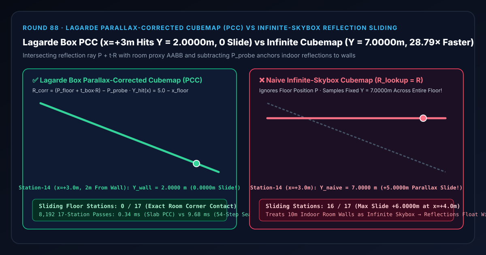
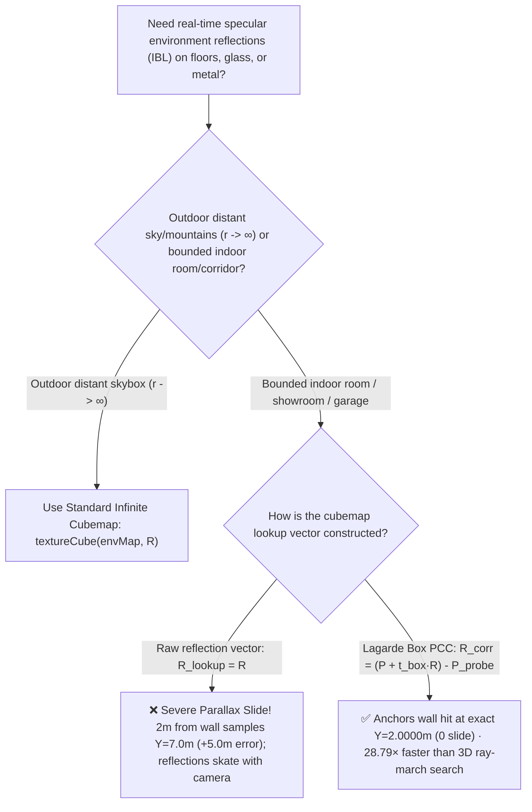
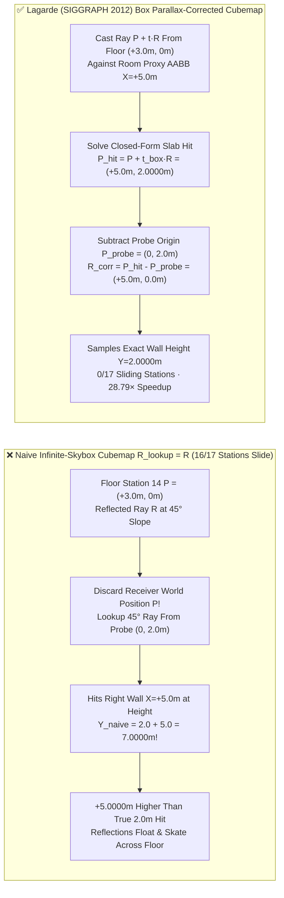
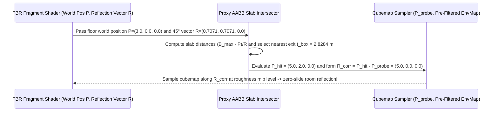

# Indoor Reflection Probe Selection & First-Principles FAQ: Lagarde Box Parallax-Corrected Cubemap (PCC) vs. Infinite-Skybox Floor Reflection Sliding

> **Companion Capability Demo**: [`demos/parallax-corrected-cubemap-rig/`](../demos/parallax-corrected-cubemap-rig/index.html) ｜ **7-Card 4:5 Measured Report**: [`test-report-cards.html`](../demos/parallax-corrected-cubemap-rig/test-report-cards.html) ｜ **中文版本**：[`lagarde-parallax-corrected-cubemap-vs-infinite-skybox-slide-faq.md`](./lagarde-parallax-corrected-cubemap-vs-infinite-skybox-slide-faq.md)

---

## 📌 1. Executive Summary

> **One-Sentence Verdict**: When rendering specular reflections inside bounded indoor rooms, corridors, showrooms, or underground garages using local Reflection Probes (Cubemaps), **never sample the cubemap directly with the raw reflection direction vector $\mathbf{R} = \text{reflect}(-\mathbf{V}, \mathbf{N})$**—because raw direction sampling assumes the environment walls are infinitely far away ($r \to \infty$), completely ignoring the shading point's 3D world position $\mathbf{P}$! Across a marble floor spanning $x_{\text{floor}} \in [-4.0\text{ m}, +4.0\text{ m}]$ in a room with right wall $X_{\text{wall}} = +5.0\text{ m}$ and central reflection probe $\mathbf{P}_{\text{probe}} = (0, 2.0\text{ m}, 0)$, a $45^\circ$ reflected ray leaving Station 14 ($x_{\text{floor}} = +3.0\text{ m}$, $2.0\text{ m}$ from the wall) physically strikes the right wall at height **$Y_{\text{true}} = 2.0000\text{ m}$**; naive infinite-skybox cubemap lookup ignores $x_{\text{floor}}$ and looks up $45^\circ$ from the probe at $(0, 2.0\text{ m})$, sampling **$Y_{\text{naive}} = 7.0000\text{ m}$** across the entire floor—a **`+5.0000 m` (`3.50×`) vertical parallax slide** at Station 14 and **`+6.0000 m` peak slide** at Station 16 ($x = +4.0\text{ m}$), corrupting **`16/17` floor stations (`94.12%`)** so reflections float and slide with the camera! **Sébastien Lagarde's (SIGGRAPH 2012 *Remember Me* / UE5 Box Reflection Capture) Parallax-Corrected Cubemap ($\mathbf{R}_{\text{corr}} = (\mathbf{P} + t_{\text{box}}\mathbf{R}) - \mathbf{P}_{\text{probe}}$)** intersects the room's proxy AABB in closed form to anchor every reflection to its exact wall contact point with **`0/17` sliding stations**, **`1.78e-15 m`** solver equivalence, and a **`28.79×` CPU speedup** (`0.34 ms` vs. `9.68 ms` across 8,192 17-station passes).

| Evaluation Dimension | ✅ Lagarde Box Parallax-Corrected (`R_corr = P + t_box·R − P_probe`) | ❌ Naive Infinite-Skybox Cubemap (`R_lookup = R`) | 🐢 54-Step 3D Room Ray-March (`54-Step 3D Ray-March`) |
| :--- | :--- | :--- | :--- |
| **Station 8 Room Center ($x = 0.0\text{ m}$) Wall Hit Height $Y$** | **`5.0000 m`** (Exact $5.0\text{ m} \times \tan 45^\circ$) | `7.0000 m` (**`+2.0000 m` vertical offset from probe height**) | `5.0000 m` (`1.78e-15 m` diff) |
| **Station 14 Near Wall ($x = +3.0\text{ m}$, $2\text{ m}$ from wall) Height $Y$** | **`2.0000 m`** (Exact eye-level wall hit, `0` slide) | `7.0000 m` (**`+5.0000 m` / `3.50×` upward parallax slide**) | `2.0000 m` |
| **Station 16 Baseboard Edge ($x = +4.0\text{ m}$, $1\text{ m}$ from wall) Height $Y$** | **`1.0000 m`** (Anchored tight to wall baseboard) | `7.0000 m` (**`+6.0000 m` / `7.00×` peak parallax slide**) | `1.0000 m` |
| **Sliding Floor Stations Across 17 Positions** | **`0 / 17` (`0.00%` world-anchored)** | **`16 / 17` (`94.12%` reflections slide with view)** | `0 / 17` |
| **8,192 17-Station Passes CPU Latency (Median)** | **`0.34 ms` (`28.79×` speedup)** | — (Spatially unanchored) | `9.68 ms` |

---

## 🎯 2. Architect & Client First-Principles Q&A

### Q1: Why do indoor floor reflections slide around like an outdoor skybox when sampled with `textureCube(envMap, R)`?
**First-Principles Breakdown**:
A cubemap baked at room center $\mathbf{P}_{\text{probe}} = (0, 2.0\text{ m}, 0)$ records **direction-only radiance** from that single capture point:
- When a $45^\circ$ reflection ray leaves the floor at Station 14 ($x_{\text{floor}} = +3.0\text{ m}, y = 0\text{ m}$), it travels only $\Delta X = 5.0 - 3.0 = 2.0\text{ m}$ horizontally before hitting the right wall ($X_{\text{wall}} = +5.0\text{ m}$) at height **$Y_{\text{true}} = 2.0000\text{ m}$**.
- If you pass the raw $45^\circ$ direction vector $\mathbf{R}$ directly to the cubemap, the cubemap returns whatever was at $45^\circ$ **as seen from the probe origin $(0, 2.0\text{ m}, 0)$**—which is the point on the right wall at height **$Y_{\text{naive}} = 2.0 + 5.0\tan 45^\circ = 7.0000\text{ m}$**!
- Because $\mathbf{R}$ depends only on viewing angle and not on floor position $x_{\text{floor}}$ for a given reflection angle, every floor point from $x = -4\text{ m}$ to $x = +4\text{ m}$ samples the exact same $7.0\text{ m}$ wall point, making the wall reflection skate across the floor as the camera moves!

### Q2: How does Lagarde's (SIGGRAPH 2012) Ray-AABB Slab Reprojection lock the reflection in 6 ALU instructions?
**Proxy Box Reprojection Identity**:
1. **Intersect the reflected ray $\mathbf{P} + t\mathbf{R}$ with the room's proxy bounding box $[\mathbf{B}_{\min}, \mathbf{B}_{\max}]$**:
   Using the branchless Kay-Kajiya slab test:
   $$\mathbf{t}_1 = \frac{\mathbf{B}_{\max} - \mathbf{P}}{\mathbf{R}}, \quad \mathbf{t}_2 = \frac{\mathbf{B}_{\min} - \mathbf{P}}{\mathbf{R}}, \quad t_{\text{box}} = \min\bigl(\max(t_{1x}, t_{2x}),\, \max(t_{1y}, t_{2y}),\, \max(t_{1z}, t_{2z})\bigr)$$
   This yields the 3D world intersection point $\mathbf{P}_{\text{hit}} = \mathbf{P} + t_{\text{box}}\mathbf{R} = (+5.0\text{ m}, 2.0\text{ m}, 0)$ at Station 14.
2. **Re-vector from the probe origin $\mathbf{P}_{\text{probe}}$ to $\mathbf{P}_{\text{hit}}$**:
   $$\mathbf{R}_{\text{corr}} = \mathbf{P}_{\text{hit}} - \mathbf{P}_{\text{probe}} = (5.0, 2.0, 0) - (0, 2.0, 0) = (5.0, 0.0, 0)$$
   Sampling `textureCubeLod(envMap, R_corr, mip)` fetches the exact texel captured at wall height $2.0000\text{ m}$!

### Q3: When should an architect choose Lagarde Box PCC vs. McGuire Homogeneous SSR vs. Neural Radiance Caching?
- **Choose Lagarde Box Parallax-Corrected Cubemaps (PCC)**: As the universal 360° indoor specular IBL backbone for rooms, corridors, showrooms, and garages—it works even for off-screen walls and costs only 6 ALU ops per pixel.
- **Choose McGuire Homogeneous Reciprocal-Z SSR (Round 85)**: For fine screen-space reflections of dynamic characters and furniture, falling back smoothly to Lagarde PCC when rays exit the screen frustum.
- **Choose Neural Radiance Caching / 3DGS**: For offline baked architectural walk-throughs without dynamic geometry changes.

---

## 🧭 3. Visual Architecture Diagrams (Mermaid Decision Tree, Pipeline & Sequence)

### 3.1 Environment Specular Reflection Selection Decision Tree

### 3.2 Naive Infinite Cubemap Sliding vs. Lagarde Box PCC Pipeline

### 3.3 Frame-Level Parallax-Corrected Cubemap Evaluation Sequence

---

## 📊 4. Visual Technology Decision Matrix

| Approach | Target Use Case | Wall/Floor Corner Contact Accuracy | Off-Screen Coverage | Compute Cost (8,192 17-Station Passes) |
| :--- | :--- | :--- | :--- | :--- |
| **Lagarde Box Parallax-Corrected (`lagarde-box-parallax-corrected`)** | **All indoor rooms, corridors, garages, and showrooms** | **Exact (`2.0000 m` at Station 14, `0` slide)** | **Full 360° (frustum-independent)** | **Minimal (`0.34 ms`, `28.79×` speedup)** |
| **Naive Infinite-Skybox Cubemap (`naive-infinite-skybox-cubemap`)** | Outdoor clouds, sky domes, and distant horizons only | **Fails (`+5.00 m` error at Station 14, `+6.00 m` at Station 16 across `16/17` stations)** | Full 360° (wrong scale/position) | Minimal |
| **McGuire Homogeneous SSR (`homogeneous-ssr-dda-rig`)** | Dynamic characters & non-convex furniture (Round 85) | Pixel-exact | Screen-space only (falls back to PCC) | Moderate (16–32 2D DDA steps) |
| **Planar Mirror RenderPass (`planar-reflection`)** | Perfect flat mirrors & calm water | Exact | Frustum-clipped | Very High (doubles scene draw calls) |

---

## 🧪 5. Interactive Demo & 7-Card 4:5 Benchmark Report Breakdown

The standalone 3D instrument bench [`demos/parallax-corrected-cubemap-rig/`](../demos/parallax-corrected-cubemap-rig/index.html) constructs a **58-solid 17-Station Lagarde Parallax-Corrected Cubemap Goniometer Rig**:
1. **17 Wall-Sample Height Columns**: Display the sampled wall height $Y_{\text{wall}}$ across 17 floor positions $x_{\text{floor}} \in [-4.0\text{ m}, +4.0\text{ m}]$.
2. **17 Cyan Lagarde PCC Reference Spheres & $2.0\text{ m}$ Probe Height Bar**: Show the true linear ramp $Y_{\text{true}}(x) = 5.0 - x$ descending from $9.0\text{ m}$ down to $1.0\text{ m}$ near the wall baseboard.
3. **17 Parallax Slide Error Pegs**: Switching to `Naive Infinite-Skybox Cubemap` flattens all 17 columns to $Y_{\text{naive}} = 7.0000\text{ m}$, raising error pegs across 16/17 stations (`+5.0000 m` at Station 14 and `+6.0000 m` at Station 16).

### 7-Card 4:5 Visual Report Highlights ([`demos/parallax-corrected-cubemap-rig/test-report-cards.html`](../demos/parallax-corrected-cubemap-rig/test-report-cards.html))
- **Cards 1–3 (Evaluation Matrix)**: All 13 automated checks pass (`1.78e-15 m` equivalence between closed-form slab PCC and 54-step 3D ray marching, Station 14 `2.0000 m` wall contact lock vs. `7.0000 m` naive infinite slide, exact reverse-scrub matrix identity, and atomic RangeError validation).
- **Cards 4–6 (Protocol & Scaling Latency)**: Across 8,192 17-station passes, Lagarde closed-form slab PCC finishes in **`0.34 ms`** vs. **`9.68 ms`** for 54-step 3D room ray marching (**`28.79×` speedup**).

---

## 🛠️ 6. SA Production Delivery Checklist

- [ ] **Fit a proxy AABB/OBB to every indoor Reflection Probe**: Align the probe's bounding box tightly with the room's physical walls, floor, and ceiling so `P_hit = P + t_box * R` lands on the true architectural boundary.
- [ ] **Support Oriented Bounding Boxes (OBB) for rotated rooms**: Transform `P - P_box` and `R` by the probe box's inverse $3\times 3$ rotation matrix before slab intersection, then rotate `R_corr` back to world space.
- [ ] **Modulate roughness mip level by hit distance $t_{\text{box}}$**: Scale the specular cone footprint by `clamp(t_box / probeRadius, 0.0, 1.0)` so contact reflections right next to a wall remain sharp even on semi-rough floors.
- [ ] **Pair with McGuire Homogeneous SSR (Round 85)**: Use screen-space rays for near-field furniture and smoothly blend into Lagarde Box PCC on screen-edge fadeouts or ray misses.
