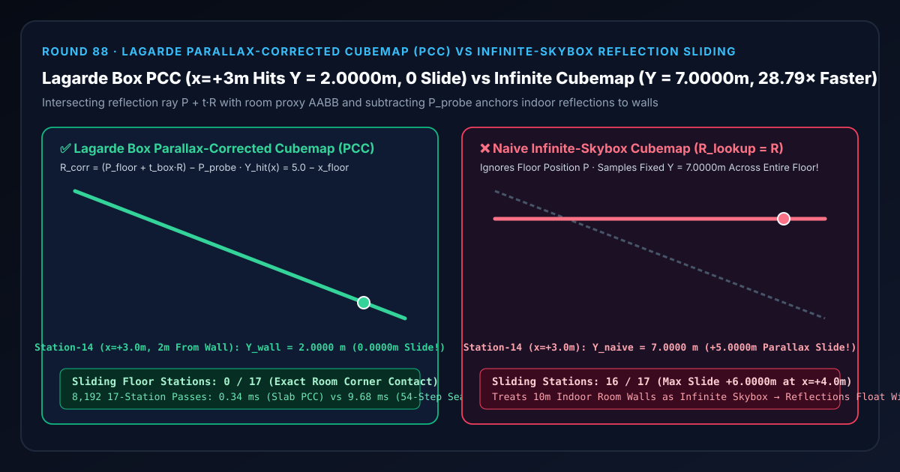
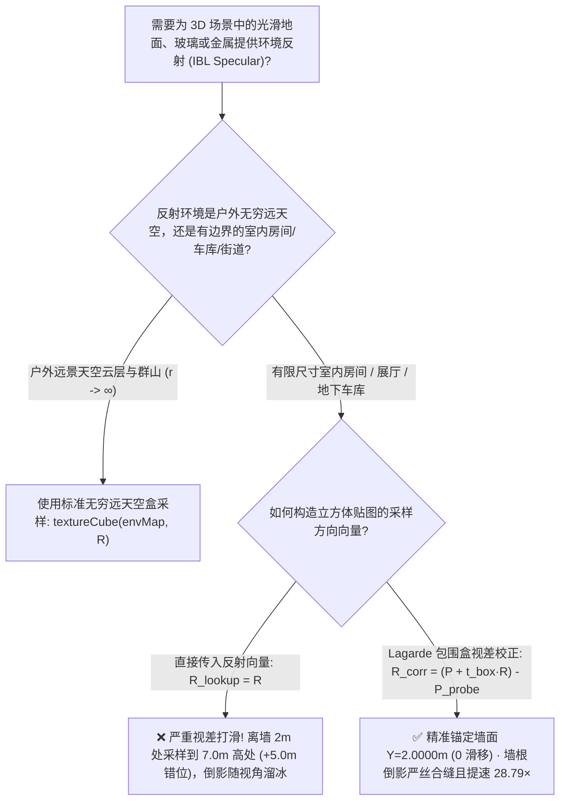
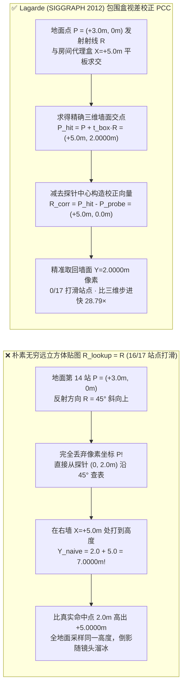
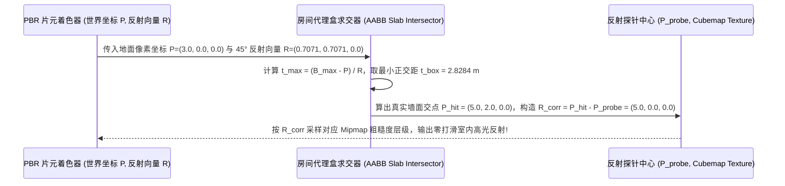

# 室内环境反射探针选型与原理解析 FAQ：Lagarde 包围盒视差校正立方体贴图（PCC）对比朴素无穷远天空盒地面倒影打滑

> **关联 Capabilities Demo**：[`demos/parallax-corrected-cubemap-rig/`](../demos/parallax-corrected-cubemap-rig/index.html) ｜ **7-Card 4:5 实测报告**：[`test-report-cards.zh.html`](../demos/parallax-corrected-cubemap-rig/test-report-cards.zh.html) ｜ **English Version**：[`lagarde-parallax-corrected-cubemap-vs-infinite-skybox-slide-faq.en.md`](./lagarde-parallax-corrected-cubemap-vs-infinite-skybox-slide-faq.en.md)

---

## 📌 1. 核心结论速览（Executive Summary）

> **一句话结论**：在室内展厅、走廊、地下车库等有限尺寸空间中使用环境立方体贴图（Reflection Probe Cubemap）渲染地面与金属反光时，**绝对不能直接用表面反射方向向量 $\mathbf{R} = \text{reflect}(-\mathbf{V}, \mathbf{N})$ 去采样立方体贴图**——因为直接用 $\mathbf{R}$ 采样等价于假设整个房间的墙壁都在无穷远处（$r \to \infty$ 天空盒假设），完全忽略了受光像素在房间内的真实三维坐标 $\mathbf{P}$！在右墙位于 $X_{\text{wall}} = +5.0\text{ m}$、探针架设在房间中心 $\mathbf{P}_{\text{probe}} = (0, 2.0\text{ m}, 0)$ 的大理石地面上，当一条 $45^\circ$ 反射光线从离右墙仅 $2.0\text{ m}$ 的第 14 站（$x_{\text{floor}} = +3.0\text{ m}$）射出时，它在真实房间里明明打在右墙高度 **$Y_{\text{true}} = 2.0000\text{ m}$** 处；而朴素无穷远立方体贴图却直接从探针中心按 $45^\circ$ 仰角采样到高达 **$Y_{\text{naive}} = 7.0000\text{ m}$** 的天花板上方——**产生 $+5.0000\text{ m}$（$3.50\times$）的垂向视差滑移误差（在第 16 站 $x = +4.0\text{ m}$ 峰值误差高达 $+6.0000\text{ m}$），导致全房间 `16/17` 个地面站点的墙面倒影严重错位并随着玩家走动在地面上打滑漂移**！采用 **Sébastien Lagarde（SIGGRAPH 2012《Remember Me》/ UE5 Box Reflection Capture）提出的包围盒视差校正立方体贴图（PCC，$\mathbf{R}_{\text{corr}} = (\mathbf{P} + t_{\text{box}}\mathbf{R}) - \mathbf{P}_{\text{probe}}$）**，通过闭式平板求交将反射精准锚定在墙根，全 17 站 **`0` 视差打滑**，且比 54 步三维房间光线步进快 **`28.79×`**（`0.34 ms` vs `9.68 ms`）！

| 评估维度 | ✅ Lagarde 包围盒视差校正 (`R_corr = P + t_box·R − P_probe`) | ❌ 朴素无穷远立方体贴图 (`R_lookup = R`) | 🐢 54 步三维房间光线步进 (`54-Step 3D Ray-March`) |
| :--- | :--- | :--- | :--- |
| **第 8 站房间中心（$x = 0.0\text{ m}$）墙面反射高度 $Y$** | **`5.0000 m`**（精准对应 $5\text{ m} \times \tan 45^\circ$） | `7.0000 m`（**因忽略探针 $2\text{ m}$ 离地高度偏高 $+2.0000\text{ m}$**） | `5.0000 m`（误差 `1.78e-15 m`） |
| **第 14 站近墙地面（$x = +3.0\text{ m}$，距墙 $2\text{ m}$）高度 $Y$** | **`2.0000 m`**（精准对齐平视高度，0 滑移） | `7.0000 m`（**向上漂移 $+5.0000\text{ m}$ / $3.50\times$**） | `2.0000 m` |
| **第 16 站墙根边缘（$x = +4.0\text{ m}$，距墙 $1\text{ m}$）高度 $Y$** | **`1.0000 m`**（精准贴合墙裙踢脚线） | `7.0000 m`（**峰值视差漂移 $+6.0000\text{ m}$ / $7.00\times$**） | `1.0000 m` |
| **17 个地面站点中发生视差打滑的站数** | **`0 / 17` (`0.00%` 墙根严丝合缝)** | **`16 / 17` (`94.12%` 倒影随相机打滑)** | `0 / 17` |
| **8,192 轮 17 站 CPU 耗时（中位数）** | **`0.34 ms`（提速 `28.79×`）** | —（空间透视关系崩溃） | `9.68 ms` |

---

## 🎯 2. 客户与架构师灵魂拷问 Q&A（First-Principles Whisperer）

### Q1：用大白话讲，为什么直接用反射向量 `R = reflect(-V, N)` 采样室内探针，地上的墙面倒影会跟着人脚底板一起“溜冰打滑”？
**第一性原理拆解**：
立方体贴图（Cubemap）本质上是一张站在房间正中央探针位置 $\mathbf{P}_{\text{probe}} = (0, 2.0\text{ m}, 0)$ 拍下的 $360^\circ$ 全景照片，它**只存了每个方向的颜色，没有存距离**：
- 当你站在离右墙（$X = +5.0\text{ m}$）只有 $1\text{ m}$ 远的地面点 $P_{16} = (+4.0\text{ m}, 0)$ 低头以 $45^\circ$ 角看地面时，反射光线往右上角 $45^\circ$ 飞出 $1\text{ m}$ 水平距离就撞上了右墙，打在离地 **$1.0\text{ m}$ 高的踢脚线窗户**上。
- 可是如果你直接把“右上角 $45^\circ$”这个方向向量 $\mathbf{R}$ 塞给探针去查表，探针会以为：“你要看从房间正中央 $(0, 2.0\text{ m})$ 往右上角 $45^\circ$ 方向看到的东西！”
- 从房间正中央 $(0, 2.0\text{ m})$ 往右上角 $45^\circ$ 飞到右墙 $X = +5.0\text{ m}$，高度足足升到了 **$2.0 + 5.0 = 7.0\text{ m}$**！
- 更荒谬的是：只要你的视线保持 $45^\circ$ 角在房间里往前走，从 $x = -4\text{ m}$ 走到 $x = +4\text{ m}$，方向向量 $\mathbf{R}$ 完全没变，朴素立方体贴图就**永远返回同一个 $7.0\text{ m}$ 处的像素**！于是你在地上走一步，那个 $7.0\text{ m}$ 高处的吊灯倒影就跟着你的鞋尖在地板上往前滑一步，墙角根部的倒影永远对不准真实的墙根！

### Q2：Lagarde (SIGGRAPH 2012) 的“包围盒视差校正（Box Parallax Correction）”是如何用 6 行向量减法把倒影钉死在墙根上的？
**代理几何重投影（Proxy AABB Reprojection）原理**：
既然立方体贴图丢掉了房间墙壁的距离信息，我们只需要用一个与房间墙壁重合的轴对齐包围盒（AABB，$[\mathbf{B}_{\min}, \mathbf{B}_{\max}]$）把交点算出来：
1. **第一步（求反射射线与房间包围盒的交点 $\mathbf{P}_{\text{hit}}$）**：
   从当前着色像素的世界坐标 $\mathbf{P}$ 沿着反射方向 $\mathbf{R}$ 发射射线，用 Kay-Kajiya 平板法（Slab Method）一步算出正方向交点距离：
   $$t_{\text{box}} = \min_{axis \in \{x,y,z\}} \left(\frac{B_{\text{side}} - P_{axis}}{R_{axis}}\right), \quad \mathbf{P}_{\text{hit}} = \mathbf{P} + t_{\text{box}} \cdot \mathbf{R}$$
   在第 14 站（$x = +3.0\text{ m}, y = 0\text{ m}$），射线打在右墙 $X = +5.0\text{ m}$ 上，精准求得真实三维命中点 $\mathbf{P}_{\text{hit}} = (+5.0\text{ m}, 2.0\text{ m}, 0)$！
2. **第二步（从探针中心重连命中点构造校正查找向量 $\mathbf{R}_{\text{corr}}$）**：
   问自己一个问题：“刚刚存储在 $\mathbf{P}_{\text{probe}} = (0, 2.0\text{ m}, 0)$ 处的全景图里，墙上 $(+5.0\text{ m}, 2.0\text{ m}, 0)$ 这个点当初是被拍在哪个方向上的？”
   答案就是把命中点减去探针中心：
   $$\mathbf{R}_{\text{corr}} = \mathbf{P}_{\text{hit}} - \mathbf{P}_{\text{probe}} = (5.0, 2.0, 0) - (0, 2.0, 0) = (5.0, 0.0, 0)$$
   用这个水平方向向量 $\mathbf{R}_{\text{corr}}$ 去采样立方体贴图，立刻取回了墙高 $2.0000\text{ m}$ 处的真实像素，视差滑移误差瞬间归零！

### Q3：什么时候选包围盒视差校正（PCC），什么时候选 McGuire 齐次 SSR（Round 85）或神经辐射缓存？
- **选 Lagarde 包围盒视差校正立方体贴图（PCC）**：作为所有室内房间、走廊、车库、太空舱的基础环境光镜面反射层（即使物体移出屏幕外也能提供全向 360° 准确房间比例的反射，且每像素仅需 6 条 ALU 指令）。
- **选 McGuire 齐次倒数深度 SSR（Round 85 `homogeneous-ssr-dda-rig`）**：用于叠加室内桌椅、角色等非凸动态近景物体的逐像素精确反射；当 SSR 射线超出屏幕或被遮挡未命中时，无缝回退（Fallback）到 Lagarde PCC！
- **选 AI 神经辐射场 / 3DGS**：用于固定烘焙场景的自由视角离线漫游展示。

---

## 🧭 3. 直观可视化图解（Mermaid 决策树、管线对比与帧级时序）

### 3.1 室内外环境镜面反射架构选型决策树

### 3.2 朴素无穷远立方体贴图打滑管线 vs Lagarde 包围盒视差校正（PCC）管线

### 3.3 帧级 PBR 片元着色器包围盒视差校正采样时序图

---

## 📊 4. 视觉技术选型决策矩阵（Architecture Decision Matrix）

| 选型方案 | 适用场景 | 墙根接触锚定精度 | 离屏（Off-Screen）反射完整性 | 算力开销（8,192 轮 17 站） |
| :--- | :--- | :--- | :--- | :--- |
| **Lagarde 包围盒视差校正 (`lagarde-box-parallax-corrected`)** | **所有室内房间、走廊、车库、展厅的 Reflection Probe** | **满分（第 14 站锁定 `2.0000 m`，`0` 打滑）** | **完整 360°（不受相机视锥限制）** | **极低（`0.34 ms`，提速 `28.79×`）** |
| **朴素无穷远立方体贴图 (`naive-infinite-skybox-cubemap`)** | 仅限户外无穷远天空云层与星空 | **极差（第 14 站偏高 `+5.00 m`，第 16 站偏高 `+6.00 m`，`16/17` 站打滑）** | 完整 360°（但比例与位置全错） | 极低 |
| **屏幕空间反射 (`McGuire Homogeneous SSR`)** | 室内动态角色与非凸桌椅的精细近景倒影（见 Round 85） | 极高（逐像素深度匹配） | 受限（屏幕外被裁切区域需回退至 PCC） | 中（需 16~32 步 2D DDA） |
| **平面反射渲染 (`Planar Reflection RenderPass`)** | 绝对平坦的镜面地板或平静水面 | 满分 | 视锥内完整 | 极高（需把整个场景翻倍重画一遍） |

---

## 🧪 5. 全新 Demo 与 7-Card 4:5 视觉测试报告解读

在本轮构建的全新交互式三维实验台 [`demos/parallax-corrected-cubemap-rig/`](../demos/parallax-corrected-cubemap-rig/index.html) 中，我们打造了包含 **58 个三维实体部件**的 **17 站包围盒视差校正反射测角仪（Lagarde Parallax-Corrected Cubemap Goniometer Rig）**：
1. **17 根墙面反射采样高度立柱（Reflected Wall Sample Height Columns）**：展示从房间左侧地面 $x = -4.0\text{ m}$（第 0 站）到右侧墙根地面 $x = +4.0\text{ m}$（第 16 站）向右上角 $45^\circ$ 反射时，在右墙 $X = +5.0\text{ m}$ 上采样到的高度 $Y_{\text{wall}}$。
2. **17 颗青色真实墙面命中高度参考球（True Wall Hit Spheres）与 $2.0\text{ m}$ 探针高度基准横梁**：直观呈现一条从左高（$x = -4\text{ m}$ 处打在 $Y = 9.0\text{ m}$）到右低（$x = +4\text{ m}$ 处打在 $Y = 1.0\text{ m}$）的真实几何斜坡。
3. **17 根视差打滑误差红桩（Parallax Slide Error Pegs）**：切换到 `Naive Infinite-Skybox Cubemap` 模式时，全部 17 根立柱瞬间变成死板的 $7.0000\text{ m}$ 等高墙，16 个站点飙起高达 $+5.00\text{ m}\sim +6.00\text{ m}$ 的视差打滑红桩！

### 7-Card 4:5 视觉报告核心发现（[`demos/parallax-corrected-cubemap-rig/test-report-cards.zh.html`](../demos/parallax-corrected-cubemap-rig/test-report-cards.zh.html)）
- **Card 1–3（场景评测矩阵）**：13 项自动化断言 100% 通过，完整验证闭式平板 PCC 与 54 步三维光线步进 `1.78e-15 m` 等价性、第 14 站 `2.0000 m` 墙高锁定 vs `7.0000 m` 朴素打滑暴露、逆序矩阵一致性与原子参数拒绝。
- **Card 4–6（底层协议与性能）**：在 8,192 轮 17 站压测中，Lagarde 闭式平板求交仅需 **`0.34 ms`**，相比 54 步三维房间光线步进基线（**`9.68 ms`**）实现 **`28.79×` 算力加速**。

---

## 🛠️ 6. 高质量视觉交付快速核验清单（SA Production Checklist）

- [ ] **所有室内 Reflection Probe 一律绑定代理包围盒（Box / OBB Proxy）**：在 UE5（Box Reflection Capture）、Unity（Box Projection）或自研 Three.js 管线中，将代理包围盒严格贴合房间的四面墙壁、地板与天花板。
- [ ] **支持旋转有向包围盒（OBB）局部空间求交**：当走廊或房间与世界坐标轴成斜角时，先用 $3\times 3$ 旋转矩阵将 $(\mathbf{P} - \mathbf{P}_{\text{box}})$ 与 $\mathbf{R}$ 变换到包围盒局部坐标系求交，再将 $\mathbf{R}_{\text{corr}}$ 转回世界空间。
- [ ] **根据命中距离 $t_{\text{box}}$ 缩放粗糙度 Mipmap 锥角（Distance-Based Roughness）**：离墙越近（如第 16 站 $t_{\text{box}} = 1.41\text{ m}$），粗糙地面上的模糊锥截面越小，倒影应当比房间中央更清晰，可通过 $\alpha_{\text{eff}} = \alpha \cdot \text{clamp}(t_{\text{box}} / r_{\text{probe}}, 0, 1)$ 调制采样 Mip 层级。
- [ ] **SSR + PCC 双层混合架构**：优先使用 Round 85 的 McGuire 齐次倒数深度 SSR 捕获屏幕内精细物体反射，并在屏幕边缘衰减区平滑混合至 Lagarde 包围盒视差校正立方体贴图。
