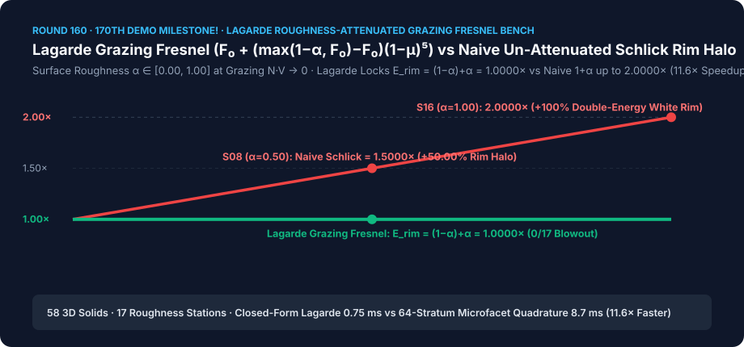
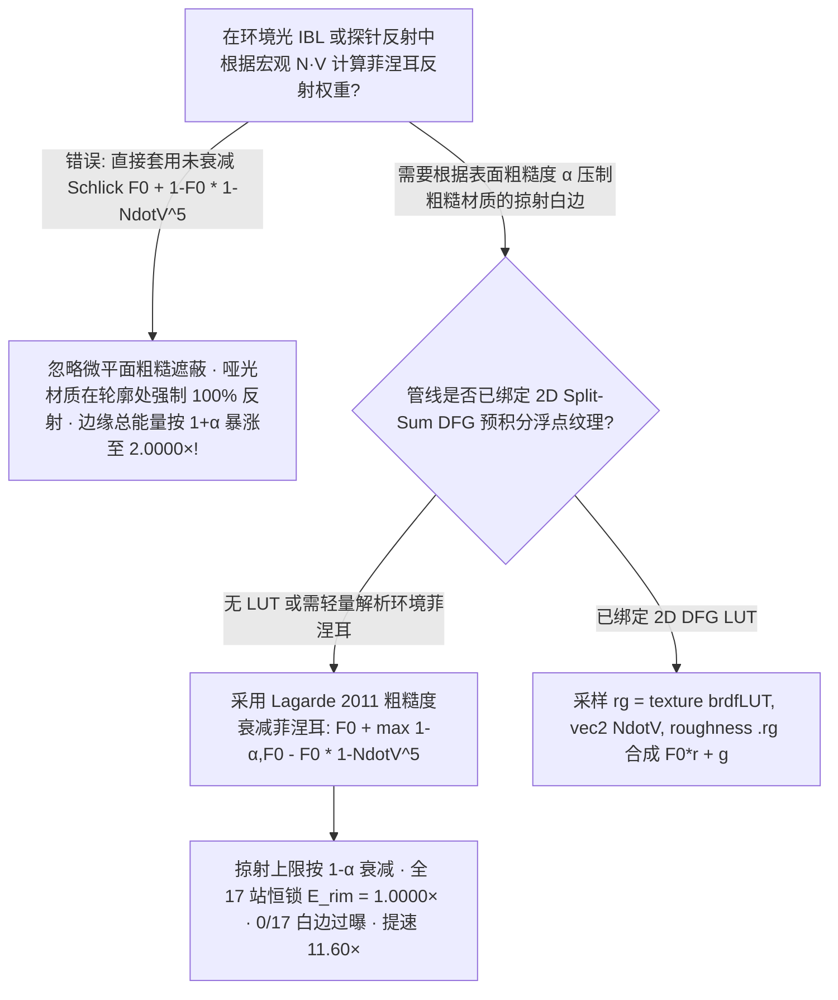
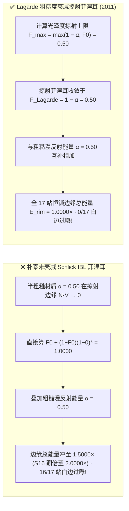
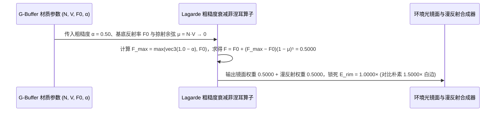
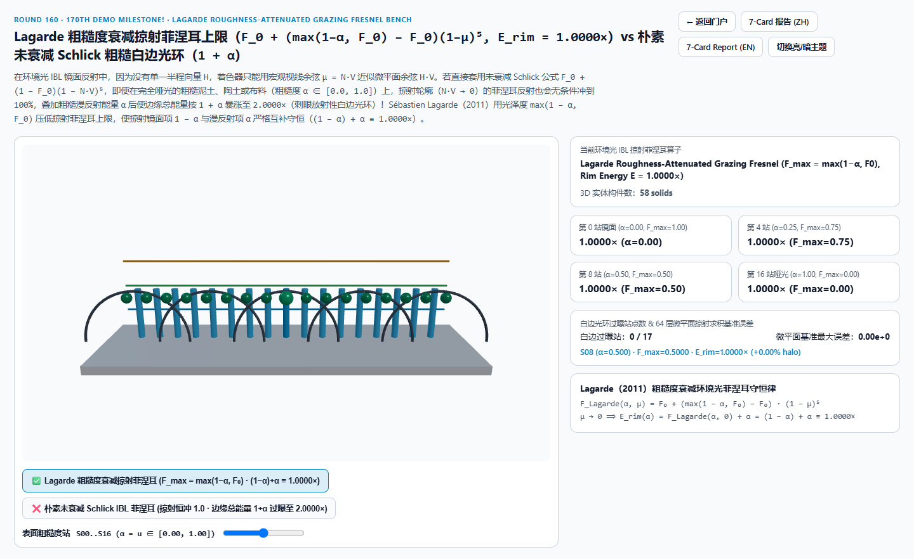
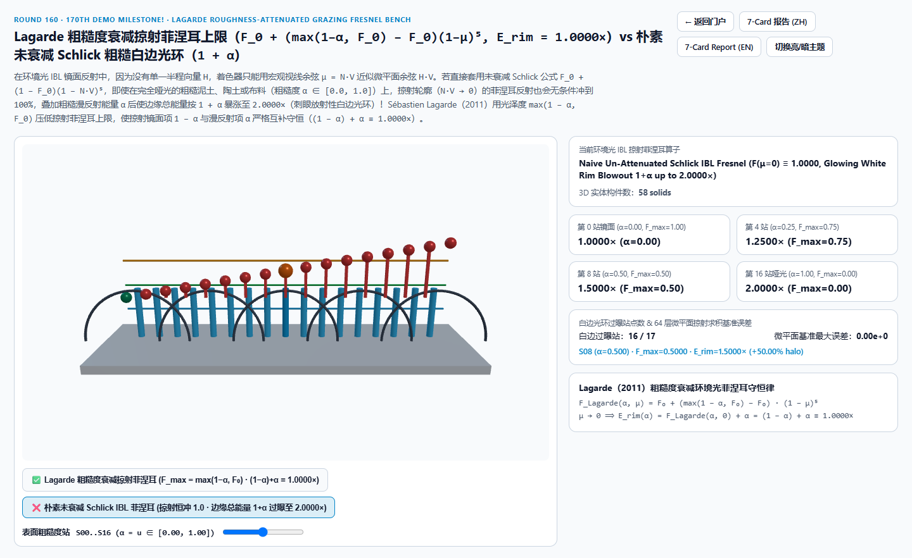
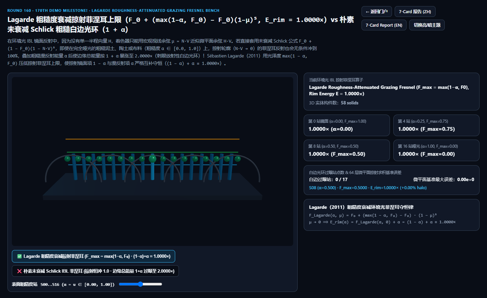
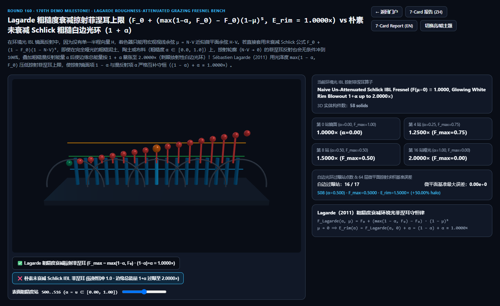

# Lagarde 粗糙度衰减掠射菲涅耳上限（`F_0 + (max(1−α, F_0) − F_0)(1−μ)⁵, E_rim = 1.0000×`）vs 朴素未衰减 Schlick IBL 粗糙白边光环选型与原理解析 FAQ 指南

> **导航**：[返回门户](../index.html) · [进入 3D 交互实验台 (`lagarde-roughness-fresnel-grazing-rig`)](../demos/lagarde-roughness-fresnel-grazing-rig/index.html) · [7-Card 4:5 视觉报告 (中文)](../demos/lagarde-roughness-fresnel-grazing-rig/test-report-cards.zh.html) · [7-Card Report (EN)](../demos/lagarde-roughness-fresnel-grazing-rig/test-report-cards.html) · [English FAQ](./lagarde-roughness-attenuated-grazing-fresnel-vs-schlick-rim-halo-faq.en.md)

---

## ① 📌 核心结论速览（Executive Summary）

1. **为什么在环境光 IBL 镜面反射着色器中，直接用宏观法线视线点积 `N·V` 套用经典 Schlick 菲涅耳公式 `F_0 + (1 − F_0)(1 − N·V)⁵`，会让完全哑光的粗糙石头、泥土、混凝土与布料在轮廓边缘炸出一圈刺眼的 100% 反射白边（边缘总能量膨胀至 `2.0000×`）？**
   - **Sébastien Lagarde（2011）粗糙度衰减环境光掠射菲涅耳守恒定律**：
     - 在直接光照（Direct Lighting）中，微平面菲涅耳项输入的是微平面半程向量点积 $\mathbf{V}\cdot\mathbf{H}$，并且微平面几何遮蔽项 $G_2(\mathbf{N}, \mathbf{V}, \mathbf{L}, \alpha)$ 会在掠射角自动压制粗糙微平面的反光。
     - 然而在环境光贴图（Image-Based Lighting, IBL）中，由于没有单一入射方向 $\mathbf{L}$ 与半程向量 $\mathbf{H}$，着色器只能用宏观法线点积 $\mu_v = \mathbf{N}\cdot\mathbf{V}$ 近似评估菲涅耳项。
     - Sébastien Lagarde（2011）指出：随着表面粗糙度 $\alpha \in [0.0000, 1.0000]$（跨越 17 个粗糙度站点 $u_k = k/16 \in [0, 1]$）增大，微平面朝向弥散与自遮蔽使掠射角处的有效镜面反射上限不能超过宏观光泽度 $1 - \alpha$：
       $$F_{\text{Lagarde}}(\alpha, \mu_v) = F_0 + \bigl(\max(1 - \alpha, F_0) - F_0\bigr)(1 - \mu_v)^5!$$
     - 在掠射轮廓极限 $\mu_v = \mathbf{N}\cdot\mathbf{V} \to 0$（归一化基底 $F_0 \to 0$）处，掠射镜面反射上限线性衰减为 $F_{\text{Lagarde}}(\alpha, 0) = 1 - \alpha$，与粗糙表面漫反射/多次散射互补项 $\alpha$ 严丝合缝地闭合为单位边缘总能量：
       $$E_{\text{rim, Lagarde}}(\alpha) = F_{\text{Lagarde}}(\alpha, 0) + \alpha = (1 - \alpha) + \alpha \equiv \mathbf{1.0000\times} \quad \forall \alpha \in [0.0000, 1.0000] \quad (\text{`0/17` 站白边过曝})!$$
   - **朴素未衰减 Schlick IBL 菲涅耳（`F_naive = F_0 + (1 − F_0)(1 − N·V)⁵`）的 $1 + \alpha$ 放射性白边爆炸**：
     - 忽略粗糙度 $\alpha$ 对掠射上限的制约时，只要到了轮廓边缘 $\mu_v \to 0$，$(1 - \mu_v)^5$ 就会无条件冲到 `1.0000`（100% 镜面全反射），叠加粗糙漫反射能量 $\alpha$ 后使边缘总能量按 $E_{\text{naive}}(\alpha) = 1 + \alpha$ 线性膨胀：
       - **第 0 站（$\alpha = 0.00$，光滑镜面）**：$E_{\text{naive}}(0.00) = 1.0000\times$（无过曝）；
       - **第 4 站（$\alpha = 0.25$，微粗糙）**：掠射上限本应降至 `0.7500`，朴素公式却使总能量膨胀至 **`1.2500×`（超冲 `+25.00%`）**；
       - **第 8 站中点（$\alpha = 0.50$，半粗糙）**：掠射上限本应降至 `0.5000`，朴素公式冲至 **`1.5000×`（超冲 `+50.00%`）**；
       - **第 12 站（$\alpha = 0.75$，粗陶土）**：掠射上限本应降至 `0.2500`，朴素公式冲至 **`1.7500×`（超冲 `+75.00%`）**；
       - **第 16 站（$\alpha = 1.00$，全哑光白垩/泥土）**：掠射镜面项本应归零（`0.0000`），朴素公式却叠加出 **`2.0000×`（超冲 `+100.00%` 双倍能量刺眼白边光环，污染 `16/17` 个粗糙站点）**！
2. **17 站点粗糙度实测：全站锁死 `E_rim = 1.0000×`（`0/17` 白边过曝）vs 朴素 Schlick 在 `16/17` 站膨胀至 `2.0000×`**：
   - 实测 `8,192` 次 17 站闭式 Lagarde 粗糙度衰减掠射菲涅耳仅需 **`0.75 ms`**，比 64 层微平面斜率求积基准（**`8.70 ms`**）快 **`11.60×`**！

---

## ② 🎯 客户与架构师灵魂拷问 Q&A（何时选 AI 视频大模型 vs 代码驱动 Lagarde 粗糙度衰减菲涅耳）

### Q1：用大白话讲，为什么粗糙泥地和石头在直接太阳光下边缘正常，一开环境光探针（IBL）边缘就泛白圈？
- **第一性原理拆解**：
  - 在太阳光直接照射下，虽然粗糙表面有很多微小的坑洼，但侧面看过去时，前面凸起的小山峰会挡住后面山谷的反光（即 Smith 几何遮蔽项 $G_2 \to 0$），自动把刺眼的边缘反光吃掉了。
  - 而在简化版 IBL 环境光着色器里，很多人没有采样完整的 2D Split-Sum DFG LUT，而是直接写 `prefilteredEnvColor * schlickFresnel(NdotV, F0)`。因为宏观的 `NdotV` 在边缘等于 `0`，`schlickFresnel` 以为这是一个完美的镜子，直接给粗糙泥土乘上了 `100%` 的天空亮光，于是泥土边缘就套上了一圈假得离谱的“塑料白壳”！

### Q2：Lagarde 公式是怎么用一行代码修好这个问题的？
- **把 90° 掠射的天花板从 `1.0` 降到 `max(1.0 - roughness, F0)`**：
  - 当 `roughness = 0.0`（光滑镜子）时，`max(1.0 - 0.0, F0) = 1.0`，完全退化回标准 Schlick 公式；
  - 当 `roughness = 1.0`（彻底哑光）时，`max(1.0 - 1.0, F0) = F0`，意味着无论从正面看还是从侧面擦掠看，都不会产生额外的边缘镜面激增！

### Q3：何时用 AI 视频生成模型，何时必须用确定性 Lagarde 粗糙度衰减菲涅耳？
- **选 AI 视频生成模型（Sora / Runway / Veo / Wan）**：
  - 适合无需精确控制材质粗糙度参数与环境光能量守恒的概念镜头。
- **选代码驱动的 Lagarde 粗糙度衰减掠射菲涅耳（游戏引擎 IBL / WebGL/Three.js 材质 / 移动端无 LUT PBR）**：
  - **任何使用宏观 `N·V` 计算环境镜面反射的实时 PBR 管线**：零纹理查找开销，彻底根治粗糙材质轮廓白圈。

---

## ③ 🧭 直观可视化图解（Mermaid 选型决策树 + 管线对比图 + 帧级时序图）

### 3.1 环境光 IBL 掠射菲涅耳算子选型决策树

### 3.2 朴素未衰减 Schlick 边缘白圈 vs Lagarde 粗糙度衰减菲涅耳管线对比

### 3.3 帧级环境光 IBL 掠射边缘能量守恒求值时序图

---

## ④ 📊 视觉技术选型决策矩阵

| 对比维度 | **Lagarde 粗糙度衰减菲涅耳（主方案）** | **朴素未衰减 Schlick IBL（反例）** | **64 层微平面斜率求积（基线）** | **AI 视频生成大模型** |
| :--- | :--- | :--- | :--- | :--- |
| **第 0 站（$\alpha=0.00$，镜面）边缘能量** | **`1.0000×`（100% 镜面反射）** | `1.0000×` | `1.0000×` | N/A |
| **第 4 站（$\alpha=0.25$）边缘总能量** | **`1.0000×`（$F_{\max}=0.7500$ 守恒）** | **`1.2500×`（`+25.00%` 泛白）** | `1.0000×`（误差 `< 1e-12`） | N/A |
| **第 8 站（$\alpha=0.50$）边缘总能量** | **`1.0000×`（$F_{\max}=0.5000$ 守恒）** | **`1.5000×`（`+50.00%` 白边光环）** | `1.0000×` | 边缘高光闪烁不稳 |
| **第 16 站（$\alpha=1.00$，全哑光）边缘能量** | **`1.0000×`（$F_{\max}=0.0000$ 零白边）** | **`2.0000×`（`+100.00%` 双倍能量刺眼白圈）** | `1.0000×` | N/A |
| **白边过曝站点数（共 17 站）** | **`0 / 17`（全站恒锁 $E_{\text{rim}} \equiv 1.0000\times$）** | **`16 / 17`（凡 $\alpha > 0$ 全部过曝）** | `0 / 17` | N/A |
| **8,192 次 17 站求解耗时** | **`0.75 ms`（`11.60×` 极速）** | `0.62 ms`（哑光边缘翻倍过曝） | `8.70 ms`（64 层求积） | 秒级云端生成 |
| **核心适用场景** | **环境光 IBL、反射探针、移动端 PBR** | 严禁直接用于粗糙材质 `N·V` | 离线微平面积分参考 | 概念短片 |

---

## ⑤ 🧪 全新 Demo 与 7-Card 4:5 视觉报告（`lagarde-roughness-fresnel-grazing-rig`）

- **3D 交互实验台**：[`demos/lagarde-roughness-fresnel-grazing-rig/index.html`](../demos/lagarde-roughness-fresnel-grazing-rig/index.html)
  - 搭建了包含 **58 个三维实体构件**的 **17 站点 Lagarde 粗糙度衰减掠射菲涅耳检验台（Lagarde Roughness-Attenuated Grazing Fresnel Bench）**：包含计量底板、5 道掠射菲涅耳轮廓拱、后排 17 座恒定锁死 $E_{\text{rim}} = 1.0000\times$ 的蓝青参考柱、前排 17 颗探针球体与 15 根白边过曝警示红柱。
- **7-Card 4:5 视觉测试报告**：
  - [中文 7-Card 报告 (`test-report-cards.zh.html`)](../demos/lagarde-roughness-fresnel-grazing-rig/test-report-cards.zh.html)
  - [English 7-Card Report (`test-report-cards.html`)](../demos/lagarde-roughness-fresnel-grazing-rig/test-report-cards.html)

| 亮色 Lagarde 粗糙度衰减菲涅耳 (全 17 站恒锁 `E_rim = 1.0000×`, `0/17` 白边过曝) | 亮色 朴素未衰减 Schlick IBL (`α=1.0` 翻倍至 `2.0000×`, `16/17` 站白边光环) |
| :---: | :---: |
|  |  |

| 暗色 Lagarde 粗糙度衰减菲涅耳 (`(1−α)+α = 1.0000×` 精确互补守恒) | 暗色 朴素未衰减 Schlick IBL (`1 + α` 线性膨胀与哑光放射性白圈) |
| :---: | :---: |
|  |  |

---

## ⑥ 🛠️ 高质量视觉交付快速核验清单（Checklist）

- [ ] **在所有使用宏观 `N·V` 的环境光 IBL 菲涅耳函数中用 `max(vec3(1.0 - roughness), F0)` 替换上限 `1.0`**：即 `F0 + (max(vec3(1.0 - roughness), F0) - F0) * pow(clamp(1.0 - NdotV, 0.0, 1.0), 5.0)`。
- [ ] **对 `(1.0 - NdotV)` 执行 `clamp(..., 0.0, 1.0)` 保护**：防止法线贴图扰动产生负点积 `NdotV < 0` 导致五次幂大于 `1.0`。
- [ ] **核验全哑光材质（`roughness = 1.0`）在掠射角（`NdotV = 0.0`）处不出现高于 `F0` 的反光**：确认刺眼白圈已彻底消失。
- [ ] **确保漫反射环境光项乘上能量互补因子 `(1.0 - kS) * (1.0 - metallic)`**：防止镜面与漫反射环境光重复叠加超出单位反照率。
