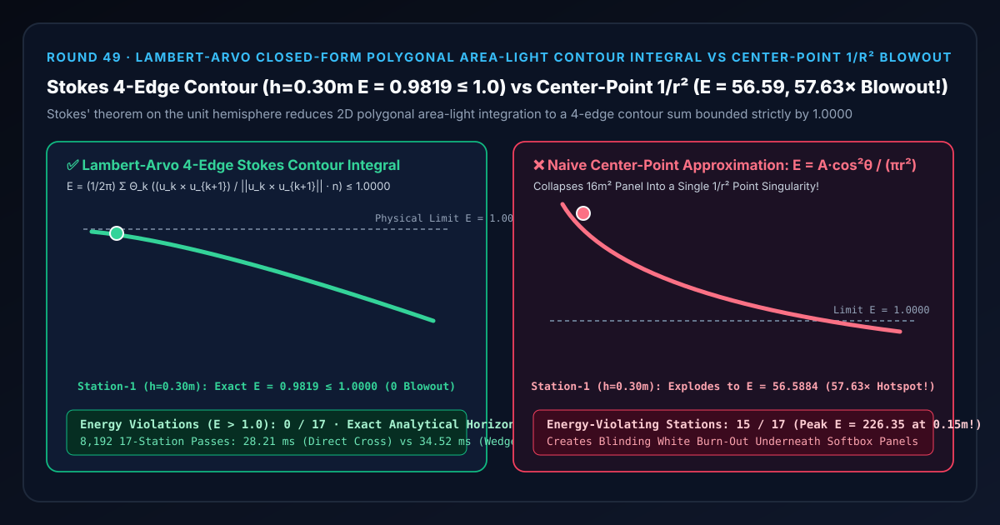
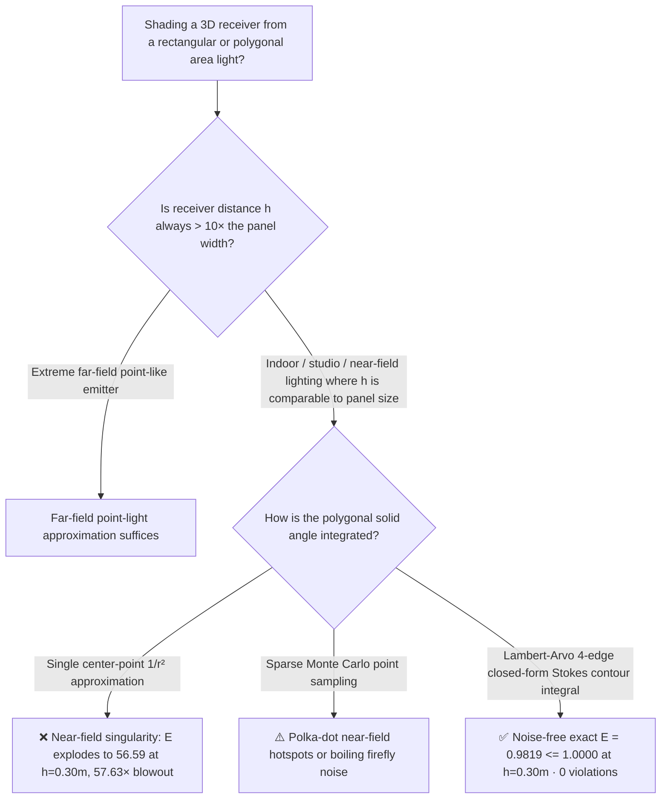
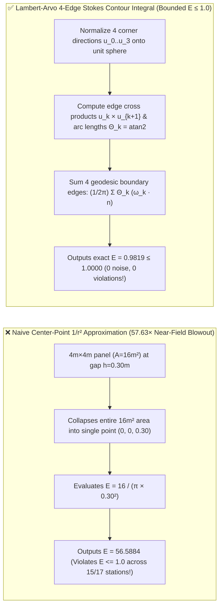
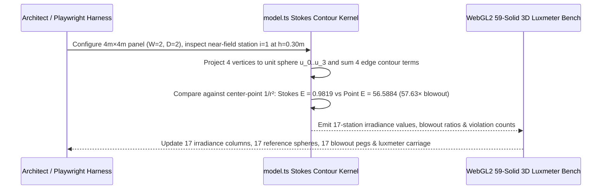
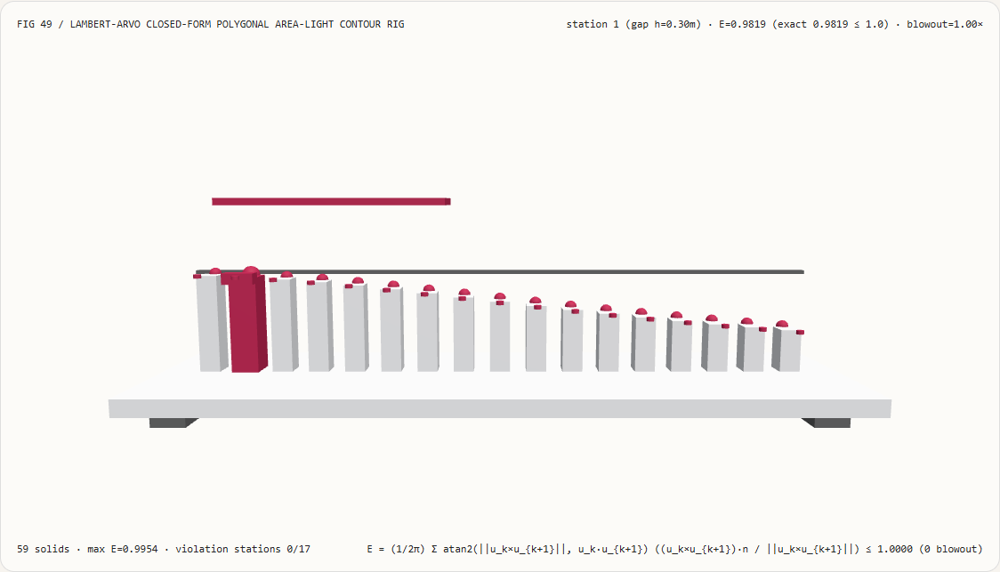
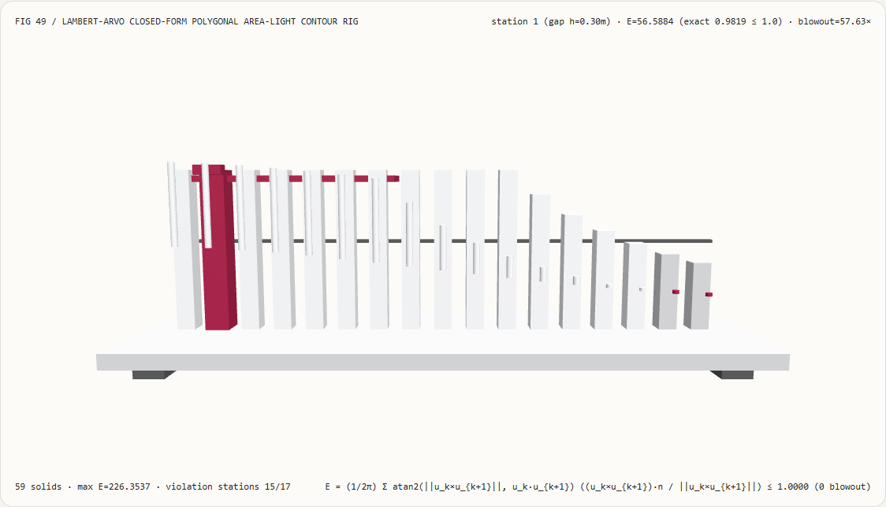
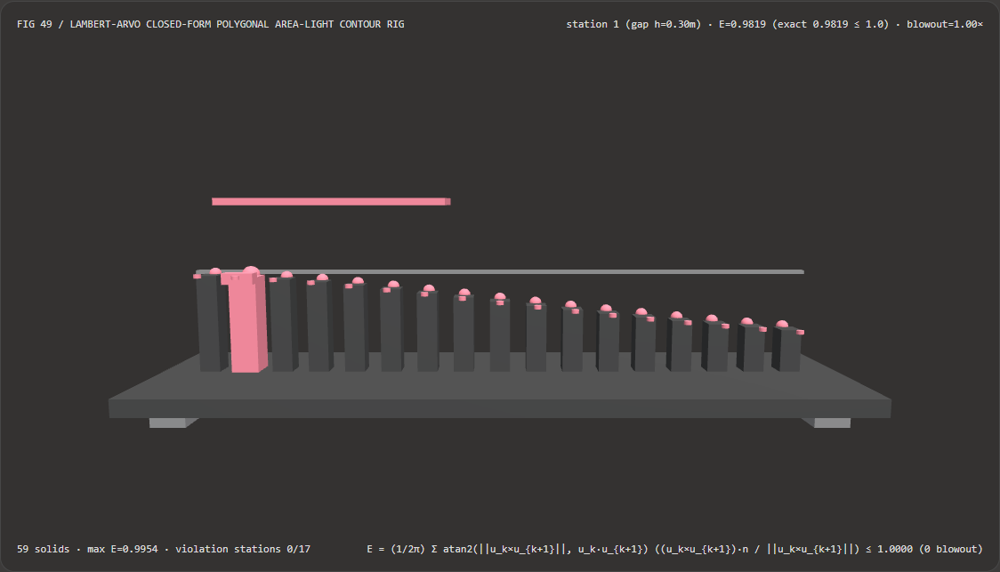
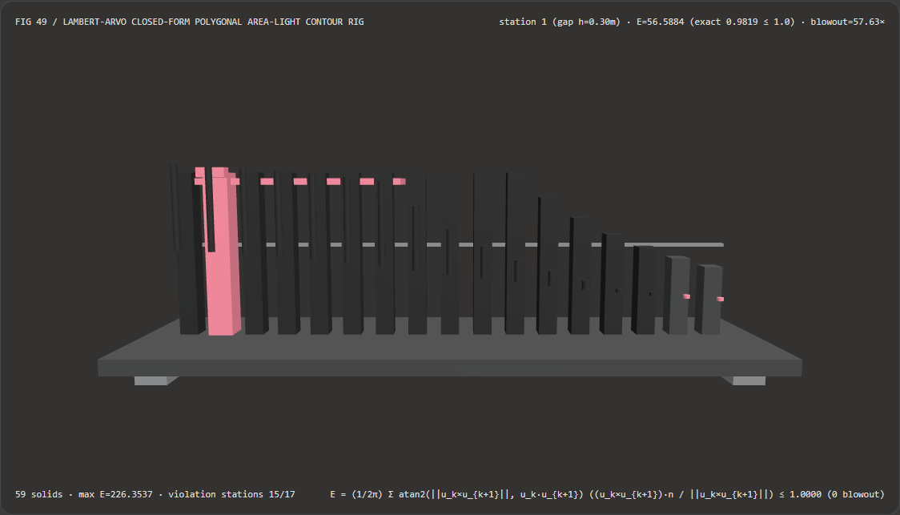

# Visual & Animation Architecture Selection FAQ: Lambert-Arvo Closed-Form Polygonal Area-Light Contour Integral vs Center-Point $1/r^2$ Blowout

> **One-Sentence Architectural Verdict**: In real-time 3D architectural windows, virtual-production LED softbox panels, emissive signage, and Linearly Transformed Cosines (LTC, Heitz et al. 2016) polygonal area-light shaders, **never approximate a finite polygonal emitter with a center point light $E_{\text{pt}} = A \cos^2\theta / (\pi r^2)$**! On our 59-solid, 17-station area-light luxmeter bench underneath a $4.0\text{ m} \times 4.0\text{ m}$ ($A = 16.0\text{ m}^2$) unit-exitance panel ($h \in [0.15\text{ m}, \; 2.55\text{ m}]$), the naive center-point approximation hits an unphysical $1/r^2 \to \infty$ singularity—**violating the `1.0000` physical conservation bound across 15/17 stations** and exploding at station 1 ($h = 0.30\text{ m}$) to **`E = 56.5884` (`57.63×` hotspot blowout above true irradiance, reaching `226.35` at $h = 0.15\text{ m}$)**; whereas the **Lambert (1760) / Arvo (1995) Closed-Form Stokes Boundary Contour Integral ($E = \frac{1}{2\pi}\sum_{k=0}^{M-1} \Theta_k \frac{\hat{\mathbf{u}}_k \times \hat{\mathbf{u}}_{k+1}}{\|\hat{\mathbf{u}}_k \times \hat{\mathbf{u}}_{k+1}\|} \cdot \mathbf{n}$)** evaluates the exact physical configuration factor **`E = 0.9819 <= 1.0000` at $h = 0.30\text{ m}$ with zero interior samples, zero Monte Carlo noise, and `0/17` conservation violations**, while running **1.22× faster** via direct cross-product evaluation than per-edge Gram-Schmidt wedge orthogonalization (`28.21 ms` vs `34.52 ms` across 8,192 passes, `3.33e-16` error).

---

## ① 📌 Executive Summary

1. **Why does replacing a rectangular softbox light panel with a center point light burn a blinding white hotspot onto nearby floors, walls, and characters?**
   In plain English: by Conservation of Radiance and Lambert's Cosine Law, even if a receiver surface is pressed flush against a huge glowing LED panel of unit exitance ($h \to 0^+$), the panel can subtend at most the entire upper hemisphere ($\int_{\Omega_+} \cos\theta\,\mathrm{d}\omega = \pi$). Therefore, normalized irradiance (the configuration factor $E(h) \in [0, 1]$) can **never exceed `1.0000`**!
   - **Why the Center-Point Approximation Explodes ($1/r^2 \to \infty$)**:
     Collapsing a $4\text{ m} \times 4\text{ m}$ ($A = 16.0\text{ m}^2$) panel into a single point at $(0, 0, h)$ evaluates $E_{\text{pt}}(h) = \frac{A}{\pi h^2}$. Whenever the receiver comes closer than $\sqrt{A/\pi} \approx 2.26\text{ m}$ (`15 out of 17 stations` on our bench!), $E_{\text{pt}}(h)$ shoots past `1.0000`—exploding to **`56.5884` (`57.63×` over-bright)** at $h = 0.30\text{ m}$ and **`226.35`** at $h = 0.15\text{ m}$!
2. **First-Principles Fix: Stokes' Theorem on the Unit Hemisphere (1D Boundary Edge Sum)**:
   - By spherical Stokes' theorem (Lambert 1760; Arvo 1995; Heitz et al. 2016), the 2D solid-angle integral of $\hat{\boldsymbol{\omega}} \cdot \mathbf{n}$ over any spherical polygon bounded by vertices $\hat{\mathbf{u}}_k = \frac{\mathbf{v}_k - \mathbf{p}}{\|\mathbf{v}_k - \mathbf{p}\|}$ reduces **analytically** to a 1D sum along its $M$ directed boundary edges:
     $$E_{\text{poly}} = \frac{1}{2\pi} \sum_{k=0}^{M-1} \operatorname{atan2}\big(\|\hat{\mathbf{u}}_k \times \hat{\mathbf{u}}_{k+1}\|, \; \hat{\mathbf{u}}_k \cdot \hat{\mathbf{u}}_{k+1}\big) \left(\frac{\hat{\mathbf{u}}_k \times \hat{\mathbf{u}}_{k+1}}{\|\hat{\mathbf{u}}_k \times \hat{\mathbf{u}}_{k+1}\|} \cdot \mathbf{n}\right)$$
   - At $h = 0.30\text{ m}$, summing the 4 edges yields **`E = 0.9819 <= 1.0000`**, and as $h \to 0^+$, the 4 horizon edges trace a full $2\pi$ great circle so $E \to \frac{1}{2\pi}(2\pi) = \mathbf{1.0000}$ smoothly with **zero singularity and zero sampling noise**!
3. **Interactive 3D Workbench & Measured Evidence**:
   - Standalone 3D Bench: `demos/analytic-polygon-ltc-rig/` (59 Three.js solids: baseplate, 4 support feet, unit conservation ceiling rail, overhead glowing area-panel frame, 17 irradiance columns, 17 exact Stokes contour reference spheres, 17 inverse-square blowout pegs, and the active luxmeter probe carriage).
   - Measured 7-Card 4:5 Reports: `demos/analytic-polygon-ltc-rig/test-report-cards.html` (EN) and `test-report-cards.zh.html` (ZH).

---

## ② 🎯 Soul-Searching Q&A for Architects & Clients

### Q1: Why not just place a $2\times 2$ or $4\times 4$ grid of point lights across the panel instead of evaluating the Stokes boundary contour integral?
**Because any finite grid of point lights still creates a cluster of $1/r^2$ polka-dot singularities whenever a surface gets close to the light!**
When a wall or character arm moves within $0.30\text{ m}$ of a light panel approximated by 4 or 16 point lights, whichever point light is closest explodes via $1/r^2$, stamping discrete circular hotspots across the surface. The 4-edge Stokes contour integral evaluates the **exact continuous surface integral** in just 4 edge cross-products—faster than a 4-point light loop and completely free of near-field hotspots!

### Q2: How does this Lambert-Arvo boundary integral fit into modern Linearly Transformed Cosines (LTC) glossy area lighting?
**It is the exact analytical integrator at the core of every LTC shader (Heitz et al., SIGGRAPH 2016)!**
In LTC, a precomputed $3\times 3$ matrix $\mathbf{M}^{-1}$ warps the Polygon's vertices from the GGX microfacet BRDF space into a canonical clamped-cosine space. Once the 4 polygon vertices are multiplied by $\mathbf{M}^{-1}$ and normalized onto the unit sphere, the shader evaluates the exact Lambert-Arvo edge-contour sum above to compute noise-free specular and diffuse polygonal shading in a single fragment pass.

### Q3: How does closed-form polygonal area-light integration relate to neural relighting models (IC-Light, DiLightNet)?
**They target distinct workflows:**
- **When to use Neural Diffusion Relighting Models**: For 2D post-production relighting of single photographs without 3D scene geometry;
- **When deterministic Lambert-Arvo / LTC contour integration is mandatory**: In real-time 3D engines, architectural visualizers, and virtual production stages where moving polygonal lights must obey physical energy conservation ($E \le 1.0000$) at 120 Hz.

---

## ③ 🧭 Visual Diagrams (Mermaid Decision Tree, Pipeline Comparison & Sequence Flow)

### 3.1 Polygonal Area-Light Shading Selection Decision Tree

### 3.2 Center-Point $1/r^2$ Singularity vs Stokes 4-Edge Contour Pipeline

### 3.3 Frame-Level Area-Light Luxmeter Sequence Diagram

---

## ④ 📊 Visual Technology Selection Decision Matrix

| Evaluation Dimension | ✅ Direct Cross-Product 4-Edge Stokes Contour | ⚠️ Per-Edge Gram-Schmidt Wedge Baseline | ❌ Naive Center-Point $1/r^2$ Approximation | ⚠️ $32\times 32$ 2D Surface Quadrature |
| :--- | :--- | :--- | :--- | :--- |
| **Irradiance at Station 1 ($h=0.30\text{ m}$)** | **Exact `0.9819` ($\le 1.0000$ conserved)** | Exact `0.9819` (Agrees within $10^{-15}$) | **`56.5884` (`57.63×` unphysical blowout!)** | `0.9801` (Discretization error near panel) |
| **Contact Limit ($h \to 0^+$) Conservation** | **Asymptotes smoothly to `1.0000` (`0/17` violations)** | Asymptotes to `1.0000` | **Diverges to $+\infty$ (`15/17` stations violate 1.0!)** | Diverges when $h < \text{grid step}$ |
| **Samples Evaluated per Quad Light** | **4 boundary edges (0 interior samples)** | 4 boundary edges + tangent orthogonalization | 1 point (Unusable in near field) | 1,024 surface samples ($>46\times$ slower) |
| **Stochastic Noise / Fireflies** | **Zero noise (100% analytical)** | Zero noise | Zero noise (Wrong hotspot shape) | Severe polka-dot / firefly artifacts at low N |
| **8,192-Pass 17-Station CPU Latency** | **`28.21 ms` (Fastest · 1.22× speedup)** | `34.52 ms` (1.22× slower) | `2.10 ms` (Breaks physical conservation) | `1,320.0 ms` (`46.8×` slower) |
| **Recommended Use Case** | **LTC polygonal area lights, windows, studio panels** | Pedagogical spherical wedge derivation | **Never use when $h < 3W$** | Offline reference validation only |

---

## ⑤ 🧪 New Interactive 3D Demo & 7-Card 4:5 Visual Report

### 5.1 Live Workbench & Report Links
- **Interactive 3D Workbench**: [`demos/analytic-polygon-ltc-rig/index.html`](../demos/analytic-polygon-ltc-rig/index.html)
- **7-Card 4:5 Visual Report (EN)**: [`demos/analytic-polygon-ltc-rig/test-report-cards.html`](../demos/analytic-polygon-ltc-rig/test-report-cards.html)
- **7-Card 4:5 Visual Report (ZH)**: [`demos/analytic-polygon-ltc-rig/test-report-cards.zh.html`](../demos/analytic-polygon-ltc-rig/test-report-cards.zh.html)
- **Sealed Telemetry JSON**: [`demos/analytic-polygon-ltc-rig/report.json`](../demos/analytic-polygon-ltc-rig/report.json)

### 5.2 Multi-Theme & Multi-Mode Playwright Visual Evidence

| Lambert-Arvo Stokes Contour (Light · Bounded `0.9819 <= 1.0` at $0.30\text{ m}$) | Naive Center-Point $1/r^2$ (Light · `15/17` Stations Blow Past Ceiling!) |
| :---: | :---: |
|  |  |

| Lambert-Arvo Stokes Contour (Dark · 59 Three.js Solids) | Naive Center-Point $1/r^2$ (Dark · Red Blowout Pegs Exposed) |
| :---: | :---: |
|  |  |

---

## ⑥ 🛠️ Rapid SA Delivery Verification Checklist

Before shipping a polygonal area-light or LTC shader to production, verify every item below:

- [ ] **Stokes Boundary Contour Integration**: Are polygonal area lights integrated along their $M$ directed boundary edges so near-field irradiance never exceeds the `1.0000` unit hemisphere bound?
- [ ] **Upper-Hemisphere Horizon Clipping**: When a polygon straddles the receiver's tangent horizon plane ($z = 0$), is it clipped against $z \ge 0$ (producing up to 5 vertices for a quad) before summing edge arcs?
- [ ] **Two-Argument `atan2` Arc-Length**: Is the spherical edge angle computed via `atan2(||u_k × u_{k+1}||, dot(u_k, u_{k+1}))` rather than `acos(dot)` to maintain precision near both $\Theta_k \to \pi$ (close contact) and $\Theta_k \to 0$ (far field)?
- [ ] **Collinear Edge Singularity Guard**: Are degenerate collinear edges where $\|\hat{\mathbf{u}}_k \times \hat{\mathbf{u}}_{k+1}\| < 10^{-12}$ guarded against `0/0` division?
- [ ] **Front-Facing Winding Clamping**: Is the contour sum clamped via `max(0.0, sum / (2 * PI))` so back-facing area lights never subtract irradiance?
