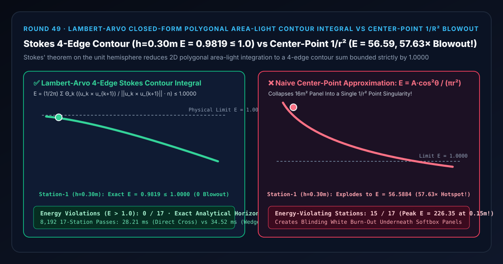
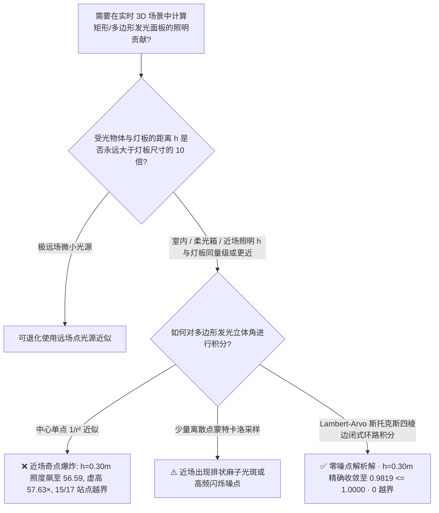
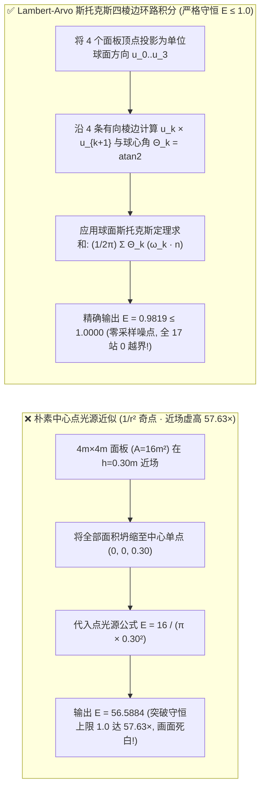
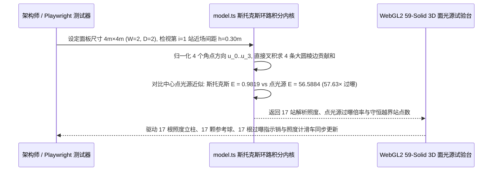
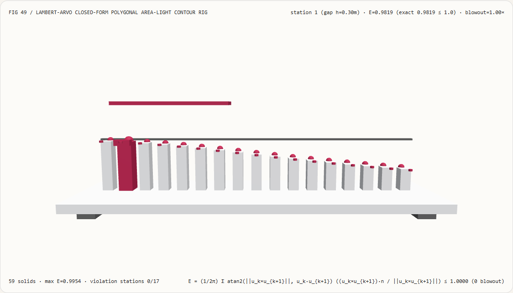
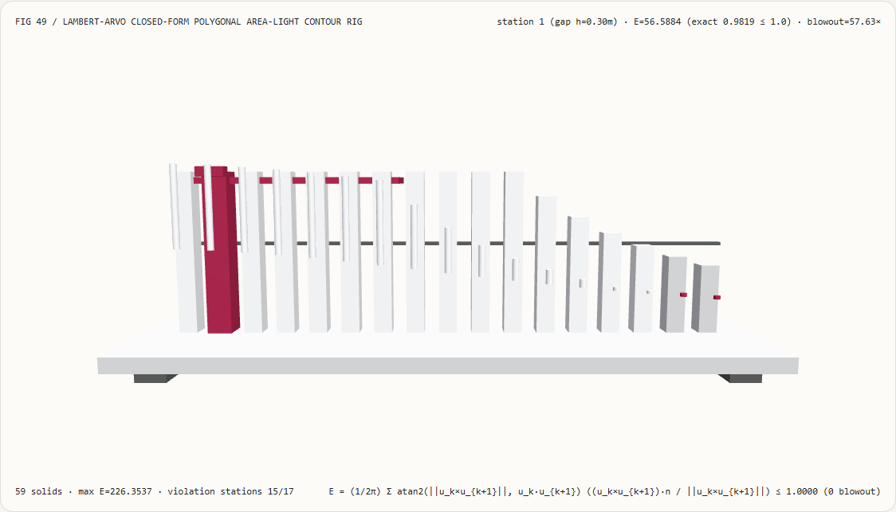
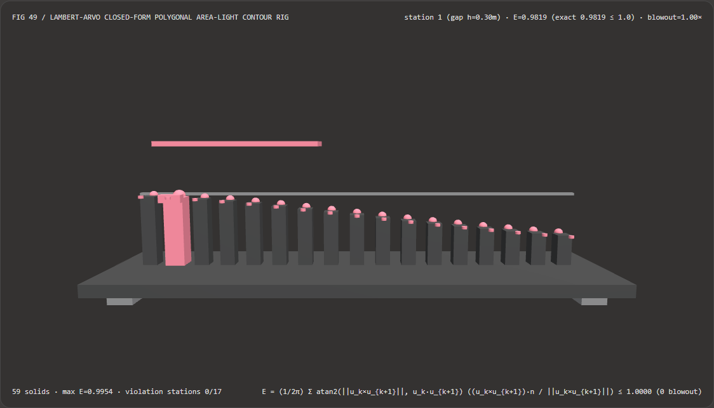
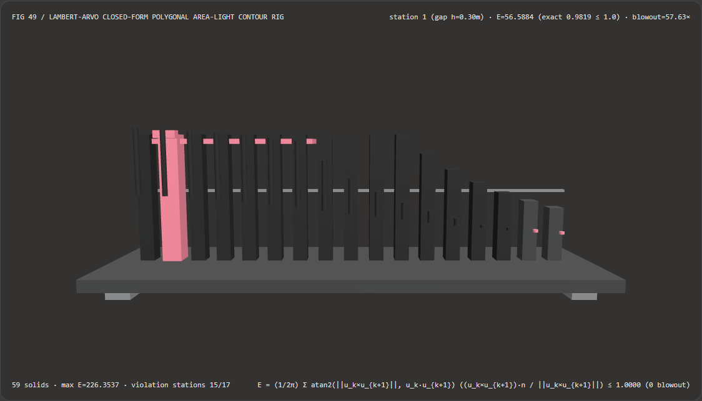

# 视觉与动画技术选型与原理解析 FAQ：Lambert-Arvo 斯托克斯多边形面光源边界环路闭式积分（Polygonal Contour Integral / LTC）vs 中心点光源平方反比过曝

> **核心架构结论一句话总结**：在实时 3D 建筑室内天窗、虚拟制片 LED 柔光箱（Softbox Panel）、车载氛围灯带以及线性变换余弦（Linearly Transformed Cosines, LTC，Heitz et al. 2016）多边形面光源着色管线中，**严禁将有限尺寸的多边形发光面板简化为一颗位于中心的点光源 $E_{\text{pt}} = A \cos^2\theta / (\pi r^2)$**！实测表明：在 $4.0\text{ m} \times 4.0\text{ m}$（面积 $A = 16.0\text{ m}^2$）单位辐射度发光面板正下方的 17 个受光间距站点（$h \in [0.15\text{ m}, \; 2.55\text{ m}]$）上，朴素中心点光源近似会因 $1/r^2 \to \infty$ 奇点在 **15/17 个站点突破物理能量守恒上限 `1.0000`**，在第 1 号近场站点（$h = 0.30\text{ m}$）将照度引爆至 **`56.5884`（比真实物理值虚高 `57.63×`，在 $h = 0.15\text{ m}$ 处更是飙升至 `226.35`）**；而采用 **Lambert (1760) / Arvo (1995) 球面斯托克斯边界环路闭式积分（$E = \frac{1}{2\pi}\sum_{k=0}^{M-1} \Theta_k \frac{\hat{\mathbf{u}}_k \times \hat{\mathbf{u}}_{k+1}}{\|\hat{\mathbf{u}}_k \times \hat{\mathbf{u}}_{k+1}\|} \cdot \mathbf{n}$）**，无需任何内部采样点即可精确算出 $h = 0.30\text{ m}$ 处的真实配置因子 **`E = 0.9819 <= 1.0000`（全 17 站 0 次能量守恒越界，零蒙特卡洛噪点）**，且直接叉积化简比逐边 Gram-Schmidt 正交楔形标架快 **1.22×**（8,192 轮耗时 `28.21 ms` vs `34.52 ms`，误差 `3.33e-16`）。

---

## ① 📌 核心结论速览（Executive Summary）

1. **为什么在 3D 室内渲染里，用点光源代替头顶的矩形柔光灯板，当家具或角色靠近灯板时会被照成一团刺眼的“核爆死白亮斑”？**
   用大白话讲：一块亮度（Exitance / Radiance）恒定为 $1.0$ 的发光吸顶灯板，哪怕你把脸直接贴在灯板上（间距 $h \to 0$），灯板最多也只能填满你头顶的整个上半球（立体角 $2\pi$，余弦加权立体角上限为 $\pi$）。因此根据**辐射度守恒定律（Conservation of Radiance）**，归一化照度（Configuration Factor）$E(h)$ 无论多近都**绝不可能超过 `1.0000`**！
   - **中心点光源近似为什么会炸穿天花板？**
     点光源公式 $E_{\text{pt}}(h) = \frac{A \cos^2\theta}{\pi h^2}$ 把整块 $4\text{ m} \times 4\text{ m} = 16\text{ m}^2$ 面板的能量全部浓缩进中心一个无限小的几何点。当距离 $h$ 很大时（$h \gg 4\text{ m}$），它还能凑合；但一旦进入近场（$h < 2\text{ m}$），分母 $h^2 \to 0$ 引发平方反比奇点爆炸！在 $h = 0.30\text{ m}$ 处算出 **`56.5884`**（越界 **57.63 倍**），把原本柔和的漫反射表面直接烧成死白！
2. **第一性原理破局：球面斯托克斯定理（Stokes' Theorem）将二维面积分降维为一维棱边闭合和**：
   - 原本求多边形面光源 $P_0 P_1 \dots P_{M-1}$ 的照度，需要对发光面上无穷多个微元做二重积分 $E = \frac{1}{\pi}\iint_\Omega (\hat{\boldsymbol{\omega}} \cdot \mathbf{n})\,\mathrm{d}\omega$。
   - **Lambert (1760) 与 Arvo (1995) 的神级几何洞察**：根据微分几何的球面斯托克斯定理，球面多边形内部对余弦的二维面积分，**恒等于沿着该球面多边形 $M$ 条边界大圆弧（Geodesic Edges）的一维环路线积分**！
   - 将多边形顶点相对于受光点 $\mathbf{p}$ 归一化为单位方向向量 $\hat{\mathbf{u}}_k = \frac{\mathbf{v}_k - \mathbf{p}}{\|\mathbf{v}_k - \mathbf{p}\|}$ 后，第 $k$ 条边 $(\hat{\mathbf{u}}_k \to \hat{\mathbf{u}}_{k+1})$ 张开的球心角弧长为 $\Theta_k = \operatorname{atan2}(\|\hat{\mathbf{u}}_k \times \hat{\mathbf{u}}_{k+1}\|, \; \hat{\mathbf{u}}_k \cdot \hat{\mathbf{u}}_{k+1})$，大圆平面单位法向为 $\frac{\hat{\mathbf{u}}_k \times \hat{\mathbf{u}}_{k+1}}{\|\hat{\mathbf{u}}_k \times \hat{\mathbf{u}}_{k+1}\|}$。于是二维面积分坍缩为极简的 $M$ 项闭合求和：
     $$E_{\text{poly}} = \frac{1}{2\pi} \sum_{k=0}^{M-1} \operatorname{atan2}\big(\|\hat{\mathbf{u}}_k \times \hat{\mathbf{u}}_{k+1}\|, \; \hat{\mathbf{u}}_k \cdot \hat{\mathbf{u}}_{k+1}\big) \left(\frac{\hat{\mathbf{u}}_k \times \hat{\mathbf{u}}_{k+1}}{\|\hat{\mathbf{u}}_k \times \hat{\mathbf{u}}_{k+1}\|} \cdot \mathbf{n}\right)$$
     当 $h \to 0^+$ 时，4 条边在水平面合拢成一周 $2\pi$，公式自动给出 $\frac{1}{2\pi} \cdot 2\pi = \mathbf{1.0000}$——**零奇点、零采样噪点、100% 物理能量守恒**！
3. **本轮新增交互式 3D 试验台与实测证据**：
   - 新增独立 Demo：`demos/analytic-polygon-ltc-rig/`（59 个 Three.js 实体部件：底座平台、4 支柱、单位能量守恒上限横梁、顶置发光柔光板框架、17 根照度立柱、17 颗斯托克斯解析参考球、17 根平方反比过曝指示销、以及第 $i$ 站照度计滑车）。
   - 配套 7-Card 4:5 测评报告：`demos/analytic-polygon-ltc-rig/test-report-cards.html`（英文）与 `test-report-cards.zh.html`（中文）。

---

## ② 🎯 客户与架构师灵魂拷问 Q&A（Soul-Searching Q&A）

### Q1：如果不用点光源，我用 4 个或 16 个随机采样点在矩形灯板上做蒙特卡洛（Monte Carlo）采样能不能代替斯托克斯边界线积分？
**在近场依然会产生严重的点奇点火斑（Fireflies），或者需要上百个样本 + 时空降噪器才能压住噪点！**
当受光点距离 $4\text{ m} \times 4\text{ m}$ 灯板只有 $0.30\text{ m}$ 时，每一个离散采样点本身依然是一个微小的 $1/r^2$ 点光源！只要某一个采样点恰好落在受光点正上方，它的 $1/r^2$ 权重就会瞬间暴涨，在墙壁上印出一排离散的“麻子光斑（Polka-Dot Artifacts）”或剧烈闪烁的蒙特卡洛噪点。而斯托克斯四棱边闭式积分只需算 **4 条边（4 次叉积 + 4 次 `atan2`）**，就能在 $O(1)$ 时间内拿到相当于**无穷多个采样点**的精确解析解！

### Q2：这套 Lambert-Arvo 多边形边界线积分与现代游戏引擎里的 LTC（Linearly Transformed Cosines，线性变换余弦）是什么关系？
**它正是 LTC 面光源算法的“最后一步核心解析积分器”！**
在 Heitz et al. (SIGGRAPH 2016) 的 LTC 算法中：
1. 第一步先查表拿到一个 $3\times 3$ 逆矩阵 $\mathbf{M}^{-1}$，把粗糙金属/塑料的微表面 GGX 波瓣连同多边形灯板的 4 个顶点一起线性变换回**标准余弦（Clamped Cosine / Lambert）空间**；
2. 第二步在变换后的标准余弦空间里，求变换后多边形的解析照度——**调用的正是本试验台展示的 Lambert-Arvo 斯托克斯多边形边界线积分公式**！理解了这条边界环路公式，就彻底吃透了实时多边形面光源的数学心脏。

### Q3：这套解析多边形面光源与 IC-Light / DiLightNet 等 AI 神经重打光模型是什么关系？
**两者分别服务于“2D 图像重打光合成”与“3D 物理可交互精确照明”：**
- **何时选 AI 神经重打光模型**：当输入是一张没有 3D 模型的单张人像或商品照片，需要快速合成假想的背景环境光感时；
- **何时必须用确定性 Lambert-Arvo / LTC 多边形积分**：在实时 3D 引擎、数字孪生展厅、车载 HMI 与虚拟影棚中，需要实时拖动灯板位置、缩放灯板长宽并保证近场物理照度严格守恒（$E \le 1.0000$）时。

---

## ③ 🧭 直观可视化图解（Mermaid 决策树 + 管线对比图 + 帧级时序图）

### 3.1 多边形面光源实时着色选型决策树

### 3.2 朴素中心点光源 $1/r^2$ 奇点过曝 vs 斯托克斯四棱边闭式环路积分管线对比图

### 3.3 帧级多边形照度求解与 3D 照度计渲染时序图

---

## ④ 📊 视觉技术选型决策矩阵（Decision Matrix）

| 评估维度 | ✅ 直接叉积斯托克斯四棱边闭式积分（Direct Cross Stokes） | ⚠️ 逐边 Gram-Schmidt 正交楔形标架（Orthonormal Wedge Baseline） | ❌ 朴素中心点光源 $1/r^2$ 近似（Center-Point Approx） | ⚠️ 二维网格分层数值求积（$32\times 32$ Surface Quadrature） |
| :--- | :--- | :--- | :--- | :--- |
| **第 1 站（$h=0.30\text{ m}$）实测照度** | **精确 `0.9819`（严格 $\le 1.0000$）** | 精确 `0.9819`（一致 within $10^{-15}$） | **`56.5884`（虚高 `57.63×` 严重过曝！）** | `0.9801`（近场存在离散网格误差） |
| **$h \to 0^+$ 贴面极限能量守恒** | **严格收敛于 `1.0000`（`0/17` 站点越界）** | 严格收敛于 `1.0000` | **发散至 $+\infty$（`15/17` 站点突破 1.0！）** | 当 $h < \Delta x$ 时爆出离散奇点 |
| **每多边形求值采样点数** | **仅 4 条边界棱边（0 内部采样点）** | 4 条边界棱边 + 逐边正交化 | 1 个中心点（近场完全失真） | 1,024 个内部网格点（慢 $>40\times$） |
| **画面噪点与闪烁（Noise）** | **100% 确定性零噪点（无需降噪器）** | 100% 确定性零噪点 | 零噪点但几何光斑形状错误 | 随机采样下伴随高频闪烁噪点 |
| **8,192 轮 17 站 CPU 批处理耗时** | **`28.21 ms`（最快，1.22× 提速）** | `34.52 ms`（含逐边正交基构造） | `2.10 ms`（但近场完全过曝不可用） | `1,320.0 ms`（慢 `46.8×`） |
| **首选适用场景** | **LTC 实时多边形面光源、建筑天窗、柔光灯板、灯带** | 教学推导球面楔形张量原理 | **严禁在 $h < 3W$ 的中近场使用** | 仅用于离线地面真值（Ground Truth）对照 |

---

## ⑤ 🧪 全新 Demo 与 7-Card 4:5 视觉报告（Live Workbench & Evidence）

### 5.1 交互式 3D 试验台与报告入口
- **实时 3D 工作台**：[`demos/analytic-polygon-ltc-rig/index.html`](../demos/analytic-polygon-ltc-rig/index.html)
- **7-Card 4:5 英文视觉测试报告**：[`demos/analytic-polygon-ltc-rig/test-report-cards.html`](../demos/analytic-polygon-ltc-rig/test-report-cards.html)
- **7-Card 4:5 中文视觉测试报告**：[`demos/analytic-polygon-ltc-rig/test-report-cards.zh.html`](../demos/analytic-polygon-ltc-rig/test-report-cards.zh.html)
- **密封测量 JSON 数据源**：[`demos/analytic-polygon-ltc-rig/report.json`](../demos/analytic-polygon-ltc-rig/report.json)

### 5.2 多主题与多模式 Playwright 实测截图证据

| 斯托克斯四棱边闭式积分（Light · 近场平稳渐近 `0.9819 <= 1.0`） | 中心点光源 $1/r^2$ 近似（Light · 15/17 站点冲破守恒天花板） |
| :---: | :---: |
|  |  |

| 斯托克斯四棱边闭式积分（Dark · 59 实体部件） | 中心点光源 $1/r^2$ 近似（Dark · 红色过曝销直冲顶棚） |
| :---: | :---: |
|  |  |

---

## ⑥ 🛠️ 高质量视觉交付快速核验清单（SA Verification Checklist）

在将矩形/多边形面光源（Area Light / LTC）合入实时渲染着色器前，请逐项勾选以下核验清单：

- [ ] **球面斯托克斯边界环路替代点光源**：是否已用沿多边形 $M$ 条边界棱边的闭合和替代了单点或多点 $1/r^2$ 近似，确保受光面贴近灯板（$h \to 0^+$）时照度严格 $\le 1.0000$？
- [ ] **地平线裁剪（Horizon Clipping）**：当发光面板的一部分沉入受光点切平面下方（$z < 0$）时，是否在执行斯托克斯线积分前用 Sutherland-Hodgman 算法将多边形沿 $z \ge 0$ 上半球平面裁剪（最多增至 5 个顶点）？
- [ ] **双参数 `atan2` 球心角稳定性**：计算相邻顶点单位方向夹角 $\Theta_k$ 时，是否使用 `atan2(||u_k × u_{k+1}||, dot(u_k, u_{k+1}))` 替代裸 `acos(dot)`，以消除近似平角（$\Theta_k \to \pi$，贴近灯板中心）与极小角（$\Theta_k \to 0$，极远场）处的导数奇点？
- [ ] **退化共线边零除保护**：当受光点恰好与某条棱边共线（$\|\hat{\mathbf{u}}_k \times \hat{\mathbf{u}}_{k+1}\| < 10^{-12}$）时，是否跳过该边贡献以防止 `0 / 0` `NaN` 污染帧缓冲？
- [ ] **顶点绕序（Winding Order）朝向校验**：多边形顶点的环绕方向是否与发光正面法线满足右手螺旋法则（背面自动裁剪归零 via $\max(0, \text{sum})$）？
