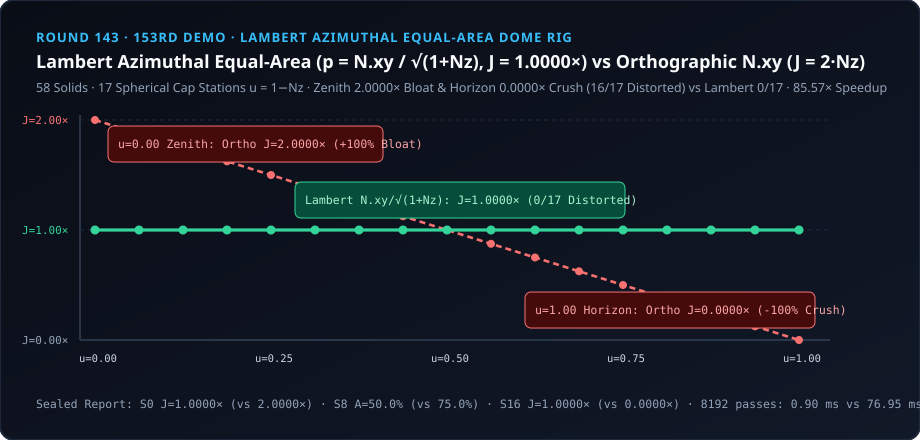
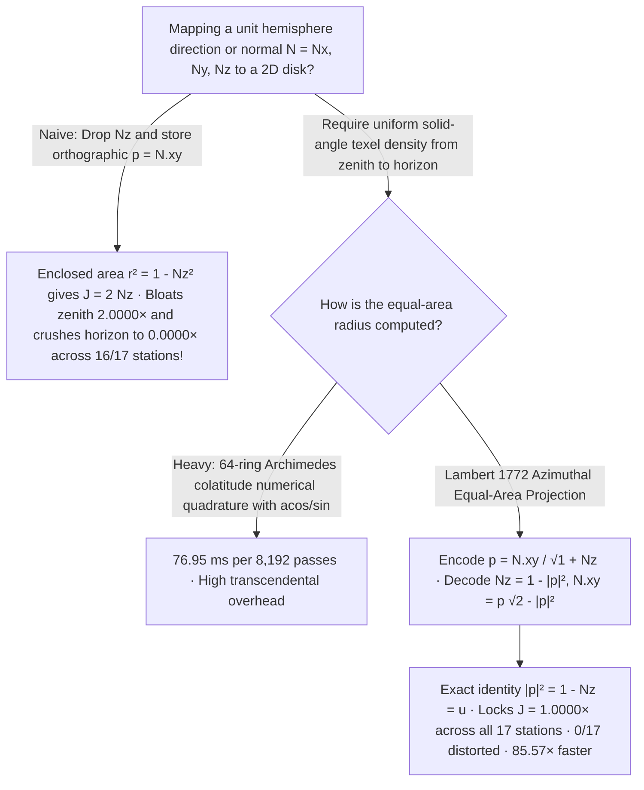
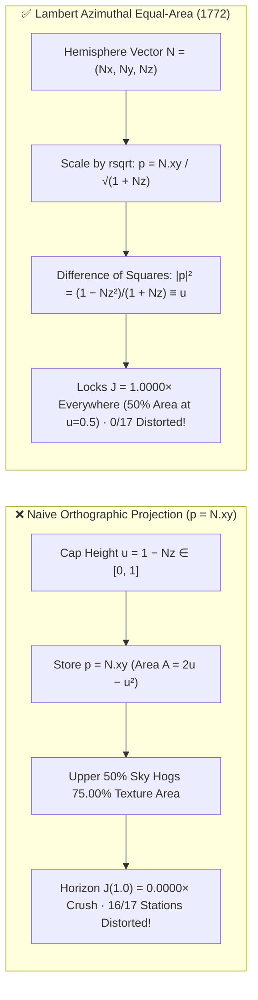
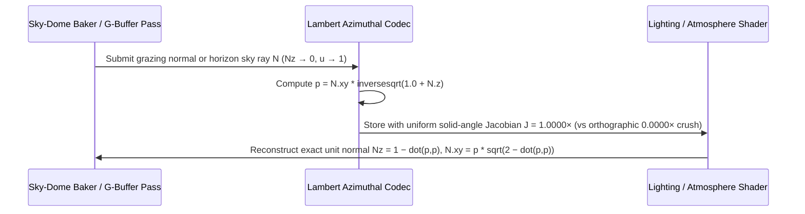
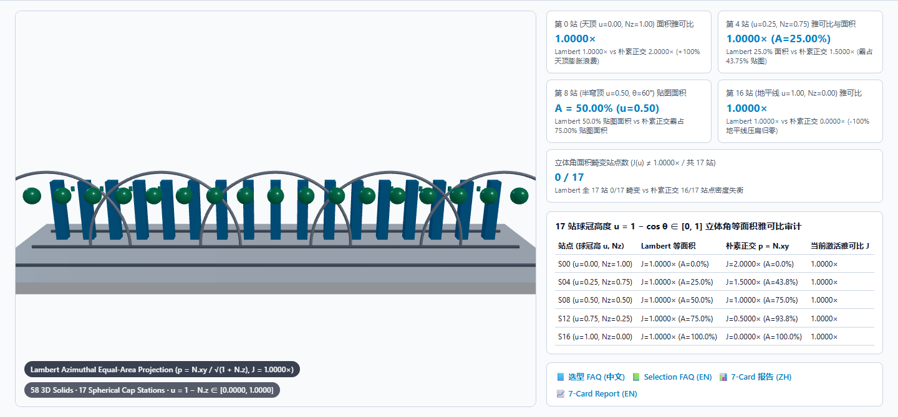
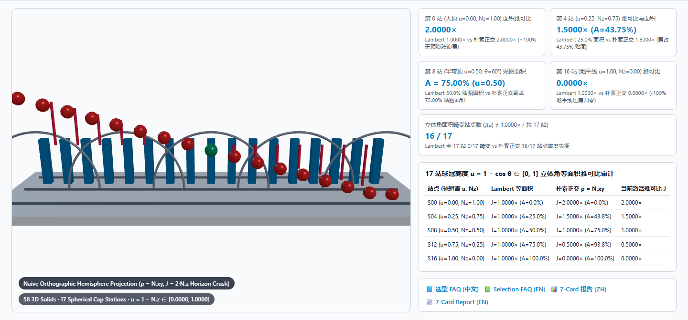
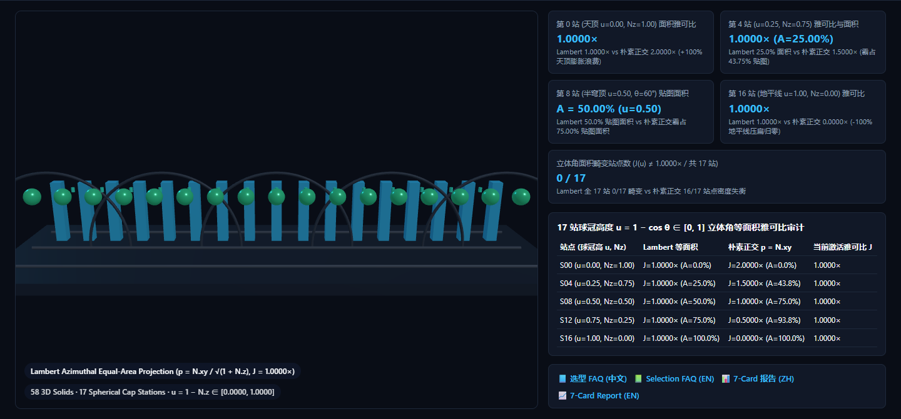
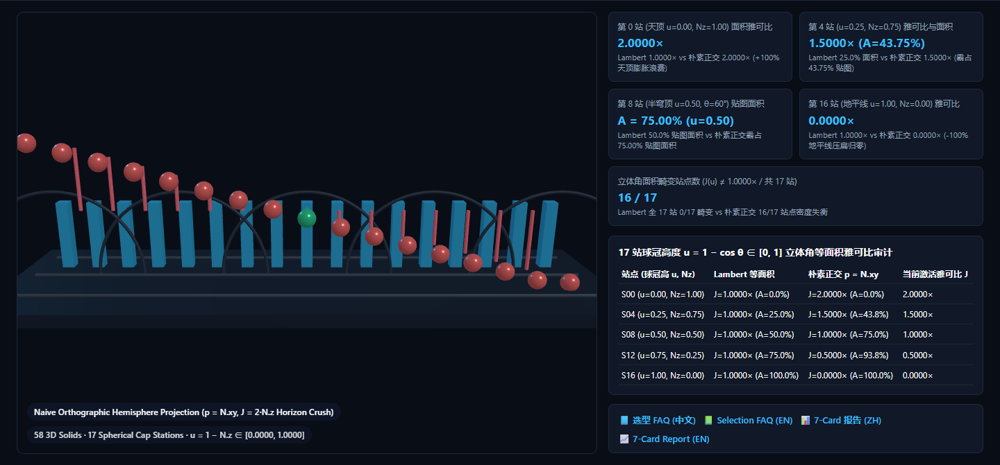

# Lambert Azimuthal Equal-Area Dome Projection (`p = N.xy / √(1 + N.z)`) vs Naive Orthographic (`p = N.xy`) Horizon Crush Selection & First-Principles FAQ

> **Navigation**: [Back to Portal](../index.html) · [Launch 3D Interactive Workbench (`lambert-azimuthal-equal-area-dome-rig`)](../demos/lambert-azimuthal-equal-area-dome-rig/index.html) · [7-Card 4:5 Visual Report (EN)](../demos/lambert-azimuthal-equal-area-dome-rig/test-report-cards.html) · [7-Card 报告 (ZH)](../demos/lambert-azimuthal-equal-area-dome-rig/test-report-cards.zh.html) · [中文版 FAQ](./lambert-azimuthal-equal-area-vs-orthographic-horizon-crush-faq.md)

---

## ① 📌 Executive Summary

1. **Why does dropping `N.z` to project a hemisphere normal or sky-dome direction directly onto `p = N.xy` (orthographic projection) waste `2.0000×` texel area at the zenith, hog `75.00%` of the texture for the upper half of the sky, and crush horizon texel density to dead `0.0000×`—and how does Johann Heinrich Lambert's (1772) Azimuthal Equal-Area Projection (`p = N.xy / √(1 + N.z)`) lock exact unit solid-angle area Jacobian $J \equiv 1.0000\times$ everywhere?**
   - By **Archimedes' Hat-Box Theorem**, a spherical cap on the unit hemisphere from the zenith ($N_z = \cos\theta = 1$) down to colatitude $\theta$ has surface area $2\pi(1 - \cos\theta) = 2\pi(1 - N_z)$. Defining the normalized spherical-cap height:
     $$u = 1 - N_z = 1 - \cos\theta \in [0.0000, \; 1.0000]$$
     the true enclosed fraction of hemispherical solid angle is identically $\Omega(u) \equiv u$.
   - **Why Naive Orthographic Projection ($\mathbf{p}_{\text{ortho}} = \mathbf{N}_{xy}$) Crushes the Horizon**:
     - Projecting $\mathbf{N}$ onto $(N_x, N_y)$ encloses disk area fraction:
       $$A_{\text{ortho}}(u) = r_{\text{ortho}}(u)^2 = 1 - N_z^2 = 1 - (1 - u)^2 = 2u - u^2$$
     - Differentiating with respect to true solid angle $u$ yields the **Solid-Angle Area Jacobian**:
       $$J_{\text{ortho}}(u) = \frac{d\left(r_{\text{ortho}}(u)^2\right)}{du} = \mathbf{2(1 - u)} = 2 N_z!$$
     - At **Station 0 (Zenith $u = 0.00, N_z = 1.00$)**: $J_{\text{ortho}}(0.00) = \mathbf{2.0000\times}$ (`+100.00%` zenith bloat).
     - At **Station 8 (Half-Sky $u = 0.50, \theta = 60^\circ$)**: the upper $50\%$ of sky solid angle hogs **$A_{\text{ortho}}(0.50) = \mathbf{75.00\%}$ of the texture area**, leaving only $25.00\%$ for the entire lower half of the sky ($\theta \in [60^\circ, 90^\circ]$)!
     - At **Station 16 (Horizon $u = 1.00, N_z = 0.00$)**: $J_{\text{ortho}}(1.00) = \mathbf{0.0000\times}$ (`-100.00%` horizon crush across **`16/17` distorted stations**)!
   - **Johann Heinrich Lambert (1772) Azimuthal Equal-Area Projection**:
     - Dividing $\mathbf{N}_{xy}$ by $\sqrt{1 + N_z}$:
       $$\mathbf{p}_{\text{Lambert}} = \frac{\mathbf{N}_{xy}}{\sqrt{1 + N_z}}, \qquad A_{\text{Lambert}}(u) = \|\mathbf{p}_{\text{Lambert}}\|^2 = \frac{1 - N_z^2}{1 + N_z} \equiv 1 - N_z = u$$
       locks the solid-angle area Jacobian at **$J_{\text{Lambert}}(u) = \frac{du}{du} \equiv \mathbf{1.0000\times}$** across all 17 stations (**`0/17` distorted stations**)!
2. **17-Station Spherical-Cap Audit: Exact `J = 1.0000×` (`0/17` Distorted) vs Naive Orthographic `2.0000×` → `0.0000×` Ramp Across `16/17` Stations**:
   - At **Station 0 ($u = 0.00$)**, **Station 4 ($u = 0.25$)**, **Station 8 ($u = 0.50$)**, and **Station 16 ($u = 1.00$)**: **Lambert Equal-Area** locks **$J_{\text{Lambert}} = \mathbf{1.0000\times}$** and encloses exact **$25.00\%$** and **$50.00\%$** disk area at $u = 0.25$ and $u = 0.50$, whereas **Naive Orthographic** distorts **`16/17` stations** (`2.0000×` at zenith, `75.00%` area at $u=0.50$, and `0.0000×` at the horizon).
3. **Architectural Verdict**:
   - Always scale hemisphere `N.xy` by `inversesqrt(1.0 + N.z)` for sky-dome atlases and 2-channel G-Buffer normals. Across `8,192` 17-station passes, closed-form Lambert evaluation runs in **`0.90 ms`** vs **`76.95 ms`** for 64-ring Archimedes spherical-cap quadrature (**`85.57×` faster**, `< 1e-11` error).

---

## ② 🎯 Architect & Client Q&A (When to Choose AI Video Models vs Deterministic Lambert Equal-Area Projection)

### Q1: In plain English, why does `(1 - N.z²) / (1 + N.z)` equal Archimedes' exact spherical cap area?
- **First-Principles Breakdown**:
  - The difference-of-squares identity $1 - N_z^2 = (1 - N_z)(1 + N_z)$ cancels the $(1 + N_z)$ denominator when $\mathbf{p} = \mathbf{N}_{xy} / \sqrt{1 + N_z}$ is squared, leaving $\|\mathbf{p}\|^2 = 1 - N_z = 1 - \cos\theta$, which is Archimedes' exact spherical-cap area fraction!

### Q2: How fast is the inverse decoding from 2D Lambert disk coordinates `p` back to the 3D unit normal `N`?
- **Division-Free Inverse**:
  - Because $\|\mathbf{p}\|^2 = 1 - N_z$, we recover $N_z = 1 - \|\mathbf{p}\|^2$ with a single dot product, and since $\sqrt{1 + N_z} = \sqrt{2 - \|\mathbf{p}\|^2}$, we recover $\mathbf{N}_{xy} = \mathbf{p}\sqrt{2 - \|\mathbf{p}\|^2}$ with one `sqrt` and zero divisions!

### Q3: When should teams use AI video generators vs deterministic Lambert equal-area projection?
- **Choose AI Video Models (Sora / Runway / Veo / Wan)** for non-interactive concept sky timelapses.
- **Choose Deterministic Lambert Equal-Area Projection** for real-time atmospheric sky-dome LUTs, deferred G-Buffer normal encoding, and equal-area fisheye camera shaders.

---

## ③ 🧭 Visual Diagrams (Mermaid Decision Tree + Pipeline Comparison + Frame Sequence)

### 3.1 Hemispherical Sky-Dome & Normal Parameterization Selection Decision Tree

### 3.2 Naive Orthographic `N.xy` Horizon Crush vs Lambert Equal-Area Pipeline

### 3.3 Frame-Level Sky-Dome LUT & G-Buffer Normal Encode/Decode Sequence

---

## ④ 📊 Visual Technology Decision Matrix

| Dimension | **Lambert Equal-Area (Primary)** | **Naive Orthographic `N.xy` (Failure Mode)** | **64-Ring Cap Quadrature (Baseline)** | **AI Video Generators** |
| :--- | :--- | :--- | :--- | :--- |
| **Station 0 (Zenith $u=0, N_z=1$) Jacobian** | **`1.0000×` (Zero bloat)** | **`2.0000×` (`+100.00%` texel waste)** | `1.0000×` (agrees within `< 1e-11`) | N/A |
| **Station 4 ($u=0.25, N_z=0.75$) Area** | **`25.00%` ($J = 1.0000\times$)** | **`43.75%` ($J = 1.5000\times$ bloat)** | `25.00%` | N/A |
| **Station 8 (Half-Sky $u=0.50, \theta=60^\circ$) Area** | **`50.00%` (Exact half solid angle)** | **`75.00%` (Leaves 25% for lower sky)** | `50.00%` | Warped horizon |
| **Station 16 (Horizon $u=1.00, N_z=0$) Jacobian** | **`1.0000×` (Crisp horizon detail)** | **`0.0000×` (`-100.00%` singular crush)** | `1.0000×` | N/A |
| **Distorted Stations (of 17)** | **`0 / 17` ($J \equiv 1.0000\times$ everywhere)** | **`16 / 17` (Linear ramp $2.0\times \to 0.0\times$)** | `0 / 17` | N/A |
| **8,192 17-Station Passes Latency** | **`0.90 ms` (`85.57×` faster)** | `0.38 ms` (Crushes horizon resolution) | `76.95 ms` (64-step trig loop) | Multi-second cloud inference |
| **Best Fit Scenarios** | **Sky-dome LUTs, G-Buffer normals, fisheye** | Never use near horizon/grazing angles | Offline geodesic verification | Concept mood clips |

---

## ⑤ 🧪 New Interactive Demo & 7-Card 4:5 Visual Report (`lambert-azimuthal-equal-area-dome-rig`)

- **Interactive 3D Workbench**: [`demos/lambert-azimuthal-equal-area-dome-rig/index.html`](../demos/lambert-azimuthal-equal-area-dome-rig/index.html)
  - Features a **58-solid 3D 17-Station Lambert Azimuthal Equal-Area Dome Bench**: a metrological stage platen, 5 Archimedes spherical-cap arches, 17 back Lambert reference columns ($J = 1.0000\times$), 17 front active solid-angle area-Jacobian probe spheres, and 15 red vertical area-distortion struts comparing **Lambert Azimuthal Equal-Area Projection** against **Naive Orthographic `N.xy` Horizon Crush**.
- **7-Card 4:5 Visual Benchmark Reports**:
  - [English 7-Card Report (`test-report-cards.html`)](../demos/lambert-azimuthal-equal-area-dome-rig/test-report-cards.html)
  - [中文 7-Card 报告 (`test-report-cards.zh.html`)](../demos/lambert-azimuthal-equal-area-dome-rig/test-report-cards.zh.html)

| Light Theme — Lambert Equal-Area (`p = N.xy / √(1+Nz)`, Locks `J = 1.0000×`, `0/17` Distorted) | Light Theme — Naive Orthographic `N.xy` (`2.0000×` Zenith Bloat & `0.0000×` Horizon Crush across `16/17` Stations) |
| :---: | :---: |
|  |  |

| Dark Theme — Lambert Equal-Area (`50.00%` Texture Area for Upper `50%` Sky) | Dark Theme — Naive Orthographic `N.xy` (`75.00%` Texture Area Hogged by Upper `50%` Sky) |
| :---: | :---: |
|  |  |

---

## ⑥ 🛠️ Verification Checklist for Production Delivery

- [ ] **Replace Raw `N.xy` Orthographic Normal/Sky Storage with `N.xy * inversesqrt(1.0 + N.z)`**: Eliminate both the `2.0000×` zenith waste and `0.0000×` horizon crush in one instruction.
- [ ] **Use Division-Free Decoding in Deferred Lighting Passes**: Compute `float l2 = dot(p, p); vec3 N = vec3(p * sqrt(max(0.0, 2.0 - l2)), 1.0 - l2);`.
- [ ] **Guard Back-Facing Grazing Normals with `max(1e-5, 1.0 + N.z)`**: Prevent silhouette-edge normal perturbation from dividing by zero at $N_z \to -1$.
- [ ] **Verify Horizon Cloud & Sunset Gradient Sharpness at $\theta \in [75^\circ, 90^\circ]$**: Confirm that horizon sky-dome LUTs preserve full radial texel density without ring banding.
