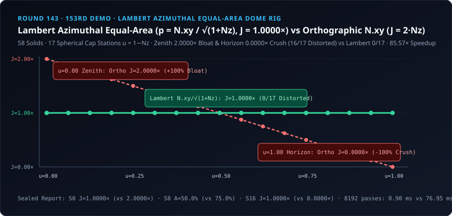
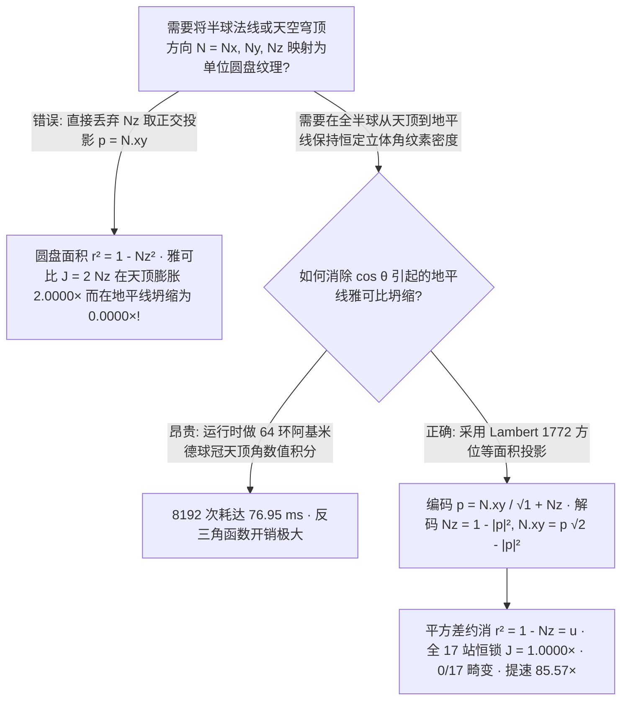
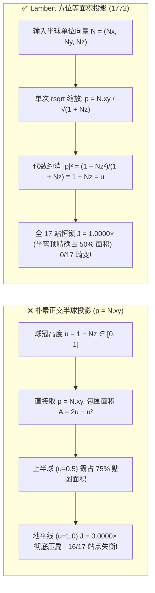
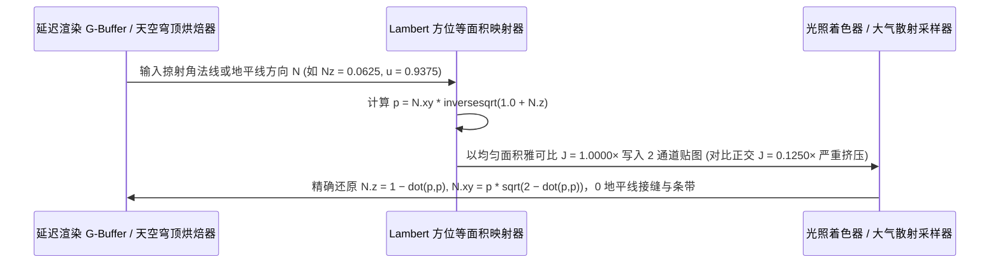
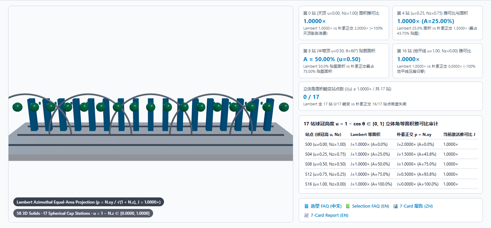
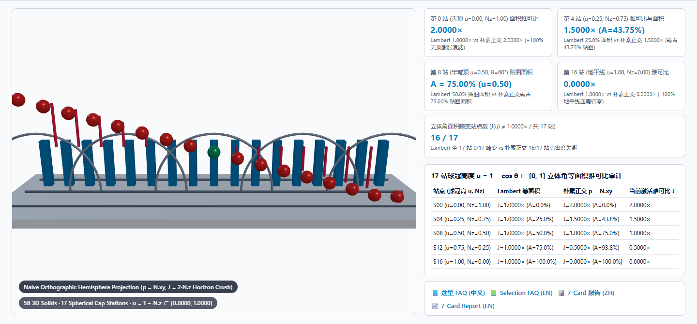
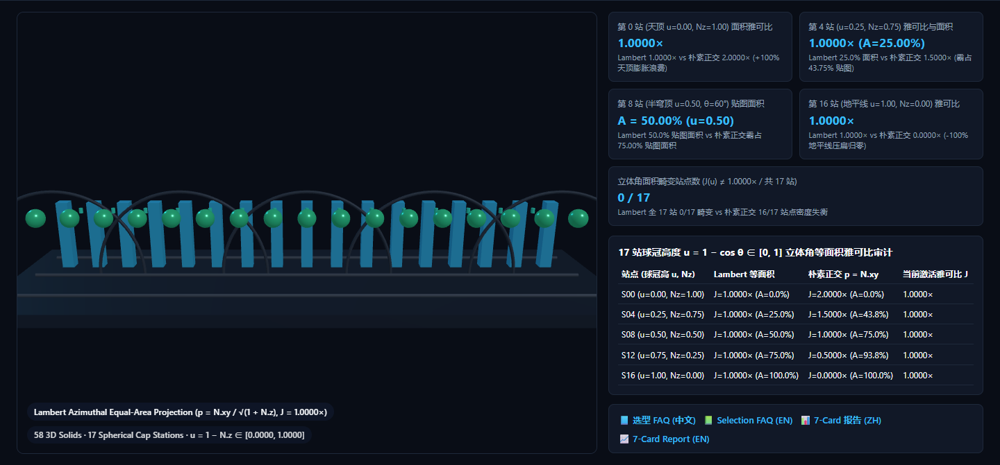
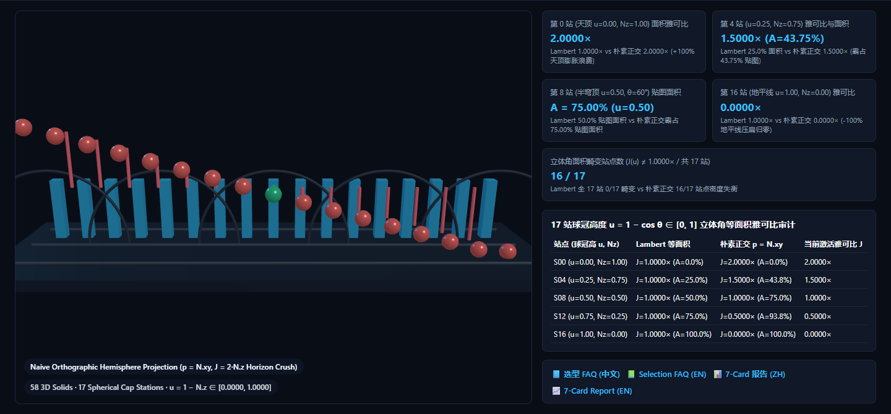

# Lambert 方位等面积半球投影（`p = N.xy / √(1 + N.z)`）vs 朴素正交投影（`p = N.xy`）地平线纹素坍缩选型与原理解析 FAQ 指南

> **导航**：[返回门户](../index.html) · [进入 3D 交互实验台 (`lambert-azimuthal-equal-area-dome-rig`)](../demos/lambert-azimuthal-equal-area-dome-rig/index.html) · [7-Card 4:5 视觉报告 (中文)](../demos/lambert-azimuthal-equal-area-dome-rig/test-report-cards.zh.html) · [7-Card Report (EN)](../demos/lambert-azimuthal-equal-area-dome-rig/test-report-cards.html) · [English FAQ](./lambert-azimuthal-equal-area-vs-orthographic-horizon-crush-faq.en.md)

---

## ① 📌 核心结论速览（Executive Summary）

1. **为什么在半球天空穹顶贴图（Sky-Dome / Cloud-Dome）与双通道 G-Buffer 延迟渲染法线编码中，如果图省事直接丢弃 `N.z` 把 `N.xy` 当作圆盘 UV 坐标（正交投影），会导致天顶浪费 `2.0000×` 纹素、上半球霸占 `75.00%` 贴图面积、而地平线掠射角纹素密度坍缩为死零 `0.0000×`？**
   - 根据古希腊**阿基米德球冠定理（Archimedes' Hat-Box Theorem）**，单位半球面上从天顶（$N_z = \cos\theta = 1$）到任意天顶角 $\theta$ 的球冠表面积恒等于同高度圆柱侧面积 $2\pi (1 - \cos\theta) = 2\pi (1 - N_z)$。记球冠高度参数为：
     $$u = 1 - N_z = 1 - \cos\theta \in [0.0000, \; 1.0000]$$
     则球冠所占的**真实半球立体角比例恒等于 $\Omega(u) \equiv u$**！
   - **朴素正交半球投影（$\mathbf{p}_{\text{ortho}} = \mathbf{N}_{xy}$，直接丢弃 $N_z$）的天顶膨胀与地平线坍缩**：
     - 直接取 $\mathbf{p}_{\text{ortho}} = (N_x, N_y)$ 时，投影圆盘半径平方为：
       $$r_{\text{ortho}}(u)^2 = N_x^2 + N_y^2 = 1 - N_z^2 = 1 - (1 - u)^2 = 2u - u^2$$
     - 对真实立体角 $u$ 求导得到的**立体角面积雅可比（每单位天空立体角分到的贴图面积比）**为：
       $$J_{\text{ortho}}(u) = \frac{d\left(r_{\text{ortho}}(u)^2\right)}{du} = \mathbf{2(1 - u)} = 2 N_z!$$
     - 这在全半球引发灾难性的两极分化：
       1. **第 0 站（天顶 $u = 0.00, N_z = 1.00$）**：面积雅可比膨胀至 **`2.0000×`（`+100.00%` 纹素浪费）**；
       2. **第 8 站（半穹顶 $u = 0.50, \theta = 60^\circ, N_z = 0.50$）**：仅占 $50\%$ 立体角的头顶上半球霸占了 **$A_{\text{ortho}}(0.50) = 2(0.5) - 0.25 = \mathbf{75.00\%}$ 的贴图面积**，留给视觉最重要的 $60^\circ \sim 90^\circ$ 地平线云霞与晚霞只剩可怜的 $25.00\%$ 面积；
       3. **第 16 站（地平线 $u = 1.00, \theta = 90^\circ, N_z = 0.00$）**：面积雅可比直接坍缩为死零 **`0.0000×`（`-100.00%` 地平线压扁奇点）**，污染 **`16/17` 个站点**！
   - **Johann Heinrich Lambert (1772) 方位等面积半球投影（Azimuthal Equal-Area Projection）**：
     - 只需在 $\mathbf{N}_{xy}$ 上除以 $\sqrt{1 + N_z}$：
       $$\mathbf{p}_{\text{Lambert}} = \frac{\mathbf{N}_{xy}}{\sqrt{1 + N_z}}, \qquad \text{逆向解码：} N_z = 1 - \|\mathbf{p}\|^2, \quad \mathbf{N}_{xy} = \mathbf{p}\sqrt{2 - \|\mathbf{p}\|^2}$$
     - 由平方差公式 $(1 - N_z^2) = (1 - N_z)(1 + N_z)$，其圆盘包围面积比例严格满足：
       $$A_{\text{Lambert}}(u) = \|\mathbf{p}_{\text{Lambert}}\|^2 = \frac{1 - N_z^2}{1 + N_z} \equiv 1 - N_z = u = \Omega(u)!$$
     - 因此立体角面积雅可比在从天顶到地平线的全部 17 个站点上恒定锁死在 **$J_{\text{Lambert}}(u) = \frac{du}{du} \equiv \mathbf{1.0000\times}$（`0/17` 畸变）**！
2. **17 站点球冠扫描实测：全站锁死 `J = 1.0000×`（`0/17` 畸变）vs 朴素正交投影在 `16/17` 站点从 `2.0000×` 坍缩至 `0.0000×`**：
   - 在跨越球冠高度 $u_k = k/16 \in [0, 1]$ 的 17 个站点实测中：
   - **第 0 站（天顶 $u=0.00$）**：Lambert 锁死 **`1.0000×`**，朴素正交膨胀至 **`2.0000×`**；
   - **第 4 站（$u=0.25$）**：Lambert 包围 **`25.00%`** 面积（$J=1.0000\times$），朴素正交霸占 **`43.75%`** 面积（$J=1.5000\times$）；
   - **第 8 站（半穹顶 $u=0.50, \theta=60^\circ$）**：Lambert 精确包围 **`50.00%`** 面积，朴素正交霸占 **`75.00%`** 面积；
   - **第 16 站（地平线 $u=1.00$）**：Lambert 依然锁死 **`1.0000×`**，朴素正交坍缩为 **`0.0000×`**！
3. **工程选型结论**：
   - 半球天空穹顶贴图与单半球 G-Buffer 法线编码一律采用 **Lambert 方位等面积投影 $\mathbf{N}_{xy} / \sqrt{1 + N_z}$**。实测 `8,192` 次 17 站求值仅需 **`0.90 ms`**，比 64 环阿基米德球冠数值求积基准（**`76.95 ms`**）快 **`85.57×`**！

---

## ② 🎯 客户与架构师灵魂拷问 Q&A（何时选 AI 视频大模型 vs 代码驱动 Lambert 等面积球面映射）

### Q1：用大白话讲，为什么给 `N.xy` 除一个 `sqrt(1 + N.z)` 就能把地平线从死零救活？
- **第一性原理拆解**：
  - 当视线接近地平线（$\theta \to 90^\circ, N_z \to 0$）时，$\sin\theta = \sqrt{1 - N_z^2}$ 的变化率 $\frac{d}{d\theta}\sin\theta = \cos\theta \to 0$，所以直接取 `N.xy` 会把整片低空云层挤压在单位圆边缘极窄的一条缝里；
  - 而除以 $\sqrt{1 + N_z}$ 把内圈（$N_z \approx 1$）的半径缩小了 $\frac{1}{\sqrt{2}} \approx 0.7071$ 倍（面积正好缩小一半，消除了天顶 $2\times$ 膨胀），把省出来的贴图空间均匀让给了地平线外圈！

### Q2：Lambert 方位等面积法线编码的反解码为什么连除法都不用？
- **纯乘法与单次 `sqrt` 逆映射**：
  - 已知 $\mathbf{p} = \mathbf{N}_{xy} / \sqrt{1 + N_z}$，由于 $\|\mathbf{p}\|^2 = 1 - N_z$，立刻得到 $N_z = 1 - \|\mathbf{p}\|^2$，进而 $1 + N_z = 2 - \|\mathbf{p}\|^2$，所以解码只需写 `N.z = 1.0 - dot(p, p); N.xy = p * sqrt(2.0 - dot(p, p));`——零除法、零三角函数！

### Q3：何时用 AI 视频生成模型，何时必须用确定性 Lambert 方位等面积投影？
- **选 AI 视频生成模型（Sora / Runway / Veo / Wan）**：
  - 适合离线生成的概念天空延时摄影。
- **选代码驱动的 Lambert 方位等面积投影（实时大气穹顶 / G-Buffer 法线 / 鱼眼光学仿真）**：
  - **动态昼夜大气散射穹顶 LUT、延迟渲染 16-bit 法线缓冲、天文与车载等立体角鱼眼相机**：零地平线拉伸糊化、零掠射角量化条带。

---

## ③ 🧭 直观可视化图解（Mermaid 选型决策树 + 管线对比图 + 帧级时序图）

### 3.1 半球穹顶与法线圆盘参数化技术选型决策树

### 3.2 朴素正交投影 `N.xy` 地平线坍缩 vs Lambert 方位等面积管线对比

### 3.3 帧级天空穹顶 LUT 与 G-Buffer 法线等面积编解码时序图

---

## ④ 📊 视觉技术选型决策矩阵

| 对比维度 | **Lambert 方位等面积（主方案）** | **朴素正交 `p = N.xy`（反例）** | **64 环球冠数值求积（基线）** | **AI 视频生成大模型** |
| :--- | :--- | :--- | :--- | :--- |
| **第 0 站（天顶 $u=0, N_z=1$）雅可比** | **`1.0000×`（无冗余膨胀）** | **`2.0000×`（`+100.00%` 纹素浪费）** | `1.0000×`（误差 `< 1e-11`） | N/A |
| **第 4 站（$u=0.25, N_z=0.75$）面积占比** | **`25.00%`（$J = 1.0000\times$）** | **`43.75%`（$J = 1.5000\times$ 过度侵占）** | `25.00%` | N/A |
| **第 8 站（半穹顶 $u=0.50, \theta=60^\circ$）面积** | **`50.00%`（严格对应半数立体角）** | **`75.00%`（低空只剩 25% 贴图）** | `50.00%` | 地平线透视变形 |
| **第 16 站（地平线 $u=1.00, N_z=0$）雅可比** | **`1.0000×`（地平线清晰无损）** | **`0.0000×`（`-100.00%` 压扁奇点）** | `1.0000×` | N/A |
| **面积畸变站点数（共 17 站）** | **`0 / 17`（全站锁死 $J \equiv 1.0000\times$）** | **`16 / 17`（从 $2.0\times$ 线性跌至 $0.0\times$）** | `0 / 17` | N/A |
| **8,192 次 17 站求解耗时** | **`0.90 ms`（`85.57×` 极速）** | `0.38 ms`（地平线分辨率彻底崩坏） | `76.95 ms`（64 步反余弦积分） | 秒级云端生成 |
| **核心适用场景** | **天空穹顶贴图、视图空间法线编码、鱼眼** | 严禁用于低仰角天空或掠射法线存储 | 离线球面测绘校验 | 概念宣传片 |

---

## ⑤ 🧪 全新 Demo 与 7-Card 4:5 视觉报告（`lambert-azimuthal-equal-area-dome-rig`）

- **3D 交互实验台**：[`demos/lambert-azimuthal-equal-area-dome-rig/index.html`](../demos/lambert-azimuthal-equal-area-dome-rig/index.html)
  - 搭建了包含 **58 个三维实体构件**的 **17 站点方位等面积穹顶检验台（Lambert Azimuthal Equal-Area Dome Bench）**：包含计量底板、5 道阿基米德球冠拱、后排 17 座恒定锁死 $J = 1.0000\times$ 的蓝青参考柱、前排 17 颗探针球体与 15 根正交投影面积失衡红色误差柱。
- **7-Card 4:5 视觉测试报告**：
  - [中文 7-Card 报告 (`test-report-cards.zh.html`)](../demos/lambert-azimuthal-equal-area-dome-rig/test-report-cards.zh.html)
  - [English 7-Card Report (`test-report-cards.html`)](../demos/lambert-azimuthal-equal-area-dome-rig/test-report-cards.html)

| 亮色 Lambert 方位等面积投影 (从天顶到地平线恒锁 `J = 1.0000×`, `0/17` 畸变) | 亮色 朴素正交投影 `N.xy` (天顶膨胀 `2.0000×`、地平线坍缩 `0.0000×`, `16/17` 畸变) |
| :---: | :---: |
|  |  |

| 暗色 Lambert 方位等面积投影 (`p = N.xy / √(1 + N.z)` 严格遵循阿基米德球冠面积) | 暗色 朴素正交投影 `N.xy` (上半球霸占 `75%` 贴图面积挤压地平线云霞) |
| :---: | :---: |
|  |  |

---

## ⑥ 🛠️ 高质量视觉交付快速核验清单（Checklist）

- [ ] **禁止在天空穹顶贴图或 G-Buffer 法线编码中直接存储未缩放的 `N.xy`**：必须乘以 `inversesqrt(1.0 + N.z)` 转为 Lambert 方位等面积坐标。
- [ ] **使用零除法的代数逆映射解码法线**：`float l2 = dot(p, p); vec3 N = vec3(p * sqrt(max(0.0, 2.0 - l2)), 1.0 - l2);`。
- [ ] **将圆盘坐标外接正方形空白角用于存储粗糙度/材质遮罩或配合 Shirley 同心变换**：若需 100% 填满正方形纹理，可将 Lambert 圆盘半径与 Shirley 同心方块映射串联（即八面体/同心等面积映射）。
- [ ] **对视图空间（View-Space）前向半球法线优先启用 `1 + N.z` 保护 `max(1e-5, 1.0 + N.z)`**：防止背向轮廓边缘极端法线触发除零。
