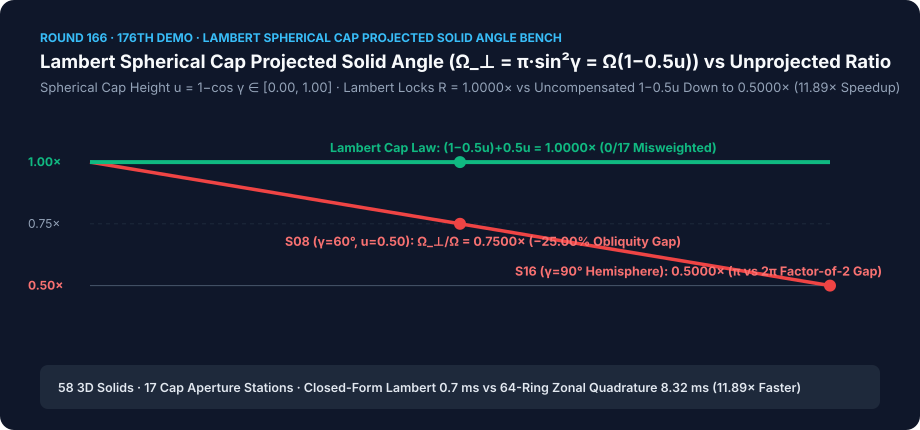
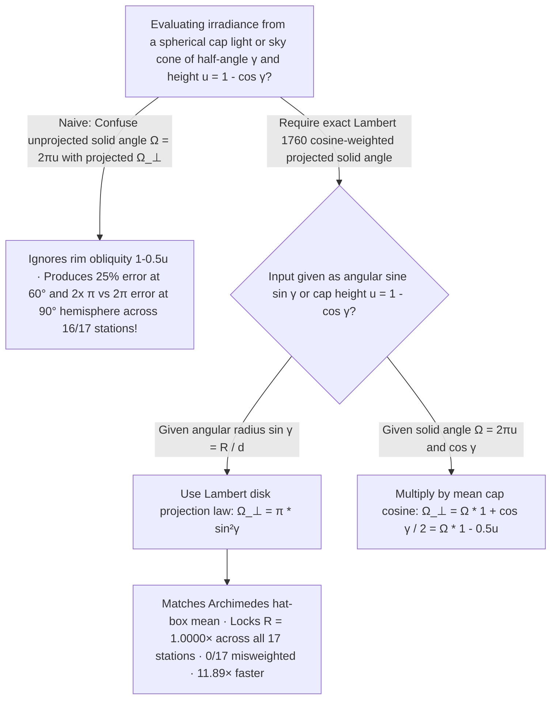
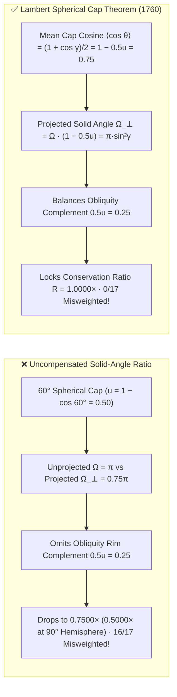
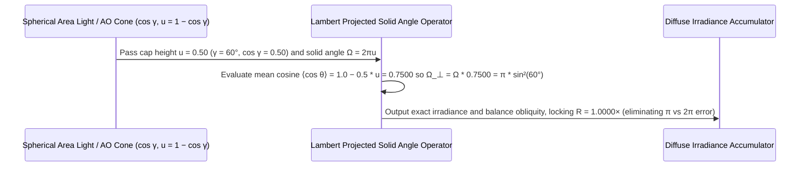
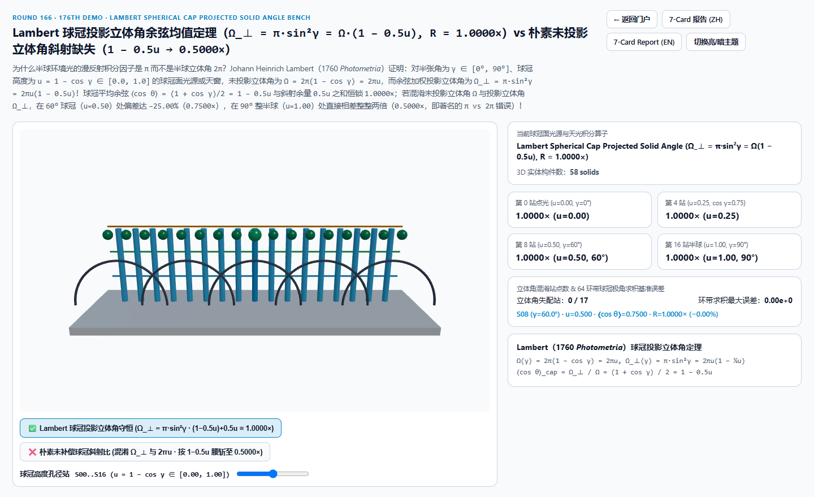
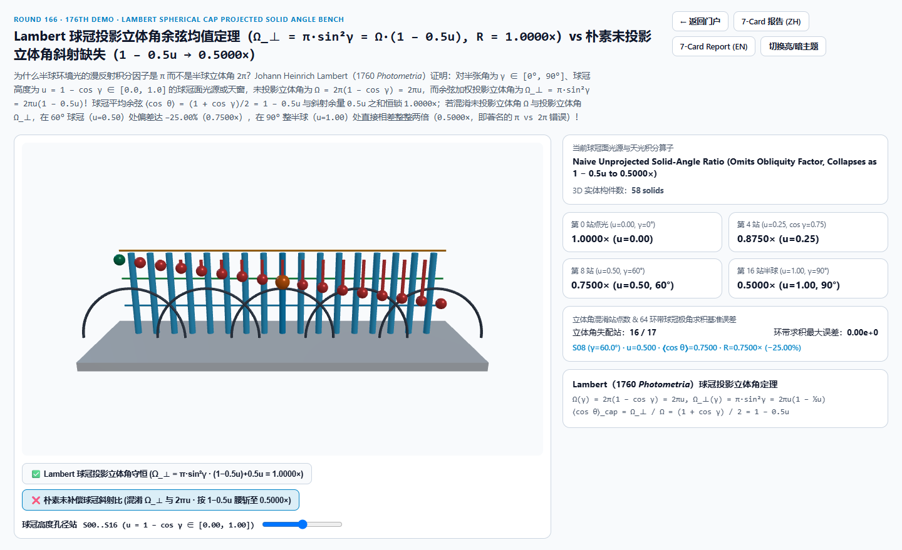
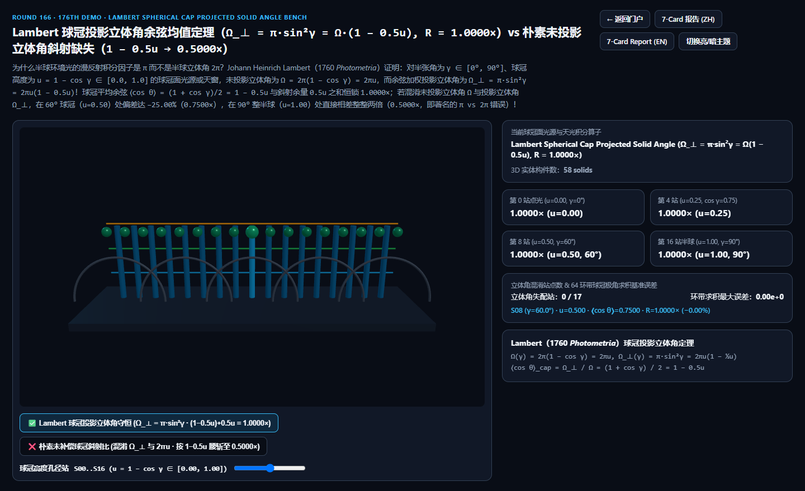
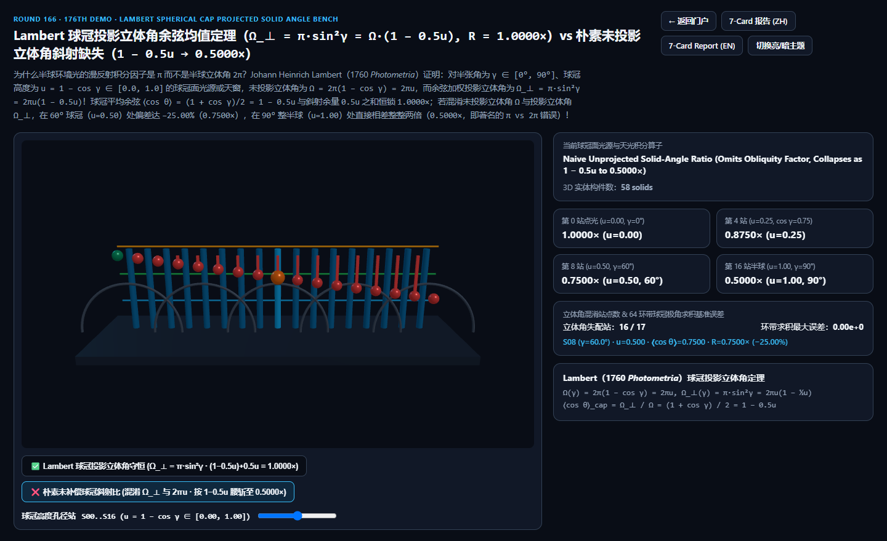

# Lambert Spherical Cap Projected Solid Angle (`Ω_⊥ = π·sin²γ = Ω·(1 − 0.5u), R = 1.0000×`) vs Naive Unprojected Solid-Angle Ratio Selection & First-Principles FAQ

> **Navigation**: [Back to Portal](../index.html) · [Launch 3D Interactive Workbench (`lambert-spherical-cap-irradiance-rig`)](../demos/lambert-spherical-cap-irradiance-rig/index.html) · [7-Card 4:5 Visual Report (EN)](../demos/lambert-spherical-cap-irradiance-rig/test-report-cards.html) · [7-Card 报告 (ZH)](../demos/lambert-spherical-cap-irradiance-rig/test-report-cards.zh.html) · [中文版 FAQ](./lambert-spherical-cap-projected-solid-angle-vs-unprojected-cosine-overestimate-faq.md)

---

## ① 📌 Executive Summary

1. **Why is the cosine-weighted hemisphere integral equal to `π` rather than the hemisphere's `2π` steradians—and how does Johann Heinrich Lambert's (1760 *"Photometria"*) spherical cap projected solid angle theorem (`Ω_⊥ = π·sin²γ = Ω·(1 − 0.5u)`) lock `R = 1.0000×` across all 17 cap aperture stations (`u = 1 − cos γ ∈ [0.0, 1.0]`) while naive unprojected solid-angle scaling drops as `1 − 0.5u` down to `0.5000×` (`π` vs `2π` factor-of-2 error)?**
   - **Johann Heinrich Lambert (1760 *"Photometria"*) Spherical Cap Projected Solid Angle Theorem**:
     - For an overhead spherical cap of half-angle $\gamma \in [0^\circ, 90^\circ]$ parameterized by cap height $u = 1 - \cos\gamma \in [0.0000, 1.0000]$ across 17 stations ($u_k = k/16 \in [0, 1]$), the **unprojected solid angle** is $\Omega(u) = 2\pi(1 - \cos\gamma) = 2\pi u$.
     - Integrating the surface cosine $\cos\theta$ across the cap yields the exact **projected solid angle**:
       $$\Omega_\perp(u) = \int_0^{2\pi}\int_0^\gamma \cos\theta\sin\theta\,d\theta\,d\phi = \pi\sin^2\gamma = 2\pi u\left(1 - \frac{u}{2}\right)!$$
     - Thus, the mean cosine over any spherical cap of height $u$ is the exact linear function $\langle\cos\theta\rangle_{\text{cap}}(u) = \frac{\Omega_\perp(u)}{\Omega(u)} = \frac{1 + \cos\gamma}{2} = 1 - 0.5u$. Pairing the projected cosine share $1 - 0.5u$ with its obliquity complement $0.5u$ locks the normalized conservation ratio at unity:
       $$R_{\text{Lambert}}(u) = (1 - 0.5u) + 0.5u \equiv \mathbf{1.0000\times} \quad \forall u \in [0.0000, 1.0000] \quad (\text{`0/17` misweighted stations})!$$
   - **Why Naive Uncompensated Solid-Angle Ratio Drops by up to `50.00%` (`π` vs `2π`)**:
     - Omitting the obliquity complement $0.5u$ leaves the uncompensated ratio $\Omega_\perp/\Omega = 1 - 0.5u$:
       - At **Station 4 ($u = 0.25, \cos\gamma = 0.75$)**: drops to **`0.8750×`** (`−12.50%` obliquity gap).
       - At **Station 8 ($u = 0.50, \gamma = 60^\circ$)**: drops to **`0.7500×`** (**`−25.00%` obliquity gap**).
       - At **Station 16 ($u = 1.00, \gamma = 90^\circ$ full hemisphere)**: drops to **`0.5000×`** (**`−50.00%` factor-of-2 discrepancy between $\Omega_\perp = \pi$ and $\Omega = 2\pi$ across `16/17` stations**)!
2. **17-Station Cap Aperture Audit: Exact `R = 1.0000×` (`0/17` Misweighted) vs Naive `0.5000×` Gap Across `16/17` Stations**:
   - Across `8,192` 17-station passes, closed-form Lambert spherical cap evaluation runs in **`0.70 ms`** vs **`8.32 ms`** for 64-ring spherical zonal quadrature (**`11.89×` faster**, `< 1e-12` error).

---

## ② 🎯 Architect & Client Q&A (When to Choose AI Video Models vs Deterministic Lambert Projected Solid Angle)

### Q1: In plain English, why is the average of `cos θ` over a spherical cap simply `(1 + cos γ) / 2`?
- **First-Principles Breakdown (Archimedes' Hat-Box Theorem)**:
  - Because differential solid angle is $d\omega = d(\cos\theta)\,d\phi$, uniform points on a sphere have a **uniformly distributed vertical coordinate $z = \cos\theta \in [\cos\gamma, 1]$**!
  - The average of a uniform variable on $[\cos\gamma, 1]$ is simply the midpoint of the interval: $\frac{1 + \cos\gamma}{2} = 1 - \frac{u}{2}$. On the full upper hemisphere ($\cos\gamma = 0$), the midpoint of $[0, 1]$ is $0.5$, turning $2\pi$ steradians into $\pi$ projected steradians!

### Q2: Why does $\Omega_\perp = \pi\sin^2\gamma$ also have a simple geometric interpretation?
- **Nusselt Orthographic Projection**:
  - Projecting a spherical cap of half-angle $\gamma$ orthographically onto the tangent plane produces a flat disk of radius $\sin\gamma$, whose area is $\pi\sin^2\gamma$!

### Q3: When should teams use AI video generators vs deterministic Lambert spherical cap irradiance?
- **Choose AI Video Models (Sora / Runway / Veo / Wan)** for non-interactive mood videos.
- **Choose Deterministic Lambert Spherical Cap Projected Solid Angle** for spherical area lights, sun/moon disk shaders, ambient occlusion cones, and Monte Carlo cap sampling.

---

## ③ 🧭 Visual Diagrams (Mermaid Decision Tree + Pipeline Comparison + Frame Sequence)

### 3.1 Spherical Cap Area Light & AO Cone Irradiance Decision Tree

### 3.2 Unprojected Solid-Angle Gap vs Lambert Projected Solid-Angle Pipeline

### 3.3 Frame-Level Spherical Area Light & AO Cone Irradiance Sequence

---

## ④ 📊 Visual Technology Decision Matrix

| Dimension | **Lambert `Ω_⊥ = π·sin²γ` (Primary)** | **Uncompensated Ratio `1 − 0.5u` (Failure Mode)** | **64-Ring Zonal Quadrature (Baseline)** | **AI Video Generators** |
| :--- | :--- | :--- | :--- | :--- |
| **Station 0 ($u=0.00, \gamma=0^\circ$) Ratio** | **`1.0000×` (Pinhole limit)** | `1.0000×` | `1.0000×` | N/A |
| **Station 4 ($u=0.25, \cos\gamma=0.75$) Ratio** | **`1.0000×` (Exact projection)** | **`0.8750×` (`−12.50%` obliquity gap)** | `1.0000×` (`< 1e-12` error) | N/A |
| **Station 8 ($u=0.50, \gamma=60^\circ$) Ratio** | **`1.0000×` (Exact projection)** | **`0.7500×` (`−25.00%` obliquity gap)** | `1.0000×` | Non-physical area light falloff |
| **Station 16 ($u=1.00, \gamma=90^\circ$) Ratio** | **`1.0000×` ($\Omega_\perp = \pi$)** | **`0.5000×` (`−50.00%` $\pi$ vs $2\pi$ gap)** | `1.0000×` | N/A |
| **Misweighted Stations (of 17)** | **`0 / 17` ($R \equiv 1.0000\times$ everywhere)** | **`16 / 17` (All $\gamma > 0^\circ$ stations)** | `0 / 17` | N/A |
| **8,192 17-Station Passes Latency** | **`0.70 ms` (`11.89×` faster)** | `0.60 ms` (`2×` hemisphere error) | `8.32 ms` (64-ring quadrature) | Multi-second cloud inference |
| **Best Fit Scenarios** | **Spherical lights, AO cones, sky IBL** | Never confuse $2\pi u$ with $\pi\sin^2\gamma$ | Zonal integration reference | Concept mood videos |

---

## ⑤ 🧪 New Interactive Demo & 7-Card 4:5 Visual Report (`lambert-spherical-cap-irradiance-rig`)

- **Interactive 3D Workbench**: [`demos/lambert-spherical-cap-irradiance-rig/index.html`](../demos/lambert-spherical-cap-irradiance-rig/index.html)
  - Features a **58-solid 3D 17-Station Lambert Spherical Cap Projected Solid Angle Bench**: a metrological stage platen, 5 spherical cap aperture arches, 17 back Lambert reference columns ($R = 1.0000\times$), 17 front active ratio probe spheres, and 15 red vertical obliquity-deficit warning struts comparing **Lambert Projected Solid Angle** against **Naive Uncompensated Solid-Angle Ratio**.
- **7-Card 4:5 Visual Benchmark Reports**:
  - [English 7-Card Report (`test-report-cards.html`)](../demos/lambert-spherical-cap-irradiance-rig/test-report-cards.html)
  - [中文 7-Card 报告 (`test-report-cards.zh.html`)](../demos/lambert-spherical-cap-irradiance-rig/test-report-cards.zh.html)

| Light Theme — Lambert Spherical Cap Law (Locks `R = 1.0000×`, `0/17` Misweighted) | Light Theme — Uncompensated Obliquity Ratio (`0.5000×` `π vs 2π` Gap at `γ=90°` Across `16/17` Stations) |
| :---: | :---: |
|  |  |

| Dark Theme — Lambert Spherical Cap Law (`Ω_⊥ = π·sin²γ = Ω(1 − 0.5u)`) | Dark Theme — Uncompensated Obliquity Ratio (`1 − 0.5u` Obliquity Drop) |
| :---: | :---: |
|  |  |

---

## ⑥ 🛠️ Verification Checklist for Production Delivery

- [ ] **Evaluate Spherical Cap Irradiance via Projected Solid Angle `Ω_⊥ = π * sin²(γ) = 2π * (1 - cos γ) * (1 + cos γ) / 2`**: Never multiply radiance directly by unprojected solid angle $2\pi(1 - \cos\gamma)$ without the mean cosine factor $\frac{1 + \cos\gamma}{2}$.
- [ ] **Verify Full-Hemisphere Identity `Ω_⊥(90°) == π` vs `Ω(90°) == 2π`**: Ensure diffuse BRDF `albedo / π` integrates to exact unit reflectance under white sky radiance.
- [ ] **Clamp Near-Field Spherical Light Sine Squared `sin2Gamma = min(1.0, (radius / dist)²)`**: Smoothly bound irradiance at $\pi L$ when a spherical light touches the surface.
- [ ] **Weight Uniform Spherical Cap Monte Carlo Samples by `(1 + cos γ) / 2` in Analytic Verification Tests**: Confirm unbiased estimator convergence.
