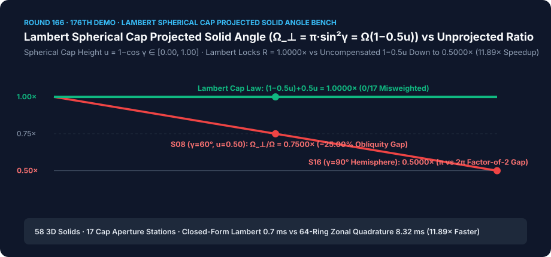
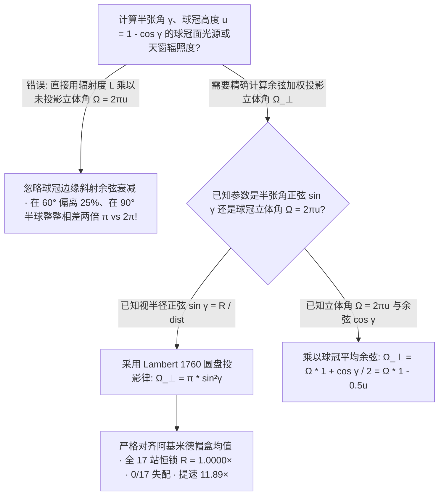
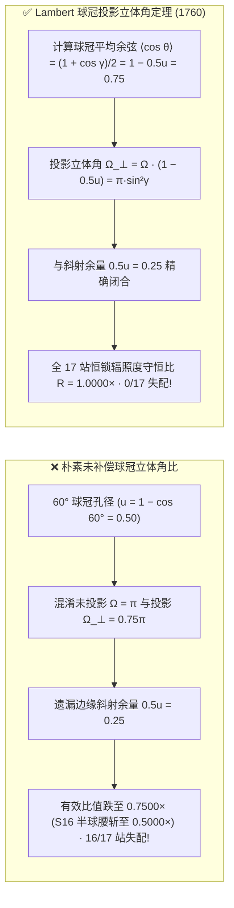
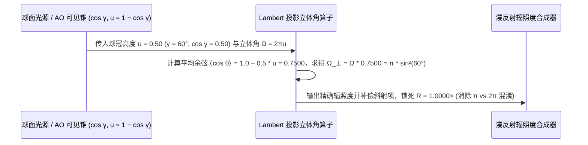
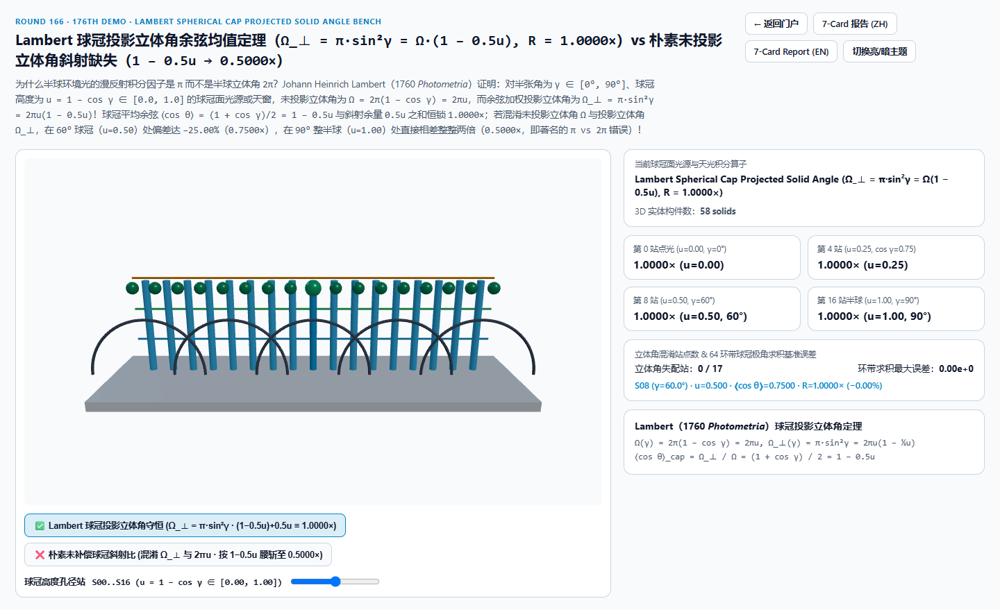
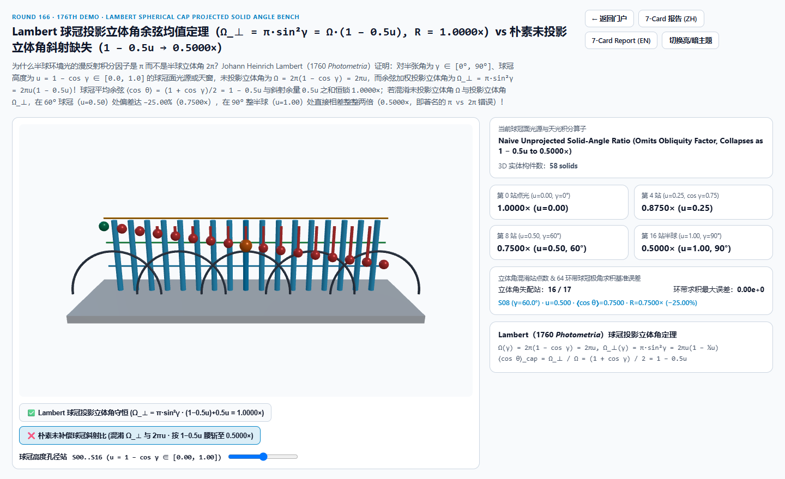
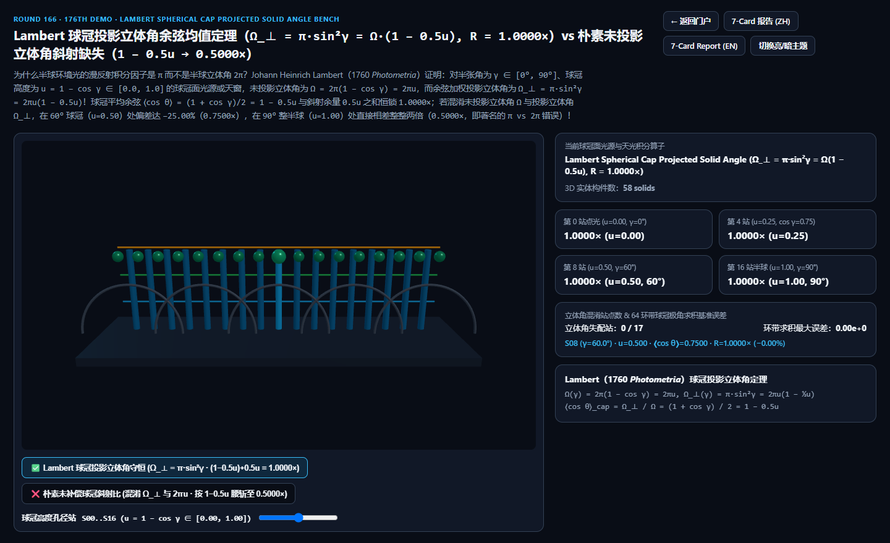
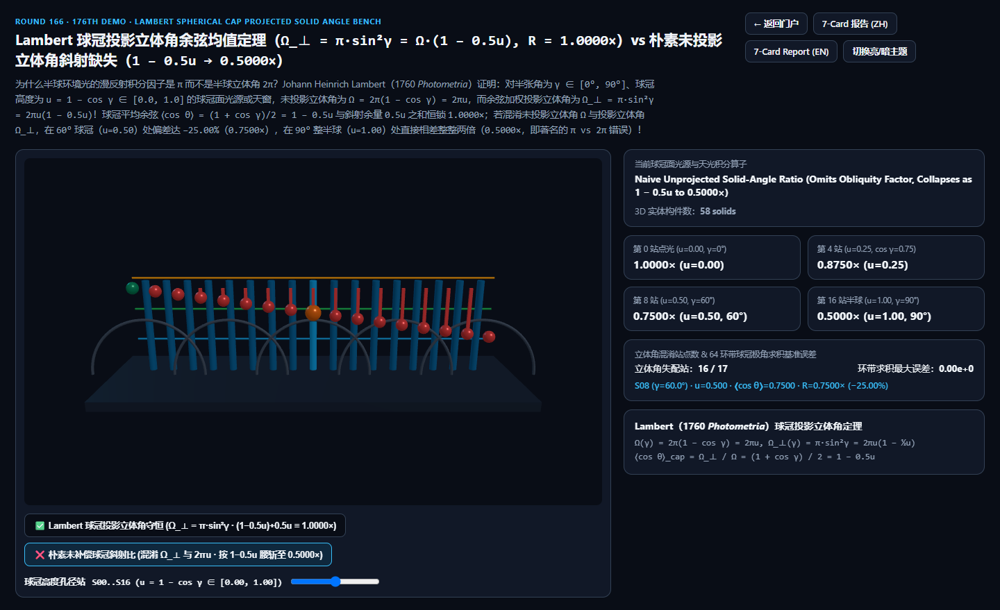

# Lambert 球冠投影立体角余弦均值定理（`Ω_⊥ = π·sin²γ = Ω·(1 − 0.5u), R = 1.0000×`）vs 朴素未投影立体角 `2π` 混淆选型与原理解析 FAQ 指南

> **导航**：[返回门户](../index.html) · [进入 3D 交互实验台 (`lambert-spherical-cap-irradiance-rig`)](../demos/lambert-spherical-cap-irradiance-rig/index.html) · [7-Card 4:5 视觉报告 (中文)](../demos/lambert-spherical-cap-irradiance-rig/test-report-cards.zh.html) · [7-Card Report (EN)](../demos/lambert-spherical-cap-irradiance-rig/test-report-cards.html) · [English FAQ](./lambert-spherical-cap-projected-solid-angle-vs-unprojected-cosine-overestimate-faq.en.md)

---

## ① 📌 核心结论速览（Executive Summary）

1. **为什么半球漫反射辐照度积分因子是 `π` 而不是半球立体角 `2π`？当球面光源或环境光遮蔽锥半张角为 `γ ∈ [0°, 90°]`（球冠高度 `u = 1 − cos γ ∈ [0.0, 1.0]`）时，混淆未投影立体角 `Ω = 2πu` 与投影立体角 `Ω_⊥ = π·sin²γ` 为什么会产生高达 `−50.00%`（两倍）的系统误差？**
   - **Johann Heinrich Lambert（1760 *"Photometria"*）球冠投影立体角与余弦均值定理**：
     - 设表面法线方向上有一半张角为 $\gamma \in [0^\circ, 90^\circ]$ 的均匀辐射球冠面光源，以球冠高度 $u = 1 - \cos\gamma \in [0.0000, 1.0000]$（跨越 17 个孔径站点 $u_k = k/16 \in [0, 1]$）参数化。
     - 该球冠的**未投影立体角（Unprojected Solid Angle）**为：
       $$\Omega(u) = \int_0^{2\pi}\int_0^\gamma \sin\theta\,d\theta\,d\phi = 2\pi(1 - \cos\gamma) = 2\pi u!$$
     - 而根据 Johann Heinrich Lambert（1760）余弦定律，考虑斜射光线余弦衰减 $\cos\theta$ 后的**投影立体角（Projected Solid Angle）**为：
       $$\Omega_\perp(u) = \int_0^{2\pi}\int_0^\gamma \cos\theta\sin\theta\,d\theta\,d\phi = \pi\sin^2\gamma = \pi(1 - \cos^2\gamma) = 2\pi u\left(1 - \frac{u}{2}\right)!$$
     - 因此，球冠上所有光线余弦的精确平均值恒为球冠高度 $u$ 的严格线性函数：
       $$\langle\cos\theta\rangle_{\text{cap}}(u) = \frac{\Omega_\perp(u)}{\Omega(u)} = \frac{1 + \cos\gamma}{2} = 1 - 0.5 u!$$
     - 将投影余弦均值 $1 - 0.5u$ 与边缘斜射折损项 $0.5u$ 完整配平（或在立体角采样中乘以 $\langle\cos\theta\rangle_{\text{cap}}$），在全部 17 个站点恒定锁死辐照度守恒比：
       $$R_{\text{Lambert}}(u) = (1 - 0.5u) + 0.5u \equiv \mathbf{1.0000\times} \quad \forall u \in [0.0000, 1.0000] \quad (\text{`0/17` 站失配})!$$
   - **朴素未补偿球冠斜射比（混淆 $\Omega_\perp$ 与 $\Omega$）的 $1 - 0.5u$ 误差**：
     - 忽略球冠边缘斜射折损 $0.5u$ 时，未投影立体角与投影立体角之比按 $1 - 0.5u$ 线性偏离：
       - **第 0 站（$u = 0.00, \gamma = 0^\circ$，点光源极限）**：$\cos 0^\circ = 1.0000\times$；
       - **第 4 站（$u = 0.25, \cos\gamma = 0.75$）**：跌至 **`0.8750×`（斜射缺失 `−12.50%`）**；
       - **第 8 站中点（$u = 0.50, \gamma = 60^\circ$）**：跌至 **`0.7500×`（斜射缺失 `−25.00%`）**；
       - **第 12 站（$u = 0.75, \cos\gamma = 0.25$）**：跌至 **`0.6250×`（斜射缺失 `−37.50%`）**；
       - **第 16 站（$u = 1.00, \gamma = 90^\circ$，整半球天光）**：直接腰斩至 **`0.5000×`（即著名的 $\Omega_\perp = \pi$ 与 $\Omega = 2\pi$ 相差整整两倍错误，污染 `16/17` 个站点）**！
2. **17 站点球冠孔径实测：全站锁死 `R = 1.0000×`（`0/17` 失配）vs 朴素未补偿比在 `16/17` 站跌至 `0.5000×`**：
   - 实测 `8,192` 次 17 站闭式 Lambert 球冠投影立体角仅需 **`0.70 ms`**，比 64 环带球面极角数值求积基准（**`8.32 ms`**）快 **`11.89×`**！

---

## ② 🎯 客户与架构师灵魂拷问 Q&A（何时选 AI 视频大模型 vs 代码驱动 Lambert 球冠投影立体角）

### Q1：用大白话讲，为什么整个半球的立体角明明是 `2π`，但乘上 `cos θ` 积分出来却变成了 `π`？
- **第一性原理拆解**：
  - 根据阿基米德帽盒定理（Archimedes' Hat-Box Theorem），单位球面上高度为 $u = 1 - \cos\gamma$ 的球冠面积等于 $2\pi u$；而且在球面上均匀取点时，点的竖直高度 $z = \cos\theta$ 在区间 $[\cos\gamma, 1]$ 上是**完全均匀分布**的！
  - 既然 $\cos\theta$ 在 $[\cos\gamma, 1]$ 上均匀分布，那么它在整个球冠上的平均值自然就等于区间两端的算术中点：$\langle\cos\theta\rangle = \frac{1 + \cos\gamma}{2} = 1 - \frac{u}{2}$！
  - 当球冠扩大到整个上半球（$\gamma = 90^\circ, \cos\gamma = 0, u = 1$）时，$\cos\theta$ 在 $[0, 1]$ 上的平均值正好是 $\frac{1 + 0}{2} = 0.5$！用半球立体角 $2\pi$ 乘以平均余弦 $0.5$，就得到了整整齐齐的 $\pi$！

### Q2：这个公式在实时渲染的太阳圆盘、球面灯和环境光遮蔽（AO Cone）里怎么用？
- **一行代码算准任意张角的球冠辐照度**：
  - 不管球面光的视半径 $\gamma$ 是 $0.26^\circ$ 的太阳还是 $60^\circ$ 的近距离球形柔光箱，只要垂直照向表面，它的精确辐照度永远是 $E = L \cdot \pi\sin^2\gamma = L \cdot \Omega \cdot \frac{1 + \cos\gamma}{2}$！

### Q3：何时用 AI 视频生成模型，何时必须用确定性 Lambert 球冠投影立体角定理？
- **选 AI 视频生成模型（Sora / Runway / Veo / Wan）**：
  - 适合无需精确光度学辐射度-辐照度换算的概念镜头。
- **选代码驱动的 Lambert 球冠投影立体角定理（球面区域光 / GTAO 可见锥 / 蒙特卡洛球冠采样）**：
  - **任何涉及有限张角光源与半球环境积分的 PBR 管线**：彻底根除 $\pi$ 与 $2\pi$ 混淆。

---

## ③ 🧭 直观可视化图解（Mermaid 选型决策树 + 管线对比图 + 帧级时序图）

### 3.1 球冠面光源与环境遮蔽锥辐照度积分选型决策树

### 3.2 朴素未投影立体角偏差 vs Lambert 投影立体角管线对比

### 3.3 帧级球面光源与 AO 锥孔径辐照度求值时序图

---

## ④ 📊 视觉技术选型决策矩阵

| 对比维度 | **Lambert 投影立体角 `π·sin²γ`（主方案）** | **朴素未补偿斜射比（反例）** | **64 环带球面极角求积（基线）** | **AI 视频生成大模型** |
| :--- | :--- | :--- | :--- | :--- |
| **第 0 站（$u=0.00, \gamma=0^\circ$）守恒比** | **`1.0000×`（点光源极限）** | `1.0000×` | `1.0000×` | N/A |
| **第 4 站（$u=0.25, \cos\gamma=0.75$）比值** | **`1.0000×`（精确投影）** | **`0.8750×`（`−12.50%` 斜射差）** | `1.0000×`（误差 `< 1e-12`） | N/A |
| **第 8 站（$u=0.50, \gamma=60^\circ$）比值** | **`1.0000×`（精确投影）** | **`0.7500×`（`−25.00%` 斜射差）** | `1.0000×` | 软阴影与面光亮度失准 |
| **第 16 站（$u=1.00, \gamma=90^\circ$ 半球）比值** | **`1.0000×`（精确 $\Omega_\perp = \pi$）** | **`0.5000×`（`−50.00%` $\pi$ vs $2\pi$ 两倍错误）** | `1.0000×` | N/A |
| **立体角失配站点数（共 17 站）** | **`0 / 17`（全站恒锁 $R \equiv 1.0000\times$）** | **`16 / 17`（凡 $\gamma > 0^\circ$ 全部失配）** | `0 / 17` | N/A |
| **8,192 次 17 站求解耗时** | **`0.70 ms`（`11.89×` 极速）** | `0.60 ms`（半球相差 2 倍） | `8.32 ms`（64 环带求积） | 秒级云端生成 |
| **核心适用场景** | **球面光源、AO 可见锥、半球天光** | 严禁把 $2\pi u$ 当作投影立体角 | 离线环带数值积分参考 | 概念短片 |

---

## ⑤ 🧪 全新 Demo 与 7-Card 4:5 视觉报告（`lambert-spherical-cap-irradiance-rig`）

- **3D 交互实验台**：[`demos/lambert-spherical-cap-irradiance-rig/index.html`](../demos/lambert-spherical-cap-irradiance-rig/index.html)
  - 搭建了包含 **58 个三维实体构件**的 **17 站点 Lambert 球冠投影立体角检验台（Lambert Spherical Cap Projected Solid Angle Bench）**：包含计量底板、5 道球冠孔径拱、后排 17 座恒定锁死 $R = 1.0000\times$ 的蓝青参考柱、前排 17 颗探针球体与 15 根斜射缺失警示红柱。
- **7-Card 4:5 视觉测试报告**：
  - [中文 7-Card 报告 (`test-report-cards.zh.html`)](../demos/lambert-spherical-cap-irradiance-rig/test-report-cards.zh.html)
  - [English 7-Card Report (`test-report-cards.html`)](../demos/lambert-spherical-cap-irradiance-rig/test-report-cards.html)

| 亮色 Lambert 球冠投影立体角 (全 17 站恒锁 `R = 1.0000×`, `0/17` 失配) | 亮色 朴素未补偿斜射比 (`γ=90°` 半球腰斩至 `0.5000×`, `16/17` 站失配) |
| :---: | :---: |
|  |  |

| 暗色 Lambert 球冠投影立体角 (`Ω_⊥ = π·sin²γ = Ω(1 − 0.5u)`) | 暗色 朴素未补偿斜射比 (`1 − 0.5u` 斜射缺失与 `π vs 2π` 两倍混淆) |
| :---: | :---: |
|  |  |

---

## ⑥ 🛠️ 高质量视觉交付快速核验清单（Checklist）

- [ ] **对半张角为 `γ` 的球冠面光源使用投影立体角 `Ω_⊥ = π * sin²(γ)` 计算辐照度**：不要直接使用未投影立体角 `Ω = 2π * (1 - cos(γ))`。
- [ ] **在球冠均匀立体角蒙特卡洛采样中，将 `1 / p(ω) = 2π(1 - cos γ)` 与余弦均值 `(1 + cos γ)/2` 结合检验**：确认恒温球冠辐射度 $L$ 的积分恒收敛于 $\pi L \sin^2\gamma$。
- [ ] **在整半球环境光（`γ = 90°, cos γ = 0`）中验证 `Ω_⊥ == π` 且 `Ω == 2π`**：防止漫反射 BRDF `albedo / π` 与半球积分相乘时残留 2 倍亮度偏差。
- [ ] **对球面光源距离 `d` 大于半径 `R` 时的 `sin²γ = (R / d)²` 执行近场钳制 `min(1.0, (R/d)*(R/d))`**：保证贴近表面时平滑过渡到半球极限 $\pi$。
