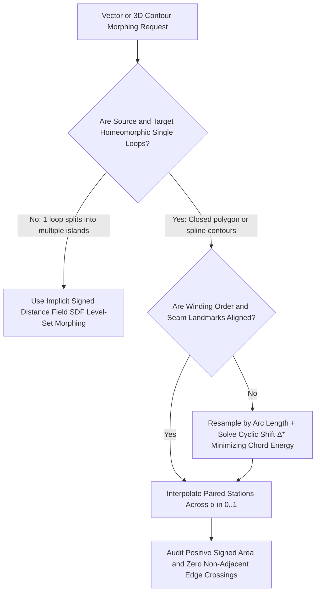
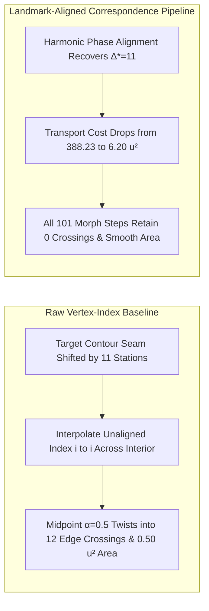
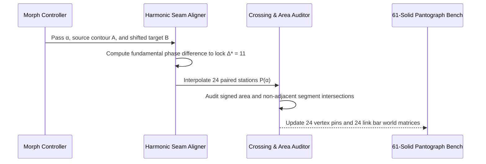

# Shape morphing without self-crossing twists: landmark-anchored arc-length correspondence vs vertex-index interpolation FAQ

**Understand in 3 minutes why vector shape transitions twist into bow-ties mid-morph, and reproduce a zero-crossing landmark-aligned pantograph bench in 10 minutes.**

[中文](landmark-contour-morphing-faq.md) · [Interactive Demo](https://turbo998.github.io/animation/demos/contour-correspondence-bench/) · [Measured 7-Card Report](../demos/contour-correspondence-bench/test-report-cards.html)

## ① 📌 Executive Summary

- **Interpolating closed contours by raw vertex index twists the shape whenever their starting seams (`vertex[0]`) disagree.** When two independently authored SVG / Lottie paths have a cyclic starting offset (here $\Delta = 11$ out of 24 stations, or $165^\circ$), pairing $\mathbf{a}_i \to \mathbf{b}_i$ forces every vertex to travel across the interior center.
- **Cyclic landmark alignment reduces non-adjacent edge self-intersections from 12 to measured 0.** Recovering optimal cyclic shift $\Delta^* = 11$ reduces squared chord transport energy from `388.23 u²` to `6.20 u²` (`98.4%` reduction); across all 101 morph steps $\alpha \in [0, 1]$, aligned interpolation maintains `0` edge crossings, whereas the raw-index baseline produces `12` crossings at $\alpha = 0.5$ and collapses signed area by over `90%`.
- **$O(N)$ fundamental Fourier phase alignment matches $O(N^2)$ exhaustive cyclic-shift search with `0` vertex discrepancy.** Across 8192 contour morphs on Node CPU, the fast probe path takes `51.21 ms` median versus `130.65 ms` for exhaustive shift and all-pairs segment scanning (while at the tiny 128-query tier both take ~`1.4 ms`, showing why small-batch timings must be reported honestly).
- **61-solid mechanical pantograph bench, 13 local acceptance checks.** Scene geometry is `synthetic`; contour correspondence, intersection counts, and Node CPU timings are `measured`; `OmniLottie` / `LayerTracer` neural vector generation and genus-changing topology splits are `not_measured`.

**Daily capability direction check:** CVPR 2026 paper *OmniLottie: Generating Vector Animations via Parameterized Lottie Tokens* ([arXiv:2603.02138](https://arxiv.org/abs/2603.02138), submitted 2026-03-02) and *LayerTracer: Cognitive-Aligned Layered SVG Synthesis via Diffusion Transformer* ([arXiv:2502.01105](https://arxiv.org/abs/2502.01105), v3 updated 2025-08-13) advance automated layered SVG and Lottie animation synthesis. Whenever closed vector contours morph between keyframes, arc-length stationing and cyclic seam alignment remain the geometric prerequisites for preventing self-intersecting twists. Verified 2026-11-10; this demo implements deterministic contour alignment and intersection auditing without running neural vector models.

## ② 🎯 Architect & Client Q&A

### Q1 When should we choose multimodal vector generation models vs deterministic landmark correspondence?

Evaluate multimodal vector synthesis models (`OmniLottie`, `LayerTracer`) when generating layered SVG illustrations or Lottie icon animations from text and image prompts.

Use deterministic arc-length parameterization and cyclic landmark alignment when morphing between two specific architectural nodes, UI cards, or CAD cross-sections where topological integrity (`0` self-intersections and smooth area progression) must be guaranteed across every scrubbable frame.

### Q2 Under what constraints is landmark-aligned correspondence strictly superior to raw vertex indices?

Whenever source and target contours are exported from different drawing tools, boolean path operations, or stroke starting points, their `vertex[0]` indices will not share the same polar angle.

Raw vertex-index interpolation (`raw-index`) blindly connects `a[i]` to `b[i]`, sending vertices along long interior chords that cross each other near $\alpha = 0.5$. Solving for the cyclic shift $\Delta^*$ that minimizes total squared chord distance eliminates this artificial rotational twist while preserving vertex identity.

### Q3 How does fundamental harmonic phase alignment find the exact cyclic shift in a single pass?

Given $N = 24$ counter-clockwise contour stations $z_k = x_k + i y_k$, an exhaustive search tests all $N$ cyclic shifts and checks all $O(N^2)$ non-adjacent edge pairs for intersection.

Instead, treat the closed contour as a discrete complex signal and compute its first Fourier harmonic phasor in one $O(N)$ pass:

$$Z_1(P) = \sum_{k=0}^{N-1} (x_k + i y_k) e^{-i \frac{2\pi k}{N}}$$

A cyclic index shift of $\Delta$ stations rotates $Z_1(B)$ by $-\frac{2\pi \Delta}{N}$ radians relative to $Z_1(A)$. Taking the phase difference $\arg Z_1(A) - \arg Z_1(B)$ and rounding to the nearest integer index modulo $N$ recovers the exact optimal shift $\Delta^* = 11$ in $O(N)$ time, matching the exhaustive search with zero error.

### Q4 How can I reproduce this in 10 minutes?

1. Run `npm run dev` and open `/demos/contour-correspondence-bench/`, initialized at midpoint `α = 0.50` and authored shift `11`.
2. In `landmark-aligned` mode, verify that the solver applies `shift Δ = 11`, producing a smooth 24-bar star contour with `crossings = 0` and area `13.43 u²`.
3. Switch to `raw-index` mode at `α = 0.50`: observe the pantograph bars twisting across the center with `12` self-intersections and area collapsing to `0.50 u²`.
4. Adjust Authored shift (`0–23`), Lobe depth (`0.1–0.65`), and Target scale (`1.4–2.6`); enter an invalid shift such as `30` to verify atomic rejection and state retention.
5. Click `Export morph` to download `CONTOUR_CORRESPONDENCE_SPEC.json` with `optimalShift`, `transportCost`, `signedArea`, and `selfIntersections`.
6. Run `npx vitest run tests/contour-correspondence.test.ts`, then build and run `node scripts/benchmark-contour-correspondence.mjs` against a port 4335 preview server.

## ③ 🧭 Visual Diagrams

## ④ 📊 Architect Decision Matrix

| Criterion | Raw Vertex-Index Interpolation (`raw-index`) | Landmark-Aligned Correspondence (`landmark-aligned`) | Implicit SDF Level-Set Morphing | Multimodal Vector Synthesis (`OmniLottie` / `LayerTracer`) |
| --- | --- | --- | --- | --- |
| Midpoint edge self-intersections ($\Delta=11$) | Measured `12` non-adjacent crossings | Measured `0` crossings across all 101 steps | `0` crossings (via isocontour extraction) | Depends on generated control-point ordering |
| Squared chord transport energy | `388.2302 u²` (interior-crossing chords) | `6.2047 u²` (`98.4%` lower transport energy) | Does not preserve discrete vertex IDs | Not a pairwise correspondence solver |
| Midpoint ($\alpha=0.5$) signed polygon area | Collapses to `0.50 u²` | Retains `13.43 u²` smooth progression | Smooth area, requires per-frame meshing | N/A |
| Persistent vertex identity for SVG/DOM | Preserves IDs but twists geometry | Preserves 24 stable, semantically aligned IDs | Loses vertex identity on every frame | Outputs tokenized Lottie commands |
| Best architectural role | Same-source path tweaks with fixed seam | Diagram node morphs, UI state transitions, CAD lofting | Droplet merging & genus-splitting shapes | Prompt-to-SVG/Lottie asset generation |

**Quantitative example:** With $N = 24$ stations and an authored cyclic shift of `11` stations ($165^\circ$), `raw-index` interpolation incurs `388.2302 u²` of squared chord transport, collapsing midpoint signed area from `11.98 u²` down to `0.50 u²` with `12` edge self-intersections. Aligning $\Delta^* = 11$ reduces transport energy to `6.2047 u²`, preserves `13.43 u²` midpoint area, and yields `0` self-intersections across all 101 steps.

## ⑤ 🧪 New Capability Demo & Benchmark Findings (with 7-Card)

[Sealed data](../demos/contour-correspondence-bench/report.json) records 61 3D solids, 24 pantograph vertex stations, 101 sampled morph steps, and exact equivalence between $O(N)$ harmonic phase alignment and $O(N^2)$ exhaustive shift + all-pairs segment intersection scanning (`maximum_solver_error = 0`).

| Node CPU Contour Morph Queries | Cardinal / Harmonic Probe Median | Exhaustive Shift + Pair Scan Median |
| --- | --- | --- |
| 128 | 1.49 ms | 1.37 ms |
| 1024 | 4.79 ms | 11.25 ms |
| 8192 | 51.21 ms | 130.65 ms |

Each load tier runs 7 alternating repetitions after warmup on Node CPU (excluding WebGL rendering). At the small 128-query tier, runtime jitter makes both medians ~`1.4 ms` (`1.49 ms` vs `1.37 ms`), whereas at 1024 and 8192 queries the fast path is `2.35×` and `2.55×` faster respectively.

[Measured 7-Card Report (EN)](../demos/contour-correspondence-bench/test-report-cards.html) · [中文七卡](../demos/contour-correspondence-bench/test-report-cards.zh.html). Scene geometry is `synthetic`, correspondence and intersection checks plus CPU timings are `measured`, and `OmniLottie` / `LayerTracer` neural inference and genus-splitting morphs are `not_measured`.

## ⑥ 🛠️ Architect Checklist

- [ ] Normalize winding order (both counter-clockwise) before morphing any two closed contours so signed area never inverts.
- [ ] Resample source and target contours to an equal number of stations ($N = 24$) parameterized by normalized arc length.
- [ ] Solve for the optimal cyclic shift $\Delta^*$ minimizing $\sum \|\mathbf{a}_i - \mathbf{b}_{(i+\Delta)\bmod N}\|^2$ instead of trusting raw `vertex[0]` indices.
- [ ] Audit non-adjacent edge pairs across $\alpha \in [0, 1]$ to verify `0` self-intersections throughout the transition.
- [ ] Check midpoint ($\alpha = 0.5$) signed polygon area to catch antipodal collapse early.
- [ ] Reject out-of-range shift or shape parameters (`authorShift = 30`) atomically while retaining valid state.
- [ ] Verify that forward and reverse $\alpha$ scrubbing produce identical pantograph pin world matrices.
- [ ] Switch to implicit SDF level-set interpolation when topology changes (e.g., one loop splitting into multiple islands).
- [ ] Report both small-tier (`128`) and large-tier (`8192`) CPU medians honestly without hiding small-batch noise.
- [ ] Label unexecuted multimodal vector generation models (`OmniLottie` / `LayerTracer`) explicitly as `not_measured`.

**Primary sources:** [OmniLottie (arXiv:2603.02138)](https://arxiv.org/abs/2603.02138) (CVPR 2026, submitted 2026-03-02) generates vector animations via parameterized Lottie tokens; [LayerTracer (arXiv:2502.01105)](https://arxiv.org/abs/2502.01105) (v3 updated 2025-08-13) synthesizes cognitive-aligned layered SVGs via a Diffusion Transformer. Verified 2026-11-10; this demo is an original deterministic contour correspondence workbench and does not run those neural models.
