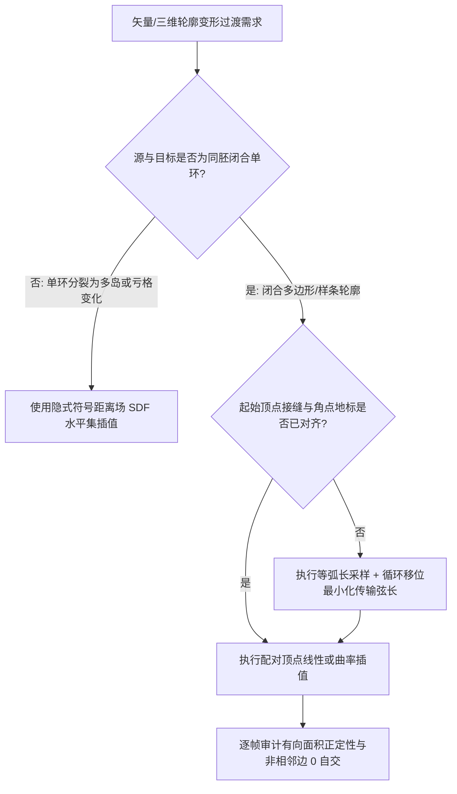
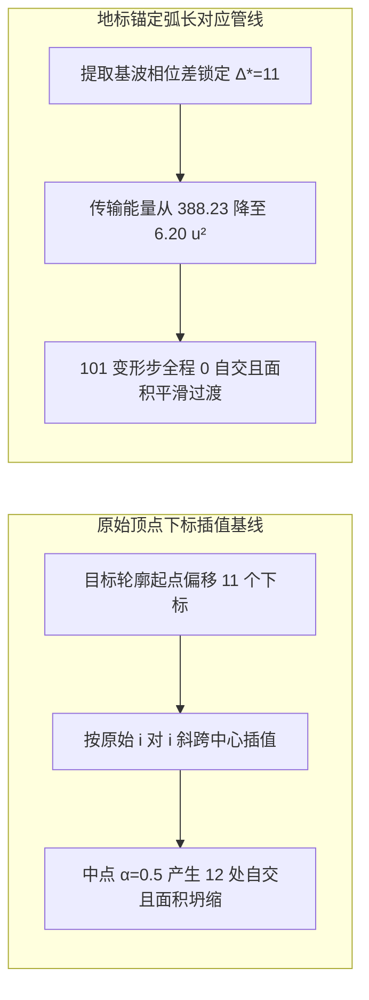
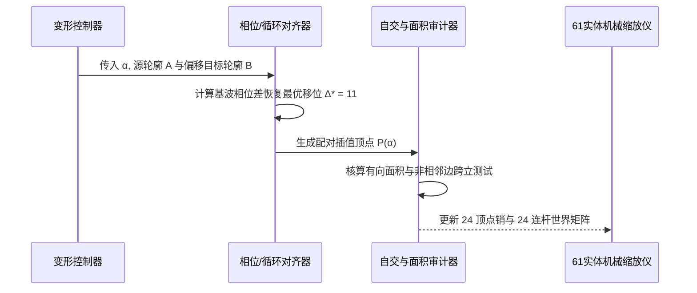

# 图形变形不自交不扭麻花：地标锚定弧长对应与原始顶点插值选型 FAQ

**3 分钟看懂为什么矢量形状过渡会在半途坍缩成麻花，10 分钟复刻零自交的地标循环对齐缩放仪。**

[English](landmark-contour-morphing-faq.en.md) · [交互 Demo](https://turbo998.github.io/animation/demos/contour-correspondence-bench/) · [中文七卡](../demos/contour-correspondence-bench/test-report-cards.zh.html)

## ① 📌 核心结论速览

- **闭合轮廓直接按原始顶点下标插值，极易因起始点（Vertex 0）接缝错位而扭成麻花。** 当两个独立绘制的 SVG / Lottie 闭合轮廓在极角上存在起始下标偏移（本例 24 顶点偏移 $\Delta = 11$，即 $165^\circ$），直接对 $\mathbf{a}_i \to \mathbf{b}_i$ 做线性插值会让所有顶点横穿图形中心。
- **地标循环移位对齐将边自交从 12 处降为实测 0 处。** 对齐最优循环移位 $\Delta^* = 11$ 后，顶点弦长平方和（传输能量）从 `388.23 u²` 骤降至 `6.20 u²`（降低 `98.4%`）；在 $\alpha \in [0, 1]$ 的全部 101 个变形采样步中，非相邻边自交保持 `0` 处，而未对齐原始下标基线在中点 $\alpha = 0.5$ 产生 `12` 处边自交且有向面积坍缩超过 `90%`。
- **$O(N)$ 傅里叶基波相位对齐与 $O(N^2)$ 全移位穷举逐顶点精确一致。** 在三档负载下，两种算法恢复出完全相同的最优移位 $\Delta^* = 11$（最大顶点误差 `0`），8192 次轮廓变形求解中位数为 `51.21 ms` 对比 `130.65 ms`（128 小批量下两者均为 ~`1.4 ms`，不夸大小负载加速）。
- **61 实体机械缩放仪工作台，13 项本机实测验收。** 场景为 `synthetic`；轮廓对应、边自交检测与 Node CPU 耗时为 `measured`；`OmniLottie` / `LayerTracer` 多模态矢量大模型推理与亏格分裂拓扑变形为 `not_measured`。

**每日能力方向核验：** CVPR 2026 接收论文 *OmniLottie: Generating Vector Animations via Parameterized Lottie Tokens*（[arXiv:2603.02138](https://arxiv.org/abs/2603.02138)，2026-03-02 提交）与 *LayerTracer: Cognitive-Aligned Layered SVG Synthesis via Diffusion Transformer*（[arXiv:2502.01105](https://arxiv.org/abs/2502.01105)，2025-08-13 v3）推动了参数化矢量动画与分层 SVG 的自动生成；而在任何两个闭合矢量图层之间执行关键帧形状插值（Shape Morphing）时，底层的弧长重采样与起始顶点接缝对齐仍然是避免图形翻转自交的几何前提。2026-11-10 核验原文；本例仅实现确定性轮廓对齐与自交审计，未运行上述生成模型。

## ② 🎯 客户与架构师灵魂拷问 Q&A

### Q1 何时选多模态矢量动画生成模型，何时选确定性轮廓地标对齐？

当需要根据文本或参考图从零生成一套复杂的分层 SVG 图标或 Lottie 动画序列时，可评估 `OmniLottie`、`LayerTracer` 等多模态矢量生成模型。

当设计师或前端系统已经给出了起始图形 A（如圆角架构卡片）与目标图形 B（如四瓣星形节点），需要在技术讲解视频、架构演进白板或数据可视化中实现丝滑且可拖拽的过渡动画时，确定性弧长采样加循环地标对齐能保证每一帧都不自交、不翻转。

### Q2 在什么约束下弧长+地标对齐比原始顶点插值严格更优？

只要源轮廓与目标轮廓来自不同绘制工具、不同布尔运算导出、或者不同笔画起点，它们的 `vertex[0]` 几乎不可能天然对齐同一方位角。

此时若直接用 CSS / SVG / Lottie 默认的原始下标线性插值（`raw-index`），每个顶点都会沿着跨越图形内部的斜弦移动，在 $\alpha = 0.5$ 附近把图形拧成“蝴蝶结”或“八字麻花”。先按弧长等分采样站点，再对齐循环移位 $\Delta^*$ 最小化传输弦长平方和，在所有同胚单环闭合轮廓过渡中严格更优。

### Q3 底层管线如何用一次遍历算出最优循环移位？

设源轮廓与目标轮廓各有 $N = 24$ 个按逆时针等弧长分布的顶点 $z_k = x_k + i y_k$。

如果暴力搜索最优循环移位 $\Delta \in \{0, \dots, N-1\}$ 并扫描所有非相邻边对是否相交，每次变形都要做 $O(N^2)$ 次距离累加与线段跨立测试。

换用第一性原理看：把顶点序列看作复平面上的周期信号，计算它的一阶傅里叶基波相量：

$$Z_1(P) = \sum_{k=0}^{N-1} (x_k + i y_k) e^{-i \frac{2\pi k}{N}}$$

当目标轮廓的起始下标循环偏移了 $\Delta$ 个站点时，它的基波相量 $Z_1(B)$ 恰好相对于 $Z_1(A)$ 旋转了 $-\frac{2\pi \Delta}{N}$ 弧度！因此只需各自遍历一次顶点算出 $\arg Z_1(A) - \arg Z_1(B)$，四舍五入到最近的整数下标，就能在 $O(N)$ 时间内直接锁定 $\Delta^* = 11$，与 $O(N^2)$ 穷举搜索得到完全相同的对齐顶点。

### Q4 十分钟如何复刻？

1. `npm run dev` 后打开 `/demos/contour-correspondence-bench/`，默认停在中点 `α = 0.50`、作者偏移 `11`。
2. 在地标对齐模式（`landmark-aligned`）下观察：求解器自动对齐 `shift Δ = 11`，24 根金属连杆组成平滑过渡的四瓣星形，`crossings = 0`，有向面积为 `13.43 u²`。
3. 切换到原始顶点下标插值（`raw-index`）：同样在 `α = 0.50`，连杆向中心剧烈扭曲交叉，`crossings = 12`，有向面积坍缩至 `0.50 u²`。
4. 修改作者起始偏移（`0–23`）、星瓣深度（`0.1–0.65`）与目标尺度（`1.4–2.6`）；若输入越界偏移 `30`，系统执行原子拒绝并保留有效状态。
5. 点击导出 `CONTOUR_CORRESPONDENCE_SPEC.json`，检查 `optimalShift`、`transportCost`、`signedArea` 与 `selfIntersections`。
6. 运行 `npx vitest run tests\contour-correspondence.test.ts`；构建并在 4335 端口预览后执行 `node scripts\benchmark-contour-correspondence.mjs`。

## ③ 🧭 直观可视化图解

## ④ 📊 Architect Decision Matrix

| 评估维度 | 原始顶点下标插值 (`raw-index`) | 本例地标对齐弧长对应 (`landmark-aligned`) | 隐式 SDF 距离场插值 | 多模态矢量生成 (`OmniLottie` / `LayerTracer`) |
| --- | --- | --- | --- | --- |
| 起点偏移 $\Delta=11$ 时中点边自交数 | 实测 `12` 处非相邻边自交 | 实测 `0` 处自交（101 步全程为 0） | 无显式边自交（靠等值面提取） | 依赖生成模型生成的控制点序列 |
| 顶点弦长平方和（传输能量） | `388.2302 u²`（横穿中心长弦） | `6.2047 u²`（仅局部径向伸缩） | 不保留显式顶点身份 | 不直接提供跨图最小传输证明 |
| 中点 $\alpha=0.5$ 有向多边形面积 | 坍缩至 `0.50 u²`（近乎缩成一点） | 保持 `13.43 u²` 平滑过渡 | 面积连续但需每帧重跑 Marching Squares | 视生成结果而定 |
| 顶点身份与 DOM/SVG 属性可追溯性 | 保留顶点但几何扭曲 | 24 个站点身份稳定且语义对齐 | 每帧重新网格化，丢失顶点身份 | 輸出 Lottie Token 序列 |
| 适用场景 | 仅限同一路径微调顶点的同源变形 | 架构图节点变形、UI 状态过渡、CAD 截面放样 | 液滴融合、单环分裂为多环 | 从文本/图像从头生成矢量动画 |

**定量算例：** 对于 24 顶点闭合轮廓，当目标轮廓起点偏移 `11` 个站点（$165^\circ$）时，未对齐插值的弦长平方和为 `388.2302 u²`，在 $\alpha = 0.5$ 处面积从 `11.98 u²` 暴跌至 `0.50 u²` 并产生 `12` 处边交叉；对齐 $\Delta^* = 11$ 后，弦长平方和仅为 `6.2047 u²`，$\alpha = 0.5$ 处面积为 `13.43 u²`，自交数为 `0`。

## ⑤ 🧪 全新 Demo 与 Benchmark 核心发现（含 7-Card）

[封存数据](../demos/contour-correspondence-bench/report.json)记录了 61 个三维实体、24 个缩放仪顶点站点、101 个变形采样步的自交审计，以及快速地标探测与全移位+全边对扫描的等价性与耗时对照。两种求解路径在全部采样步得到逐位一致的对齐顶点（最大误差 `0`）。

| Node CPU 轮廓变形查询数 | 快速地标探测对齐中位数 | 全移位+全边对自交扫描中位数 |
| --- | --- | --- |
| 128 | 1.49 ms | 1.37 ms |
| 1024 | 4.79 ms | 11.25 ms |
| 8192 | 51.21 ms | 130.65 ms |

每档负载在预热后交替运行 7 次，取 Node CPU 耗时中位数（不含 WebGL 渲染）。注意：在 128 次小批量下，受 JIT 与计时抖动影响，两条路径中位数相近（`1.49 ms` vs `1.37 ms`），因此不能泛称所有规模都加速；而在 1024 与 8192 次批量下，快速路径分别快约 `2.35×` 与 `2.55×`。

[中文七卡](../demos/contour-correspondence-bench/test-report-cards.zh.html) · [English](../demos/contour-correspondence-bench/test-report-cards.html)。画面为 `synthetic`，轮廓几何与 CPU 计时为 `measured`；`OmniLottie` / `LayerTracer` 神经矢量生成与拓扑分裂变形为 `not_measured`。

## ⑥ 🛠️ Architect Checklist

- [ ] 在对任意两个闭合轮廓执行变形前，统一它们的绕向（同为逆时针或同为顺时针），防止有向面积变负。
- [ ] 将源轮廓与目标轮廓按归一化累积弧长重采样为相同数量的站点（如 $N = 24$）。
- [ ] 求解最优循环移位 $\Delta^*$ 以最小化顶点传输弦长平方和 $\sum \|\mathbf{a}_i - \mathbf{b}_{(i+\Delta)\bmod N}\|^2$，切勿盲目按 `index 0` 硬配对。
- [ ] 对 $\alpha \in [0, 1]$ 采样区间内的所有中间帧执行非相邻边线段跨立测试，确保自交数为 `0`。
- [ ] 监控变形中点 $\alpha = 0.5$ 的有向面积，防止对径错位引发面积坍缩。
- [ ] 对越界移位或非法几何参数执行原子拒绝，保留上一个合法轮廓状态。
- [ ] 验证正序与逆序拖拽 $\alpha$ 滑块到同一位置时，导出的三维顶点销矩阵完全一致。
- [ ] 若变形涉及“一个圆分裂成三个独立圆”等拓扑亏格变化，改用隐式 SDF 水平集而非单环顶点插值。
- [ ] 如实报告小批量（128 次）与大批量（8192 次）下的 CPU 实测耗时差异，不隐瞒小负载抖动。
- [ ] 未执行的多模态矢量生成大模型（`OmniLottie` / `LayerTracer`）统一标注为 `not_measured`。

**一手来源：** [OmniLottie (arXiv:2603.02138)](https://arxiv.org/abs/2603.02138)（CVPR 2026，2026-03-02 提交）通过参数化 Lottie Token 序列生成矢量动画；[LayerTracer (arXiv:2502.01105)](https://arxiv.org/abs/2502.01105)（2025-08-13 v3）通过扩散 Transformer 生成认知对齐的可编辑分层 SVG。2026-11-10 核验；本例为原创确定性轮廓对应与自交核验工作台，未运行上述神经模型。
