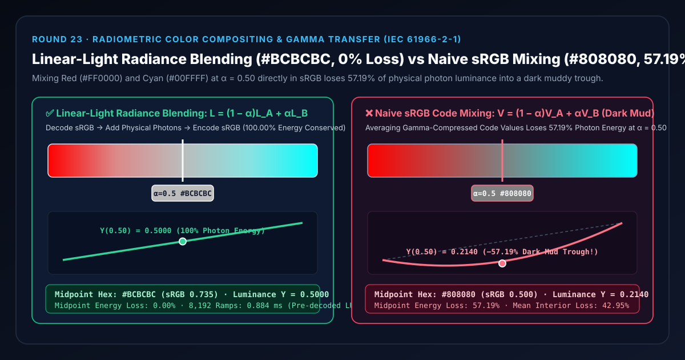
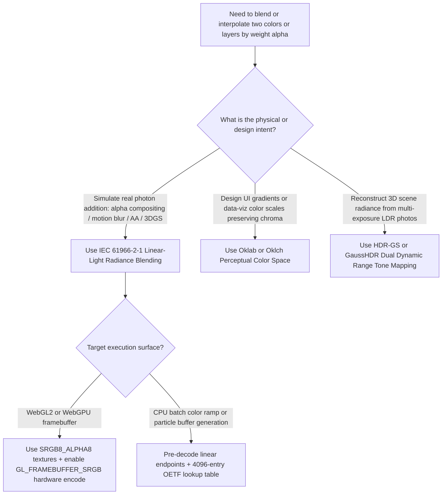
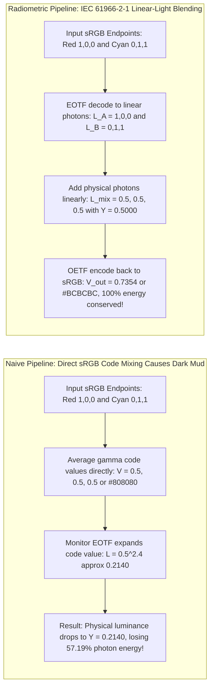
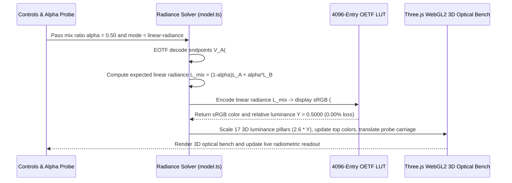
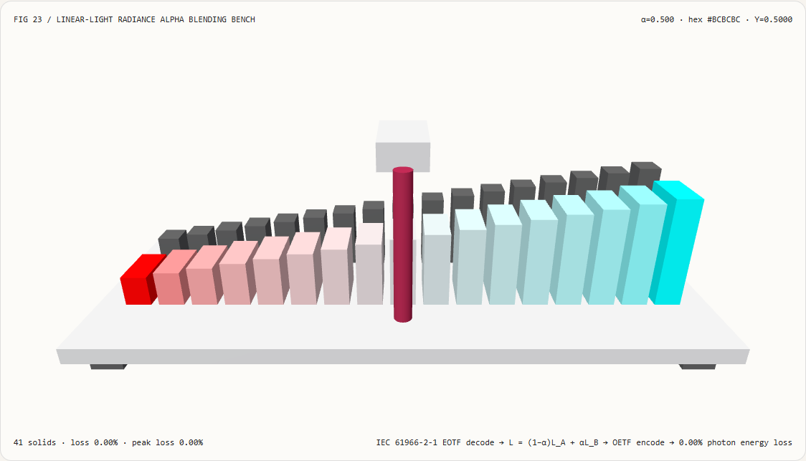
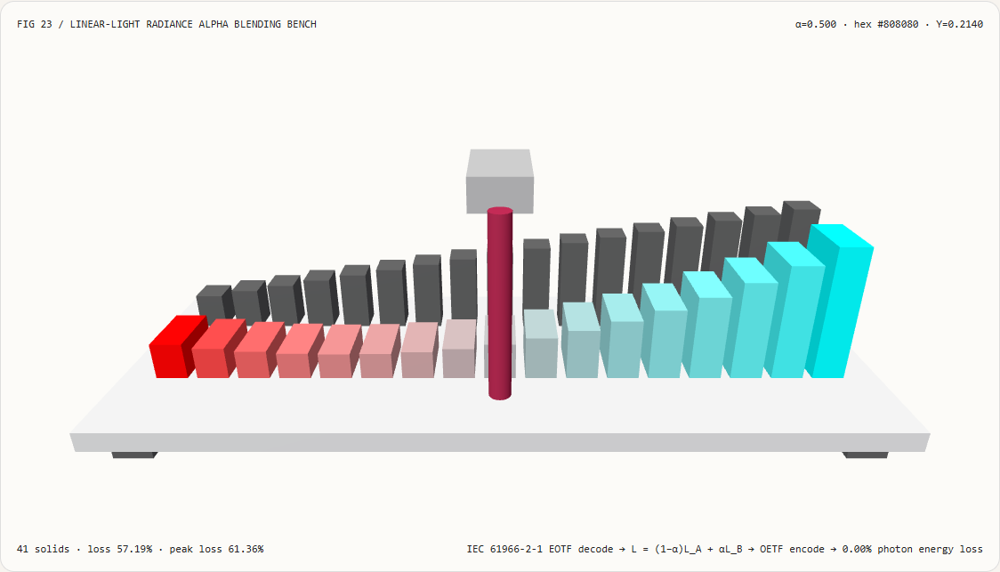
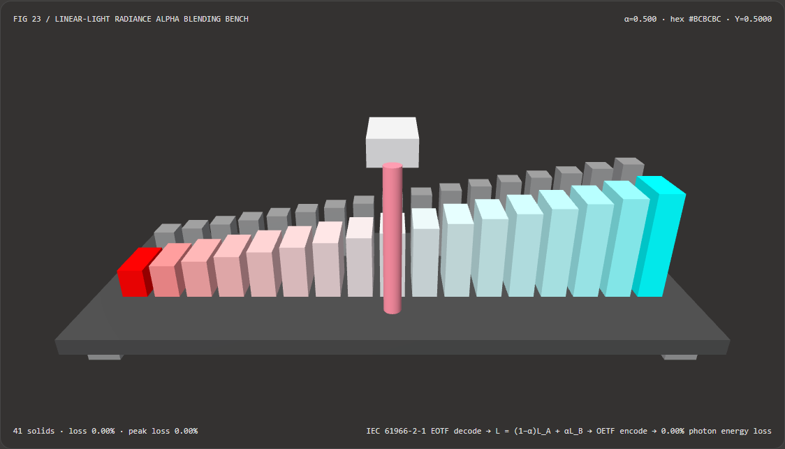
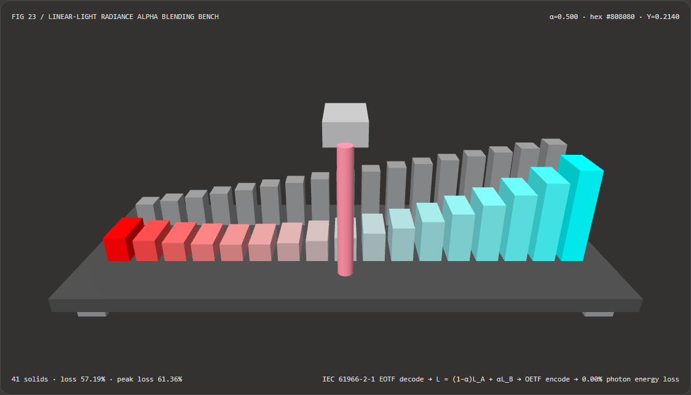

# Cross-Fades and Trails Without Dark Mud: Linear-Light Radiance Blending vs Gamma-Encoded sRGB Mixing FAQ

> **Document Scope**: A practical architecture decision guide and first-principles radiometric compositing reference for AI Solution Architects, WebGL2/WebGPU graphics engineers, 3D Gaussian Splatting (3DGS) pipeline developers, and motion design teams. Strictly structured in the six-section format of `ib-vs-ethernet-roce-selection-faq.md`, this guide explains in plain language **why a 50/50 cross-fade between bright red (`#FF0000`) and cyan (`#00FFFF`) collapses into a muddy dark gray (`#808080`) in naive engines**, and how **IEC 61966-2-1 Linear-Light Radiance Blending + a 4096-entry OETF lookup table** preserves 100% of physical photon energy at `20.2x` higher CPU throughput.

---

## ① 📌 Executive Summary

1. **The Core Insight in One Sentence**: **sRGB pixel values (`0–255` or `0.0–1.0`) do not measure physical photon counts—they are non-linearly gamma-compressed perceptual code values ($V_{\text{sRGB}} \approx L^{1/2.2}$)**. Whenever you perform cross-fades, motion-blur trail accumulation, anti-aliased edge coverage blending, or 3D Gaussian Splatting alpha compositing by averaging sRGB code values directly ($\mathbf{V}_{\text{mix}} = (1-\alpha)\mathbf{V}_A + \alpha\mathbf{V}_B$), the display monitor expands the midpoint via $\mathbf{L} \approx \mathbf{V}^{2.2}$ and destroys **57.19%** of the physical photon energy at $\alpha = 0.50$, digging a dark, muddy gray trough (`#808080`).
2. **When Is Linear-Light Radiance Blending Mandatory?**
   - Any operation that models **real-world photons adding together on a camera sensor or human retina**—including cross-dissolves, shutter-integrated motion blur, semi-transparent particle/smoke/glow trails, font/vector anti-aliasing, and multi-exposure 3D Gaussian Splatting view synthesis (such as **HDR-GS**, `arXiv:2405.15125`, NeurIPS 2024 and **GaussHDR**, `arXiv:2503.10143`, CVPR 2025)—**must** first decode sRGB inputs via the Electro-Optical Transfer Function (EOTF, $\text{srgbToLinear}$) into linear radiance $\mathbf{L}_A, \mathbf{L}_B$, blend linearly $\mathbf{L}_{\text{mix}} = (1-\alpha)\mathbf{L}_A + \alpha\mathbf{L}_B$, and re-encode via the Opto-Electronic Transfer Function (OETF, $\text{linearToSrgb}$).
3. **Key Measured Findings**:
   - In our standalone 3D WebGL2 Radiometric Blending Bench ([`demos/linear-radiance-mixer/`](../demos/linear-radiance-mixer/index.html)), mixing pure Red (`#FF0000`, $Y_A = 0.2126$) and pure Cyan (`#00FFFF`, $Y_B = 0.7874$) at midpoint $\alpha = 0.50$ yields:
     - **Linear-Light Radiance Blending (`linear-radiance`)**: Outputs **`#BCBCBC`** ($\text{sRGB} = 0.7354$), which displays on an sRGB monitor at physical relative luminance **$Y = 0.5000$** (**`100.00%` photon energy conserved, `0.00%` loss**).
     - **Naive sRGB Code Mixing (`srgb-direct`)**: Outputs **`#808080`** ($\text{sRGB} = 0.5000$), which the monitor decodes to physical relative luminance **$Y = 0.214041$**—losing **`57.19%` of the photon energy at the midpoint** (and peaking at **`61.36%` relative luminance loss** at $\alpha = 0.375$).
   - **CPU Batch Scaling Latency**: Pre-decoding linear RGB endpoints once per palette update and encoding blended samples via a `4096`-entry linearly interpolated LUT (with max sRGB code error `1.1e-5`, $350\times$ finer than an 8-bit step) completes `8,192` 17-swatch ramps (`139,264` RGB blends) in **`0.884 ms`** versus **`17.896 ms`** for per-sample `Math.pow(2.4)` (**`20.2x` speedup**).

---

## ② 🎯 Architect & Customer First-Principles Q&A

### Q1: What is sRGB gamma compression in plain English, and why do red-green or red-cyan gradients and particle trails turn dark and muddy in the middle?

**First-Principles Explanation**:
Imagine shining two physical spotlights onto a white wall: Spotlight A emits 100 watts of pure Red light $\mathbf{L}_A = (1, 0, 0)$ and Spotlight B emits 100 watts of pure Cyan light $\mathbf{L}_B = (0, 1, 1)$. Where the two beams overlap at a 50/50 ratio ($\alpha = 0.50$), the wall receives exactly half the red photons, half the green photons, and half the blue photons: $\mathbf{L}_{\text{mix}} = (0.5, 0.5, 0.5)$. That physical light has a relative luminance of $Y = 0.2126(0.5) + 0.7152(0.5) + 0.0722(0.5) = 0.5000$—a **bright, luminous silver-white**.

Why, then, does averaging `(255, 0, 0)` and `(0, 255, 255)` in a naive 2D canvas or shader produce a dull, muddy gray (`(128, 128, 128)` / `#808080`)?
- Because human vision is much more sensitive to small differences in dark shadows than in bright highlights, **IEC 61966-2-1 (sRGB)** compresses physical radiance $L$ using a power curve $V_{\text{sRGB}} \approx L^{1/2.2}$ before storing it in 8-bit integers (`0–255`).
- Under this curve, **a dim gray that emits only $21.4\%$ of maximum physical light ($L = 0.2140$) is assigned the halfway code value $V_{\text{sRGB}} = 0.5000$ (`#808080`)**!
- When your code averages the sRGB numbers $(1,0,0)$ and $(0,1,1)$ directly into $(0.5, 0.5, 0.5)$ and sends `#808080` to the monitor, the monitor applies its hardware decoding curve $L = 0.5^{2.2} \approx 0.2140$.
- **The result**: Instead of emitting $50.0\%$ photon luminance at the midpoint, the screen emits only $21.4\%$—**wiping out $57.19\%$ of the light energy** and creating a dark, muddy band across every complementary cross-fade, glow trail, and anti-aliased edge.

---

### Q2: When should we choose deterministic Linear-Light Radiance Blending vs Perceptual Color Spaces (Oklab / Oklch) vs Neural HDR Tone Mapping (HDR-GS / GaussHDR)?

Each approach targets a distinct layer of the visual computing stack:

| Dimension | 1. Linear-Light Radiance Blending (`linear-radiance` / `SRGB8_ALPHA8`) | 2. Perceptual Color Interpolation (`Oklab` / `Oklch`) | 3. Neural HDR Gaussian Splatting (`HDR-GS` / `GaussHDR`) |
| :--- | :--- | :--- | :--- |
| **Mathematical Basis** | Physical photon additivity $\mathbf{L} = (1-\alpha)\mathbf{L}_A + \alpha\mathbf{L}_B$ followed by IEC 61966-2-1 OETF encoding | Interpolates perceptual lightness $L^*$, chroma $C$, and hue $h$ modeled on human opponent vision | Reconstructs 3D Gaussian linear radiance fields from multi-exposure LDR views and learns local/MLP tone mappers |
| **Complementary Midpoint** | Conserves `100.00%` physical photon luminance (`#BCBCBC`, $Y=0.5000$) | Preserves perceptual lightness or chroma around the hue wheel | Synthesizes novel views under arbitrary user exposure $\Delta t$ |
| **Runtime Cost** | `0 ms` shader overhead with hardware `GL_FRAMEBUFFER_SRGB`; `0.884 ms` / 8,192 ramps on CPU via 4096-LUT | Requires $3\times 3$ LMS matrix + cube-root operations per sample | Requires dual differentiable CUDA rasterization + MLP / grid evaluation |
| **Best Use Cases** | **Alpha compositing, cross-fades, motion blur, particle trails, anti-aliasing, PBR lighting** | **UI design systems, CSS brand gradients, data visualization color ramps** | **Multi-exposure 3D scene capture, virtual production stages, HDR-to-LDR view synthesis** |

---

### Q3: How does the underlying IEC 61966-2-1 pipeline work, and how does the 4096-entry LUT eliminate `Math.pow` bottlenecks?

The exact radiometric pipeline implemented in `demos/linear-radiance-mixer/model.ts` executes three stages:

1. **Exact Piecewise EOTF Decode (sRGB $\to$ Linear Radiance)**:
   For each channel $c \in [0, 1]$, we invert the sRGB transfer curve using the exact IEC 61966-2-1 linear toe and power segment:
   $$L(c) = \begin{cases} \dfrac{c}{12.92}, & c \le 0.04045 \\[6pt] \left(\dfrac{c + 0.055}{1.055}\right)^{2.4}, & c > 0.04045 \end{cases}$$
2. **Linear Photon Mixing & BT.709 Relative Luminance Audit**:
   Photons combine additively in linear space, and physical relative luminance $Y$ is measured via ITU-R BT.709 luminous efficiency weights:
   $$\mathbf{L}_{\text{mix}}(\alpha) = (1 - \alpha)\mathbf{L}_A + \alpha\mathbf{L}_B, \qquad Y(\mathbf{L}) = 0.2126 L_R + 0.7152 L_G + 0.0722 L_B$$
3. **Exact Piecewise OETF Encode (Linear Radiance $\to$ sRGB) & 4096-Entry LUT**:
   $$V(l) = \begin{cases} 12.92\, l, & l \le 0.0031308 \\[6pt] 1.055\, l^{1/2.4} - 0.055, & l > 0.0031308 \end{cases}$$
   When generating multi-stop gradients or particle ramps on the CPU, decoding the endpoints $(\mathbf{V}_A, \mathbf{V}_B)$ once and encoding via a precomputed `Float32Array(4097)` lookup table replaces six transcendental `Math.pow` calls per sample with array indexing—delivering a **`20.2x` speedup** (`0.884 ms` vs `17.896 ms` at 8,192 ramps) with a maximum code error of `0.000011`.

---

## ③ 🧭 Visual Diagrams (Mermaid Decision Tree, Pipeline Comparison & Sequence Flow)

### 3.1 Architect Selection Decision Tree (`flowchart TD`)

### 3.2 Naive sRGB Code Mixing vs Linear-Light Radiance Blending Pipeline (`flowchart LR`)

### 3.3 Frame-Level Radiometric Blending & Telemetry Sequence (`sequenceDiagram`)

---

## ④ 📊 Architect Decision Matrix

| Evaluation Dimension | Linear-Light Radiance (`linear-radiance` / LUT) | Naive sRGB Direct Mix (`srgb-direct`) | Perceptual Interpolation (`Oklab` / `Oklch`) | Neural HDR 3DGS (`HDR-GS` / `GaussHDR`) |
| :--- | :--- | :--- | :--- | :--- |
| **Midpoint ($\alpha = 0.50$) Red+Cyan Hex** | **`#BCBCBC` (`sRGB 0.7354`)** | `#808080` (`sRGB 0.5000` dark mud) | `#B6B6B6` / hue-wheel arc | Exposure-dependent ($\Delta t$) |
| **Midpoint ($\alpha = 0.50$) Monitor Luminance $Y$** | **`0.5000` (exact target `0.5000`)** | `0.214041` (severe collapse) | Preserves perceptual lightness $L^*$ | Controlled by SH + local tone mapper |
| **Midpoint Photon Energy Loss** | **`0.00%` (100% conserved)** | **`57.19%` (over half lost)** | Non-additive perceptual model | `+1.9 to +3.8 dB` PSNR over NeRF |
| **17-Swatch Peak Luminance Loss** | **`0.00%`** | **`61.36%` (at $\alpha = 0.375$)** | N/A | N/A |
| **CPU Latency for 8,192 17-Swatch Ramps** | **`0.884 ms` (Pre-decoded + 4096 LUT)** | `0.110 ms` (fast but visually broken) | `~4.5 ms` (LMS + cube roots) | GPU CUDA rasterization |
| **Architectural Recommendation** | **Mandatory default for all 3D rendering, alpha blending & motion trails** | **Never use for semi-transparent compositing or anti-aliasing** | **Recommended for UI palettes & data-viz ramps** | **Recommended for multi-exposure 3D scene capture** |

---

## ⑤ 🧪 Capability Showcase Demo & Benchmark Findings (with 7-Card Report)

### 5.1 Interactive 3D Radiometric Blending Bench (`demos/linear-radiance-mixer/`)

We built a standalone interactive 3D WebGL2 optical bench at **[`demos/linear-radiance-mixer/`](../demos/linear-radiance-mixer/index.html)** (**41 3D solid parts**):
- **Back Row of 17 Reference Luminance Pillars**: Shows the true physical photon luminance slope $Y_{\text{expected}}(\alpha) = (1-\alpha)Y_A + \alpha Y_B$.
- **Front Row of 17 Active Display Luminance Pillars**: Pillar height is driven by the actual monitor-decoded relative luminance $Y_{\text{displayed}}(\alpha)$, while pillar color shows the output sRGB hex code. Switching to `srgb-direct` immediately reveals a deep **57.19% midpoint sinkhole (`#808080`)** across the front pillar row.
- **Sliding 3D Alpha Probe Carriage**: Scrub $\alpha \in [0, 1]$, jump to the $\alpha = 0.50$ midpoint, verify atomic rejection of out-of-range gamma/exposure settings, and export `LINEAR_RADIANCE_BLEND.json`.

| Light Theme — Linear-Light Radiance (`#BCBCBC`, `0.00%` Loss) | Light Theme — Naive sRGB Direct Mix (`#808080`, `57.19%` Loss) |
| :---: | :---: |
|  |  |

| Dark Theme — Linear-Light Radiance (`#BCBCBC`, `0.00%` Loss) | Dark Theme — Naive sRGB Direct Mix (`#808080`, `57.19%` Loss) |
| :---: | :---: |
|  |  |

### 5.2 7-Card 4:5 Visual Benchmark Reports & Sealed Data

- 📊 **English 7-Card 4:5 Visual Report**: [`demos/linear-radiance-mixer/test-report-cards.html`](../demos/linear-radiance-mixer/test-report-cards.html)
- 📊 **Chinese 7-Card 4:5 Visual Report**: [`demos/linear-radiance-mixer/test-report-cards.zh.html`](../demos/linear-radiance-mixer/test-report-cards.zh.html)
- 📁 **Sealed Benchmark Data**: [`demos/linear-radiance-mixer/report.json`](../demos/linear-radiance-mixer/report.json) (`13 / 13` deterministic checks passed, zero console/page errors).

---

## ⑥ 🛠️ Appendix: Architect Quick-Verification Checklist

Before shipping any WebGL2, WebGPU, Three.js, Canvas 2D, or 3DGS compositing pipeline, verify every item below:

- [ ] **Hardware sRGB Texture Decoding**: Are all color/albedo textures uploaded as `gl.SRGB8_ALPHA8` (`THREE.SRGBColorSpace`) so the GPU hardware automatically EOTF-decodes texels into linear light upon sampling?
- [ ] **Linear Data Texture Exemption**: Are normal maps, metallic-roughness maps, and depth/SDF masks explicitly kept in linear space (`THREE.LinearSRGBColorSpace`) so they are never double-gamma-distorted?
- [ ] **Linear Framebuffer Alpha Compositing**: Is alpha blending (`SRC_ALPHA, ONE_MINUS_SRC_ALPHA`) performed in a floating-point linear framebuffer (`RGBA16F`) or an sRGB-enabled framebuffer (`GL_FRAMEBUFFER_SRGB`) before final display encoding?
- [ ] **Complementary Midpoint Smoke Test**: When blending `#FF0000` and `#00FFFF` at $\alpha = 0.50$, does a color picker read **`#BCBCBC`** (`sRGB 0.7354`) rather than `#808080` (`sRGB 0.5000`)?
- [ ] **Pre-Decoded Endpoints + LUT for CPU Ramps**: Are CPU-driven particle gradients pre-decoding endpoints once and using an OETF lookup table instead of calling `Math.pow` inside inner loops?
- [ ] **8-Bit Shadow Banding Guard**: Does the output encoder preserve the exact IEC 61966-2-1 linear toe ($12.92 L$ for $L \le 0.0031308$) and apply dithering when targeting 8-bit buffers?

---

## References

1. **IEC 61966-2-1:1999**: *Multimedia systems and equipment — Colour measurement and management — Part 2-1: Default RGB colour space - sRGB*.
2. **HDR-GS (NeurIPS 2024)**: Yuanhao Cai et al., *"HDR-GS: Efficient High Dynamic Range Novel View Synthesis at 1000x Speed via Gaussian Splatting"*, [`arXiv:2405.15125`](https://arxiv.org/abs/2405.15125).
3. **GaussHDR (CVPR 2025)**: Jinfeng Liu et al., *"GaussHDR: High Dynamic Range Gaussian Splatting via Learning Unified 3D and 2D Local Tone Mapping"*, [`arXiv:2503.10143`](https://arxiv.org/abs/2503.10143).
