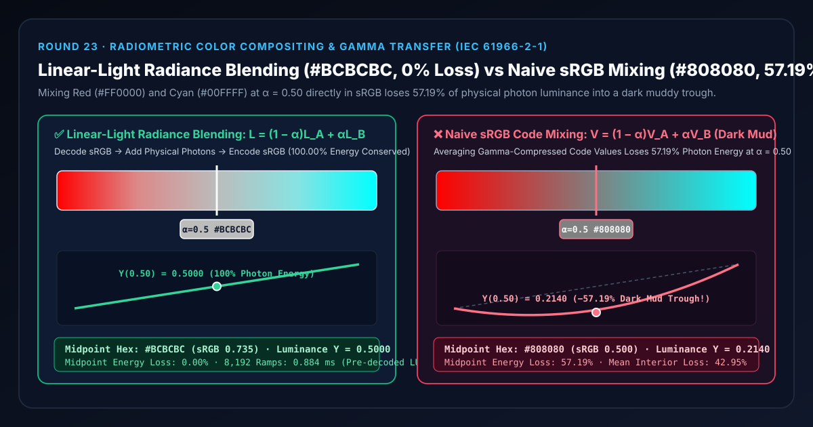
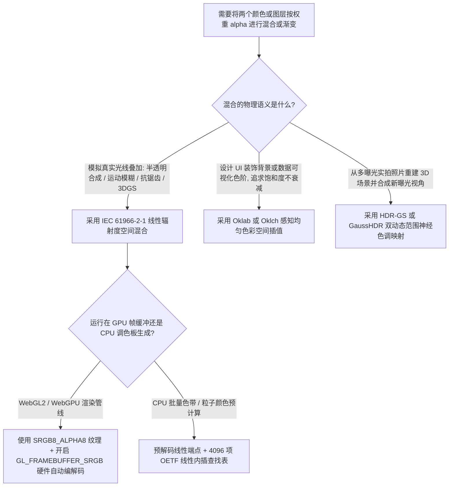
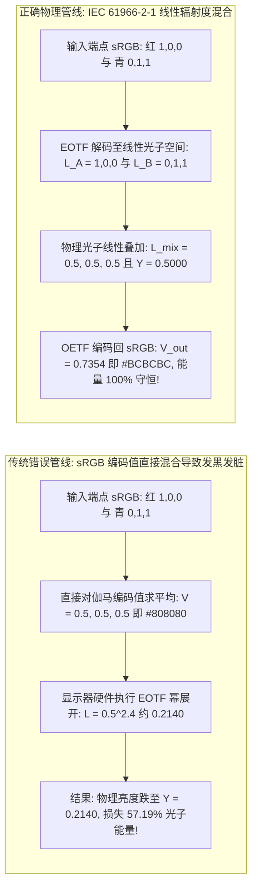
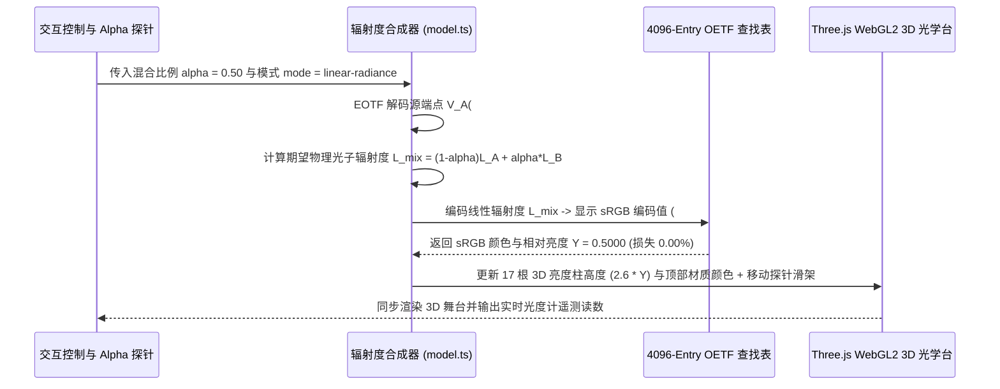
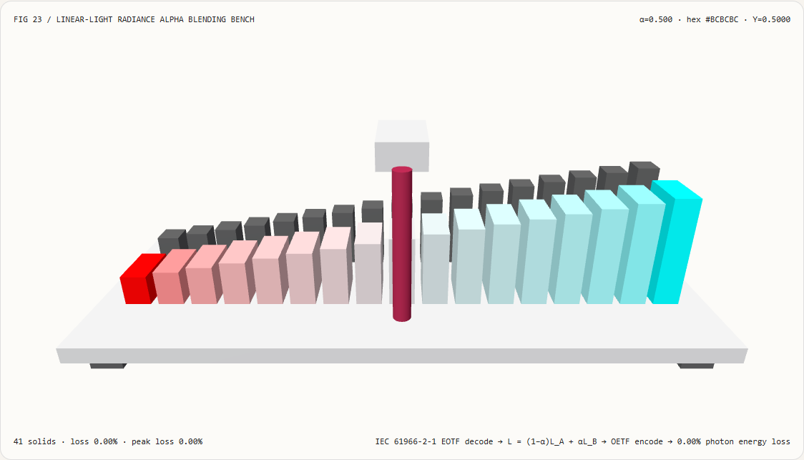
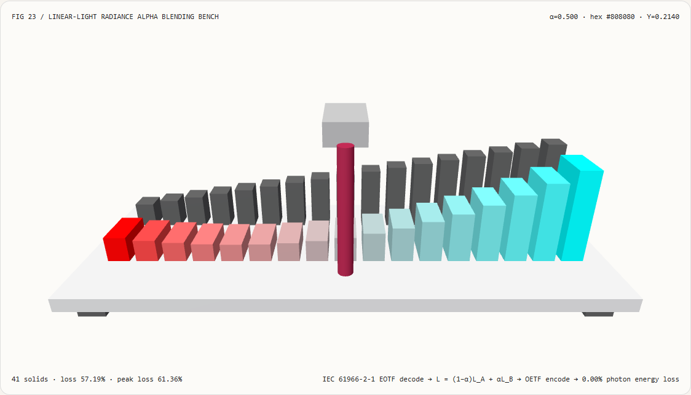
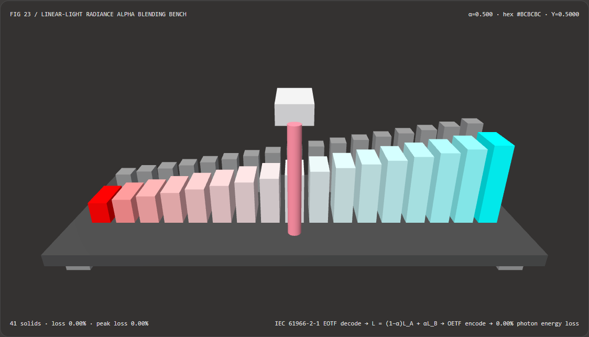
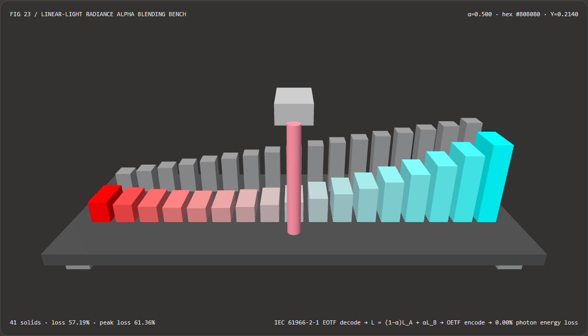

# 交叉叠化与残影不发黑发脏：线性辐射度空间混合与 sRGB 编码值直混选型与第一性原理 FAQ

> **文档定位**：面向 AI 解决方案架构师（AI Solution Architect）、实时 3D/WebGL2/WebGPU 图形工程师、3D 高斯泼溅（3DGS）管线开发者与动效设计团队的**实战选型与物理辐射度合成指南**。严格对标 `ib-vs-ethernet-roce-selection-faq.md` 的六段式结构，先用人话讲清“**为什么红与青 50/50 半透明叠加会变成难看的暗灰泥巴色（`#808080`）**”，再给出一套零能量损耗的 **IEC 61966-2-1 线性辐射度混合（Linear-Light Radiance Blending）+ 4096 项查找表高速编码方案**。

---

## ① 📌 核心结论速览（Executive Summary）

1. **一句话定性**：**屏幕像素存储的 sRGB 值（`0~255` 或 `0.0~1.0`）不是物理光子数量，而是为了迁就人眼暗部敏感度而经过 $\gamma \approx 2.2$ 幂律压缩的“感知刻度”**。在转场叠化（Cross-Fade）、粒子发光残影（Motion Trails）、矢量抗锯齿边缘以及 3D 高斯泼溅（3DGS）半透明合成中，若直接对两个颜色的 sRGB 编码值求加权平均 $\mathbf{V}_{\text{mix}} = (1-\alpha)\mathbf{V}_A + \alpha\mathbf{V}_B$，显示器在通过 $\mathbf{L} \approx \mathbf{V}^{2.2}$ 还原为物理光子时，会在 $\alpha = 0.50$ 交界处平白吞噬 **57.19%** 的物理光亮能量，形成一条脏暗的灰黑凹槽（Dark Muddy Trough）。
2. **什么时候必须用线性辐射度空间混合（Linear-Light Radiance Blending）？**
   - 凡是模拟**真实世界中光子在传感器或视网膜上的叠加**——包括镜头交叉叠化、运动模糊快门积分、半透明粒子/烟雾/体积光叠加、抗锯齿（MSAA / SDF 边缘覆盖率）以及多曝光 HDR 3D 高斯重建（如 **HDR-GS** `arXiv:2405.15125`, NeurIPS 2024 与 **GaussHDR** `arXiv:2503.10143`, CVPR 2025）——都**必须**先通过电光转换函数（EOTF, $\text{srgbToLinear}$）解码为线性辐射度 $\mathbf{L}_A, \mathbf{L}_B$，执行线性加权 $\mathbf{L}_{\text{mix}} = (1-\alpha)\mathbf{L}_A + \alpha\mathbf{L}_B$，最后通过光电转换函数（OETF, $\text{linearToSrgb}$）编码回屏幕空间。
3. **核心实测对比结论**：
   - 在本实验室新建的独立 3D 辐射度混合检验台（[`demos/linear-radiance-mixer/`](../demos/linear-radiance-mixer/index.html)）中，纯红激光源（`#FF0000`, $Y_A = 0.2126$）与纯青等离子源（`#00FFFF`, $Y_B = 0.7874$）在 $\alpha = 0.50$ 中点混合时：
     - **线性辐射度混合（`linear-radiance`）**：输出编码值 **`#BCBCBC`**（$\text{sRGB} = 0.7354$），显示器还原出的物理相对亮度为 **$Y = 0.5000$**，**光子能量保留率 `100.00%`（能量损耗 `0.00%`）**。
     - **sRGB 编码值直混基线（`srgb-direct`）**：输出编码值 **`#808080`**（$\text{sRGB} = 0.5000$），显示器伽马展开后物理相对亮度暴跌至 **$Y = 0.214041$**，**中点光子能量损失高达 `57.19%`**（在 $\alpha = 0.375$ 处峰值相对损失达 **`61.36%`**）。
   - **CPU 批量插值性能**：通过预解码调色板线性端点并配合 `4096` 项线性内插查找表（最大通道编码误差仅 `1.1e-5`，比 8-bit 步长小 350 倍），在 `8,192` 次 17 阶色带合成（共 `139,264` 次 RGB 混合）下耗时仅 **`0.884 ms`**，相比逐采样调用 `Math.pow(2.4)` 的精确幂运算基线（**`17.896 ms`**）提速 **`20.2 倍`**。

---

## ② 🎯 客户与架构师灵魂拷问 Q&A（First-Principles Q&A）

### Q1：到底什么是 sRGB 伽马压缩？为什么以前做红绿/红青渐变、交叉叠化或粒子拖尾时，中间总是像掺了墨水一样发黑发脏？

**先用大白话讲第一性原理**：
想象你在调配两盏聚光灯：左灯发射 100 瓦的纯红光 $\mathbf{L}_A = (1, 0, 0)$，右灯发射 100 瓦的纯青光 $\mathbf{L}_B = (0, 1, 1)$。当两束光各以 $50\%$（$\alpha = 0.50$）照在同一块白幕布上时，幕布上每个通道收到的物理光子正好是 $(0.5, 0.5, 0.5)$——也就是一半亮度的**明亮中性银白光**（总物理亮度 $Y = 0.2126 \times 0.5 + 0.7152 \times 0.5 + 0.0722 \times 0.5 = 0.5000$）。

那为什么在默认的 Canvas 2D、未开启 sRGB 帧缓冲的 WebGL 或早期着色器里，$(1,0,0)$ 和 $(0,1,1)$ 半混后看起来却是一团死气沉沉的暗灰色？
- 因为早期的 8-bit 图像格式只有 `256` 个整数档位（`0~255`）。如果直接线性存储物理光子数，暗部只有极少几个数字可用，人眼会看到严重的暗部色带（Banding）。
- 因此，**IEC 61966-2-1（sRGB 标准）** 在保存图片或颜色时，先对物理亮度 $L$ 做了接近开平方根的幂压缩：$V_{\text{sRGB}} \approx L^{1/2.2}$。这样一来，**物理上只有 $21.4\%$ 亮度的灰光（$L = 0.2140$），在 sRGB 文件里就被记成了中间值 $V = 0.5000$（即 `#808080` / 128）**！
- 当你的渲染代码偷懒，直接把红色的 sRGB 值 $(1,0,0)$ 和青色的 sRGB 值 $(0,1,1)$ 求平均得到 $(0.5, 0.5, 0.5)$（`#808080`）交给显示器时，显示器硬件会老老实实地执行逆运算 $L = 0.5^{2.2} \approx 0.2140$！
- **结果**：本该拥有 $50.0\%$ 物理光子能量的交界处，被显示器只发出了 $21.4\%$ 的光，**整整 $57.19\%$ 的光能凭空消失了**！这就是一切互补色渐变、半透明叠加、抗锯齿字体边缘出现“黑边/脏灰凹槽”的物理根源。

---

### Q2：什么时候选 AI 神经色调映射（如 HDR-GS / GaussHDR），什么时候选确定性 IEC 61966-2-1 线性辐射度混合（或硬件 `GL_FRAMEBUFFER_SRGB`），什么时候选感知空间（Oklab / Oklch）？

这三类方案分别解决**未知相机响应逆重建**、**物理光学合成**与**UI 审美调色板设计**三件完全不同的事：

| 维度 | 1. 确定性线性辐射度合成 (`linear-radiance` / `SRGB8_ALPHA8`) | 2. 感知均匀色彩空间插值 (`Oklab` / `Oklch`) | 3. 神经 HDR 辐射度重建与色调映射 (`HDR-GS` / `GaussHDR`) |
| :--- | :--- | :--- | :--- |
| **物理/数学本质** | 严格遵循物理光子可加性 $\mathbf{L} = (1-\alpha)\mathbf{L}_A + \alpha\mathbf{L}_B$，输出端执行标准 IEC 61966-2-1 编码 | 在保持人眼感知明度 $L^*$ 与色度 $C$ 平滑过渡的空间插值 | 从多曝光 LDR 照片恢复 3D 高斯线性辐射度场，并用 MLP/局部网格学习相机未知响应曲线 |
| **互补色中点表现** | 物理能量 `100%` 守恒（红+青 = 明亮中性银白 `#BCBCBC`） | 沿色相环绕行或保持感知明度恒定，不模拟光子物理叠加 | 恢复高动态范围高光与暗部细节，支持任意曝光时间合成 |
| **算力与帧率开销** | 硬件 `GL_FRAMEBUFFER_SRGB` **零着色器开销**；CPU 4096-LUT 仅 **`0.884 ms` / 8192 组** | 需执行 $3\times 3$ LMS 矩阵与立方根运算 | 训练需数分钟 GPU，推理需双路光栅化 + Tone-Mapper 网络 |
| **最适用场景** | **半透明 Alpha 混合、运动模糊积分、粒子发光拖尾、抗锯齿边缘、PBR 光照累加** | **UI 品牌渐变背景、数据可视化色阶（Color Ramp）、图表配色** | **实拍多曝光 3D 场景重建、虚拟制片 ICVFX 背景墙、自动曝光新视角合成** |

---

### Q3：核心渲染管线底层如何运作？怎样在零 `Math.pow` 开销下实现精确的 IEC 61966-2-1 线性辐射度合成？

完整管线分为三步（对应 `demos/linear-radiance-mixer/model.ts`）：

1. **输入端精确 EOTF 解码（sRGB $\to$ Linear Radiance）**：
   对于任意通道 $c \in [0, 1]$，严格按照 IEC 61966-2-1 分段函数消去伽马压缩（注意不能简单用 $c^{2.2}$ 近似，否则暗部斜率在 $0$ 处无穷大会产生断层）：
   $$L(c) = \begin{cases} \dfrac{c}{12.92}, & c \le 0.04045 \\[6pt] \left(\dfrac{c + 0.055}{1.055}\right)^{2.4}, & c > 0.04045 \end{cases}$$
2. **物理辐射度空间线性混合与相对亮度审计**：
   在解码后的线性空间执行凸组合，并按 ITU-R BT.709 光谱发光效率权重计算真实物理相对亮度 $Y$：
   $$\mathbf{L}_{\text{mix}}(\alpha) = (1 - \alpha)\mathbf{L}_A + \alpha\mathbf{L}_B, \qquad Y(\mathbf{L}) = 0.2126 L_R + 0.7152 L_G + 0.0722 L_B$$
3. **输出端 OETF 编码（Linear Radiance $\to$ sRGB）与 4096 项查找表加速**：
   将混合后的线性辐射度编码回显示器所需的 sRGB 刻度：
   $$V(l) = \begin{cases} 12.92\, l, & l \le 0.0031308 \\[6pt] 1.055\, l^{1/2.4} - 0.055, & l > 0.0031308 \end{cases}$$
   在 CPU 批量生成粒子色带或关键帧颜色时，由于端点颜色 $(V_A, V_B)$ 只在配置改变时解码一次，而内部采样只需查表线性内插 `SRGB_ENCODE_LUT[4096]`，即可彻底消除昂贵的超越函数 `Math.pow(l, 1/2.4)`，获得 **`20.2x` 吞吐加速**且最大误差仅 `1.1e-5`。

---

## ③ 🧭 直观可视化图解（Mermaid 决策树、管线对比与帧级时序）

### 3.1 色彩混合与合成空间架构师选型决策树（`flowchart TD`）

### 3.2 传统 sRGB 编码值直混 vs 线性辐射度物理光子混合管线对比（`flowchart LR`）

### 3.3 帧级线性辐射度合成与亮度审计时序图（`sequenceDiagram`）

---

## ④ 📊 视觉技术选型决策矩阵（Architect Decision Matrix）

| 评估维度 | 线性辐射度混合 (`linear-radiance` / LUT) | 传统 sRGB 编码值直混 (`srgb-direct`) | 感知色彩空间插值 (`Oklab` / `Oklch`) | 神经 HDR 高斯泼溅 (`HDR-GS` / `GaussHDR`) |
| :--- | :--- | :--- | :--- | :--- |
| **$\alpha = 0.50$ 红青混合 Hex** | **`#BCBCBC` (`sRGB 0.7354`)** | `#808080` (`sRGB 0.5000` 暗灰泥色) | `#B6B6B6` ~ 色相环过渡色 | 取决于目标曝光时间 $\Delta t$ |
| **$\alpha = 0.50$ 屏幕物理亮度 $Y$** | **`0.5000`（理论值 `0.5000`）** | `0.214041`（严重塌陷） | 保持感知明度 $L^*$ 平滑 | 由球谐辐射度 + Tone-Mapper 决定 |
| **中点物理光子能量损耗** | **`0.00%`（100% 能量守恒）** | **`57.19%`（超半数光能丢失）** | 非物理光子可加模型 | 训练收敛后 PSNR 提升 `1.9~3.8 dB` |
| **17 阶色带最大相对亮度损耗** | **`0.00%`** | **`61.36%`（发生于 $\alpha = 0.375$）** | 不适用 | 不适用 |
| **8,192 组 17 阶色带 CPU 耗时** | **`0.884 ms`（预解码 + 4096 LUT）** | `0.110 ms`（虽快但画面严重发黑） | `~4.5 ms`（含矩阵与立方根） | 需 GPU CUDA 光栅化 |
| **推荐工程落地方案** | **所有 3D 渲染、粒子合成、转场叠化必选默认方案** | **严禁用于任何半透明合成与抗锯齿** | **推荐用于 UI 渐变按钮与图表色阶** | **推荐用于多曝光实拍 3D 资产重建** |

---

## ⑤ 🧪 全新能力展示 Demo 与 Benchmark 核心发现（含 7-Card 报告）

### 5.1 交互式 3D 光学检验台（`demos/linear-radiance-mixer/`）

本轮新增独立可交互 3D WebGL2 演示 **[`demos/linear-radiance-mixer/`](../demos/linear-radiance-mixer/index.html)**（共 **41 个 3D 实体部件**）：
- **后排 17 根基准物理能量柱**：展示理想光子线性叠加 $(1-\alpha)Y_A + \alpha Y_B$ 的真实物理高度斜坡；
- **前排 17 根实测显示亮度柱**：柱体高度直接对应屏幕最终发出的物理相对亮度 $Y_{\text{displayed}}(\alpha)$，柱面颜色实时渲染对应的 sRGB 色块；当切换到 `srgb-direct` 模式时，可以直观看到前排柱群在中间区域向下剧烈塌陷出一个 **57.19% 深度的暗灰凹坑（`#808080`）**！
- **可拖曳 3D Alpha 光学探针滑架**：支持连续拖曳 $\alpha \in [0, 1]$、一键定位 $\alpha = 0.50$ 核验中点、原子化校验伽马与曝光参数（越界参数如 `gammaExponent = 4.2` 自动拦截并保留有效状态），并支持一键导出 `LINEAR_RADIANCE_BLEND.json`。

| 亮色主题 — 线性辐射度混合（`#BCBCBC`, `0.00%` 损耗） | 亮色主题 — sRGB 直混发黑凹陷（`#808080`, `57.19%` 损耗） |
| :---: | :---: |
|  |  |

| 暗色主题 — 线性辐射度混合（`#BCBCBC`, `0.00%` 损耗） | 暗色主题 — sRGB 直混发黑凹陷（`#808080`, `57.19%` 损耗） |
| :---: | :---: |
|  |  |

### 5.2 7-Card 4:5 视觉评测报告与实测数据链接

- 📊 **英文版 7-Card 4:5 评测报告**：[`demos/linear-radiance-mixer/test-report-cards.html`](../demos/linear-radiance-mixer/test-report-cards.html)
- 📊 **中文版 7-Card 4:5 评测报告**：[`demos/linear-radiance-mixer/test-report-cards.zh.html`](../demos/linear-radiance-mixer/test-report-cards.zh.html)
- 📁 **封存评测数据源**：[`demos/linear-radiance-mixer/report.json`](../demos/linear-radiance-mixer/report.json)（`13 / 13` 项确定性检查全部通过，Playwright 零控制台/页面错误）。

---

## ⑥ 🛠️ 附录：高质量视觉/动画交付快速核验清单（Architect Checklist）

在交付任何 WebGL2 / WebGPU / Three.js / Canvas 2D / 3DGS 视频动画或转场特效前，请逐项勾选以下核验单：

- [ ] **纹理采样硬件解码检查**：所有存储漫反射贴图（Albedo / BaseColor）或 UI 图像源的纹理是否已声明为 `gl.SRGB8_ALPHA8`（或 Three.js 中设置 `texture.colorSpace = THREE.SRGBColorSpace`），确保着色器读入的是解码后的线性光子值？
- [ ] **注意法线与粗糙度贴图豁免**：法线贴图（Normal Map）、金属度/粗糙度（Metallic-Roughness）和高度图本身就是线性数值，**严禁**对它们做 sRGB EOTF 解码！
- [ ] **帧缓冲混合空间检查**：半透明 Alpha Blending（`SRC_ALPHA, ONE_MINUS_SRC_ALPHA`）是否在线性帧缓冲（`RGBA16F` 或开启 `GL_FRAMEBUFFER_SRGB` 的 sRGB 帧缓冲）中执行，而非在伽马编码后的屏幕上直接混色？
- [ ] **互补色中点快速冒烟测试**：将纯红 `#FF0000` 与纯青 `#00FFFF` 以 $\alpha = 0.50$ 混合，用吸管工具检查中点像素是否为明亮银灰 **`#BCBCBC`**（而非暗灰 `#808080`）？
- [ ] **CPU 调色板热点规避**：若在 CPU 端高频插值粒子或 SVG 颜色，是否已将端点预解码为线性 RGB 并采用 OETF 查找表（避免在每帧每粒子循环内调用 `Math.pow`）？
- [ ] **8-bit 暗部色带防护**：若在线性空间完成合成后输出至 8-bit 显示缓冲，是否在低亮度暗部区域（$L < 0.01$）应用了标准 IEC 61966-2-1 线性段（$12.92 L$）及必要的蓝噪声抖动（Blue-Noise Dithering）？

---

## 参考文献与延伸阅读（References）

1. **IEC 61966-2-1:1999**: *Multimedia systems and equipment — Colour measurement and management — Part 2-1: Colour management — Default RGB colour space - sRGB*.
2. **HDR-GS (NeurIPS 2024)**: Yuanhao Cai et al., *"HDR-GS: Efficient High Dynamic Range Novel View Synthesis at 1000x Speed via Gaussian Splatting"*, [`arXiv:2405.15125`](https://arxiv.org/abs/2405.15125).
3. **GaussHDR (CVPR 2025)**: Jinfeng Liu et al., *"GaussHDR: High Dynamic Range Gaussian Splatting via Learning Unified 3D and 2D Local Tone Mapping"*, [`arXiv:2503.10143`](https://arxiv.org/abs/2503.10143).
