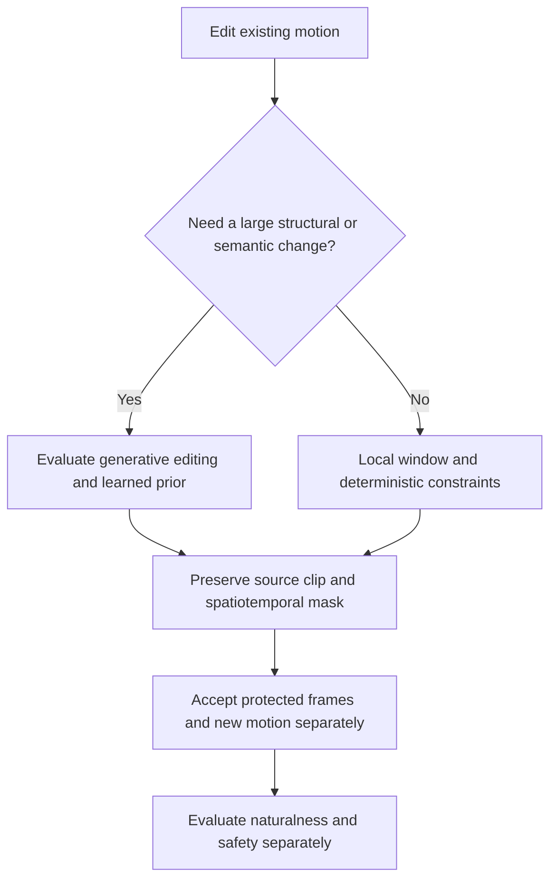
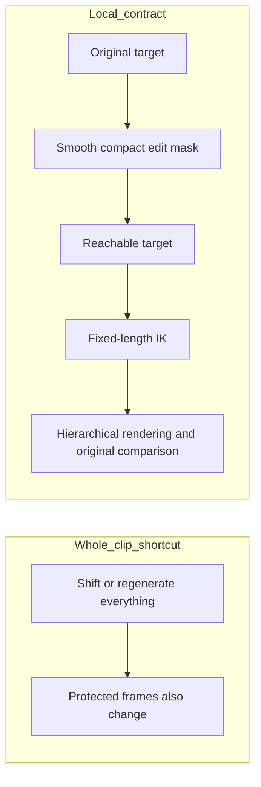
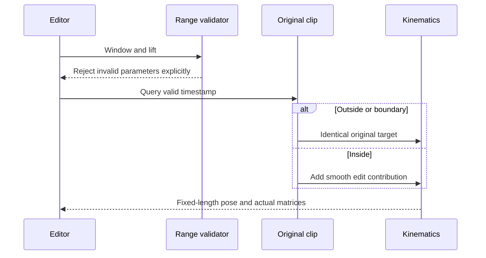

# Edit the window without rewriting the clip: local motion preservation and IK FAQ

**Three minutes for boundaries; ten minutes to reproduce local lifting.**

[中文](local-motion-preservation-faq.md) · [Interactive demo](https://turbo998.github.io/animation/demos/masked-motion-arm/) · [Measured cards](../demos/masked-motion-arm/test-report-cards.html)

## ① 📌 Executive Summary

- **Generating a new movement and editing an existing one are different tasks.** Lift only within 3–7 seconds while retaining the original outside. All 82 sampled protected poses remain exact; “the whole film still looks okay” is not equivalent.
- **Smooth edits must not stretch bones.** The original 73-solid two-link arm retains lengths of 2.2 and 1.6 scene units. Inverse kinematics finds joint angles from the desired target rather than scaling links.
- **Do not confuse two clocks.** A paper's generation-iteration schedule and a clip's spatiotemporal mask are different axes. This prototype implements clip-time masking and analytic kinematics, not Scheduled Inpainting inference.
- **Fourteen local acceptance checks and sealed seven-card evidence.** Scene: `synthetic`; code/Node CPU: `measured`; learned naturalness, paper implementation, real-device safety and GPU time: `not_measured`.

**Verified daily direction:** the July 31, 2026 primary paper *Interactive Generative Motion Editing via Scheduled Inpainting* combines existing-motion preservation, local changes, stitching and extension in an interactive generative workflow. Primary text verified November 9, 2026; not claimed as today's launch or a measured popularity ranking.

## ② 🎯 Customer and architect Q&A

### Q1 When should I choose AI video versus interactive code?

Natural performances, major action transitions and photographic appearance can favor video/motion generation or professional animation tools. “Change only the 3–7-second lift while keeping 82 protected samples identical” needs an explicit edit boundary and inspectable acceptance state.

Use a model for natural movement and code for boundaries and project state when appropriate. **Creating a new motion does not establish preservation of the old one.** Mechanical-arm kinematics is not a human-motion model.

### Q2 Under which constraints does deterministic code win?

Fixed lengths, reachable targets, a declared time window and exact outside preservation are structured requirements that code can expose and compare. A customer can inspect protected portions without recreating the entire clip.

Changing “step down” into “jump down a high platform” needs semantic and full-body coordination. Simple warping can become unnatural. The paper uses a learned prior for larger structural edits; **our bounded analytic modification does not solve that problem**.

Useful for equipment animation, training and editable explanations—not collision avoidance, torque, speed limits or real robot execution.

### Q3 How does the pipeline preserve and modify at once?

Think of revising a paragraph rather than rewriting an entire article. The edit mask is zero outside the window, strengthens inside, then smoothly weakens. Its position, slope and acceleration contributions vanish at the boundaries.

Raise the midpoint target by 0.8 scene units, then solve shoulder/elbow angles with fixed link lengths. Two rulers reach a point; the rulers do not stretch. An unreachable target is rejected, not silently clamped and reported as achieved.

**The paper adds a generation-iteration axis.** During denoising/generation steps, a schedule controls how strongly original motion is preserved. A spatiotemporal mask controls which clip frames/joints receive that preservation. One clock is “which generation step”; another is “which second and joint in the clip.” This demo has only a simplified clip-time window—no denoising, learned prior or neural generation.

The deliberate baseline lifts every time by 0.4. It is wrong only under the protected-outside contract; whole-clip lifting is legitimate when that is the user's intention.

### Q4 How can I reproduce it in ten minutes?

1. Run `npm run dev` and open `/demos/masked-motion-arm/`.
2. At one second compare original/local modes: actual wrist matrices are identical. Whole-clip mode shifts the protected target by 0.4.
3. At five seconds the local midpoint rises by 0.8 while links retain 2.2/1.6 lengths.
4. Move the edit boundaries and revisit timestamps; outside returns to the original.
5. Apply start8/end3, expect explicit rejection, and export actual state as `LOCAL_MOTION_EDIT.json`.
6. Run `npx vitest run tests\masked-motion.test.ts`; after build/preview at 4335 run `node scripts\benchmark-masked-motion.mjs`.

## ③ 🧭 Visual explanations

## ④ 📊 Architect Decision Matrix

| Acceptance requirement | Whole-video generation | Generative motion editing | Local mask plus IK | Whole-clip offset |
| --- | --- | --- | --- | --- |
| Exact protected frames | Usually opaque state | Mask and explicit evaluation | 82 samples preserved exactly | Violates this contract |
| Large semantic edits | Evaluate appearance | Learned prior can help | Only bounded target edits | Does not solve semantics |
| Fixed bone lengths | Pixels do not certify | Representation/constraints matter | Independent two-link check | Still needs kinematics |
| Smooth boundaries | Inspect temporal output | Schedule/representation matter | Edit contribution vanishes through second order | No local boundary |
| Real-device safety | Cannot certify from film | Separate engineering needed | Not implemented | Not implemented |

**Count example:** 0–12 seconds sampled every 0.1 second gives 121 timestamps. The strict interior of 3–7 seconds has 39; the remaining 82, including boundaries, must remain protected. A target lift of 0.8 is not a bone extension of 0.8.

## ⑤ 🧪 New demo and measured findings, including seven cards

The [sealed report](../demos/masked-motion-arm/report.json) includes actual hierarchical matrix comparisons, reverse visits, invalid-window rejection and fourteen checks. Across three tiers, analytic versus independent 40-step angle bisection has maximum endpoint discrepancy approximately `2.1782e-12` scene units, below the declared `1e-10` limit.

| Node CPU pose queries | Analytic IK median | 40-step angle-solve median |
| --- | --- | --- |
| 128 | 0.065 ms | 0.198 ms |
| 1024 | 0.448 ms | 1.495 ms |
| 8192 | 3.596 ms | 11.934 ms |

Each tier/path has seven alternating runs after warmup. This is not FPS for 8192 rendered arms or the paper's model speed. Raw CPU repeats retain JIT/system variation.

Boundary edit-acceleration finite differences peak near `0.00009999`, against a `.005` test limit. This is a numerical edit-contribution check, not certified mechanical acceleration safety. Protected frames, new-motion naturalness and physical safety require separate acceptance.

[English cards](../demos/masked-motion-arm/test-report-cards.html) · [中文七卡](../demos/masked-motion-arm/test-report-cards.zh.html). Scheduled Inpainting was not run; paper claims are not used as measured local bars.

## ⑥ 🛠️ Architect Checklist

- [ ] Define editing existing motion versus generating new motion.
- [ ] Preserve source clips, windows and protected frames.
- [ ] Distinguish generation-step schedules from clip spatiotemporal masks.
- [ ] Compare exact outside/boundary state, not merely the film.
- [ ] Inspect edit-contribution position, velocity and acceleration transitions.
- [ ] Define fixed lengths, reachability and joint branch.
- [ ] Reject unreachable targets instead of silently claiming clamped success.
- [ ] Compare actual scene matrices with independent kinematics.
- [ ] Evaluate naturalness, collisions, torque and safety separately.
- [ ] Record CPU queries, model inference and GPU rendering separately; do not zero missing data.

**Primary source:** [arXiv:2607.29133](https://arxiv.org/abs/2607.29133), v1 July 31, 2026; [paper text](https://arxiv.org/html/2607.29133v1) describes generation schedules, spatiotemporal strength masks and representation space. Verified November 9, 2026. This is an original deterministic teaching prototype, not paper-model reproduction.
