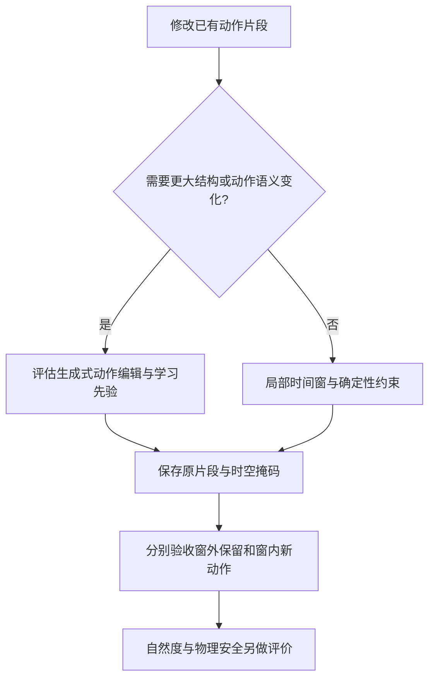
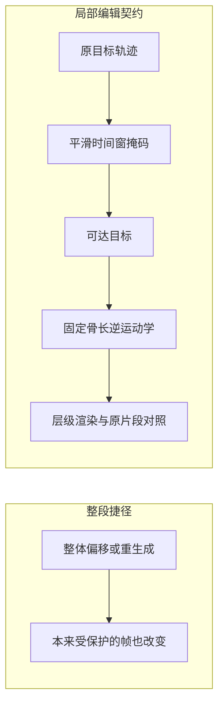
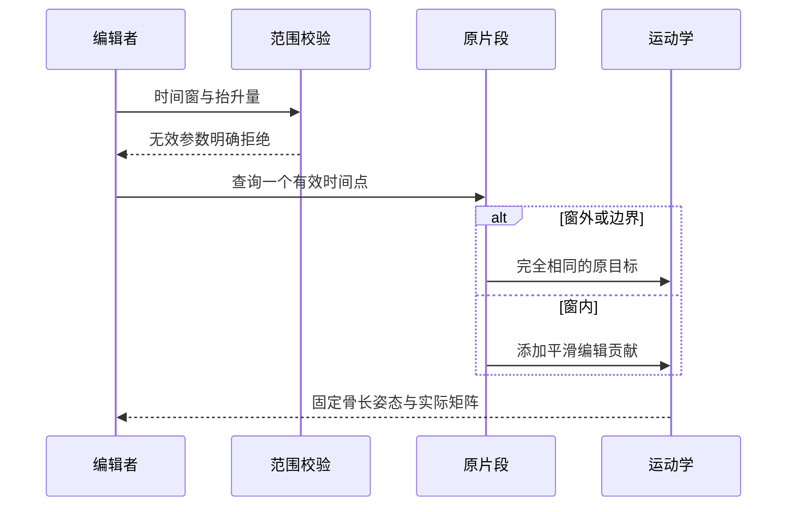

# 只改指定时间窗，不改坏原片段：局部动作保留与逆运动学选型 FAQ

**3 分钟看懂边界，10 分钟复刻局部抬升。**

[English](local-motion-preservation-faq.en.md) · [交互 Demo](https://turbo998.github.io/animation/demos/masked-motion-arm/) · [中文七卡](../demos/masked-motion-arm/test-report-cards.zh.html)

## ① 📌 核心结论速览

- **重新生成整段动作与编辑已有动作不是同一任务。** 本例只要求 3–7 秒内抬高目标；窗外姿态必须和原片段相同。82 个采样窗外姿态精确保留，不能用“整段看起来还行”代替。
- **平滑修改不应该拉长骨头。** 原创 73 实体双连杆机械臂保留 2.2 与 1.6 示意单位骨长。逆运动学从目标位置求关节角度，不是直接拉伸连杆。
- **两个时钟不要混淆。** 论文的生成迭代调度与动画片段的时间掩码是不同控制轴。本例只实现片段时间窗和解析运动学，没有运行生成模型或复现 Scheduled Inpainting。
- **14 项本机验收与封存七卡。** 场景 `synthetic`；代码与 Node CPU `measured`；模型自然度、论文实现、真实机器人安全与 GPU 时间 `not_measured`。

**每日能力方向核验：** 2026-07-31 一手论文 *Interactive Generative Motion Editing via Scheduled Inpainting* 将已有动作的保留、局部修改、拼接和扩展放入交互式生成流程。2026-11-09 核验原文；这是已公开方向，不声称今天首发或拥有当天热度排名。

## ② 🎯 客户与架构师灵魂拷问 Q&A

### Q1 何时选 AI 视频大模型，何时选代码驱动交互动画？

想要人物自然表演、复杂动作转变和逼真画面，可以评估视频生成、动作生成或专业动画工具。想要“只改 3–7 秒的抬升，其余 82 个采样点完全不动”，需要显式的编辑范围、可检查状态和确定性验收。

模型可以补自然动作，代码可以维护边界与项目状态。**生成一个新动作不能自动证明它保留了旧动作。** 本例没有把机械臂运动学当作人体动作模型。

### Q2 在什么约束下代码驱动严格更优？

固定骨长、明确可达目标、指定时间窗和精确保留窗外状态，是结构化代码可以直接证明与测试的要求。原片段不必全部重新制作，客户可以手动复核不该改的部分。

但把“走下台阶”变为“跳下高台”需要动作语义和身体协调，简单平移可能制造不自然动作。论文针对这类更大结构变化引入学习先验；**我们的解析小幅编辑不声称解决了这个问题**。

本例适合设备动画、训练演示和可编辑说明图；不适合碰撞规避、关节力矩、速度限制或真实机械执行。

### Q3 底层管线如何同时保留与修改？

像修一段文章：先圈定要改的段落，而不是把整篇重写。编辑掩码在窗外为零，窗内逐渐变强，再逐渐变弱；这样接入原动作时，位置、变化速度与变化加速度不会突然增加编辑贡献。

本例将窗中点目标抬高 0.8 示意单位，再由固定骨长的逆运动学反求肩与肘角。像用两根定长尺子够到一点，不是把尺子拉长。超出可达空间的目标明确拒绝；不悄悄夹紧后假装达成了目标。

**论文的额外轴是生成迭代。** 在去噪/生成的不同步骤中，调度决定保留已有动作多强；片段的时空掩码决定哪些帧、哪些关节受影响。一个是“生成过程走到哪一步”，一个是“动作片段哪一秒、哪个关节”。本 Demo 只有后者的简化时间窗；它没有去噪过程、学习先验或神经生成。

全片基线故意在所有时间加同样的 0.4 抬升。只有当验收要求窗外受保护时，它才是错误基线；如果用户本来要整体抬高，就不是错误算法。

### Q4 十分钟如何复刻？

1. `npm run dev` 后打开 `/demos/masked-motion-arm/`，比较原片段与局部编辑。
2. 在 1 秒比较两者，实际腕部矩阵应相同；切到全片基线，受保护目标却抬高 0.4。
3. 在 5 秒查看窗中点，局部目标抬高 0.8，连杆仍为 2.2 与 1.6。
4. 移动窗口起止时间，再前后拖动时间轴；窗外应回到原动作。
5. 输入起点 8、终点 3，观察明确拒绝及有效状态保留。导出 `LOCAL_MOTION_EDIT.json` 留下编辑契约。
6. 执行 `npx vitest run tests\masked-motion.test.ts`；构建并在 4335 预览后执行 `node scripts\benchmark-masked-motion.mjs`。

## ③ 🧭 直观可视化图解

## ④ 📊 Architect Decision Matrix

| 验收条件 | 重生成整段视频 | 生成式动作编辑 | 本例掩码加逆运动学 | 全片偏移 |
| --- | --- | --- | --- | --- |
| 窗外精确保留 | 通常不直接暴露状态 | 需要掩码与单独验收 | 82 采样姿态精确保留 | 违反本例保护条件 |
| 大幅动作语义变化 | 画面可评估 | 学习先验有价值 | 只支持有界小幅目标编辑 | 不解决语义 |
| 骨长保持 | 像素不能认证 | 依表示与约束 | 固定两段，独立检查 | 仍需运动学 |
| 边界平滑 | 需检查时序结果 | 调度与表示决定 | 编辑贡献到二阶为零 | 无局部边界定义 |
| 真实设备安全 | 不可据成片认证 | 另做安全工程 | 明确未实现 | 明确未实现 |

**定量算例：** 0–12 秒按 0.1 秒采样得到 121 个时间点；3–7 秒内严格内部为 39 个，其余含边界共 82 个必须保持。目标抬升 0.8 不等于连杆伸长 0.8。

## ⑤ 🧪 全新 Demo 与 Benchmark 核心发现（含 7-Card）

[封存数据](../demos/masked-motion-arm/report.json)包含实际层级矩阵对照、逆序重访、非法窗口拒绝和 14 项验收。解析与独立 40 步角度二分在三档采样中的最大末端误差约 `2.1782e-12` 示意单位，低于声明门限 `1e-10`。

| Node CPU 姿态查询数 | 解析逆运动学中位数 | 40 步角度求解中位数 |
| --- | --- | --- |
| 128 | 0.065 ms | 0.198 ms |
| 1024 | 0.448 ms | 1.495 ms |
| 8192 | 3.596 ms | 11.934 ms |

每档每路径预热后交替七次。这里不是渲染 8192 台机械臂的 FPS，也不是论文模型速度；本机 CPU 原始重复保留，包括系统与 JIT 扰动。

边界加速度有限差分最大约 `0.00009999`，测试门限 `.005`；这是编辑贡献的数值检查，不是机械加速度安全认证。窗外精确保留、窗内自然度和真实设备安全是三份不同验收。

[中文七卡](../demos/masked-motion-arm/test-report-cards.zh.html) · [English](../demos/masked-motion-arm/test-report-cards.html)。未运行 Scheduled Inpainting；不把论文声称的性能放入本地实测柱形。

## ⑥ 🛠️ Architect Checklist

- [ ] 明确任务是修改已有动作，还是生成全新动作。
- [ ] 保存原片段、时间范围与受保护帧。
- [ ] 区分生成迭代调度与片段时空掩码。
- [ ] 窗外与边界逐项比较原状态，不只看成片。
- [ ] 检查编辑贡献的位置、速度与加速度接入。
- [ ] 固定骨长、可达范围和关节分支明确。
- [ ] 不可达目标拒绝，不悄悄夹紧后宣称成功。
- [ ] 实际渲染矩阵与独立运动学一致。
- [ ] 自然度、碰撞、力矩与控制安全分别验证。
- [ ] CPU 查询、模型推理、GPU 渲染分别记录，未测不填零。

**一手来源：** [arXiv:2607.29133](https://arxiv.org/abs/2607.29133)，v1 发布于 2026-07-31；[原文](https://arxiv.org/html/2607.29133v1)说明生成迭代调度、时空强度掩码与表示空间。2026-11-09 核验；本例为原创确定性教学演示，不是论文模型复现。
