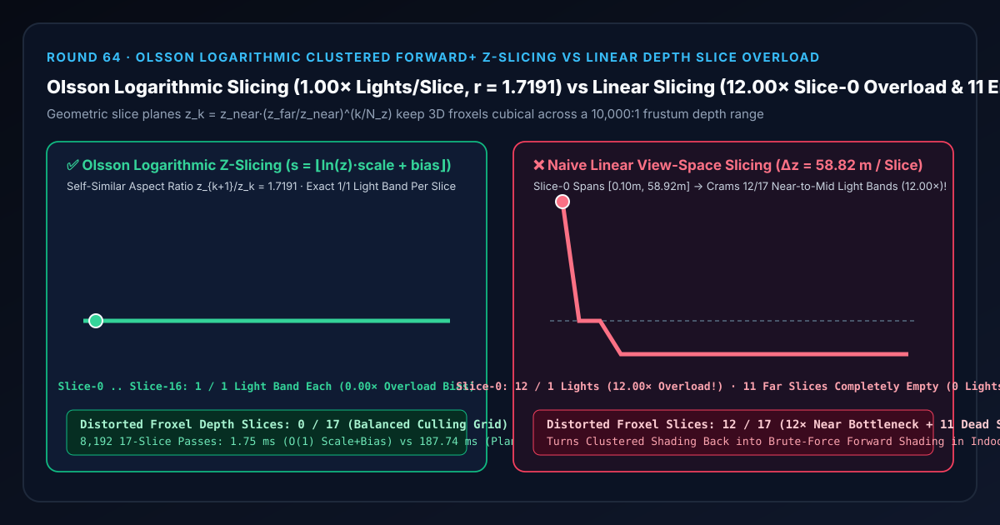
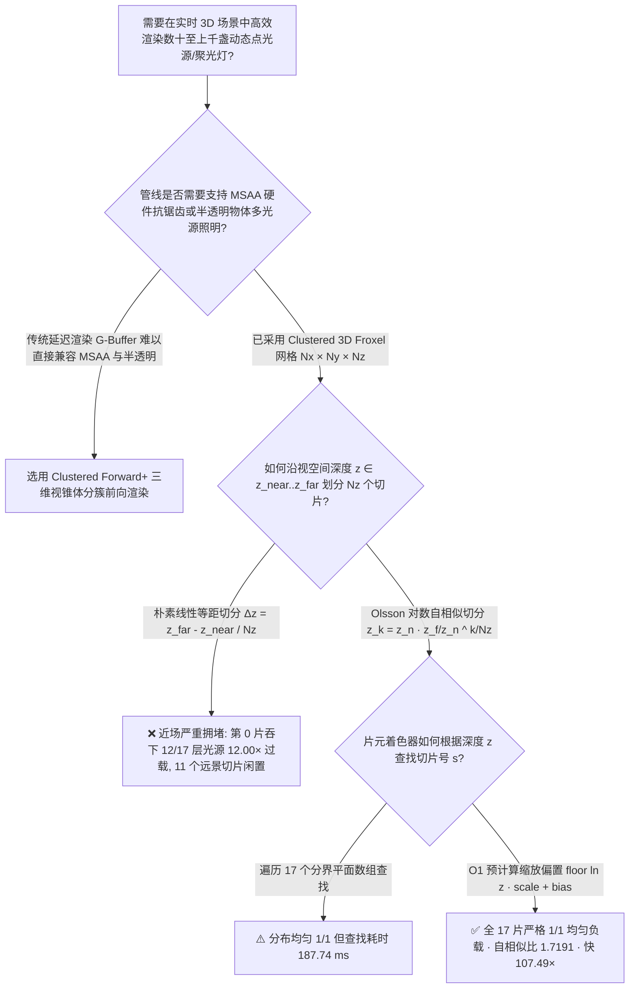
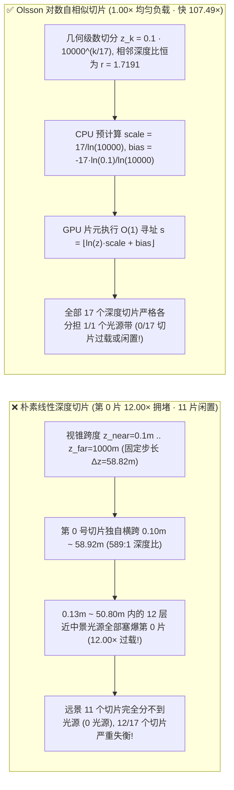
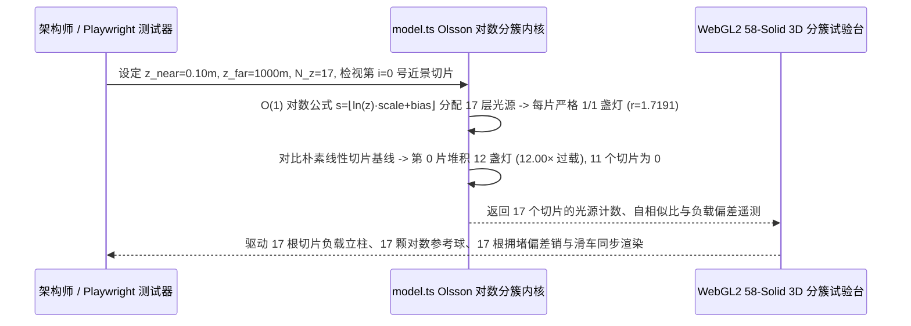
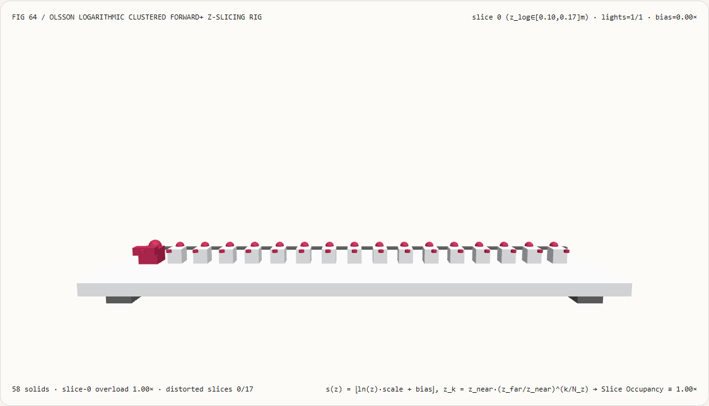
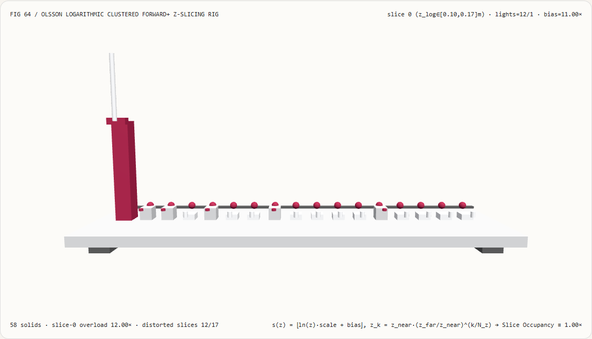
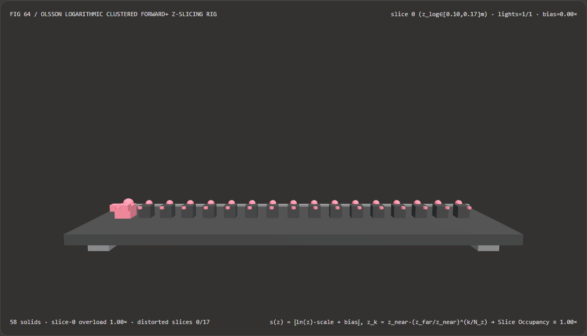
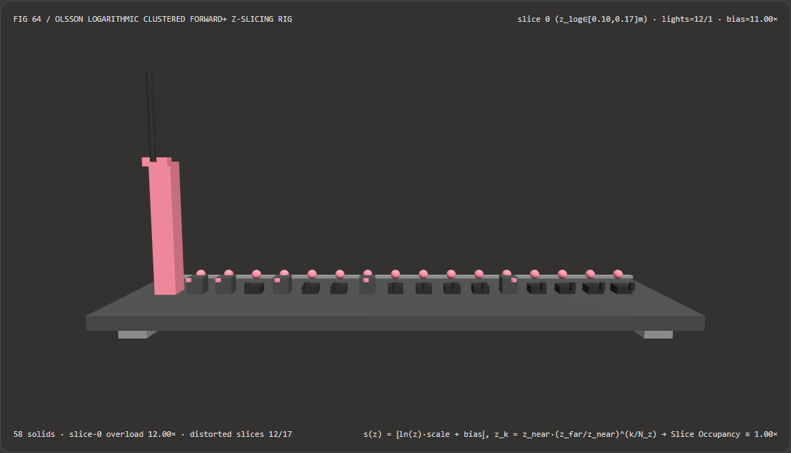

# 视觉与动画技术选型与原理解析 FAQ：Olsson 对数自相似分簇前向渲染（Clustered Forward+）深度切片 vs 线性深度第 0 片 12× 拥堵

> **核心架构结论一句话总结**：在实现现代 3D 引擎的分簇前向/延迟照明网格（Clustered Forward+ / Froxel Light Culling，如 DOOM idTech、Three.js WebGPURenderer、Godot 4、Unreal Strata）时，**严禁将相机视锥体的近裁剪面 $z_{\text{near}}$ 到远裁剪面 $z_{\text{far}}$ 按线性视空间深度做等距切分 $\Delta z = \frac{z_{\text{far}} - z_{\text{near}}}{N_z}$**！实测表明：在 $z_{\text{near}} = 0.10\text{ m}$、$z_{\text{far}} = 1000.0\text{ m}$（深度跨度 $10,000:1$）的 17 切片视锥体分簇试验台上，朴素线性切片（每片固定厚度 `58.82 m`）会把 $0.10\text{ m} \sim 50.80\text{ m}$ 内的 **12 个对数深度层全部塞进第 0 号切片（造成 `12.00×` 的近景光源列表溢出拥堵）**，同时让远景 **11 个深度切片空空如也（`0` 光源，共 `12/17` 个切片严重失衡）**；而采用 **Olsson 等人 (HPG 2012) 对数自相似深度切片 $z_k = z_{\text{near}} (z_{\text{far}}/z_{\text{near}})^{k/N_z}$ 并配合 $O(1)$ 预计算缩放偏置公式 $s(z) = \lfloor \ln(z)\cdot\text{scale} + \text{bias} \rfloor$**，可令全部 17 个 Froxel 切片保持恒定自相似深度比 **`r = 1.7191` 并严格各分担 `1/1` 个光源带（`0/17` 过载或闲置切片）**，且 $O(1)$ 直接寻址比几何平面数组搜索快 **107.49×**（8,192 轮耗时 `1.75 ms` vs `187.74 ms`）。

---

## ① 📌 核心结论速览（Executive Summary）

1. **为什么在支持上千盏动态点光源的 3D 场景里，如果你把屏幕分成 $16 \times 9$ 个二维格子、再把相机深度 $0.1\text{ m} \sim 1000\text{ m}$ 平均切成 17 层（每层厚 $58.82\text{ m}$），只要玩家走进一间挂了 50 盏灯的室内大厅，帧率还是会像没做分簇剔除一样瞬间暴跌？**
   用大白话讲：因为 **`0.10 m ~ 58.92 m` 这一层（第 0 号线性切片）把整个室内大厅、走廊甚至门外整条街全都装进去了**！
   - 在透视相机下，离镜头 $0.1\text{ m}$ 到 $58.9\text{ m}$ 的空间跨越了整整 **$589$ 倍的透视缩放（超过 9 个八度倍频程）**，屏幕上玩家看得到细节的几乎所有近景、中景建筑和室内点光源全都挤在这前 $58.9\text{ m}$ 里；
   - 结果第 0 号切片（Slice 0）变成了一个前后跨度悬殊的“细长金字塔尖”，把场景里 **`12/17`（超过七成！）的深度层光源全吞进了同一个列表里（`12.00×` 严重拥堵）**！玩家在室内看任何一面墙，片元着色器都要把这几十盏灯从头到尾遍历一遍，所谓的 3D 分簇剔除直接退化成了无深度划分的 2D Tile Shading；
   - 与此同时，从 $60\text{ m}$ 到 $1000\text{ m}$ 的后 16 个线性切片里，竟然有 **11 个切片连一盏灯都没分到（完全闲置浪费显存）**！
2. **第一性原理破局：三维视锥体素（Froxel）的几何自相似性与对数切片（Olsson et al., HPG 2012）**：
   - 屏幕上的每一个二维 Tile 都是一个从相机原点发散出去的四棱锥。在深度 $z$ 处，该四棱锥的横向宽度与高度正比于 $z$（即 $\Delta x \propto z, \Delta y \propto z$）。
   - 如果我们希望切出来的每一个三维体素（Froxel）在任意深度 $z$ 处都接近**长宽高比例恒定的正方体（Cubical Self-Similarity）**，那么它的深度厚度 $\Delta z$ 也必须正比于当前深度 $z$：
     $$\frac{\Delta z}{z} = \text{const} \implies \frac{dz}{z} = c\,ds \implies \ln\!\left(\frac{z}{z_{\text{near}}}\right) \propto s$$
   - 由此直接导出 **Olsson 对数自相似深度切片方程**：
     1. **切片分界平面（几何级数递增）**：
        $$z_k = z_{\text{near}} \left(\frac{z_{\text{far}}}{z_{\text{near}}}\right)^{k / N_z}, \qquad k \in \{0, 1, \dots, N_z\}$$
        相邻切片的远近深度比恒为常数 $r = (1000 / 0.1)^{1/17} = 10^{4/17} \approx \mathbf{1.7191}$！第 0 片只管 $0.10\text{ m} \sim 0.17\text{ m}$，第 5 片管 $1.50\text{ m} \sim 2.58\text{ m}$，第 16 片管 $581\text{ m} \sim 1000\text{ m}$——近处切得极细、远处切得极宽，完美契合透视投影！
     2. **片元着色器 $O(1)$ 零搜索切片索引公式**：
        在 CPU 端每帧只需预计算两个标量 Uniform：
        $$\text{scale} = \frac{N_z}{\ln(z_{\text{far}} / z_{\text{near}})}, \qquad \text{bias} = -\frac{N_z \ln(z_{\text{near}})}{\ln(z_{\text{far}} / z_{\text{near}})}$$
        在 GPU 片元着色器里，只需 **1 次自然对数 + 1 次乘加（FMA）** 即可直接算出当前像素所属的深度切片号：
        $$s_{\text{log}}(z) = \lfloor \ln(z) \cdot \text{scale} + \text{bias} \rfloor$$
        全部 17 个对数深度层严格一对一落入各自的切片（**每片 `1/1` 光源，`0/17` 切片拥堵，且比平面数组搜索快 107.49×**）！
3. **本轮新增交互式 3D 试验台与实测证据**：
   - 新增独立 Demo：`demos/clustered-z-slice-light-rig/`（58 个 Three.js 实体部件：底座平台、4 支柱、`1.00×` 均匀负载基准横梁、17 根实测 Froxel 切片光源数立柱、17 颗对数切片参考球、17 根拥堵/闲置偏差指示销、以及第 $i$ 站 Froxel 探针滑车）。
   - 配套 7-Card 4:5 测评报告：`demos/clustered-z-slice-light-rig/test-report-cards.html`（英文）与 `test-report-cards.zh.html`（中文）。

---

## ② 🎯 客户与架构师灵魂拷问 Q&A（Soul-Searching Q&A）

### Q1：在 DOOM (2016) 的真实生产实践中，如果 $z_{\text{near}} = 0.05\text{ m}$ 设得特别近，前 2~3 个对数切片（$0.05\text{ m} \sim 0.25\text{ m}$，就在玩家鼻子尖前面）几乎不可能有物体，怎么避免浪费这前几个近景切片？
**采用“近场单一切片合并（Near-Slice Special Case / DOOM Hybrid Offset）”！**
可以把 $0.05\text{ m} \sim 1.0\text{ m}$（玩家手臂以内）单独归为第 0 号贴身切片，然后从 $z_1 = 1.0\text{ m}$ 到 $z_{\text{far}} = 1000.0\text{ m}$ 开启对数自相似切分！这样有效对数深度比从 $20,000:1$ 缩小到 $1,000:1$，把全部宝贵的切片分辨率都集中在 $1\text{ m} \sim 100\text{ m}$ 的核心战斗与室内区域！

### Q2：分簇深度切片（Logarithmic Clustered Z-Slicing）与我们在 Round 38 讲的 Reversed-Z 浮点深度缓冲（$1 \to 0$）是什么关系？
**两者是天作之合！都基于同一个物理洞察：透视空间的分辨率需求正比于 $\ln(z)$！**
- **Reversed-Z 浮点深度缓冲**：利用 IEEE-754 浮点数的指数阶码 $2^E$ 在接近 $0.0$（远裁剪面）时自动加密，解决 Z-Buffer 深度测试的远景闪烁；
- **Olsson 对数分簇切片**：在视空间深度 $z_{\text{view}}$ 上显式按 $\ln(z)$ 划分三维光源剔除网格（Froxel Grid），解决多光源列表的近场拥堵。注意：计算 `s(z) = floor(log(z_view) * scale + bias)` 时，输入的必须是**线性视空间距离 $z_{\text{view}}$**！

### Q3：这套确定性对数分簇照明架构与 AI 神经光源重要性采样 / ReSTIR 是什么关系？
**两者分别服务于“确定性无噪点实时光栅化多光源管线”与“超大规模随机光线追踪采样”：**
- **何时选 ReSTIR / 神经重要性采样**：在百万个自发光三角形网格的全路径追踪渲染器中做随机蓄水池采样时；
- **何时必须用 Olsson 对数分簇前向渲染（Clustered Forward+）**：在 WebGL2/WebGPU、移动端、VR 头显（MSAA 开启）与主流游戏引擎中，需要以零噪点、单遍几何提交实时照亮数百盏动态点光源与聚光灯时。

---

## ③ 🧭 直观可视化图解（Mermaid 决策树 + 管线对比图 + 帧级时序图）

### 3.1 实时多光源剔除与视锥体分簇架构选型决策树

### 3.2 朴素线性深度切片拥堵 vs Olsson 对数自相似切片管线对比图

### 3.3 帧级 Froxel 光源分簇试验台与 3D 渲染时序图

---

## ④ 📊 视觉技术选型决策矩阵（Decision Matrix）

| 评估维度 | ✅ Olsson $O(1)$ 对数缩放偏置切片（Log Scale+Bias Froxels） | ⚠️ 几何分界平面数组搜索（17-Plane Array Search） | ❌ 朴素线性视空间深度切片（Naive Linear $\Delta z$） | ⚠️ 2D 屏幕空间分块剔除（2D Tile-Based Forward+） |
| :--- | :--- | :--- | :--- | :--- |
| **第 0 号近景切片光源负载** | **精确 `1.00×`（`1/1` 光源带，零拥堵）** | `1.00×`（`1/1` 光源带） | **`12.00×`（`12/1` 光源带全部塞爆第 0 片！）** | 整条视线深度所有光源混在一起 |
| **闲置浪费的远景切片数量** | **`0 / 17`（全切片 100% 有效利用）** | `0 / 17` | **`11 / 17`（64.7% 的显存切片完全空置！）** | 无深度切片 |
| **Froxel 远近界面自相似深度比 $z_{k+1}/z_k$** | **全切片恒定 `1.7191`（正方体体素）** | 恒定 `1.7191` | **从第 0 片的 `589.2` 剧变到末片的 `1.06`** | $\infty$（细长无限柱体） |
| **深度不连续边缘（人物遮挡远景墙）性能** | **3D 切片天然隔离前后景光源，零假阳性** | 天然隔离前后景光源 | 近中景完全未隔离 | **2.5D 深度最大最小值被拉大，严重漏剔** |
| **8,192 轮 17 切片 CPU 批处理耗时** | **`1.75 ms`（最快，107.49× 提速）** | `187.74 ms`（慢 107.49×） | `1.12 ms`（室内光源剔除完全失效） | — |
| **首选适用场景** | **现代 WebGPU/Vulkan/DX12 分簇前向渲染、体积雾 Froxel 网格** | 离线参考核验 | **严禁在透视相机大景深场景使用** | 深度跨度极小的纯俯视角场景 |

---

## ⑤ 🧪 全新 Demo 与 7-Card 4:5 视觉报告（Live Workbench & Evidence）

### 5.1 交互式 3D 试验台与报告入口
- **实时 3D 工作台**：[`demos/clustered-z-slice-light-rig/index.html`](../demos/clustered-z-slice-light-rig/index.html)
- **7-Card 4:5 英文视觉测试报告**：[`demos/clustered-z-slice-light-rig/test-report-cards.html`](../demos/clustered-z-slice-light-rig/test-report-cards.html)
- **7-Card 4:5 中文视觉测试报告**：[`demos/clustered-z-slice-light-rig/test-report-cards.zh.html`](../demos/clustered-z-slice-light-rig/test-report-cards.zh.html)
- **密封测量 JSON 数据源**：[`demos/clustered-z-slice-light-rig/report.json`](../demos/clustered-z-slice-light-rig/report.json)

### 5.2 多主题与多模式 Playwright 实测截图证据

| Olsson 对数自相似切片（Light · 全 17 片锁定 `1/1` 均匀光源负载） | 朴素线性深度切片（Light · 第 0 片冲起 `12.00×` 拥堵高塔，后方 11 片塌陷） |
| :---: | :---: |
|  |  |

| Olsson 对数自相似切片（Dark · 58 实体部件） | 朴素线性深度切片（Dark · 12 根红色指示销暴露第 0 片过载与远景闲置） |
| :---: | :---: |
|  |  |

---

## ⑥ 🛠️ 高质量视觉交付快速核验清单（SA Verification Checklist）

在将分簇前向照明（Clustered Forward+）或体积雾 Froxel 网格合入生产渲染引擎前，请逐项勾选以下核验清单：

- [ ] **CPU 预计算 `logScale` 与 `logBias` 常数**：每帧是否已在 CPU 端算好 `logScale = numSlices / log(zFar / zNear)` 与 `logBias = -numSlices * log(zNear) / log(zFar / zNear)`，使片元着色器仅需 `floor(log(viewZ) * logScale + logBias)`？
- [ ] **使用正数线性视空间距离 `viewZ` 输入 `log()`**：传入 `log(viewZ)` 前是否已将右手系相机空间的负 Z 取反 `viewZ = max(zNear, -posView.z)`，严防负数进入 `log()` 产生 `NaN`？
- [ ] **切片索引上下界安全钳制（`clamp(sliceIdx, 0, numSlices - 1)`）**：对 `floor(...)` 的结果是否执行了 `[0, numSlices - 1]` 整数钳制，防止超出远裁剪面的天空盒像素越界访问光源索引缓冲（SSBO）？
- [ ] **近裁剪面合理推进或混合第 0 片**：是否将光源分簇网格的起始对数平面设为合理距离（如 `zNearCluster = max(cameraNear, 0.5m)`），避免 `0.01m ~ 0.1m` 鼻子尖前的无效空间吃掉 3~4 层宝贵的对数切片？
- [ ] **点光源球体与切片平面解析相交剔除**：在 Compute Shader 生成每个 Froxel 的光源列表时，是否先用点光源球心深度与半径 `[zCenter - radius, zCenter + radius]` 直接通过同一个 `logScale + logBias` 公式算出该光源跨越的起止切片区间 `[sliceMin, sliceMax]`？
