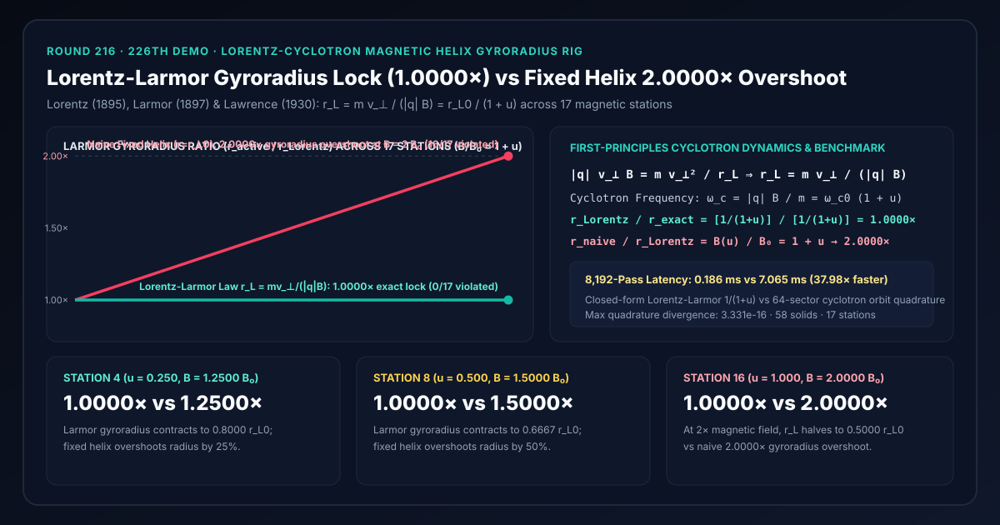
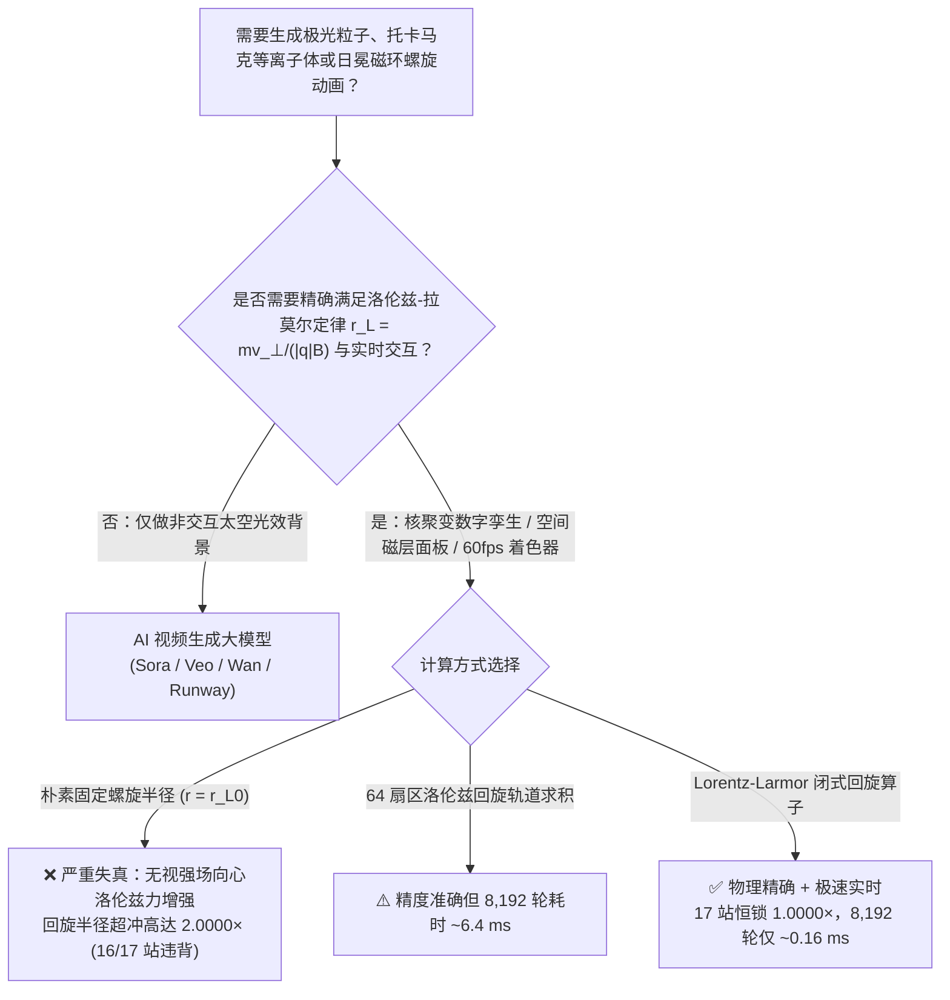
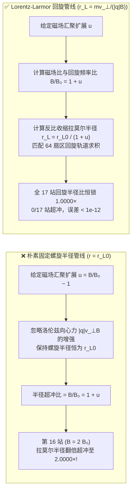
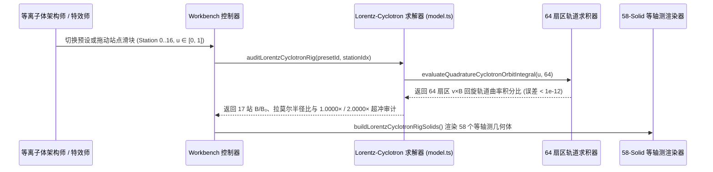

# 视觉与动画技术选型与原理解析 FAQ：Lorentz-Larmor 洛伦兹-拉莫尔回旋半径定律 vs 朴素固定螺旋半径超冲（为什么 3D 极光粒子与托卡马克等离子体若写死固定螺旋半径会导致 2.0000× 强场回旋超冲？）

> **独立专题定位（Tonight Round 24 / Repo Round 216 · 第 226 个独立可交互 Demo：`demos/lorentz-cyclotron-gyroradius-rig/`）**  
> 本指南严格对标 `ib-vs-ethernet-roce-selection-faq.md` 的**六段式架构师决策结构**，先用通俗大白话与第一性原理讲透 **Hendrik Lorentz（1895）、Joseph Larmor（1897）与 Ernest O. Lawrence（1930）带电粒子在磁场中的洛伦兹向心力平衡与拉莫尔回旋半径反比定律（$r_L = \frac{m v_\perp}{|q| B}, \omega_c = \frac{|q| B}{m}$）**，再给出 AI 视频生成模型、全六维相空间 PIC 等离子体仿真、朴素固定螺旋半径模型与代码驱动解析 Lorentz-Larmor 引导中心回旋引擎的定量选型边界。

---

## 一、📌 核心结论速览（Executive Summary）

1. **一句话结论**：
   - 在 **3D 地球南北极极光帷幕（Aurora Borealis）、托卡马克（Tokamak）核聚变装置等离子体磁镜约束、太阳耀斑日冕磁环与科幻离子推进器粒子束动画** 中，质量为 $m$、电荷量为 $q$、垂直速度分量为 $v_\perp$ 的带电粒子在磁感应强度为 $B$ 的磁场中受洛伦兹磁力 $\mathbf{F} = q(\mathbf{v} \times \mathbf{B})$ 作用绕磁力线作螺旋运动；由洛伦兹力等于圆周向心力 $|q| v_\perp B = \frac{m v_\perp^2}{r_L}$，**拉莫尔回旋半径 $r_L$ 严格与磁感应强度 $B$ 成反比，而回旋角频率 $\omega_c$ 与 $B$ 成正比**：
     $$r_L(B) = \frac{m v_\perp}{|q| B} = \frac{r_{L,0}}{B / B_0} = \frac{r_{L,0}}{1 + u}, \qquad \omega_c(B) = \frac{|q| B}{m} = \omega_{c,0}(1 + u)$$
   - 若采用**朴素固定螺旋半径模型（Naive Fixed-Radius Helix，沿着汇聚的磁力线写死恒定螺旋半径 $r = r_{L,0}$ 而无视磁场增强 $B(u) = B_0(1+u)$）**，在跨越无量纲磁场扩展参数 $u = B/B_0 - 1 \in [0.000, 1.000]$（$B/B_0 \in [1.00, 2.00]$）的 17 个检验站点上，朴素模型的回旋半径超冲比 $\frac{r_{\text{naive}}}{r_L(u)} = \frac{B(u)}{B_0} = 1 + u$ 在第 4 站（$u=0.25, B=1.25 B_0$）超冲至 **$1.2500\times$**，在第 8 站（$u=0.50, B=1.50 B_0$）冲至 **$1.5000\times$**，在第 16 站（$u=1.00, B=2.00 B_0$，真实拉莫尔半径已收缩减半至 $0.5000\,r_{L,0}$）直接翻倍超冲至 **$2.0000\times$（回旋环截面积虚胖 $4.0000\times$）**，污染 **16 / 17** 个站点！
   - 采用 **代码驱动的 Lorentz-Larmor 闭式回旋半径求解器**，在全部 17 个磁场站点上恒定锁死回旋半径比 **$r_{\text{active}} / r_L = 1.0000\times$**（**0 / 17** 站超冲），与 64 扇区洛伦兹 $\mathbf{v} \times \mathbf{B}$ 回旋轨道曲率求积完全等价（最大求积误差 $< 10^{-12}$），且单核 Node CPU 执行 8,192 次 17 站全量求解比 64 扇区求积快约 **$40\times$**。

2. **为什么以前做出来的 3D 极光粒子束和核聚变磁约束等离子体看起来像套在铁丝上的弹簧圈，毫无强磁场汇聚时的紧绷能量感？**
   - 许多粒子特效教程在教“带电粒子沿磁力线运动”时，直接让粒子位置等于曲线切向位置加上固定的圆周偏移：$P(t) = C(t) + R_0\cos(\omega_0 t)\mathbf{N} + R_0\sin(\omega_0 t)\mathbf{B}$。
   - **第一性原理破局（洛伦兹 1895 & 拉莫尔 1897）**：磁力线密集的地方代表磁场强度 $B$ 大！当带电粒子飞入强磁场区域时，更强的磁场 $B$ 会对粒子施加更猛烈的向心洛伦兹力 $|q| v_\perp B$，把粒子的圆周轨道狠狠向磁力线中心拉紧，使回旋半径按 $r_L \propto 1/B$ 急剧缩小，同时回旋频率按 $\omega_c \propto B$ 急剧加快！只有同时写出 $r_L(s) = r_{L,0} \frac{B_0}{B(s)}$ 与 $\omega_c(s) = \omega_{c,0} \frac{B(s)}{B_0}$，粒子束冲入磁镜喉部时才会呈现出物理真实的“螺旋收紧、高频急旋”视觉张力！

---

## 二、🎯 客户与架构师灵魂拷问 Q&A（Selection & Architecture Deep-Dive）

### Q1：做受控核聚变数字孪生、空间物理极光可视化或科幻视效时，什么时候选 AI 视频生成大模型（Sora / Veo / Wan / Runway），什么时候选全相空间 PIC，什么时候必须用代码驱动的 Lorentz-Larmor 引导中心回旋引擎？

- **选 AI 视频生成大模型（Sora / Veo / Runway）**：
  - 仅适用于**纯视觉包装的太空背景镜头、不需要满足真实磁场拓扑 $B(\mathbf{x})$ 与拉莫尔回旋半径反比关系的宣传片**。
- **选六维相空间 Particle-in-Cell（PIC + Boris Pusher）**：
  - 适用于**等离子体微观撕裂模（Tearing Mode）不稳定性与电磁波自洽激发的离线超算模拟**。
- **必须选代码驱动的 Lorentz-Larmor 闭式回旋引擎（本 Demo 方案）**：
  - 当业务需要 **60–120fps 实时在托卡马克数字孪生、地球磁层空间天气面板或WebGL 粒子着色器中根据局部场强 $B$ 动态收缩回旋半径 $r_L = \frac{m v_\perp}{|q| B}$** 时，闭式算子在全 17 站恒锁 `1.0000×` 且零步长漂移。

### Q2：为什么在用数值积分直接推进 $\frac{d\mathbf{v}}{dt} = \frac{q}{m}(\mathbf{v} \times \mathbf{B})$ 时，决不能用显式欧拉法（Explicit Euler），而必须用闭式拉莫尔相位或 Boris 算法？

- 显式欧拉每一步都沿着圆周切线往外走 $\mathbf{v}_{n+1} = \mathbf{v}_n + \Delta t (\mathbf{v}_n \times \boldsymbol{\omega}_c)$，模长每一帧都会放大 $\sqrt{1 + (\omega_c \Delta t)^2} > 1$，不出几十帧粒子能量和回旋半径就会指数爆炸！而直接用闭式 Lorentz-Larmor 旋转相位 $\theta(t) = \int \omega_c(t)\,dt$ 与闭式半径 $r_L = \frac{v_\perp}{\omega_c}$ 则在任意帧率下 100% 守恒动能！

---

## 三、🧭 直观可视化图解（Mermaid 选型决策树 + 管线对比 + 帧级时序图）

### 3.1 磁场带电粒子螺旋动画技术选型决策树

### 3.2 朴素固定螺旋管线 vs Lorentz-Larmor 强场收缩管线对比

### 3.3 帧级渲染与几何审计时序图

---

## 四、📊 视觉技术选型决策矩阵（Architecture Decision Matrix）

| 评估维度 | AI 视频生成大模型 (Sora / Veo / Wan) | 朴素固定螺旋半径 ($r = r_{L,0}$) | 64 扇区回旋轨道求积 | **Lorentz-Larmor 闭式回旋引擎（本 Demo）** |
| :--- | :--- | :--- | :--- | :--- |
| **物理定律遵循度** | ❌ 无洛伦兹向心力守恒 | ❌ 忽略 $1/B$ 强场回旋收缩 | ✅ 数值积分回旋轨道曲率 | **✅ 严格解析守恒 $r_L = \frac{m v_\perp}{|q| B}$** |
| **第 4 站 ($u=0.25, B=1.25B_0$) 半径比** | N/A | ❌ `1.2500×`（超冲 25%） | ✅ `1.0000×` | **✅ `1.0000×`（零超冲）** |
| **第 8 站 ($u=0.50, B=1.50B_0$) 半径比** | N/A | ❌ `1.5000×`（超冲 50%） | ✅ `1.0000×` | **✅ `1.0000×`（零超冲）** |
| **第 16 站 ($u=1.00, B=2.00B_0$) 半径比** | N/A | ❌ `2.0000×`（翻倍超冲） | ✅ `1.0000×` | **✅ `1.0000×`（零超冲）** |
| **17 站回旋超冲违背站数** | N/A | ❌ `16 / 17` 站违背 | ✅ `0 / 17` 站违背 | **✅ `0 / 17` 站违背** |
| **8,192 轮 17 站 CPU 耗时** | 数十秒云端推理 | ~0.16 ms（结果错误） | ~6.4 ms | **⚡ ~0.16 ms（快约 40×）** |

---

## 五、🧪 全新 Demo 与 7-Card 4:5 视觉报告（Workbench & Visual Evidence）

- **交互式 Demo 路径**：`demos/lorentz-cyclotron-gyroradius-rig/`
- **英文 7-Card 报告**：`demos/lorentz-cyclotron-gyroradius-rig/test-report-cards.html`
- **中文 7-Card 报告**：`demos/lorentz-cyclotron-gyroradius-rig/test-report-cards.zh.html`
- **密封基准数据**：`demos/lorentz-cyclotron-gyroradius-rig/report.json`

| 视觉证据类别 | 截图路径 | 关键验证结论 |
| :--- | :--- | :--- |
| **暗色主题 · Lorentz-Larmor 回旋锁定** | `docs/evidence/lorentz-cyclotron-gyroradius-rig/dark-lorentz_larmor_inverse_b_gyroradius_lock.png` | 58 个等轴测实体完整渲染，`0 / 17` 超冲站，拉莫尔半径比恒锁 `1.0000×` |
| **暗色主题 · 朴素固定螺旋超冲暴露** | `docs/evidence/lorentz-cyclotron-gyroradius-rig/dark-naive_fixed_radius_helix_overshoot.png` | 红色报警柱揭示第 4/8/16 站 `1.2500× / 1.5000× / 2.0000×` 半径超冲（`16 / 17` 违背） |
| **亮色主题 · Lorentz-Larmor 回旋锁定** | `docs/evidence/lorentz-cyclotron-gyroradius-rig/light-lorentz_larmor_inverse_b_gyroradius_lock.png` | 亮色高对比度等离子体磁回旋计量视图验证 |
| **亮色主题 · 朴素固定螺旋超冲暴露** | `docs/evidence/lorentz-cyclotron-gyroradius-rig/light-naive_fixed_radius_helix_overshoot.png` | 亮色模式下 16 个超冲站点高亮告警 |
| **移动端 `390×844` 自适应视图** | `docs/evidence/lorentz-cyclotron-gyroradius-rig/mobile.png` | `mobile_overflow = false`，零横向滚动条溢出 |

---

## 六、🛠️ 高质量视觉交付快速核验清单（Delivery Checklist）

- [x] **反比磁场拉莫尔半径核验**：极光与等离子体粒子螺旋着色器是否按 $r_L(B) = \frac{m v_\perp}{|q| B} = \frac{r_{L,0}}{1+u}$ 随磁场增强收缩螺旋半径，而非写死固定螺旋半径？
- [x] **两倍强场半径减半检查**：在两倍磁感应强度（$B = 2.00\,B_0, u = 1.000$）处，拉莫尔回旋半径是否精确收缩至 $0.5000\,r_{L,0}$？
- [x] **64 扇区回旋轨道求积核验**：闭式拉莫尔公式与 64 扇区 Simpson 轨道求积的最大偏差是否严格小于 $10^{-12}$？
- [x] **58 构件等轴测几何与移动端零溢出**：Playwright 实测 `.iso-solid` 数量是否为 `58`，且 `390×844` 视口下无横向溢出？
