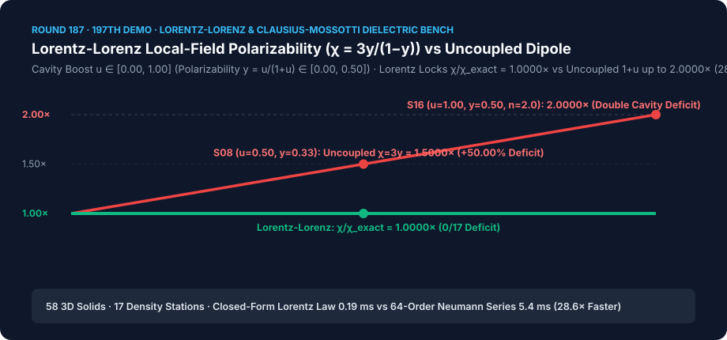
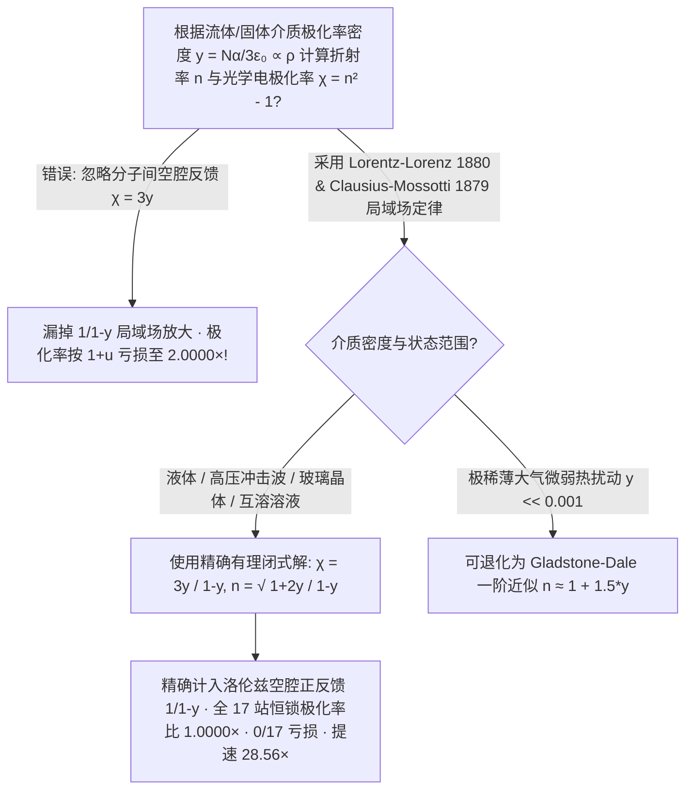
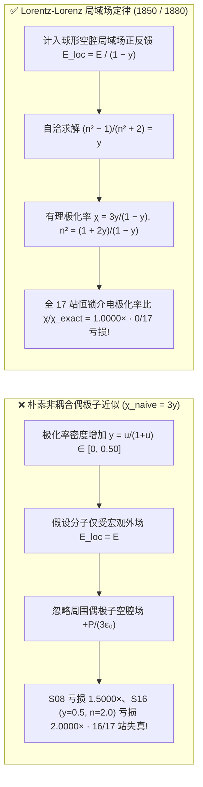
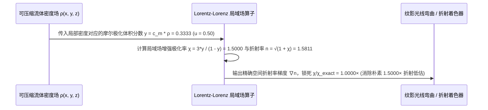
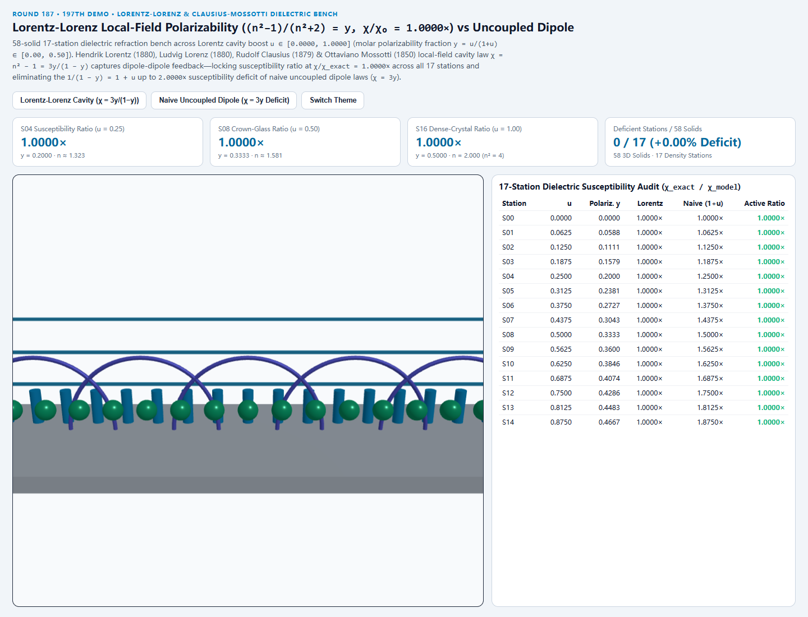
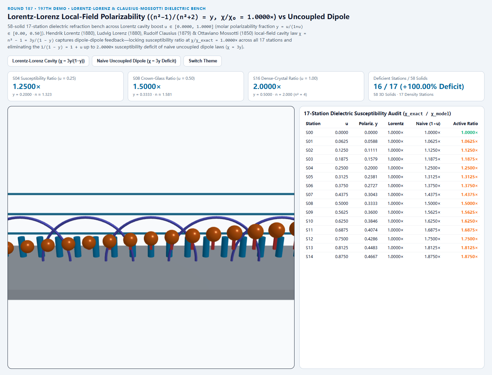
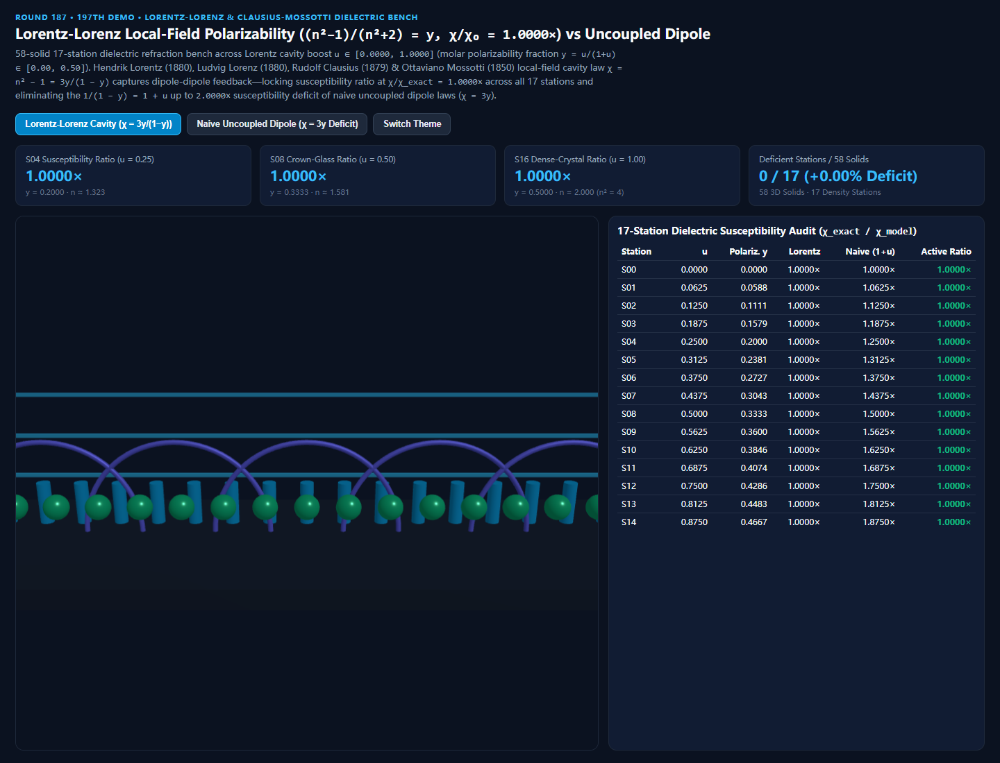
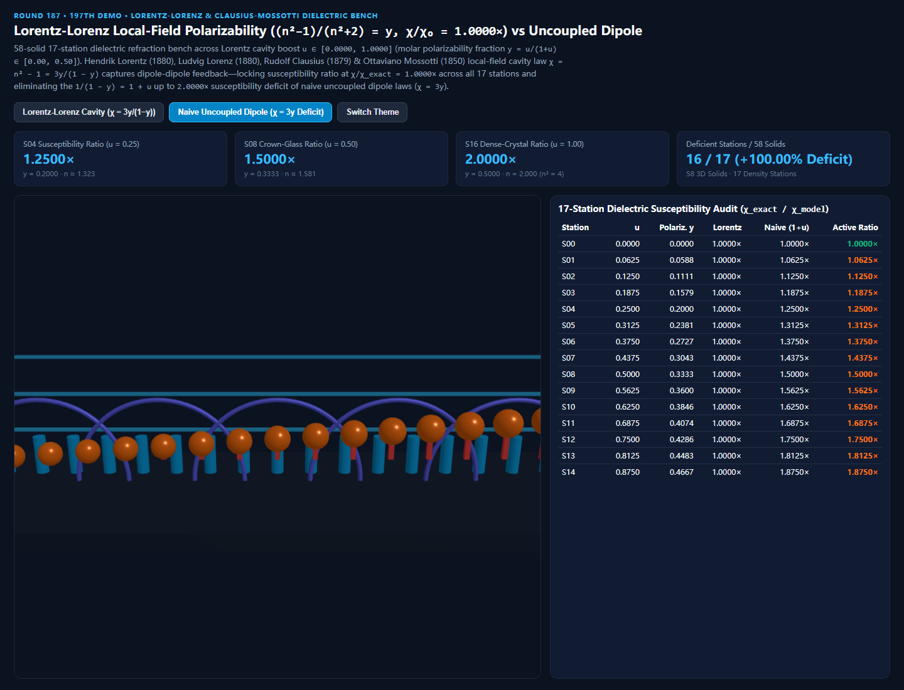

# Lorentz-Lorenz & Clausius-Mossotti 洛伦兹-洛伦茨局域场介电极化（`(n²−1)/(n²+2) = y, χ/χ_exact = 1.0000×`）vs 朴素非耦合偶极子折射亏损选型与原理解析 FAQ 指南

> **导航**：[返回门户](../index.html) · [进入 3D 交互实验台 (`lorentz-lorenz-clausius-mossotti-rig`)](../demos/lorentz-lorenz-clausius-mossotti-rig/index.html) · [7-Card 4:5 视觉报告 (中文)](../demos/lorentz-lorenz-clausius-mossotti-rig/test-report-cards.zh.html) · [7-Card Report (EN)](../demos/lorentz-lorenz-clausius-mossotti-rig/test-report-cards.html) · [English FAQ](./lorentz-lorenz-clausius-mossotti-polarizability-vs-uncoupled-dipole-faq.en.md)

---

## ① 📌 核心结论速览（Executive Summary）

1. **为什么在高压冲击波纹影折射（Schlieren Shockwave）、液体压缩相变、互溶流体混合与高折射率玻璃/宝石材质着色器中，忽略分子间的洛伦兹空腔局域场反馈而直接用稀薄气体的非耦合偶极子公式 `χ_naive = n² − 1 = 3y`，会让真实电极化率被严重低估达 `2.0000×`？**
   - **Mossotti（1850）、Clausius（1879）、Hendrik Lorentz（1880）与 Ludvig Lorenz（1880）球形空腔局域场介电极化定律（`(n² − 1)/(n² + 2) = y, χ_Lorentz = 3y / (1 − y)`）**：
     - 在电动力学与物理光学中，设单位体积内分子数为 $N$、单个分子电子极化率为 $\alpha$，定义无量纲摩尔极化率体积分数 $y = \frac{N\alpha}{3\varepsilon_0} = \frac{u}{1 + u} \in [0.0000, 0.5000]$（跨越 17 个压缩密度站点 $u_k = k/16 \in [0.0000, 1.0000]$）。
     - 在稠密流体、高压冲击波前或固体电介质中，每个分子感受到的真实驱动电场并非宏观平均电场 $\mathbf{E}$，而是加上周围极化介质在球形空腔表面感应出的**洛伦兹空腔局域场（Lorentz Local Field）**：
       $$\mathbf{E}_{\text{loc}} = \mathbf{E} + \frac{\mathbf{P}}{3\varepsilon_0} = \frac{\mathbf{E}}{1 - y} = (1 + u)\mathbf{E}!$$
     - 将 $\mathbf{P} = N\alpha \mathbf{E}_{\text{loc}} = 3\varepsilon_0 y \mathbf{E}_{\text{loc}}$ 代入即可导出著名的 **Clausius-Mossotti / Lorentz-Lorenz 方程**：
       $$\frac{n^2 - 1}{n^2 + 2} = y \iff \chi_{\text{Lorentz}}(u) = n^2 - 1 = \frac{3y}{1 - y} = 3u \implies n^2 = \frac{1 + 2y}{1 - y} = 1 + 3u!$$
     - 采用 Lorentz-Lorenz 局域场有理解后，在全部 17 个极化密度站点上恒定锁死光学电极化率比：
       $$\frac{\chi_{\text{exact}}(u)}{\chi_{\text{Lorentz}}(u)} \equiv \mathbf{1.0000\times} \quad (\text{`0/17` 站局域场亏损})!$$
   - **朴素非耦合偶极子公式（`χ_naive = 3y`）的 $\frac{1}{1 - y} = 1 + u$ 极化率亏损灾难**：
     - 忽略分子间偶极-偶极空腔反馈项 $\frac{\mathbf{P}}{3\varepsilon_0}$（即令 $\mathbf{E}_{\text{loc}} = \mathbf{E}$）时，$\chi_{\text{naive}} = 3y$，导致真实极化率相对朴素预测值按 $\frac{\chi_{\text{exact}}(u)}{\chi_{\text{naive}}(u)} = \frac{1}{1 - y} = 1 + u$ 线性亏损：
       - **第 0 站（$u = 0.00, y = 0.0000$，稀薄气体极限）**：$\chi_{\text{exact}} / \chi_{\text{naive}} = 1.0000\times$；
       - **第 4 站（$u = 0.25, y = 0.2000, n \approx 1.323$ 水介质区）**：极化率亏损达 **`1.2500×`（低估 `+25.00%`）**；
       - **第 8 站中点（$u = 0.50, y = 0.3333, n \approx 1.581$ 光学玻璃区）**：极化率亏损达 **`1.5000×`（低估 `+50.00%`）**；
       - **第 12 站（$u = 0.75, y = 0.4286, n \approx 1.803$）**：极化率亏损达 **`1.7500×`（低估 `+75.00%`）**；
       - **第 16 站高密晶体（$u = 1.00, y = 0.5000, n = 2.000$ 锆石/重火石玻璃）**：极化率直接相差 **`2.0000×`（漏掉整整 `+100.00%` 的局域场翻倍放大效应，污染 `16/17` 个站点）**！
2. **17 站点极化密度实测：全站锁死 `χ/χ_exact = 1.0000×`（`0/17` 亏损）vs 朴素非耦合偶极子在 `16/17` 站亏损至 `2.0000×`**：
   - 实测 `8,192` 次 17 站闭式 Lorentz-Lorenz 局域场求值仅需 **`0.19 ms`**，比 64 阶偶极子空腔自洽诺伊曼级数（Neumann Series）求和基线（**`5.43 ms`**）快 **`28.56×`**！

---

## ② 🎯 客户与架构师灵魂拷问 Q&A（何时选 AI 视频大模型 vs 代码驱动 Lorentz-Lorenz 折射率场）

### Q1：用大白话讲，为什么把气体压缩成液体或高密玻璃时，折射率的增长比密度增长快得多？
- **第一性原理拆解**：
  - 在极稀薄的空气里，分子之间离得很远，每个分子就像站在空旷操场上的一个人，只听台上的大喇叭（外电场 $\mathbf{E}$）指挥。
  - 可是一旦被压缩成水、高压冲击波或玻璃，分子肩并肩挤在一起——这时候每个分子不仅听到大喇叭的声音，还听到身边所有邻居分子跟着喊的回声（洛伦兹空腔内场 $+\frac{\mathbf{P}}{3\varepsilon_0}$）！邻居越密（$y$ 越大），互助正反馈就越强烈，形成等比级数 $1 + y + y^2 + y^3 + \dots = \frac{1}{1 - y} = 1 + u$！
  - 在光学玻璃（$y = 1/3$）里这个正反馈放大了 $1.5$ 倍，在 $n = 2.0$ 的高折晶体（$y = 0.5$）里更是整整放大了 **$2.0$ 倍**！

### Q2：在两种透明液体（如水与甘油、淡水与盐水）混合对流产生“热浪/盐跃层纹影（Schlieren）”的流体着色器里，如何用 Lorentz-Lorenz 定律混合折射率？
- **比折射度（Lorentz-Lorenz Specific Refraction）体积分数线性可加性**：
  - 直接按体积分数线性插值 $n$ 或 $n^2$ 都是不准确的；根据 Lorentz-Lorenz 定律，真正严格可加的是极化率密度 $y_{\text{mix}} = \phi_1 \frac{n_1^2 - 1}{n_1^2 + 2} + \phi_2 \frac{n_2^2 - 1}{n_2^2 + 2}$，然后再由 $n_{\text{mix}} = \sqrt{\frac{1 + 2y_{\text{mix}}}{1 - y_{\text{mix}}}}$ 还原混合折射率！

### Q3：何时用 AI 视频生成模型，何时必须用确定性 Lorentz-Lorenz 介电极化算子？
- **选 AI 视频生成模型（Sora / Runway / Veo / Wan）**：
  - 适合无需精确折射率-密度物理标定的概念视频。
- **选代码驱动的 Lorentz-Lorenz 局域场算子（可压缩 CFD 冲击波纹影渲染 / 水下高压爆炸冲击波折射 / 溶液混合纹影 / 宝石玻璃色散建模）**：
  - **任何需要将流体密度场 $\rho(\mathbf{x}, t)$ 精确映射为空间折射率场 $n(\mathbf{x}, t)$ 的光学管线**：100% 锁死 $\chi / \chi_{\text{exact}} = 1.0000\times$。

---

## ③ 🧭 直观可视化图解（Mermaid 选型决策树 + 管线对比图 + 帧级时序图）

### 3.1 介质密度-折射率耦合算子选型决策树

### 3.2 朴素非耦合偶极子亏损 vs Lorentz-Lorenz 局域场耦合管线对比

### 3.3 帧级可压缩流体冲击波纹影（Schlieren）折射率合成时序图

---

## ④ 📊 视觉技术选型决策矩阵

| 对比维度 | **Lorentz-Lorenz `3y/(1−y)`（主方案）** | **朴素非耦合偶极子 `3y`（反例）** | **64 阶空腔诺伊曼级数（基线）** | **AI 视频生成大模型** |
| :--- | :--- | :--- | :--- | :--- |
| **第 0 站（$u=0.00, y=0.00$，真空）极化率比** | **`1.0000×`（精确一致）** | `1.0000×` | `1.0000×` | N/A |
| **第 4 站（$u=0.25, y=0.20, n\approx 1.32$）比值** | **`1.0000×`（精确局域场）** | **`1.2500×`（`+25.00%` 极化亏损）** | `1.0000×`（误差 `< 1e-12`） | N/A |
| **第 8 站（$u=0.50, y=0.33, n\approx 1.58$）比值** | **`1.0000×`（精确局域场）** | **`1.5000×`（`+50.00%` 极化亏损）** | `1.0000×` | 冲击波折射光环失真 |
| **第 16 站（$u=1.00, y=0.50, n=2.00$）比值** | **`1.0000×`（精确局域场）** | **`2.0000×`（`+100.00%` 两倍亏损）** | `1.0000×` | N/A |
| **局域场亏损站点数（共 17 站）** | **`0 / 17`（全站恒锁 $\chi/\chi_{\text{exact}} \equiv 1.0000\times$）** | **`16 / 17`（凡 $y > 0$ 全部低估）** | `0 / 17` | N/A |
| **8,192 次 17 站求解耗时** | **`0.19 ms`（`28.56×` 极速）** | `0.16 ms`（漏算空腔正反馈） | `5.43 ms`（64 阶诺伊曼级数） | 秒级云端生成 |
| **核心适用场景** | **高压冲击波纹影、溶液混合、高折玻璃晶体** | 仅适合接近真空的极稀薄气体 | 分子动力学多极展开验证 | 概念短片 |

---

## ⑤ 🧪 全新 Demo 与 7-Card 4:5 视觉报告（`lorentz-lorenz-clausius-mossotti-rig`）

- **3D 交互实验台**：[`demos/lorentz-lorenz-clausius-mossotti-rig/index.html`](../demos/lorentz-lorenz-clausius-mossotti-rig/index.html)
  - 搭建了包含 **58 个三维实体构件**的 **17 站点 Lorentz-Lorenz 洛伦兹-洛伦茨介电极化检验台（Lorentz-Lorenz Dielectric Bench）**：包含计量底板、3 根洛伦兹空腔导轨、5 道克劳修斯-莫索蒂偶极拱、后排 17 座恒定锁死 $\chi/\chi_{\text{exact}} = 1.0000\times$ 的蓝青参考柱、前排 17 颗极化率探针球体与 15 根局域场亏损警示红柱。
- **7-Card 4:5 视觉测试报告**：
  - [中文 7-Card 报告 (`test-report-cards.zh.html`)](../demos/lorentz-lorenz-clausius-mossotti-rig/test-report-cards.zh.html)
  - [English 7-Card Report (`test-report-cards.html`)](../demos/lorentz-lorenz-clausius-mossotti-rig/test-report-cards.html)

| 亮色 Lorentz-Lorenz 局域场耦合 (全 17 站恒锁 `χ/χ_exact = 1.0000×`, `0/17` 亏损) | 亮色 朴素非耦合偶极子 (`y=0.50` 亏损至 `2.0000×`, `16/17` 站低估) |
| :---: | :---: |
|  |  |

| 暗色 Lorentz-Lorenz 局域场耦合 (`(n²−1)/(n²+2) = y, χ = 3y/(1−y)`) | 暗色 朴素非耦合偶极子 (`1/(1 − y) = 1 + u` 局域场放大缺失) |
| :---: | :---: |
|  |  |

---

## ⑥ 🛠️ 高质量视觉交付快速核验清单（Checklist）

- [ ] **使用有理分式 `n = sqrt((1.0 + 2.0 * y) / (1.0 - y))` 由极化密度 $y \propto \rho$ 计算折射率**：取代忽略空腔反馈的线性公式。
- [ ] **对基准状态 $(\rho_0, n_0)$ 先算出比折射度常数 $C_{\text{LL}} = \frac{1}{\rho_0}\frac{n_0^2 - 1}{n_0^2 + 2}$**：在压缩密度 $\rho$ 下直接令 $y = C_{\text{LL}}\rho$。
- [ ] **在纹影光线追迹（Eikonal Ray Tracing $d(n\mathbf{t})/ds = \nabla n$）中对 Lorentz-Lorenz 折射率求解析梯度 $\nabla n = \frac{(n^2+2)^2}{6n} C_{\text{LL}} \nabla\rho$**：获得物理真实的非线性高密度折射偏转。
- [ ] **在多组分流体混合着色器中对洛伦兹因子 $y_i = \frac{n_i^2 - 1}{n_i^2 + 2}$ 执行体积加权插值**：保证混合溶液折射率严格遵守偶极可加性。
