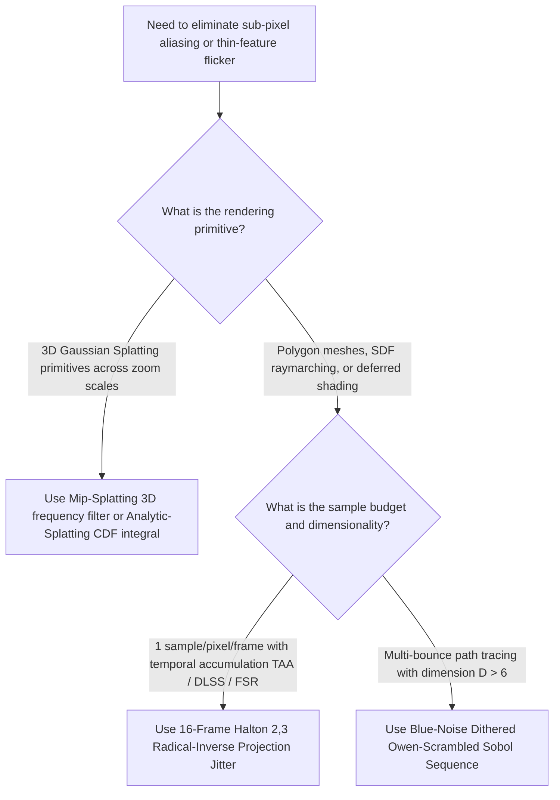
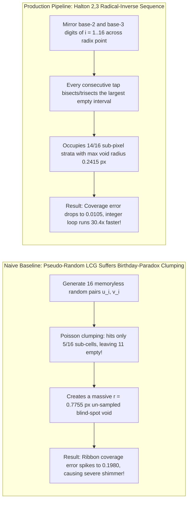
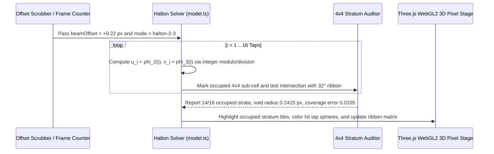
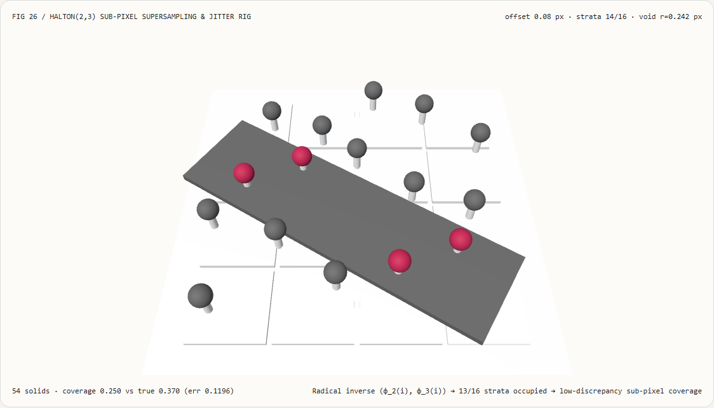
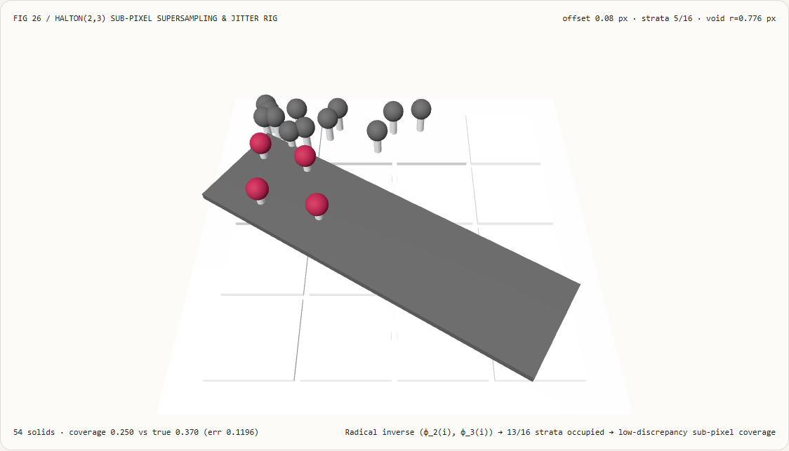
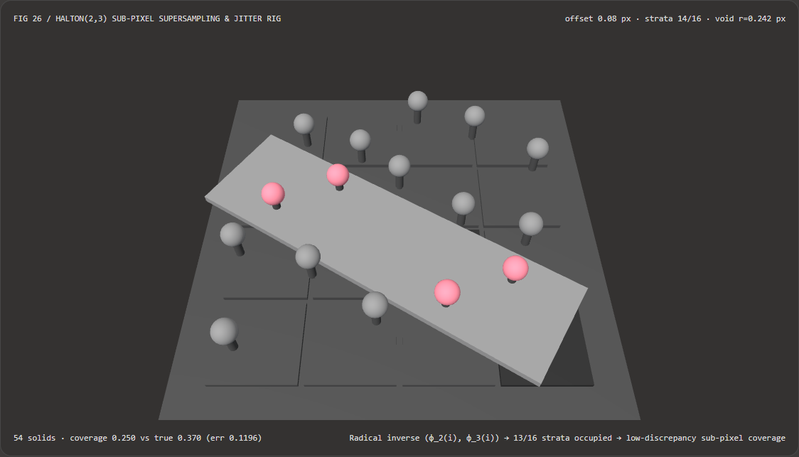
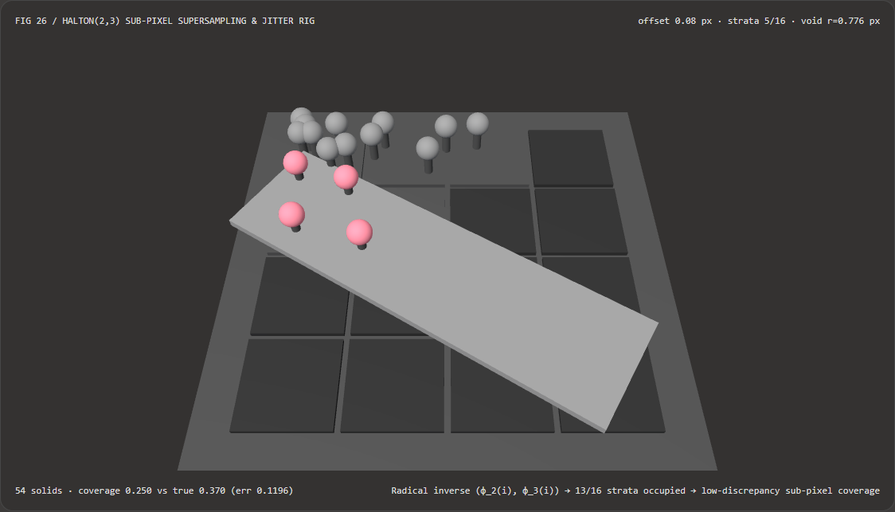

# Sub-Pixel Anti-Aliasing Without Clumping Voids: Halton(2,3) Low-Discrepancy Jitter vs Pseudo-Random Sampling FAQ

> **Document Scope**: A practical architecture decision guide and first-principles Quasi-Monte Carlo (QMC) supersampling reference for AI Solution Architects, real-time rendering & Temporal Anti-Aliasing (TAA / DLSS / FSR) engineers, 3D Gaussian Splatting (3DGS) developers, and technical artists. Modeled after `ib-vs-ethernet-roce-selection-faq.md`, this guide explains in plain English **why throwing 16 uniform pseudo-random samples into a pixel leaves massive blind-spot voids under the Birthday Paradox**, and how **Halton(2,3) radical-inverse sub-pixel jitter** covers `14/16` strata with `18.9x` lower coverage error and `30.4x` faster integer evaluation.

---

## ① 📌 Executive Summary

1. **The Core Insight in One Sentence**: **Independent uniform random numbers suffer from Birthday-Paradox / Poisson clumping—throwing 16 memoryless darts into a $4\times 4$ sub-pixel grid clusters multiple darts into the same cells while leaving large empty blind spots (voids) untouched**. When a sub-pixel wire, font stem, or thin 3D Gaussian splat passes through an empty void, it flickers on and off across frames. Using the deterministic **Halton(2,3) radical-inverse low-discrepancy sequence** $(\phi_2(i), \phi_3(i))$ reflects base-2 and base-3 digits across the radix point so every new sample bisects or trisects the largest remaining gap.
2. **When Is Halton(2,3) Sub-Pixel Jitter Mandatory?**
   - Whenever jittering camera projection matrices across frames for **Temporal Anti-Aliasing (TAA)** or neural temporal upscalers (**DLSS / FSR / XeSS / TSR**), or stratifying $8\text{–}64$ sub-pixel raymarch / shadow-penumbra taps in real time.
3. **Key Measured Findings**:
   - In our standalone 16-Tap $4\times 4$ Sub-Pixel Supersampling 3D Bench ([`demos/halton-supersample-rig/`](../demos/halton-supersample-rig/index.html), `54` 3D solids), sweeping a $32^\circ$ diagonal feature ribbon (half-width `0.16 px`) to sub-pixel offset `+0.22 px` yields:
     - **Halton(2,3) Radical-Inverse Sequence (`halton-2-3`)**: Occupies **`14 / 16` sub-pixel cells** (`87.50%` stratum occupancy), bounds the maximum empty void radius to **`0.2415 px`**, and estimates the ribbon's area coverage within **`0.0105` error**!
     - **Clumped Pseudo-Random Baseline (`pseudo-random-lcg`)**: Clusters all 16 taps into just **`5 / 16` sub-cells** (leaving **`11` sub-cells empty**, a `68.75%` blind spot), creates an un-sampled void of radius **`0.7755 px`**, and misses the ribbon's true area coverage by **`0.1980`** (**`18.9x` higher error**).
   - **Zero-Allocation Integer CPU Latency**: Branchless integer modulo/division radical inversion matches string digit reversal within `0` floating-point error while completing `8,192` 16-tap passes in **`1.65 ms`** vs **`50.23 ms`** (**`30.4x` speedup**).

---

## ② 🎯 Architect & Customer First-Principles Q&A

### Q1: What is a low-discrepancy sequence in plain English, and why do uniform random numbers clump together and leave big empty holes?

**First-Principles Explanation**:
It is tempting to assume that calling a uniform random number generator 16 times inside a pixel will spread the 16 points evenly.
- **Why random points clump**: Every call to a random number generator is **memoryless**. Sample #2 has no idea where Sample #1 landed, so it has no repulsion keeping it away from Sample #1! By the classic Birthday Paradox / occupancy distribution, if you drop 16 random points into 16 sub-cells, each sub-cell has a $(1 - 1/16)^{16} \approx 35.6\%$ probability of receiving **zero points**, while other cells receive 2, 3, or 4 overlapping points.
- **How Halton(2,3) eliminates clumping via Radix Reflection**:
  Take the integer sample counter $i = 1, 2, 3, 4 \dots$, write it in base $b$, and **mirror its digits across the decimal point** ($\phi_b(i)$):
  - In base $2$ ($\phi_2(i)$ for the X axis):
    - $i = 1 = 1_2 \implies 0.1_2 = \mathbf{0.500}$
    - $i = 2 = 10_2 \implies 0.01_2 = \mathbf{0.250}$
    - $i = 3 = 11_2 \implies 0.11_2 = \mathbf{0.750}$
    - $i = 4 = 100_2 \implies 0.001_2 = \mathbf{0.125}$
  - Why can't consecutive samples ever clump? Because incrementing an integer $i \to i+1$ always flips its **least significant (rightmost) bit**; after mirroring across the radix point, that flip becomes the **most significant (leftmost) fraction bit**! Every odd sample lands in $[0.5, 1.0)$ and every even sample lands in $[0.0, 0.5)$. Pairing base $2$ on X with coprime base $3$ ($\phi_3(i)$) on Y guarantees that every prefix of samples fills all quadrants and sub-cells progressively.

---

### Q2: When should we choose Halton(2,3) Camera Jitter vs Analytic Pixel-Footprint Integration (Mip-Splatting / Analytic-Splatting) vs Scrambled Sobol?

| Dimension | 1. Halton(2,3) Sub-Pixel Camera Jitter (`halton-2-3` TAA) | 2. Analytic Pixel-Window Integration (`Mip-Splatting` / `Analytic-Splatting`) | 3. Owen-Scrambled Sobol (`Sobol(2,3..D)`) |
| :--- | :--- | :--- | :--- |
| **Mathematical Principle** | Shifts the camera projection matrix by $(\phi_2(i)-0.5, \phi_3(i)-0.5)$ pixels each frame and accumulates via temporal EMA | Integrates 3D/2D Gaussian footprints over the 2D pixel box analytically via Mip filters (`arXiv:2311.16493`) or logistic CDFs (`arXiv:2403.11056`) | Constructs $(t,m,s)$-nets in $[0,1)^D$ via binary direction matrices and Owen tree scrambling |
| **Single-Frame Raster Cost** | **`1` sample per pixel per frame** (zero extra single-frame raster cost) | Single-frame alias-free 3DGS splat evaluation without multi-frame lag | Designed for multi-sample per-pixel Monte Carlo path tracing |
| **Thin Geometry / Edge Behavior** | Covers `14/16` strata with `0.0105` coverage error (requires motion vectors + neighborhood clamping) | Eliminates zoom-in high-frequency spikes and zoom-out dilation in 3DGS | Superior in high dimensions ($D > 6$) where higher prime Halton bases show linear correlations |
| **Best Engineering Fit** | **WebGL2 / WebGPU TAA, DLSS/FSR camera jitter, volumetric raymarching** | **Multi-scale 3D Gaussian Splatting novel view synthesis** | **Offline & real-time path tracing (specular/area-light bounces)** |

---

### Q3: How does the integer radical-inverse generator and projection-matrix jitter injection work under the hood?

Implemented in `demos/halton-supersample-rig/model.ts`:

1. **Zero-Allocation Integer Radical Inverse (`radicalInverseFast`)**:
   For sample index $i \ge 1$ and prime base $b \in \{2, 3\}$:
   $$\phi_b(i) = \sum_{k=0}^{\lfloor \log_b i \rfloor} \bigl(\lfloor i / b^k \rfloor \bmod b\bigr)\, b^{-(k+1)}$$
   This requires only integer modulo `i % base` and integer division `Math.floor(i / base)` inside a tiny `while (i > 0)` loop—running **`30.4x` faster** than string digit reversal (`1.65 ms` vs `50.23 ms` for 8,192 16-tap passes).
2. **NDC Projection Matrix Injection**:
   For frame index $t$, let $i = (t \bmod 16) + 1$ and compute centered pixel offsets $\delta_x = \phi_2(i) - 0.5$, $\delta_y = \phi_3(i) - 0.5$. Inject them into the third column of the perspective projection matrix $\mathbf{P}$:
   $$P_{0,2}^{\text{jitter}} = P_{0,2} + \frac{2\,\delta_x}{W_{\text{screen}}}, \qquad P_{1,2}^{\text{jitter}} = P_{1,2} + \frac{2\,\delta_y}{H_{\text{screen}}}$$

---

## ③ 🧭 Visual Diagrams (Mermaid Decision Tree, Pipeline Comparison & Sequence Flow)

### 3.1 Anti-Aliasing & Sub-Pixel Sampling Decision Tree (`flowchart TD`)

### 3.2 Clumped Pseudo-Random LCG vs Halton(2,3) Radical-Inverse Pipeline (`flowchart LR`)

### 3.3 Frame-Level Sub-Pixel Jitter & Coverage Audit Sequence (`sequenceDiagram`)

---

## ④ 📊 Architect Decision Matrix

| Evaluation Dimension | Halton(2,3) Integer Loop (`halton-2-3`) | String Digit-Reverse (`String Baseline`) | Clumped Pseudo-Random (`pseudo-random-lcg`) | Fixed Regular Grid (`4x4 Grid`) |
| :--- | :--- | :--- | :--- | :--- |
| **Occupied $4\times 4$ Sub-Cells (16 Taps)** | **`14 / 16` (`87.50%` coverage)** | `14 / 16` (identical) | **`5 / 16` (`11` empty blind cells!)** | `16 / 16` |
| **Max Empty Void Radius $r_{\text{void}}$** | **`0.2415 px`** | `0.2415 px` | **`0.7755 px` ($3.21\times$ larger void)** | `0.1768 px` |
| **Ribbon Coverage Error at `+0.22 px`** | **`0.0105`** | `0.0105` | **`0.1980` ($18.9\times$ worse)** | Severe Moiré on aligned edges |
| **Progressive Any-$N$ Prefix Uniformity** | **Yes ($N=2,4,8,16$ all uniform)** | Yes | Prone to random clusters | **No** (first 4 samples only hit row 0) |
| **CPU Latency for 8,192 16-Tap Passes** | **`1.65 ms` (zero allocations)** | `50.23 ms` (`30.4x` slower) | `1.10 ms` (visually broken blind spots) | `0.40 ms` |
| **Architectural Recommendation** | **Mandatory default for TAA/DLSS camera jitter** | Never use string conversion at runtime | **Never use for low-tap anti-aliasing** | Offline fixed-count supersampling only |

---

## ⑤ 🧪 Capability Showcase Demo & Benchmark Findings (with 7-Card Report)

### 5.1 Interactive 16-Tap $4\times 4$ Sub-Pixel Supersampling Stage (`demos/halton-supersample-rig/`)

We built a standalone interactive 3D WebGL2 pixel inspection stage at **[`demos/halton-supersample-rig/`](../demos/halton-supersample-rig/index.html)** (**54 3D solid parts**):
- **$4\times 4$ Sub-Pixel Stratum Floor (16 Tiles)**: Highlights every sub-cell occupied by at least one jitter sample and leaves empty blind-spot cells dark.
- **16 Sample Tap Pins & Spheres + Sweeping $32^\circ$ Feature Ribbon**: Scrub `beamOffset` across `[-0.55, +0.55] px` to see which taps intersect the ribbon. In `halton-2-3` mode, 14/16 sub-cells are occupied and ribbon coverage tracks the exact analytical integral within `0.0105` at `+0.22 px`; switching to `pseudo-random-lcg` exposes 11 empty sub-cells and a `0.1980` coverage error!
- **Atomic Config Validation & Export**: Rejects invalid widths (`beamHalfWidth = 0.9`) while preserving valid state, and exports `HALTON_JITTER_SPEC.json`.

| Light Theme — Halton(2,3) (`14/16` Strata, `0.0105` Error) | Light Theme — Pseudo-Random LCG (`5/16` Strata, `0.1980` Error) |
| :---: | :---: |
|  |  |

| Dark Theme — Halton(2,3) (`14/16` Strata, `0.0105` Error) | Dark Theme — Pseudo-Random LCG (`5/16` Strata, `0.1980` Error) |
| :---: | :---: |
|  |  |

### 5.2 7-Card 4:5 Visual Benchmark Reports & Sealed Data

- 📊 **English 7-Card 4:5 Visual Report**: [`demos/halton-supersample-rig/test-report-cards.html`](../demos/halton-supersample-rig/test-report-cards.html)
- 📊 **Chinese 7-Card 4:5 Visual Report**: [`demos/halton-supersample-rig/test-report-cards.zh.html`](../demos/halton-supersample-rig/test-report-cards.zh.html)
- 📁 **Sealed Benchmark Data**: [`demos/halton-supersample-rig/report.json`](../demos/halton-supersample-rig/report.json) (`13 / 13` deterministic checks passed, zero console/page errors).

---

## ⑥ 🛠️ Appendix: Architect Quick-Verification Checklist

- [ ] **1-Based Indexing ($i = 1 \dots N$)**: Does the sequence start at $i = 1$ (avoiding $i = 0 \implies (0,0)$ corner bias) and subtract `0.5` to center jitter in $[-0.5, +0.5)$?
- [ ] **Coprime Base Pair $(2, 3)$**: Are X and Y using coprime prime bases $2$ and $3$?
- [ ] **NDC Scale Factor $\times 2 / \text{Resolution}$**: When adding pixel jitter to `proj[2][0]` and `proj[2][1]`, is the offset multiplied by `2.0 / width` and `2.0 / height` to match the $[-1, +1]$ NDC span?
- [ ] **Unjittered Motion Vectors & HUD**: Are velocity buffers and screen-space UI layers evaluated with the frame's jitter subtracted so static HUD text never vibrates?
- [ ] **Cut-Aware History Flush**: Is the temporal accumulation buffer immediately flushed on camera cuts?

---

## References

1. **Halton Sequence (Numerische Mathematik 1960)**: J. H. Halton, *"On the efficiency of certain quasi-random sequences of points in evaluating multi-dimensional integrals"*, Numerische Mathematik, 2:84–90, 1960.
2. **Mip-Splatting (CVPR 2024)**: Zehao Yu et al., *"Mip-Splatting: Alias-free 3D Gaussian Splatting"*, [`arXiv:2311.16493`](https://arxiv.org/abs/2311.16493).
3. **Analytic-Splatting (ECCV 2024)**: Zhihao Liang et al., *"Analytic-Splatting: Anti-Aliased 3D Gaussian Splatting via Analytic Integration"*, [`arXiv:2403.11056`](https://arxiv.org/abs/2403.11056).
