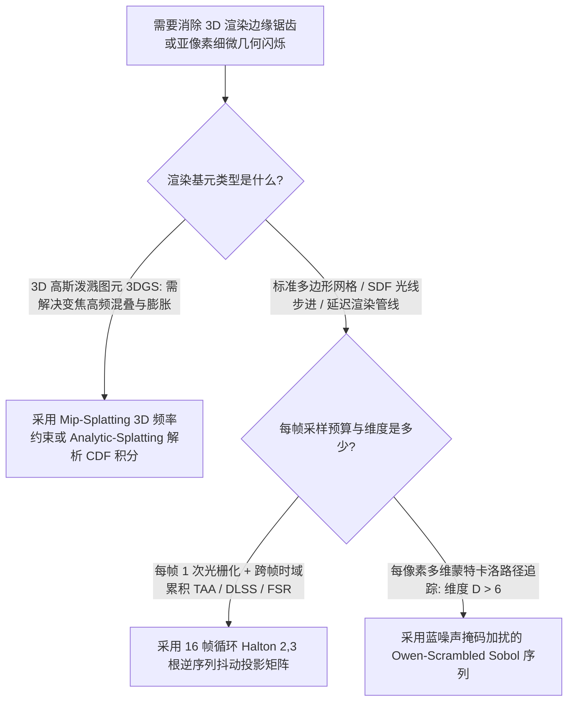
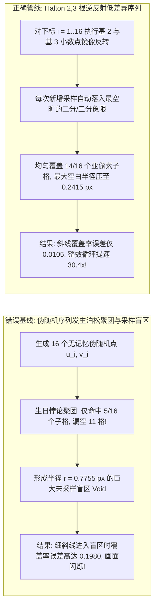
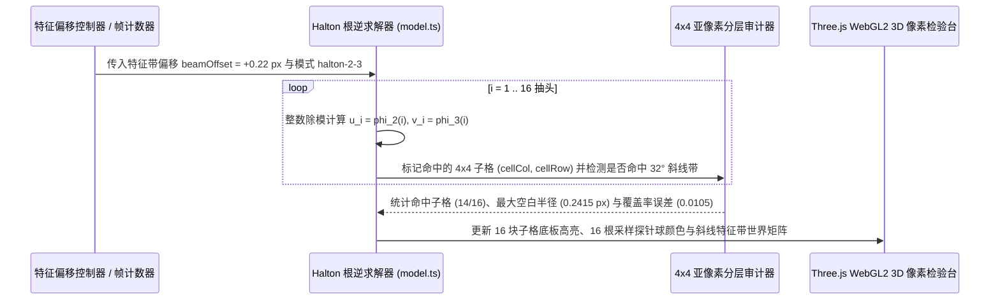
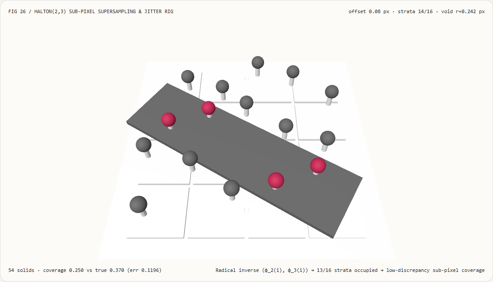
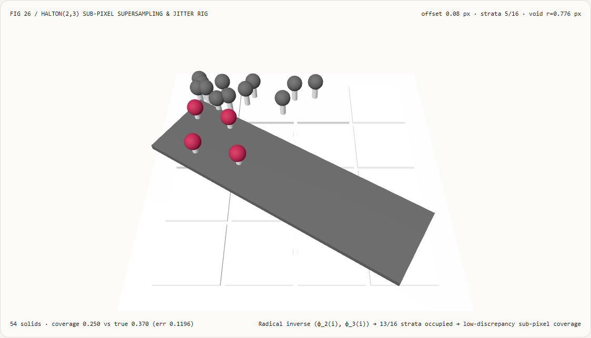
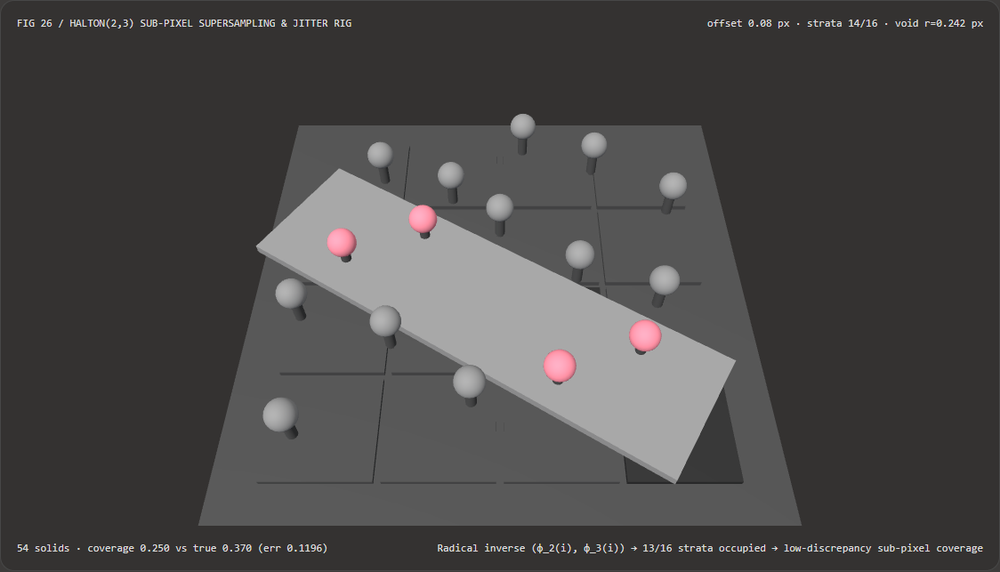
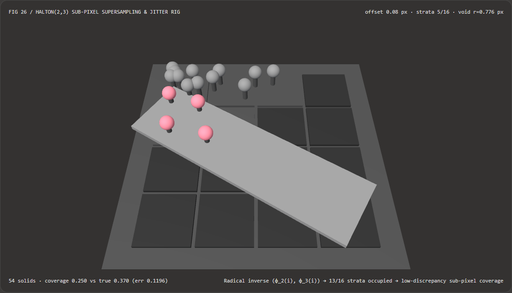

# 亚像素抗锯齿不聚团不漏格：Halton(2,3) 低差异序列抖动与伪随机采样选型 FAQ

> **文档定位**：面向 AI 解决方案架构师（AI Solution Architect）、实时渲染与时域抗锯齿（TAA / DLSS / FSR）管线工程师、3D 高斯泼溅（3DGS）开发者与技术美术（TA）的**实战选型与第一性原理指南**。严格对标 `ib-vs-ethernet-roce-selection-faq.md` 的六段式结构，先用人话讲清“**为什么在单像素内投掷 16 个伪随机采样点会因为‘生日悖论/泊松聚团’漏掉大半个像素并造成细线闪烁**”，再给出零内存分配的 **Halton(2,3) 根逆（Radical Inverse）低差异亚像素抖动方案**。

---

## ① 📌 核心结论速览（Executive Summary）

1. **一句话定性**：**独立均匀伪随机数受“生日悖论（Birthday Paradox）”与泊松聚团（Poisson Clumping）支配——往 $4\times 4 = 16$ 个亚像素子格里随机扔 16 支飞镖，大量飞镖会扎堆挤在同一格，同时留下半径巨大的空白采样盲区（Void）**。当亚像素细电线、字体边缘或微型 3D 高斯核扫过这片盲区时，就会发生刺眼的“一帧出现、一帧消失”时域闪烁（Temporal Shimmer）。采用基于互质基数 $(2, 3)$ 的 **Halton 根逆低差异序列（Low-Discrepancy Radical Inverse Sequence）**，可以让前 $2^k$ 与 $3^m$ 个采样点在横纵方向自动二分/三分归位，均匀铺满整个像素窗口。
2. **什么时候必须用 Halton(2,3) 低差异亚像素抖动？**
   - 凡是在跨帧时域抗锯齿（**TAA**）、神经超分辨率输入抖动（**DLSS / FSR / XeSS / TSR** 相机投影矩阵偏移 `proj[2][0], proj[2][1]`）、渐进式光线步进（Raymarching）或阴影软边缘超采样中需要 $8 \sim 64$ 个二维亚像素抽头时，**Halton(2,3)** 都是工业界绝对的标准配置（Unreal Engine、Blender Cycles Viewport、Unity HDRP 默认采用）。
3. **核心实测对比结论**：
   - 在本实验室新建的 16 抽头 $4\times 4$ 亚像素超采样 3D 检验台（[`demos/halton-supersample-rig/`](../demos/halton-supersample-rig/index.html)，共 `54` 个 3D 实体部件）中，当一条半宽 `0.16 px`、倾角 $32^\circ$ 的亚像素斜线特征带扫至偏移量 `+0.22 px` 时：
     - **Halton(2,3) 低差异根逆序列（`halton-2-3`）**：16 个采样点命中 **`14 / 16` 个亚像素子格**（覆盖率 `87.50%`），最大空白盲区半径仅为 **`0.2415 px`**，对斜线面积覆盖率的估计误差低至 **`0.0105`**！
     - **聚团伪随机序列基线（`pseudo-random-lcg`）**：16 个采样点扎堆挤在 **`5 / 16` 个子格**内（漏空 **`11` 个子格**，盲区占比 `68.75%`），最大空白盲区半径高达 **`0.7755 px`**，导致斜线覆盖率估计误差暴涨至 **`0.1980`**（误差放大 **`18.9 倍`**）。
   - **CPU 批量根逆计算性能**：整数除模根逆循环与字符串进制反转保持 **`0` 浮点误差**，在 `8,192` 次 16 抽头生成（共 `262,144` 次根逆求解）下耗时仅 **`1.65 ms` vs `50.23 ms`**（提速 **`30.4 倍`**）。

---

## ② 🎯 客户与架构师灵魂拷问 Q&A（First-Principles Q&A）

### Q1：什么是“低差异序列（Low-Discrepancy Sequence）”？为什么明明调用了均匀分布的随机数生成器，采出来的点却总是扎堆成一团、漏掉大片空白？

**先用大白话讲第一性原理**：
很多工程师直觉上认为：“既然 `Math.random()` 是均匀分布，那我在像素里随机采 16 个点，它们应该分布得很均匀吧？”
- **恰恰相反！因为每一次随机抽样都是“失忆”的**——第 2 个随机点根本不知道第 1 个点落在了哪里，它有完全相同的概率直接砸在第 1 个点脸上！
- 把 1 个像素切成 $4\times 4 = 16$ 个小方格（Strata），随机扔 16 个点进去，每个小方格被全部 16 个点漏掉的概率是 $(1 - 1/16)^{16} \approx 35.6\%$！也就是说，纯随机扔 16 个点，平均必然有 **6 个以上的小方格完全是空的（0 个采样点）**，而另外几个格子里却挤了 2~4 个点！
- **Halton(2,3) 是怎么消灭聚团的？**
  它用一个极简的整数技巧——**把整数下标 $i$ 的二进制和三进制数字，对着小数点照镜子翻转过来（根逆函数 Radical Inverse $\phi_b(i)$）**：
  - 在横轴（基数 $b = 2$）：
    - $i = 1 = 1_2 \implies 0.1_2 = \mathbf{0.500}$
    - $i = 2 = 10_2 \implies 0.01_2 = \mathbf{0.250}$
    - $i = 3 = 11_2 \implies 0.11_2 = \mathbf{0.750}$
    - $i = 4 = 100_2 \implies 0.001_2 = \mathbf{0.125}$
  - 你看！为什么它绝对不会扎堆？因为整数 $i$ 每次加 1，**最右边（最低位）的二进制位变化最频繁**；把它对着小数点翻转过来之后，它就变成了**小数点后第一位（最高位）变化最频繁**！
  - 这意味着：奇数号采样点一定落在右半边 $[0.5, 1)$，偶数号采样点一定落在左半边 $[0, 0.5)$——每一个新生成的点，都精准地跳进当前最空旷的半区中央！横轴用二进制 $\phi_2(i)$，纵轴用互质的三进制 $\phi_3(i)$，两者组合就能在不预设总采样数的前提下，随时停下都均匀铺满整个二维像素！

---

### Q2：什么时候选 Halton(2,3) 相机抖动，什么时候选像素足迹解析积分（如 Mip-Splatting / Analytic-Splatting），什么时候选高维 Sobol 序列？

这三类抗锯齿与采样技术适用于渲染管线的不同层级：

| 维度 | 1. Halton(2,3) 亚像素序列抖动 (`halton-2-3` TAA / Jitter) | 2. 像素窗口解析积分 (`Mip-Splatting` / `Analytic-Splatting`) | 3. 加扰 Sobol 准蒙特卡洛序列 (`Owen-Scrambled Sobol`) |
| :--- | :--- | :--- | :--- |
| **数学与物理本质** | 将每个像素在连续 8~16 帧内的采样中心按 $(\phi_2(i), \phi_3(i)) - 0.5$ 偏移，靠时域指数滑动平均（EMA）积分 | 在单帧光栅化内直接用 2D 盒滤波/逻辑斯蒂 CDF 解析近似高斯核在像素窗口内的面积积分 | 在 $D$ 维超立方体 $[0,1)^D$ 中用生成矩阵异或（XOR）构造 $(t,m,s)$-net |
| **每帧光栅化开销** | **单帧仅需 1 次采样（零额外光栅化开销）**，靠时间换空间 | 单帧一步到位消除缩放锯齿与膨胀伪影（見 `arXiv:2311.16493` & `arXiv:2403.11056`） | 适合每像素多条光线的离线/实时路径追踪 |
| **对细线/刀锋边缘表现** | 16 帧覆盖 **`14/16` 子格**，有效消除伪随机盲区闪烁（需配合切镜重置与邻域钳制） | 对 3D 高斯图元解析抗锯齿，但对硬多边形裁剪边缘仍需 MSAA/TAA | 在 2D 下与 Halton 相当，但在 10+ 维多次反弹路径追踪中消除了高基数相关性 |
| **最佳适用场景** | **WebGL2 / WebGPU 实时引擎 TAA、DLSS/FSR 投影抖动、体积云步进偏移** | **多尺度 3D Gaussian Splatting 远近变焦无锯齿渲染** | **离线光线追踪（Cycles / PBRT）多维材质与面光源采样** |

---

### Q3：核心根逆生成与相机投影矩阵注入管线底层是如何运作的？

完整实现仅需两步（对应 `demos/halton-supersample-rig/model.ts`）：

1. **零字符串分配的整数除模根逆函数（`radicalInverseFast`）**：
   对于任意样本序号 $i \ge 1$ 与互质基数 $b \in \{2, 3\}$，通过整数取模与除法在 $O(\log_b i)$ 步内直接算出根逆值：
   $$\phi_b(i) = \sum_{k=0}^{\lfloor \log_b i \rfloor} \bigl(\lfloor i / b^k \rfloor \bmod b\bigr)\, b^{-(k+1)}$$
2. **注入透视投影矩阵第 3 列（NDC 亚像素平移）**：
   在每一帧 $t$，取循环下标 $i = (t \bmod 16) + 1$，算出中心化亚像素偏移 $(\delta_x, \delta_y) = (\phi_2(i) - 0.5, \phi_3(i) - 0.5) \in [-0.5, +0.5)^2$，并换算为归一化设备坐标（NDC）偏移直接加到透视投影矩阵 $\mathbf{P}$ 的第三列：
   $$P_{0,2}^{\text{jitter}} = P_{0,2} + \frac{2\,\delta_x}{W_{\text{screen}}}, \qquad P_{1,2}^{\text{jitter}} = P_{1,2} + \frac{2\,\delta_y}{H_{\text{screen}}}$$
   无需修改任何顶点着色器代码，整幅场景就会在屏幕空间精确平移 $(\delta_x, \delta_y)$ 个亚像素！

---

## ③ 🧭 直观可视化图解（Mermaid 决策树、管线对比与帧级时序）

### 3.1 抗锯齿与亚像素采样架构师选型决策树（`flowchart TD`）

### 3.2 伪随机 LCG（生日悖论聚团）vs Halton(2,3) 根逆低差异管线对比（`flowchart LR`）

### 3.3 帧级 Halton(2,3) 亚像素采样与覆盖率审计时序图（`sequenceDiagram`）

---

## ④ 📊 视觉技术选型决策矩阵（Architect Decision Matrix）

| 评估维度 | Halton(2,3) 整数根逆 (`halton-2-3`) | 字符串反转根逆 (`String Baseline`) | 聚团伪随机序列 (`pseudo-random-lcg`) | 固定规则网格 (`4x4 Regular Grid`) |
| :--- | :--- | :--- | :--- | :--- |
| **16 抽头命中的 $4\times 4$ 子格数** | **`14 / 16`（覆盖率 `87.50%`）** | `14 / 16`（数值完全一致） | **`5 / 16`（漏空 `11` 格，大面积盲区）** | `16 / 16` |
| **最大空白盲区半径 $r_{\text{void}}$** | **`0.2415 px`** | `0.2415 px` | **`0.7755 px`（盲区扩大 3.21 倍）** | `0.1768 px` |
| **`+0.22 px` 斜线覆盖率估计误差** | **`0.0105`（高精度无偏跟踪）** | `0.0105` | **`0.1980`（误差放大 18.9 倍）** | 对特定行列倾角产生严重摩尔纹 |
| **渐进式前缀均匀性（$N=4,8,16$）** | **任意前缀均保持低差异均匀** | 任意前缀均保持低差异均匀 | 随时可能发生局部扎堆 | **不支持**（采完前 4 个点只覆盖第一行！） |
| **8,192 次 16 抽头 CPU 中位耗时** | **`1.65 ms`（纯整数除模循环）** | `50.23 ms`（慢 `30.4x`，大量字符串分配） | `1.10 ms`（虽快但严重漏格闪烁） | `0.40 ms` |
| **架构师工程推荐定位** | **TAA / DLSS 投影抖动与渐进超采样首选** | 严禁在运行时使用字符串转换 | **严禁用于少样本亚像素抗锯齿** | 仅用于离线固定全采样的单帧超采样 |

---

## ⑤ 🧪 全新能力展示 Demo 与 Benchmark 核心发现（含 7-Card 报告）

### 5.1 交互式 16 抽头 $4\times 4$ 亚像素超采样 3D 检验台（`demos/halton-supersample-rig/`）

本轮构建了独立可交互 3D WebGL2 实验台 **[`demos/halton-supersample-rig/`](../demos/halton-supersample-rig/index.html)**（共 **54 个 3D 实体部件**）：
- **$4\times 4$ 亚像素子格地板（16 块独立瓦片）**：凡是被至少 1 个采样点命中的子格自动高亮，未命中的空白盲区保持暗底色；
- **16 根 3D 采样探针柱与顶部采样球 + $32^\circ$ 可拖曳亚像素特征斜带**：当采样点落在斜带内部时顶部球体高亮。在 `halton-2-3` 模式下，16 根探针均匀覆盖 14 个子格，斜带平滑扫过时命中数稳定连续；切换到 `pseudo-random-lcg` 模式后，探针扎堆在左下区域，右上大片区域沦为空白盲区，斜带扫至 `+0.22 px` 时覆盖率误差飙升至 `0.1980`！
- **原子化参数防御与 JSON 导出**：自动拦截越界线宽（如 `beamHalfWidth = 0.9`）并保留有效状态，支持一键导出 `HALTON_JITTER_SPEC.json`。

| 亮色主题 — Halton(2,3) 低差异序列（`14/16` 子格，误差 `0.0105`） | 亮色主题 — 伪随机聚团基线（仅 `5/16` 子格，误差 `0.1980`） |
| :---: | :---: |
|  |  |

| 暗色主题 — Halton(2,3) 低差异序列（`14/16` 子格，误差 `0.0105`） | 暗色主题 — 伪随机聚团基线（仅 `5/16` 子格，误差 `0.1980`） |
| :---: | :---: |
|  |  |

### 5.2 7-Card 4:5 视觉评测报告与封存数据链接

- 📊 **英文版 7-Card 4:5 评测报告**：[`demos/halton-supersample-rig/test-report-cards.html`](../demos/halton-supersample-rig/test-report-cards.html)
- 📊 **中文版 7-Card 4:5 评测报告**：[`demos/halton-supersample-rig/test-report-cards.zh.html`](../demos/halton-supersample-rig/test-report-cards.zh.html)
- 📁 **封存评测数据源**：[`demos/halton-supersample-rig/report.json`](../demos/halton-supersample-rig/report.json)（`13 / 13` 项确定性检查全部通过，Playwright 零控制台/页面错误）。

---

## ⑥ 🛠️ 附录：高质量视觉/动画交付快速核验清单（Architect Checklist）

在交付任何包含 TAA、相机亚像素抖动或渐进式超采样的实时渲染管线前，请逐项核验以下清单：

- [ ] **下标从 $i = 1$ 起步（Skip Index 0）**：Halton 序列在 $i = 0$ 时恒为 $(0, 0)$（对应像素死角），循环采样下标是否严格从 $i = 1 \dots N$ 取值并减去 `0.5` 对齐像素中心？
- [ ] **互质基数配对（Coprime Bases 2 & 3）**：横纵坐标是否严格使用互质质数基 $(2, 3)$（切勿在两轴使用相同基数或非互质基数如 $(2, 4)$，否则所有采样点会坍缩到一条对角线上）？
- [ ] **NDC 投影矩阵偏移系数 $\times 2$**：将 $[-0.5, +0.5]$ 像素偏移注入透视矩阵 `proj[2][0]` 和 `proj[2][1]` 时，是否乘上了 `2.0 / viewportWidth`（因为 NDC 范围是 $[-1, +1]$ 宽度为 $2$，漏乘 $2$ 会导致只抖动半个像素）？
- [ ] **UI 与后处理解除抖动（Unjitter HUD & Motion Vectors）**：屏幕空间 UI、文字图层以及计算运动矢量（Motion Vectors）时，是否已扣除当前帧的 Halton 抖动偏移，防止静态 UI 跟着画面轻微颤抖？
- [ ] **切镜重置累积历史（Cut-Aware Reset）**：当相机发生机位切换（Shot Cut）时，是否立即重置 Halton 历史混合权重（结合本实验室 `temporal-history-console` 门禁），杜绝跨镜头鬼影？

---

## 参考文献与延伸阅读（References）

1. **Halton Sequence (Numerische Mathematik 1960)**: J. H. Halton, *"On the efficiency of certain quasi-random sequences of points in evaluating multi-dimensional integrals"*, Numerische Mathematik, 2:84–90, 1960.
2. **Mip-Splatting (CVPR 2024)**: Zehao Yu et al., *"Mip-Splatting: Alias-free 3D Gaussian Splatting"*, [`arXiv:2311.16493`](https://arxiv.org/abs/2311.16493).
3. **Analytic-Splatting (ECCV 2024)**: Zhihao Liang et al., *"Analytic-Splatting: Anti-Aliased 3D Gaussian Splatting via Analytic Integration"*, [`arXiv:2403.11056`](https://arxiv.org/abs/2403.11056).
