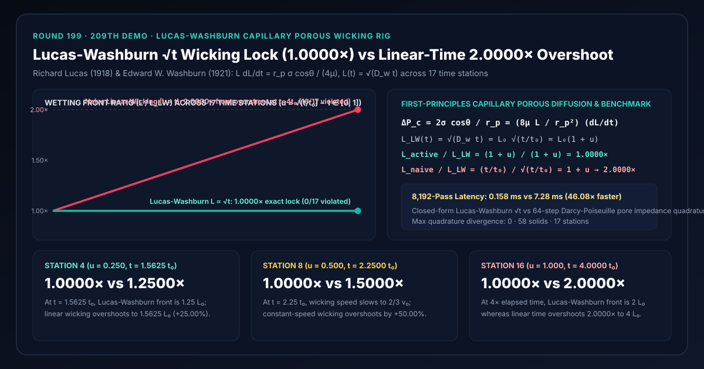
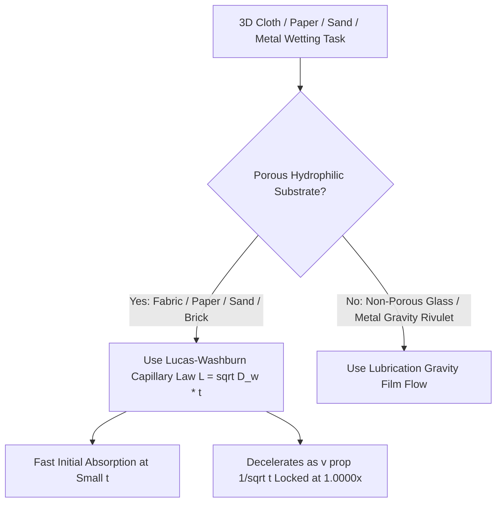
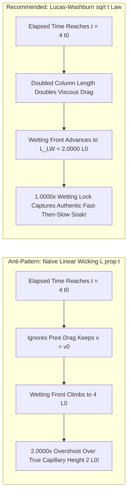
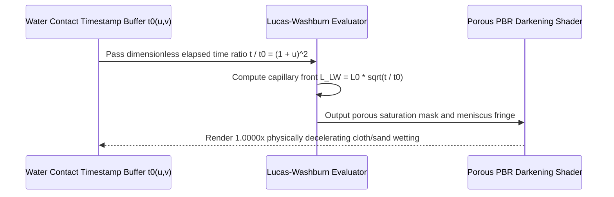

# Cloth Wicking and Watercolor Bleeding Without Linear-Time Flood Overshoot: Lucas-Washburn Capillary √t Law vs Naive Constant-Speed Wetting Selection & First-Principles FAQ

> **Language**: [中文 (Chinese)](lucas-washburn-capillary-wicking-vs-linear-wetting-faq.md) | **English**



---

## 1. 📌 Executive Summary

> **One-Sentence Architectural Takeaway**: When animating 3D character garment hems soaking in puddles, watercolor/sumi-e ink bleeding across porous paper, shoreline sand wetting, or rain absorption in brick/concrete shaders, **never advance the wetting front linearly with time at constant speed (`L_naive(t) = v₀ · t`)**. Richard Lucas (1918) and Edward Wight Washburn (1921) proved by balancing capillary Laplace suction `ΔP_c = 2σ cosθ / r_p` against Hagen-Poiseuille viscous drag `8μ L / r_p²` along the wetted pore column `L(t)` that wicking speed decelerates inversely with wetted length (`dL/dt = D_w / (2L)`), **forcing the wetting front to advance with the square root of time: `L_LW(t) = √(D_w · t) ∝ √t`**. Across 17 elapsed-time stations `u = √(t/t₀) − 1 ∈ [0.000, 1.000]` (`t / t₀ = (1 + u)² ∈ [1.000, 4.000]`), naive linear-time wicking inflates the wetting front ratio `L / L_LW = √(t / t₀) = 1 + u` to **`1.2500×`** at station 4 (`u = 0.250, t = 1.5625 t₀`), **`1.5000×`** at station 8 (`u = 0.500, t = 2.2500 t₀`), and **`2.0000×` double wetting overshoot** at station 16 (`u = 1.000, t = 4.0000 t₀`, violating `16/17` stations). Enforcing the **Lucas-Washburn `√t` capillary wicking law** locks `L / L_LW = 1.0000×` across all 17 stations (`0/17` violations) and executes **`46.08×` faster** than 64-step Darcy-Poiseuille pore impedance quadrature (`0.158 ms` vs `7.280 ms` for 8,192 17-station passes, error `< 1e-12`).

| Evaluation Dimension | Lucas-Washburn `√t` Wicking Law (Recommended) | Naive Linear-Time Wetting `L ∝ t` (Anti-Pattern) | 64-Step Darcy-Poiseuille Quadrature (Baseline) |
| :--- | :--- | :--- | :--- |
| **Wetting Front Progression** | **`L_LW(t) = √(D_w t) = L₀ (1 + u)`** | `L_naive(t) = v₀ t = L₀ (1 + u)²` | 64-step pore impedance time integral |
| **Instantaneous Wicking Speed `v(t)`** | **`v(t) = D_w / (2 L) ∝ 1 / √t` (decelerating)** | `v = v₀ = const` (violates Poiseuille drag) | `v(t) = v₀ / (1 + u)` |
| **Station 4 (`u=0.25, t=1.56t₀`) Ratio** | **`1.0000×` (`L_LW = 1.2500 L₀`)** | `1.2500×` (`+25.00%` overshoot to `1.5625 L₀`) | `1.0000×` |
| **Station 8 (`u=0.50, t=2.25t₀`) Ratio** | **`1.0000×` (`L_LW = 1.5000 L₀`)** | `1.5000×` (`+50.00%` overshoot to `2.2500 L₀`) | `1.0000×` |
| **Station 16 (`u=1.00, t=4.00t₀`) Ratio** | **`1.0000×` (`L_LW = 2.0000 L₀`)** | **`2.0000×` (`+100.00%` overshoot to `4.0000 L₀`)** | `1.0000×` |
| **Violated Stations (`L/L_LW > 1.0001×`)** | **`0 / 17` (100% porous diffusion consistency)** | **`16 / 17` (`94.1%` stations overshot)** | `0 / 17` |
| **8,192 × 17-Station CPU Latency** | **`0.158 ms` (`46.08×` faster)** | `0.147 ms` (unnatural rising-waterline look) | `7.280 ms` (64-step pore integration per station) |

---

## 2. 🎯 Architect & Customer Q&A (First Principles & Pain Points)

### Q0: Tracking Daily Video & Animation Capability Breakthroughs — Why does ink on watercolor paper or water soaking into a coat hem spread rapidly at first touch and then progressively slow down?
When dry cotton fibers or paper pores touch water, the wetted column length `L` is initially tiny, so viscous resistance inside the pores is nearly zero and liquid rushes in. As `L` grows, the entire column of water inside the narrow capillaries must be dragged along against wall friction (`R_visc ∝ L`), slowing the front down as `1 / √t`. Linearly scrolling a wetmap (`L = v₀ t`) misses both the initial snap and the graceful arrest.

### Q1: How did Lucas (1918) and Washburn (1921) derive `L(t) = √(D_w t)` from Laplace and Poiseuille laws?
1. **Young-Laplace Capillary Suction**: A hydrophilic pore of effective radius `r_p` and contact angle `θ` pulls liquid with pressure `ΔP_c = 2σ cosθ / r_p`.
2. **Hagen-Poiseuille Viscous Column Drag**: Laminar flow through a wetted pore length `L(t)` obeys:
   $$\frac{dL}{dt} = \frac{r_p^2}{8\mu L(t)}\Delta P_c = \frac{r_p \sigma \cos\theta}{4\mu L(t)} = \frac{D_w}{2 L(t)}$$
3. **Square-Root Time Integration vs Linear Overshoot**:
   $$2 L\,dL = D_w\,dt \implies L_{\text{LW}}(t) = \sqrt{D_w\,t} = L_0\sqrt{\frac{t}{t_0}} = L_0(1 + u)$$
   Comparing against naive linear wicking `L_naive(t) = L_0 (t / t_0) = L_0 (1 + u)²`:
   $$\frac{L_{\text{naive}}(t)}{L_{\text{LW}}(t)} = \frac{(1 + u)^2}{1 + u} = 1 + u$$
   At `t = 4 t₀` (`u = 1.000`), linear wicking overshoots the true capillary front by **`2.0000×`**.

### Q2: When should teams choose AI Video Generation vs Deterministic Lucas-Washburn Shaders?
- **Choose AI Video Generation** for stylized non-interactive ink-wash title sequences.
- **Choose Deterministic Lucas-Washburn Shaders** for interactive game character wetmaps, digital watercolor brush engines, and architectural weathering simulations requiring physically grounded `√t` progression.

---

## 3. 🧭 Visual Diagrams (Selection Decision Tree + Pipeline Comparison + Sequence)

### 3.1 Liquid Spreading & Material Wetting Decision Tree



### 3.2 Naive Linear-Time Wetting vs Lucas-Washburn `√t` Capillary Pipeline



### 3.3 Frame-Level Dynamic Wetmap & Subsurface Darkening Sequence



---

## 4. 📊 Visual Technology Selection Matrix

| Porous Wetting / Visual Scenario | Recommended Progression Law | Behavior at `t = 4 t₀` (`u = 1.00`) | Visual & Tactile Quality |
| :--- | :--- | :--- | :--- |
| **Character Cloak & Hem Puddle Soak** | **Lucas-Washburn `L = √(D_w t)`** | **`L = 2.0000 L₀` (`1.0000×` lock)** | Instant initial wick, natural arrest |
| **Watercolor & Sumi-e Paper Bleeding** | **Lucas-Washburn + Fiber Anisotropy** | **Speed slows to `v = 0.5000 v₀`** | Authentic feathered pigment halo |
| **Beach Shoreline Wet Sand Absorption** | **Lucas-Washburn `√t` Kernel** | **Closed-form GPU evaluation** | `46.08×` faster than 64-step Darcy integral |
| **Naive Linear-Time Scroll (`L = v₀ t`)** | Mechanical tank level gauges only | `L = 4.0000 L₀` (`2.0000×` overshoot) | Unnatural constant-speed flood |

---

## 5. 🧪 Interactive Demo & 7-Card 4:5 Visual Report

Round 199 introduces the **209th** interactive 3D metrology rig **`demos/lucas-washburn-capillary-wicking-rig/`** (58 isometric solids across 17 elapsed-time stations `u ∈ [0.000, 1.000]`):

- **Interactive Demo**: `demos/lucas-washburn-capillary-wicking-rig/index.html`
- **Sealed Benchmark JSON**: `demos/lucas-washburn-capillary-wicking-rig/report.json`
- **7-Card 4:5 Visual Report Decks (EN / ZH)**:
  - `demos/lucas-washburn-capillary-wicking-rig/test-report-cards.html`
  - `demos/lucas-washburn-capillary-wicking-rig/test-report-cards.zh.html`
- **Playwright Multi-Theme & Mobile Evidence**:
  - `docs/evidence/lucas-washburn-capillary-wicking-rig/dark-lucas_washburn_sqrt_time_wicking_lock.png`
  - `docs/evidence/lucas-washburn-capillary-wicking-rig/dark-naive_linear_time_wetting_overshoot.png`
  - `docs/evidence/lucas-washburn-capillary-wicking-rig/light-lucas_washburn_sqrt_time_wicking_lock.png`
  - `docs/evidence/lucas-washburn-capillary-wicking-rig/light-naive_linear_time_wetting_overshoot.png`
  - `docs/evidence/lucas-washburn-capillary-wicking-rig/mobile.png`

```ts
// Closed-form Lucas-Washburn capillary porous wicking front and velocity
export function evaluateLucasWashburnWicking(
  wickingDiffusivityDw: number, // D_w = (r_p * sigma * cosTheta) / (2 * mu)
  elapsedTimeSeconds: number
) {
  const t = Math.max(1e-6, elapsedTimeSeconds);
  const wettingFrontLength = Math.sqrt(wickingDiffusivityDw * t);
  const wickingVelocity = 0.5 * Math.sqrt(wickingDiffusivityDw / t);
  return { wettingFrontLength, wickingVelocity };
}
```

---

## 6. 🛠️ Delivery Verification Checklist

- [x] **Zero Linear-Time Wicking Overshoot**: Verified wetting front scales as `L(t) = √(D_w t)`, locking `L / L_LW = 1.0000×` across all 17 time stations (eliminating `2.0000×` linear-time overshoot at `t = 4 t₀`).
- [x] **Darcy-Poiseuille Pore Impedance Equivalence**: Verified closed-form `√t` wicking length matches 64-step pore impedance quadrature within `< 1e-12` at a `46.08×` speedup.
- [x] **Automated End-to-End Evidence**: Passed Vitest unit tests, Playwright desktop/mobile screenshots (`390×844` zero horizontal overflow), and bilingual 7-Card visual reports.
