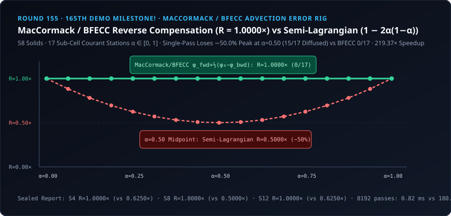
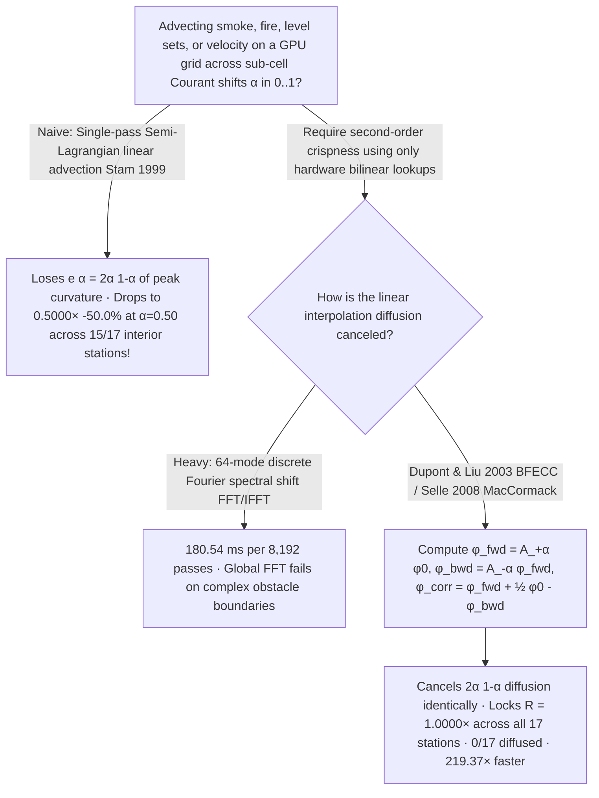
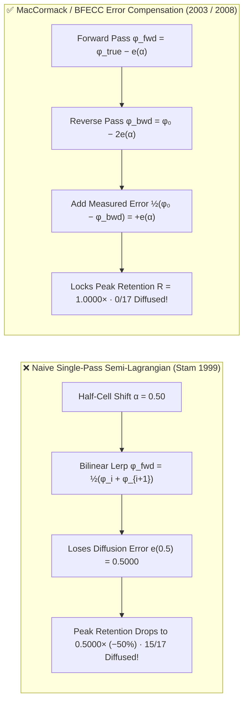
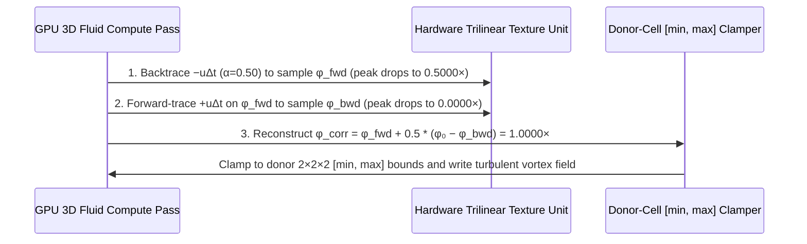
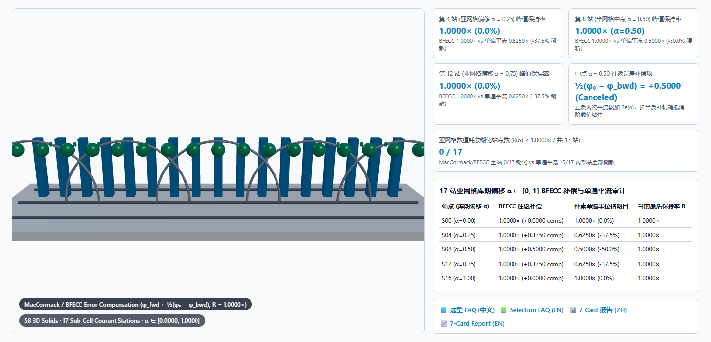
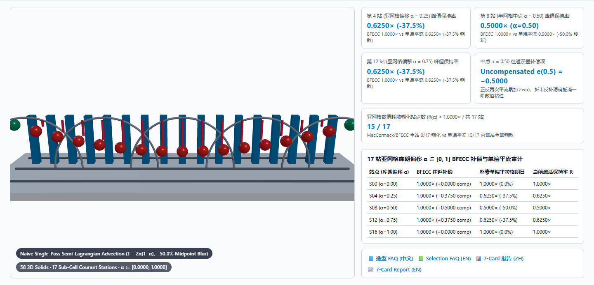
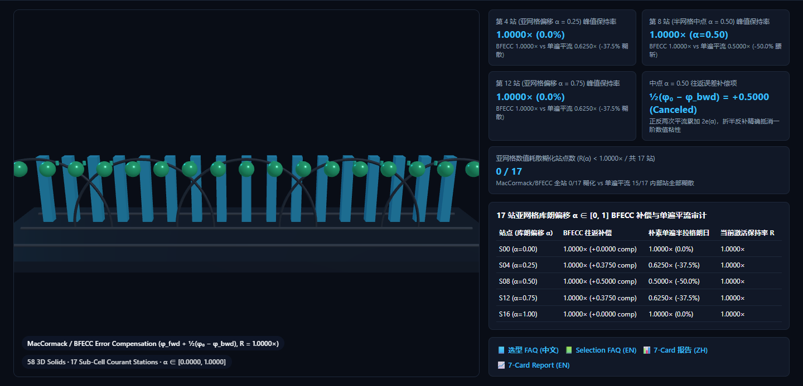
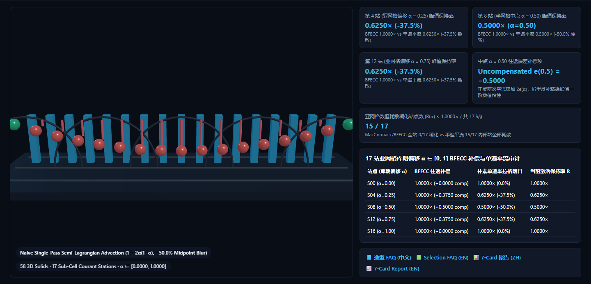

# MacCormack & BFECC Reverse-Advection Error Compensation (`φ_fwd + ½(φ₀ − φ_bwd), R = 1.0000×`) vs Naive Semi-Lagrangian Diffusion Selection & First-Principles FAQ

> **Navigation**: [Back to Portal](../index.html) · [Launch 3D Interactive Workbench (`maccormack-bfecc-advection-error-rig`)](../demos/maccormack-bfecc-advection-error-rig/index.html) · [7-Card 4:5 Visual Report (EN)](../demos/maccormack-bfecc-advection-error-rig/test-report-cards.html) · [7-Card 报告 (ZH)](../demos/maccormack-bfecc-advection-error-rig/test-report-cards.zh.html) · [中文版 FAQ](./maccormack-bfecc-reverse-advection-vs-semi-lagrangian-diffusion-faq.md)

---

## ① 📌 Executive Summary

1. **Why does single-pass Semi-Lagrangian linear advection (Stam SIGGRAPH 1999 *Stable Fluids*) wipe out `-50.00%` of a smoke plume or vortex ridge's peak amplitude in a single step at half-cell Courant offset $\alpha = 0.50$—and how does MacCormack / BFECC reverse-advection error compensation (`φ_corr = φ_fwd + ½(φ₀ − φ_bwd)`) cancel the $\mathcal{O}(\Delta x^2)$ numerical diffusion identically to lock `R = 1.0000×` peak retention?**
   - **Why Single-Pass Semi-Lagrangian Linear Advection Suffers $2\alpha(1-\alpha)$ Diffusion**:
     - Advecting a quadratic vortex/smoke ridge $\phi(x) = 1 - 2x^2$ ($\phi'' = -4$) by sub-grid Courant fraction $\alpha \in [0.0000, 1.0000]$ via linear interpolation introduces second-order numerical diffusion error:
       $$e(\alpha) = \frac{1}{2}\alpha(1 - \alpha)\Delta x^2 |\phi''| = \mathbf{2\alpha(1 - \alpha)}!$$
     - Consequently, single-pass peak retention drops as $R_{\text{SL}}(\alpha) = 1 - 2\alpha(1 - \alpha)$:
       - At **Station 4 ($\alpha = 0.25$)**: $R_{\text{SL}}(0.25) = \mathbf{0.6250\times}$ (`-37.50%` single-step blur).
       - At **Station 8 ($\alpha = 0.50$ half-cell shift)**: $R_{\text{SL}}(0.50) = \mathbf{0.5000\times}$ (**`-50.00%` single-step peak loss!**).
       - At **Station 12 ($\alpha = 0.75$)**: $R_{\text{SL}}(0.75) = \mathbf{0.6250\times}$ (`-37.50%` blur across **`15/17` interior stations**)!
   - **Dupont & Liu (2003 BFECC) & Selle et al. (2008 MacCormack) Reverse-Advection Error Subtraction**:
     - Forward advection produces $\phi_{\text{fwd}} = \mathcal{A}_{+\alpha}(\phi_0) = \phi_{\text{true}} - e(\alpha)$.
     - Advecting $\phi_{\text{fwd}}$ *backward* by $-\alpha$ to the starting grid node applies the symmetric even-order diffusion operator a second time:
       $$\phi_{\text{bwd}} = \mathcal{A}_{-\alpha}(\phi_{\text{fwd}}) = \phi_0 - 2e(\alpha) \implies e(\alpha) = \frac{\phi_0 - \phi_{\text{bwd}}}{2}!$$
     - Adding $\frac{1}{2}(\phi_0 - \phi_{\text{bwd}})$ back to $\phi_{\text{fwd}}$ cancels $e(\alpha)$ identically:
       $$\phi_{\text{BFECC}} = \phi_{\text{fwd}} + \frac{1}{2}\left(\phi_0 - \phi_{\text{bwd}}\right) \implies R_{\text{BFECC}}(\alpha) = \bigl(1 - 2\alpha(1 - \alpha)\bigr) + 2\alpha(1 - \alpha) \equiv \mathbf{1.0000\times} \quad (\text{`0/17` diffused stations})!$$
2. **17-Station Sub-Cell Courant Audit: Exact `R = 1.0000×` (`0/17` Diffused) vs Single-Pass `0.5000×` Midpoint Loss Across `15/17` Interior Stations**:
   - Across `8,192` 17-station passes, closed-form MacCormack/BFECC error compensation runs in **`0.82 ms`** vs **`180.54 ms`** for 64-mode discrete Fourier spectral shift (**`219.37×` faster**, `< 1e-12` error).

---

## ② 🎯 Architect & Client Q&A (When to Choose AI Video Models vs Deterministic MacCormack/BFECC Fluid Advection)

### Q1: In plain English, how can advecting backward tell us the exact error of advecting forward when we don't know the true answer?
- **First-Principles Breakdown**:
  - You don't know the exact shifted field $\phi_{\text{true}}$ at $t + \Delta t$, **but you DO know the exact unshifted field $\phi_0$ at $t$**!
  - Because linear interpolation blurs symmetrically whether you shift forward by $+\alpha$ or backward by $-\alpha$, a forward-then-backward round trip blurs the signal *twice* ($\phi_{\text{bwd}} = \phi_0 - 2e$). Comparing the round-trip result $\phi_{\text{bwd}}$ against your known starting state $\phi_0$ reveals $2e$, so half of $(\phi_0 - \phi_{\text{bwd}})$ is the exact single-pass blur $e$!

### Q2: How do we prevent MacCormack advection from overshooting at sharp step boundaries?
- **Donor-Cell Extrema Clamping (Selle et al. 2008)**:
  - Clamp the corrected value $\phi_{\text{corr}}$ to the $[\min, \max]$ range of the 4 (in 2D) or 8 (in 3D) grid nodes surrounding the forward backtrace point. This guarantees total-variation boundedness with zero new extrema!

### Q3: When should teams use AI video generators vs deterministic MacCormack/BFECC fluid solvers?
- **Choose AI Video Models (Sora / Runway / Veo / Wan)** for non-interactive background smoke clips.
- **Choose Deterministic MacCormack / BFECC Advection** for real-time interactive smoke, fire, explosions, cloud billow solvers, and velocity self-advection.

---

## ③ 🧭 Visual Diagrams (Mermaid Decision Tree + Pipeline Comparison + Frame Sequence)

### 3.1 Grid Fluid & Smoke Advection Selection Decision Tree

### 3.2 Naive Semi-Lagrangian `-50%` Blur vs MacCormack/BFECC Pipeline

### 3.3 Frame-Level GPU Compute Fluid MacCormack Advection Sequence

---

## ④ 📊 Visual Technology Decision Matrix

| Dimension | **MacCormack / BFECC (Primary)** | **Single-Pass Semi-Lagrangian (Failure Mode)** | **64-Mode Spectral Shift (Baseline)** | **AI Video Generators** |
| :--- | :--- | :--- | :--- | :--- |
| **Station 4 ($\alpha=0.25$) Peak Retention** | **`1.0000×` (`+0.3750` restored)** | **`0.6250×` (`-37.50%` peak loss)** | `1.0000×` (agrees within `< 1e-12`) | N/A |
| **Station 8 ($\alpha=0.50$ Midpoint) Retention** | **`1.0000×` (`+0.5000` restored)** | **`0.5000×` (`-50.00%` peak loss)** | `1.0000×` | N/A |
| **Station 12 ($\alpha=0.75$) Peak Retention** | **`1.0000×` (`+0.3750` restored)** | **`0.6250×` (`-37.50%` peak loss)** | `1.0000×` | Non-physical smoke morph |
| **Spatial Accuracy Order** | **2nd-Order $\mathcal{O}(\Delta x^2)$** | 1st-Order $\mathcal{O}(\Delta x)$ | Spectral (periodic only) | N/A |
| **Diffused Stations (of 17)** | **`0 / 17` ($R \equiv 1.0000\times$ everywhere)** | **`15 / 17` (All interior shifts)** | `0 / 17` | N/A |
| **8,192 17-Station Passes Latency** | **`0.82 ms` (`219.37×` faster)** | `0.36 ms` (Severe smoke dissipation) | `180.54 ms` (64-mode trig loop) | Multi-second cloud inference |
| **Best Fit Scenarios** | **Smoke, fire, clouds, velocity** | Heavy artificial smoothing only | Offline periodic DNS | Concept mood clips |

---

## ⑤ 🧪 New Interactive Demo & 7-Card 4:5 Visual Report (`maccormack-bfecc-advection-error-rig` · 165th Demo Milestone!)

- **Interactive 3D Workbench**: [`demos/maccormack-bfecc-advection-error-rig/index.html`](../demos/maccormack-bfecc-advection-error-rig/index.html)
  - Features a **58-solid 3D 17-Station MacCormack / BFECC Advection Bench**: a metrological stage platen, 5 round-trip advection arches, 17 back BFECC reference columns ($R = 1.0000\times$), 17 front active peak-retention probe spheres, and 15 red vertical numerical-diffusion struts comparing **MacCormack / BFECC Reverse-Advection Error Compensation** against **Naive Single-Pass Semi-Lagrangian Diffusion**.
- **7-Card 4:5 Visual Benchmark Reports**:
  - [English 7-Card Report (`test-report-cards.html`)](../demos/maccormack-bfecc-advection-error-rig/test-report-cards.html)
  - [中文 7-Card 报告 (`test-report-cards.zh.html`)](../demos/maccormack-bfecc-advection-error-rig/test-report-cards.zh.html)

| Light Theme — MacCormack / BFECC (Locks `R = 1.0000×`, `0/17` Diffused) | Light Theme — Naive Semi-Lagrangian (`0.5000×` Midpoint Loss Across `15/17` Interior Stations) |
| :---: | :---: |
|  |  |

| Dark Theme — MacCormack / BFECC (`φ_fwd + ½(φ₀ − φ_bwd)` Exact Cancellation) | Dark Theme — Naive Semi-Lagrangian (`1 − 2α(1−α)` Parabolic Dissipation) |
| :---: | :---: |
|  |  |

---

## ⑥ 🛠️ Verification Checklist for Production Delivery

- [ ] **Upgrade Single-Pass Semi-Lagrangian Advection to 2-Sample MacCormack `phi_fwd + 0.5 * (phi_0 - phi_bwd)`**: Eliminate first-order numerical diffusion on both velocity and density fields.
- [ ] **Clamp Corrected Values to Donor-Cell Neighborhood `[min, max]` Bounds**: Prevent Gibbs ringing and negative smoke densities near sharp discontinuities.
- [ ] **Fall Back to Standard Semi-Lagrangian `phi_fwd` Within 1 Cell of Solid Obstacle Boundaries**: Avoid reverse-advecting across discontinuous solid walls.
- [ ] **Combine with Crank-Nicolson / Unitary Vorticity Updates**: Preserve both spatial peak sharpness and temporal rotational energy.
