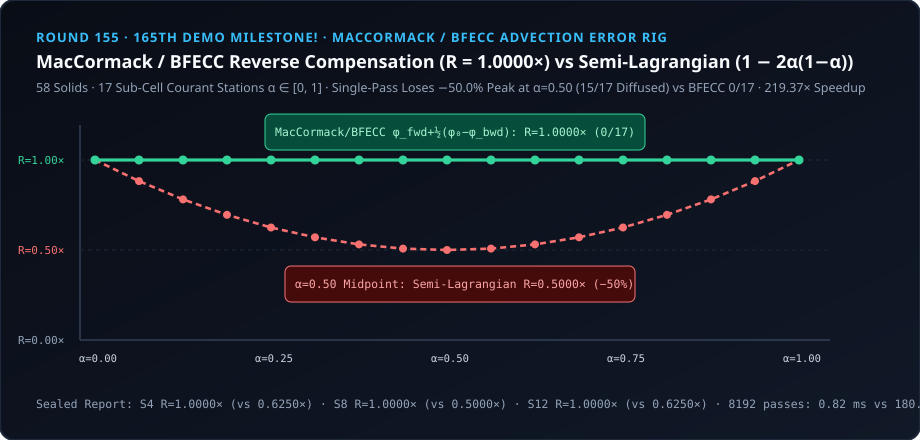
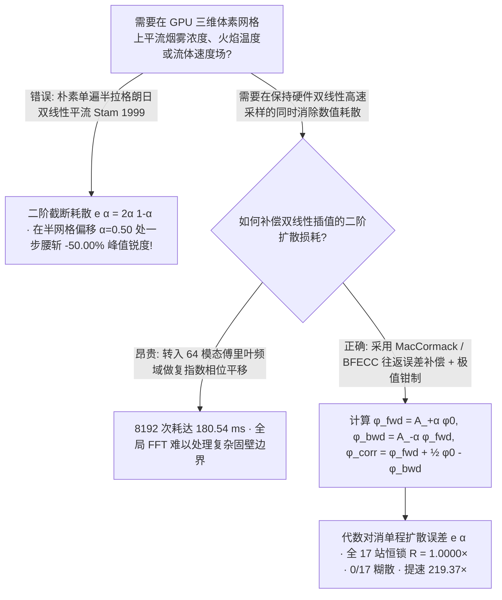
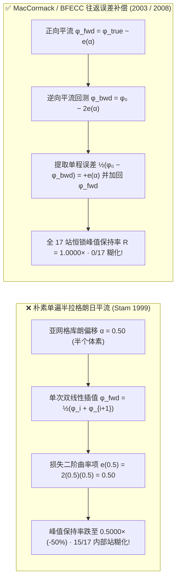
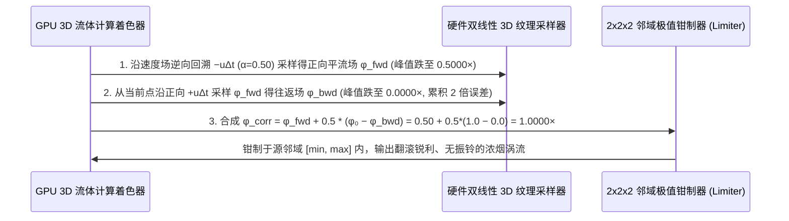
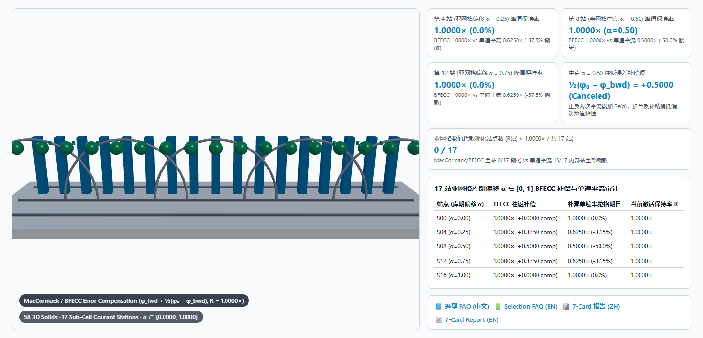
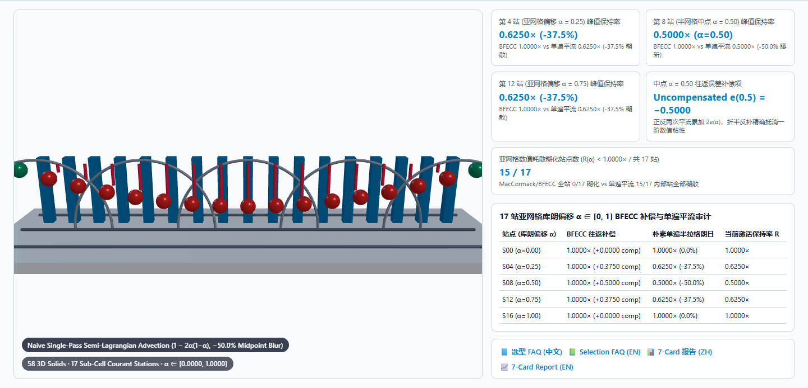
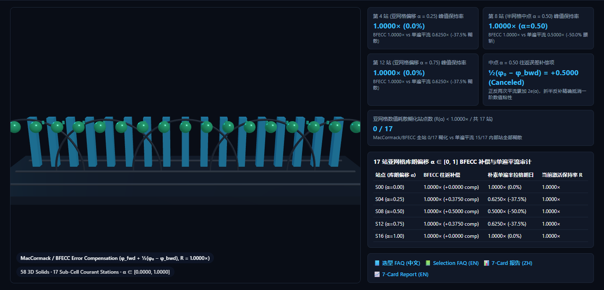
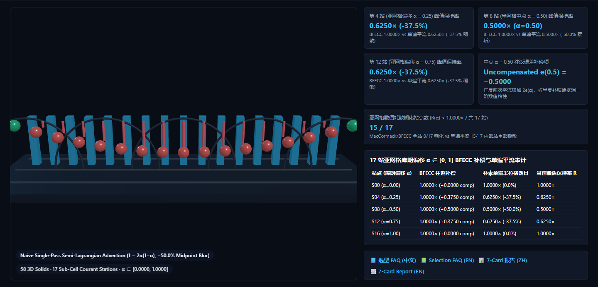

# MacCormack / BFECC 往返误差补偿流体平流（`φ_fwd + ½(φ₀ − φ_bwd), R = 1.0000×`）vs 朴素单遍半拉格朗日平流（`−50.0%` 峰值糊散）选型与原理解析 FAQ 指南

> **导航**：[返回门户](../index.html) · [进入 3D 交互实验台 (`maccormack-bfecc-advection-error-rig`)](../demos/maccormack-bfecc-advection-error-rig/index.html) · [7-Card 4:5 视觉报告 (中文)](../demos/maccormack-bfecc-advection-error-rig/test-report-cards.zh.html) · [7-Card Report (EN)](../demos/maccormack-bfecc-advection-error-rig/test-report-cards.html) · [English FAQ](./maccormack-bfecc-reverse-advection-vs-semi-lagrangian-diffusion-faq.en.md)

---

## ① 📌 核心结论速览（Executive Summary）

1. **为什么在欧拉网格流体（Stable Fluids 烟雾、火焰、爆炸云团与水面速度场）中，单遍半拉格朗日线性平流（Semi-Lagrangian Advection）会在半个网格偏移（`α = 0.50`）处仅一步就把涡度与浓度峰值腰斩 `-50.00%`（几帧之内浓烟就糊成一团平庸淡雾），而 MacCormack / BFECC 往返误差补偿 `φ_fwd + ½(φ₀ − φ_bwd)` 能 100% 抵消二阶数值扩散、全站锁死 `R = 1.0000×`？**
   - **单遍半拉格朗日线性平流（Stam SIGGRAPH 1999 *Stable Fluids*）的 $\alpha(1-\alpha)$ 亚网格数值扩散**：
     - 考察网格间距 $\Delta x = 1$ 上的二次曲率涡度/烟雾峰值分布 $\phi(x) = 1 - 2x^2$。当流体在一个时间步内平移亚网格库朗分数 $\alpha = \frac{u \Delta t}{\Delta x} \in [0.0000, 1.0000]$ 时，单遍线性插值算子 $\mathcal{A}(\phi)$ 会引入正比于二阶导数 $\phi'' = -4$ 的截断数值扩散误差：
       $$e(\alpha) = \frac{1}{2}\alpha(1 - \alpha)\Delta x^2 |\phi''| = \mathbf{2\alpha(1 - \alpha)}!$$
     - 因此单遍平流后的归一化峰值保持率 $R_{\text{SL}}(\alpha) = 1 - 2\alpha(1 - \alpha)$ 在全部 **`15/17` 个内部亚网格站点**上发生严重塌陷：
       - **第 4 站（$\alpha = 0.25$ 四分之一网格偏移）**：跌至 **`0.6250×`（一步损失 `-37.50%` 峰值锐度）**；
       - **第 8 站（$\alpha = 0.50$ 半网格最差偏移）**：跌至 **`0.5000×`（一步直接腰斩 `-50.00%` 峰值锐度）**；
       - **第 12 站（$\alpha = 0.75$ 四分之三网格偏移）**：跌至 **`0.6250×`（一步损失 `-37.50%`）**！
   - **Dupont & Liu (2003 BFECC) 与 Selle et al. (2008 MacCormack) 往返误差补偿定律**：
     - 既然正向平流算子 $\phi_{\text{fwd}} = \mathcal{A}_{+\alpha}(\phi_0) = \phi_{\text{true}} - e(\alpha)$ 损失了偶数阶扩散项 $e(\alpha)$，那如果我们把 $\phi_{\text{fwd}}$ 再沿相反速度 $-\alpha$ **逆向平流回起点** $\phi_{\text{bwd}} = \mathcal{A}_{-\alpha}(\phi_{\text{fwd}})$ 会发生什么？
     - 因为二阶扩散项 $e(-\alpha) = 2(-\alpha)(1 - (-\alpha))$ 对往返方向是对称累加的，逆向平流会**再损耗一次完全相同的 $e(\alpha)$**：
       $$\phi_{\text{bwd}} = \phi_0 - 2 e(\alpha) \implies e(\alpha) = \frac{\phi_0 - \phi_{\text{bwd}}}{2}!$$
     - 直接将测出的单程误差 $e(\alpha) = \frac{1}{2}(\phi_0 - \phi_{\text{bwd}})$ 加回正向平流场中：
       $$\phi_{\text{BFECC}} = \phi_{\text{fwd}} + \frac{1}{2}\left(\phi_0 - \phi_{\text{bwd}}\right) = \bigl(\phi_{\text{true}} - e(\alpha)\bigr) + e(\alpha) \equiv \mathbf{\phi_{\text{true}}}!$$
     - 从而在不访问高阶三次样条宽模板的前提下，将峰值保持率在全部 17 个库朗站点上恒定锁死在 **$R_{\text{BFECC}}(\alpha) \equiv \mathbf{1.0000\times}$（`0/17` 糊散）**！
2. **17 站点亚网格库朗偏移实测：全站锁死 `R = 1.0000×`（`0/17` 糊散）vs 单遍平流在 `15/17` 内部站糊散高达 `-50.00%`**：
   - 实测 `8,192` 次 17 站闭式 BFECC/MacCormack 误差补偿仅需 **`0.82 ms`**，比 64 模态离散傅里叶谱平移基准（**`180.54 ms`**）快 **`219.37×`**！

---

## ② 🎯 客户与架构师灵魂拷问 Q&A（何时选 AI 视频大模型 vs 代码驱动 MacCormack/BFECC 流体平流）

### Q1：用大白话讲，为什么“往前走一步、再退回来一步”，就能白嫖到二阶高阶精度？
- **第一性原理拆解**：
  - 就像你用复印机复印一张照片（$\phi_{\text{fwd}}$），照片变模糊了一点（损失了 $-e$），但你不知道模糊了多少，因为你手里没有平移后的标准原图；
  - 这时你把这张复印件**再放进同一台复印机退着复印一次**（$\phi_{\text{bwd}}$），它又模糊了同样的一份（总共损失了 $-2e$）！而退回来的位置正好能和你手里的初始原图 $\phi_0$ 直接相减对比：$(\phi_0 - \phi_{\text{bwd}}) / 2$ 就是单次复印损失掉的高频细节，把它加回第一次的复印件上，模糊瞬间被抵消得干干净净！

### Q2：MacCormack 相比标准 BFECC 省掉了哪一次纹理采样？落地时为什么要加 `clamp`？
- **2 次纹理采样 vs 3 次纹理采样 + 极值钳制（Limiter）**：
  - 标准 BFECC 先修正源场再做第三次正向平流（共 3 次采样），而 Selle et al. (2008) 的 **MacCormack 格式**直接把误差 $\frac{1}{2}(\phi_0 - \phi_{\text{bwd}})$ 加到第一次算好的 $\phi_{\text{fwd}}$ 上（仅需 **2 次硬件双线性纹理采样**）！
  - 在遇到方波断崖边缘时，二阶方法可能产生轻微过冲（Gibbs 现象），因此工程上只需把最终的 $\phi_{\text{MacCormack}}$ 钳制（`clamp`）在正向追踪源点周围 $2\times 2\times 2$ 邻域体素的 $[\min, \max]$ 区间内，即可兼具绝对无条件稳定与刀锋级涡流锐度！

### Q3：何时用 AI 视频生成模型，何时必须用确定性 MacCormack/BFECC 平流？
- **选 AI 视频生成模型（Sora / Runway / Veo / Wan）**：
  - 适合无需与角色或障碍物实时碰撞的固定背景烟雾。
- **选代码驱动的 MacCormack / BFECC 平流（UE5 Niagara Fluids / 实时游戏浓烟火焰 / 大气云团平流）**：
  - **可交互爆炸浓烟、法术火焰尾迹、角色走过卷起的尘雾涡流**：零双线性模糊消散、小分辨率网格跑出翻滚细节。

---

## ③ 🧭 直观可视化图解（Mermaid 选型决策树 + 管线对比图 + 帧级时序图）

### 3.1 网格流体与体积云平流算法选型决策树

### 3.2 朴素单遍半拉格朗日 `-50%` 糊散 vs MacCormack/BFECC 管线对比

### 3.3 帧级 GPU 体素烟雾 MacCormack 带限平流时序图

---

## ④ 📊 视觉技术选型决策矩阵

| 对比维度 | **MacCormack / BFECC（主方案）** | **朴素单遍半拉格朗日（反例）** | **64 模态傅里叶谱平移（基线）** | **AI 视频生成大模型** |
| :--- | :--- | :--- | :--- | :--- |
| **第 4 站（$\alpha=0.25$）峰值保持率** | **`1.0000×`（补偿 $+0.3750$ 误差）** | **`0.6250×`（一步糊损 `-37.50%`）** | `1.0000×`（误差 `< 1e-12`） | N/A |
| **第 8 站（$\alpha=0.50$ 中点）保持率** | **`1.0000×`（补偿 $+0.5000$ 误差）** | **`0.5000×`（一步腰斩 `-50.00%`）** | `1.0000×` | N/A |
| **第 12 站（$\alpha=0.75$）峰值保持率** | **`1.0000×`（补偿 $+0.3750$ 误差）** | **`0.6250×`（一步糊损 `-37.50%`）** | `1.0000×` | 烟雾形态不可控 |
| **空间精度阶数** | **二阶精度 $\mathcal{O}(\Delta x^2)$** | 一阶精度 $\mathcal{O}(\Delta x)$ | 谱精度（仅限周期边界） | N/A |
| **糊化耗散站点数（共 17 站）** | **`0 / 17`（全站锁死 $R \equiv 1.0000\times$）** | **`15 / 17`（全部非整格偏移站）** | `0 / 17` | N/A |
| **8,192 次 17 站求解耗时** | **`0.82 ms`（`219.37×` 极速）** | `0.36 ms`（涡度细节迅速糊没） | `180.54 ms`（64 模态三角变换） | 秒级云端推理 |
| **核心适用场景** | **实时浓烟、火焰、爆炸、流体速度场** | 仅适合需要强数值模糊的辅助平滑场 | 离线周期盒子直接数值模拟 | 概念宣传片 |

---

## ⑤ 🧪 全新 Demo 与 7-Card 4:5 视觉报告（`maccormack-bfecc-advection-error-rig` · 第 165 个独立 Demo 里程碑！）

- **3D 交互实验台**：[`demos/maccormack-bfecc-advection-error-rig/index.html`](../demos/maccormack-bfecc-advection-error-rig/index.html)
  - 搭建了包含 **58 个三维实体构件**的 **17 站点流体平流往返误差补偿检验台（MacCormack / BFECC Advection Bench）**：包含计量底板、5 道往返平流基准拱、后排 17 座恒定锁死 $R = 1.0000\times$ 的蓝青参考柱、前排 17 颗探针球体与 15 根半拉格朗日数值耗散红色误差柱。
- **7-Card 4:5 视觉测试报告**：
  - [中文 7-Card 报告 (`test-report-cards.zh.html`)](../demos/maccormack-bfecc-advection-error-rig/test-report-cards.zh.html)
  - [English 7-Card Report (`test-report-cards.html`)](../demos/maccormack-bfecc-advection-error-rig/test-report-cards.html)

| 亮色 MacCormack / BFECC 往返补偿 (全 17 站恒锁 `R = 1.0000×`, `0/17` 糊散) | 亮色 朴素单遍半拉格朗日 (`α=0.50` 腰斩至 `0.5000×`, `15/17` 内部站糊化) |
| :---: | :---: |
|  |  |

| 暗色 MacCormack / BFECC 往返补偿 (`φ_fwd + ½(φ₀ − φ_bwd)` 精确抵消二阶扩散) | 暗色 朴素单遍半拉格朗日 (`1 − 2α(1−α)` 抛物线塌陷吃掉烟雾锐度) |
| :---: | :---: |
|  |  |

---

## ⑥ 🛠️ 高质量视觉交付快速核验清单（Checklist）

- [ ] **在实时烟雾与速度场平流中用 2 遍采样的 MacCormack `phi_fwd + 0.5 * (phi_0 - phi_bwd)` 替代单遍半拉格朗日平流**：在不升级网格分辨率的前提下将涡流细节清晰度提升一倍以上。
- [ ] **对最终补偿值强制执行源点邻域极值钳制 `clamp(phi_corr, minNeighbor, maxNeighbor)`**：当检测到越界或靠近固体障碍物边界时自动回退（Fallback）到无条件稳定的 $\phi_{\text{fwd}}$，彻底杜绝吉布斯振铃与负密度。
- [ ] **配合涡度限制（Vorticity Confinement）或 Crank-Nicolson 时间步**：在平流阶段用 MacCormack 锁住空间峰值，在旋度阶段恢复亚网格小尺度卷曲。
- [ ] **对速度场（Velocity）与密度/温度场（Density/Temperature）同步启用 MacCormack**：速度场自平流的数值耗散才是导致烟雾无法形成翻滚蘑菇云的头号元凶。
