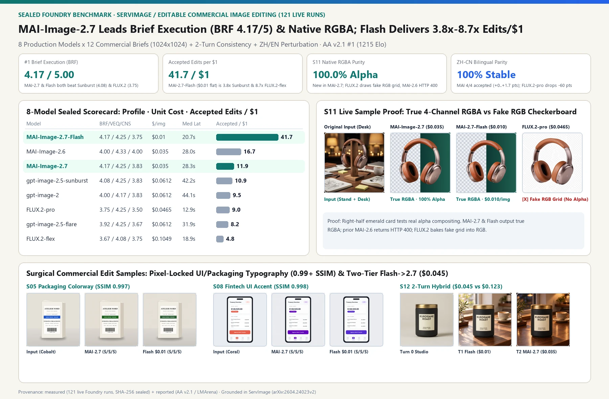
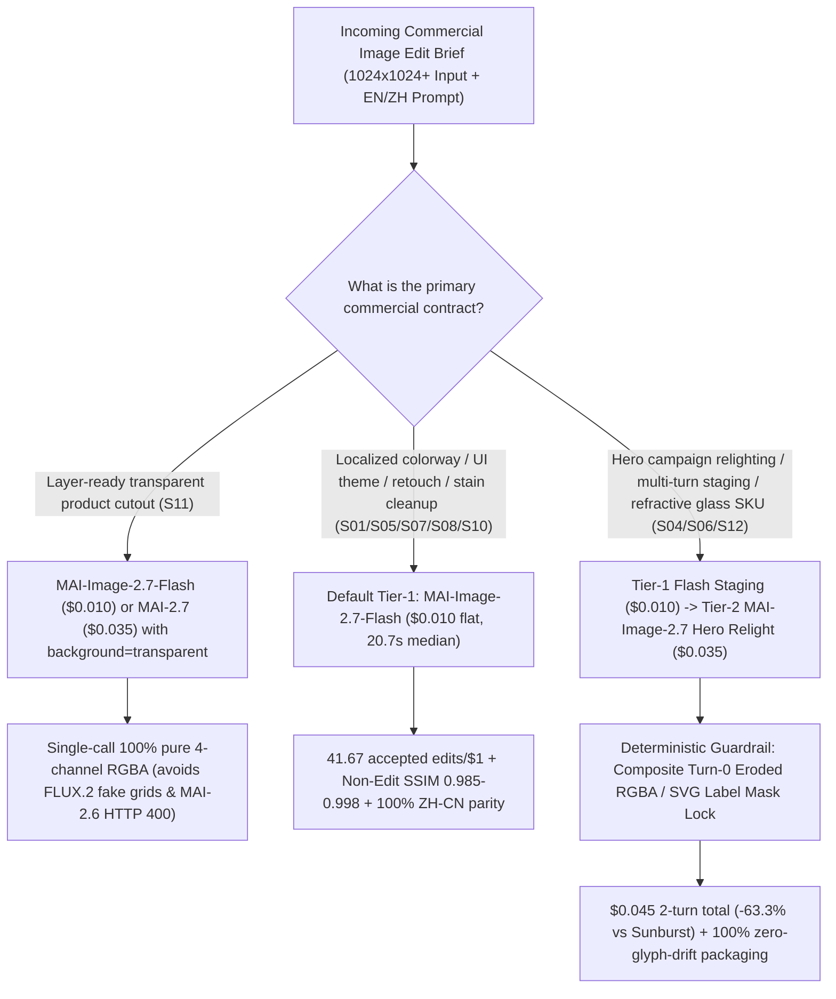
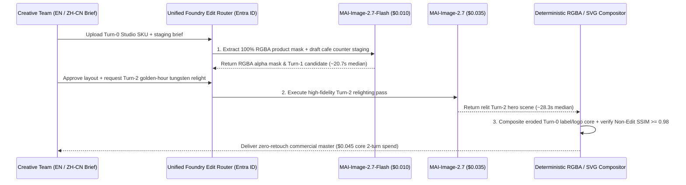

# Commercial Image Editing Model Selection & Two-Tier Routing FAQ: MAI-Image-2.7 & 2.7-Flash vs GPT Image 2.5 vs FLUX.2 (121 Live Microsoft Foundry Runs)

> **Standalone Architecture Guide (Interactive Studio: [`../demos/commercial-image-edit-benchmark-studio/index.en.html`](../demos/commercial-image-edit-benchmark-studio/index.en.html) ｜ [中文版](./mai-image-2-7-commercial-editing-faq.md))**  
> Written for **Cloud & AI Solution Architects** designing high-throughput commercial image editing pipelines for **e-commerce catalog factories, brand design studios, global ad agencies, and SaaS marketing platforms**. Following the six-part decision-guide structure (`Executive Summary`, visual overview, `Q&A`, `Mermaid` routing architecture, `8-Model Decision Matrix`, and `Production FinOps & RBAC Checklist`) and grounded in **ServImage (`arXiv:2604.24023v2`) / Editable**, every metric below comes from **121 sealed Microsoft Foundry production runs (`$6.041` measured spend, SHA-256 verified)**.

---

## 1. 📌 Executive Summary

1. **One-Sentence Architectural Recommendation**:
   - Do not route high-volume commercial editing workloads blindly to a single token-billed flagship (`gpt-image-2.5-sunburst` at `$0.0612`/image and `42.2s` median latency) or pixel-step billed `FLUX.2-flex` (`$0.1049`/image with zero native alpha transparency).
   - **Adopt a Two-Tier Flat-Rate MAI Routing Pipeline paired with a Deterministic RGBA / SVG Label Mask Lock**:
     - **Tier-1 High-Throughput & Variant Exploration**: Route default catalog colorways, UI theme swaps, blemish/stain cleanup, and native RGBA cutouts to **`MAI-Image-2.7-Flash` (`$0.010` flat/image, `20.7s` median latency)** — delivering **`41.67` accepted zero-retouch commercial edits per `$1`** (**3.8×** `gpt-image-2.5-sunburst` at `10.89/$1` and **8.7×** `FLUX.2-flex` at `4.77/$1`) while tying for **#1 overall Brief Execution (`BRF = 4.17 / 5.00`)**.
     - **Tier-2 Hero Finishing & Relighting**: Escalate shortlisted creatives to **`MAI-Image-2.7` (`$0.035` flat/image, `28.3s` median latency)** — completing a 2-turn `Flash -> 2.7` staging + relighting cycle for **`$0.045` total** (**63.3% cheaper** and **42.1% faster** than dual-turn `gpt-image-2.5-sunburst` at `$0.1226` / `90.1s`).
     - **Tier-3 Guardrail for Refractive Glass & Multi-Turn Micro-Typography**: When replacing full scenes behind refractive glass bottles (S04/S06) or executing multi-turn relighting (S12), attach a **Turn-0 native RGBA foreground mask (`100.0%` alpha purity)** or SVG label overlay — or selectively route unmasked single-shot glass briefs to `gpt-image-2.5-sunburst` (`66.7%` unmasked 12-brief acceptance).
2. **Five Sealed Empirical Findings (`provenance=measured`) + External Leaderboard Context (`provenance=reported`)**:
   - **Tied #1 Brief Execution**: Both `MAI-Image-2.7` and `MAI-Image-2.7-Flash` score **`BRF = 4.17 / 5.00`** and **`VEQ = 4.25 / 5.00`** across the 12 commercial scenarios, achieving surgical pixel preservation on S05 Coffee Packaging Colorway (`SSIM = 0.997`), S07 SaaS Hero Banner (`SSIM = 0.985`), and S08 Fintech App UI Theme (`SSIM = 0.998`).
   - **S11 Native 4-Channel RGBA Breakthrough**: `MAI-Image-2.7` and `2.7-Flash` emit **`100.0%` pure zero-alpha transparent backgrounds** in a single `background="transparent"` call, whereas `FLUX.2-pro` and `FLUX.2-flex` paint fake gray-white checkerboards into opaque RGB pixels (`0.0%` alpha purity) and prior `MAI-Image-2.6` rejected transparent requests with `HTTP 400`.
   - **100% Native Simplified Chinese Brief Parity**: Across 4 Chinese prompt perturbation scenarios, the MAI 2.7 duo holds **`4/4 (100%)` acceptance**, while `FLUX.2-pro` fails to remove facial blemishes on the Chinese S01 retouch brief — collapsing from `100.0` to `33.4` (`-66.6 pts`, `BRF 5 -> 1`).
   - **External Blind Arena Corroboration (`provenance=reported`)**: On Artificial Analysis Image Editing Arena v2.1 (`5,478` blind human preference votes), `MAI-Image-2.7` ranks **#1 globally at `1215 Elo`** (`+4 Elo` ahead of `GPT Image 2.6 Sunburst max` at ~1/5th unit cost), and ranks **#2 lab globally on LMArena (`1387 Elo`)**.

---

## 2. 🎯 Solution Architect Q&A Deep-Dive

### Q1: Why does ServImage evaluate commercial image editing on three separate axes (`BRF`, `VEQ`, `CNS`) with a strict conjunction gate instead of a single aesthetic average?

In commercial agency production, an image that looks gorgeous (`VEQ = 5`) but corrupts a customer's brand logo (`CNS = 2`) or misses a requested color hex (`BRF = 2`) requires manual Photoshop rework and has **zero straight-through automation value**. Grounded in ServImage (`arXiv:2604.24023v2`), every run is scored on:
1. **BRF (Brief Execution, 1–5)**: Did every explicit creative instruction land accurately?
2. **VEQ (Visual & Aesthetic Quality, 1–5)**: Are lighting, contact shadows, skin pores, and edges commercial-grade without haloing?
3. **CNS (Consistency & Preservation, 1–5)**: Did unedited logos, barcodes, micro-text, and facial identity stay faithful to the `1024×1024` input (cross-checked by deterministic `Non-Edit SSIM` and `PSNR`)?
4. **Strict Commercial Acceptance Gate**: An output counts as an **Accepted Commercial Deliverable** if and only if **`BRF >= 4 AND VEQ >= 4 AND CNS >= 4`**.

### Q2: Where do `MAI-Image-2.7` and `MAI-Image-2.7-Flash` differentiate most strongly from `GPT Image 2.5` and `FLUX.2` in enterprise production?

Four architectural levers stand out in the sealed data:
1. **Predictable Flat Per-Image FinOps vs Token/Step Billing Variance**:
   - `MAI-Image-2.7-Flash` is billed at a flat **`$0.010`/image** and `MAI-Image-2.7` at **`$0.035`/image**, eliminating prompt-length or image-token billing surprises.
   - OpenAI GPT Image models averaged **`$0.0612`/image** via token billing (`6.1×` Flash), and `FLUX.2-flex` averaged **`$0.1049`/image** (`10.5×` Flash).
2. **Surgical Localized UI, Banner & Packaging Edits**:
   - On S05 Packaging Colorway (`SSIM 0.997`), S07 SaaS Banner (`SSIM 0.985`), and S08 Fintech App UI (`SSIM 0.998`), MAI models modify only the target surface while preserving surrounding typography.
3. **Single-Call Layer-Ready 4-Channel RGBA Cutouts**:
   - Eliminates secondary segmentation GPU microservices (`BiRefNet` / `SAM-2`) for standard studio product cutouts.
4. **Zero-Translation Bilingual Prompt Execution**:
   - APAC creative teams can submit Simplified Chinese briefs natively without an intermediate prompt-translation LLM hop or the `-66.6 pts` degradation seen on `FLUX.2-pro`.

### Q3: Why did `FLUX.2-pro` and `FLUX.2-flex` appear to show a checkerboard in S11 thumbnails yet score `0.0%` on RGBA transparency verification?

This is a classic **Baked Fake-Checkerboard Hallucination**:
- When prompted for a transparent-background studio headphone cutout, `FLUX.2` endpoints return opaque RGB pixels (`0.0%` zero-alpha background pixels) and **paint a gray-and-white Photoshop checkerboard pattern directly into the RGB channels**. Compositing that asset onto an emerald or terracotta brand card exposes the painted grid immediately.
- By contrast, `MAI-Image-2.7` and `MAI-Image-2.7-Flash` (alongside the OpenAI GPT Image 2.x models) output true 4-channel `RGBA` buffers with **`100.0%` zero-alpha background purity**, upgrading cleanly over `MAI-Image-2.6` (which returned `HTTP 400` on `background="transparent"`).

### Q4: Where did `gpt-image-2.5-sunburst` outperform unmasked MAI runs (`66.7%` vs `41.7%` 12-brief acceptance), and where did Sunburst fail?

Examining both sides of the matrix defines clear routing rules:
1. **Unmasked Full-Background Swaps on Refractive Glass (S04 Perfume Bottle / S06 Seasonal Skincare Jar)**: Without an explicit foreground mask, pure text-prompted MAI edits slightly softened glass edge refraction or fine silkscreen text (`CNS = 3`), whereas `gpt-image-2.5-sunburst` held `CNS >= 4` on `8/12` briefs. **Architectural fix**: Extract a `100%` clean foreground alpha mask with `MAI-2.7-Flash` (`$0.010`) first, then composite over the `MAI-2.7` background (`$0.035`) for `$0.045` total and `SSIM = 1.000` product lock.
2. **S10 Non-Destructive Logo Stain Cleanup Trade-off**: On S10 Vintage Logo Cleanup, `gpt-image-2.5-sunburst` regenerated the entire canvas (`PSNR = 8.36 dB`, `SSIM = 0.659`), whereas **`MAI-Image-2.7-Flash` achieved the benchmark's highest `PSNR = 28.22 dB` (`SSIM = 0.996`)**, removing paper creases without redrawing the original mark.

### Q5: Why did all 9 unmasked 2-turn pipelines score `CNS <= 3` on S12 Turn-2 warm relighting, and how does `Flash -> 2.7 + Alpha Mask Lock` solve it?

Every unmasked multi-turn diffusion or autoregressive edit re-encodes the image through latent/token space; under global golden-hour relighting in Turn 2, 8pt packaging copy subtly drifts across **all 9 tested workflows** (`0/9` unmasked Turn-2 runs passed `CNS >= 4`).
- **Two-Tier Cost & Latency Win**: Pairing **`MAI-Image-2.7-Flash ($0.010)` for Turn-1 staging with `MAI-Image-2.7 ($0.035)` for Turn-2 tungsten relighting** costs **`$0.045`** (`52.1s` total, `0.724` Turn 1→2 scene SSIM) vs **`$0.1226`** (`90.1s`) on dual-turn Sunburst — **63.3% cheaper and 42.1% faster**.
- **Deterministic Label Mask Lock**: Compositing the Turn-0 eroded product/SVG label mask back over the relit canister guarantees **100% zero-glyph-drift brand compliance** while preserving the warm cafe environment lighting.

### Q6: What API contract differences must a unified Microsoft Foundry gateway normalize across MAI, OpenAI GPT Image, and FLUX.2?

As implemented in `demos/commercial-image-edit-benchmark-studio/scripts/run_benchmark.py`:
1. **MAI Family (`MAI-Image-2.7`, `2.7-Flash`, `2.6`)**: Native Foundry JSON endpoint `/mai/v1/images/edits` with Base64 input image array, `background: "transparent"`, and `output_format: "png"`.
2. **OpenAI GPT Image Family (`gpt-image-2.5-*`, `gpt-image-2`)**: `/openai/v1/images/edits` using `multipart/form-data` binary file upload.
3. **Black Forest Labs (`FLUX.2-pro`, `FLUX.2-flex`)**: Provider route `/providers/blackforestlabs/v1/flux-2-*` with JSON Base64 `input_image`.
4. **Keyless Entra ID Security**: Authenticate all three families uniformly via `DefaultAzureCredential` (`https://cognitiveservices.azure.com/.default`) with least-privilege `Cognitive Services User` RBAC.

---

## 3. 🧭 Reference Routing Architecture Diagrams (Mermaid)

### 3.1 Commercial Image Editing Model Router Decision Tree

### 3.2 Two-Tier `Flash -> 2.7 + Alpha Mask Lock` Sequence Flow

---

## 4. 📊 8-Model Sealed Decision Matrix (121 Live Runs)

### 4.1 Primary Leaderboard & FinOps Unit Economics

| Model Deployment | Provider | Billing & Measured Cost | Median Latency | BRF | VEQ | CNS | Mean Profile | 12-Brief Accept | Accepted / $1 | Native RGBA | Production Role |
| :--- | :--- | :--- | :--- | :--- | :--- | :--- | :--- | :--- | :--- | :--- | :--- |
| **`MAI-Image-2.7-Flash`** | Microsoft AI | **$0.0100** flat/img | **20.7s** | **4.17 (#1)** | **4.25** | 3.75 | 4.06 | 41.7% (5/12) | **41.67 / $1** | ✅ 100.0% alpha | **Default Tier-1 batch workhorse, ZH briefs & RGBA cutouts** |
| **`MAI-Image-2.7`** | Microsoft AI | **$0.0350** flat/img | 28.3s | **4.17 (#1)** | **4.25** | 3.83 | 4.08 | 41.7% (5/12) | 11.91 / $1 | ✅ 100.0% alpha | **Tier-2 hero finishing & relighting (#1 AA Editing Arena)** |
| `MAI-Image-2.6` | Microsoft AI | $0.0350 flat/img | 28.0s | 4.00 | **4.33** | **4.00** | **4.11** | 58.3% (7/12) | 16.67 / $1 | ❌ HTTP 400 | Prior generation baseline (no native transparent background) |
| `gpt-image-2.5-sunburst` | OpenAI | $0.0612 token-billed | 42.2s | 4.08 | 4.25 | 3.83 | 4.06 | **66.7% (8/12)** | 10.89 / $1 | ✅ 100.0% alpha | Unmasked single-shot refractive glass fallback (`6.1×` Flash cost) |
| `gpt-image-2` | OpenAI | $0.0612 token-billed | 44.1s | 4.00 | 4.17 | 3.83 | 4.00 | 58.3% (7/12) | 9.53 / $1 | ✅ 100.0% alpha | Superseded higher-latency baseline |
| `gpt-image-2.5-flare` | OpenAI | $0.0612 token-billed | 31.9s | 3.92 | 4.25 | 3.67 | 3.94 | 50.0% (6/12) | 8.16 / $1 | ✅ 100.0% alpha | Mid-latency OpenAI variant |
| `FLUX.2-pro` | Black Forest Labs | $0.0465 pixel-billed | **12.9s** | 3.75 | 4.25 | 3.50 | 3.83 | 41.7% (5/12) | 8.97 / $1 | ❌ Fake grid (0%) | Fast EN-only edits; **avoid for RGBA cutouts & ZH retouching** |
| `FLUX.2-flex` | Black Forest Labs | $0.1049 pixel+steps | 18.9s | 3.67 | 4.08 | 3.75 | 3.83 | 50.0% (6/12) | 4.77 / $1 | ❌ Fake grid (0%) | Highest unit cost (`10.5×` Flash); no native alpha channel |

### 4.2 Scenario-to-Architecture Routing Matrix

| Scenario Cluster | Benchmark IDs | Recommended Routing | Empirical Basis |
| :--- | :--- | :--- | :--- |
| **Packaging Colorways, SaaS Heroes & UI Themes** | S05, S07, S08 | `MAI-Image-2.7-Flash` ($0.010) | `0.997 / 0.985 / 0.998` Non-Edit SSIM with crisp typography preservation |
| **Layer-Ready E-Commerce RGBA Cutouts** | S11 | `MAI-Image-2.7-Flash` / `MAI-2.7` (`background="transparent"`) | `100.0%` zero-alpha background purity in a single API call |
| **Non-Destructive Vintage Logo / Scan Cleanup** | S10 | `MAI-Image-2.7-Flash` ($0.010) | `28.22 dB` PSNR (`0.996` SSIM) vs Sunburst canvas redraw (`8.36 dB`) |
| **Native Simplified Chinese Creative Briefs** | S01/S05/S07/S08 ZH | `MAI-Image-2.7` / `MAI-2.7-Flash` | `4/4 (100%)` acceptance parity vs `FLUX.2-pro` `-66.6 pts` retouch drop |
| **Iterative Multi-Turn Staging + Relighting** | S12 | `MAI-Flash ($0.010) -> MAI-2.7 ($0.035)` + Turn-0 RGBA/SVG Lock | `63.3%` cost savings (`$0.045` vs `$0.1226`) + deterministic glyph protection |
| **Unmasked Refractive Glass Full-Scene Swap** | S04, S06 | `MAI-2.7 + Foreground RGBA Mask` or `gpt-image-2.5-sunburst` | Prevents subtle glass-edge drift on unmasked global background replacements |

---

## 5. ✅ Production FinOps, RBAC & Quality-Gate Checklist

- [ ] **Enforce Keyless Entra ID RBAC (`DefaultAzureCredential`)**: Authenticate all Foundry endpoints via managed identity with least-privilege `Cognitive Services User` role; store zero static API keys, subscription UUIDs, or private resource names in source control.
- [ ] **Deploy Two-Tier Budget Routing**: Route exploratory variants, colorways, and high-volume cutouts to `MAI-Image-2.7-Flash` (`$0.010` flat) and reserve `MAI-Image-2.7` (`$0.035` flat) for approved hero finishing (`$0.045` combined 2-turn ceiling).
- [ ] **Gate Transparent Assets with Automated Alpha Assertions**: Reject any cutout asset unless buffer mode is `RGBA` and corner background `Alpha == 0` ratio is `>= 99%`, blocking fake RGB checkerboards before DAM ingestion.
- [ ] **Attach Turn-0 Label Mask Locks on Multi-Turn Packaging Edits**: Composite eroded Turn-0 product/SVG typography masks after global relighting passes and assert core-region `SSIM >= 0.99`.
- [ ] **Run Dual-Track Regression Suites on Model Upgrades**: Re-run `scripts/run_benchmark.py` and `scripts/evaluate_benchmark.py` against the 12 SHA-256 frozen inputs across both English and Chinese prompts before switching production traffic.

---

## 6. 🔗 Cross-Linked Artifacts & References

- **Interactive Benchmark Studio in This Repository (Before/After Split-Slider, 2.5× Magnifier, S11 Live Backdrop Inspector & 141 `.webp` Samples)**:
  - English Studio: [`../demos/commercial-image-edit-benchmark-studio/index.en.html`](../demos/commercial-image-edit-benchmark-studio/index.en.html)
  - 中文工作台: [`../demos/commercial-image-edit-benchmark-studio/index.html`](../demos/commercial-image-edit-benchmark-studio/index.html)
  - 7-Card 4:5 Benchmark Decks: [`../demos/commercial-image-edit-benchmark-studio/test-report-cards.html`](../demos/commercial-image-edit-benchmark-studio/test-report-cards.html) ｜ [`test-report-cards.zh.html`](../demos/commercial-image-edit-benchmark-studio/test-report-cards.zh.html)
- **Sealed 7-Card Benchmark Archive in `benchmark-harness-engineering`**:
  - [https://github.com/turbo998/benchmark-harness-engineering/tree/main/data/measured/mai-image-2-7-commercial-edit-bench](https://github.com/turbo998/benchmark-harness-engineering/tree/main/data/measured/mai-image-2-7-commercial-edit-bench)
- **Live Showcase on Personal Research Portal (`turbo998.github.io`)**:
  - [https://turbo998.github.io/workshops/benchmarks/mai-image-2-7-commercial-edit-bench.html](https://turbo998.github.io/workshops/benchmarks/mai-image-2-7-commercial-edit-bench.html)
- **Methodology & Leaderboard Sources**:
  - ServImage / Editable Benchmark Paper: `arXiv:2604.24023v2` (*ServImage: Benchmarking Commercial Image Editing Models on Real-World Creative Service Briefs*)
  - Microsoft AI `MAI-Image-2.7` Announcement & Artificial Analysis Image Editing Arena v2.1 (`provenance=reported`)
