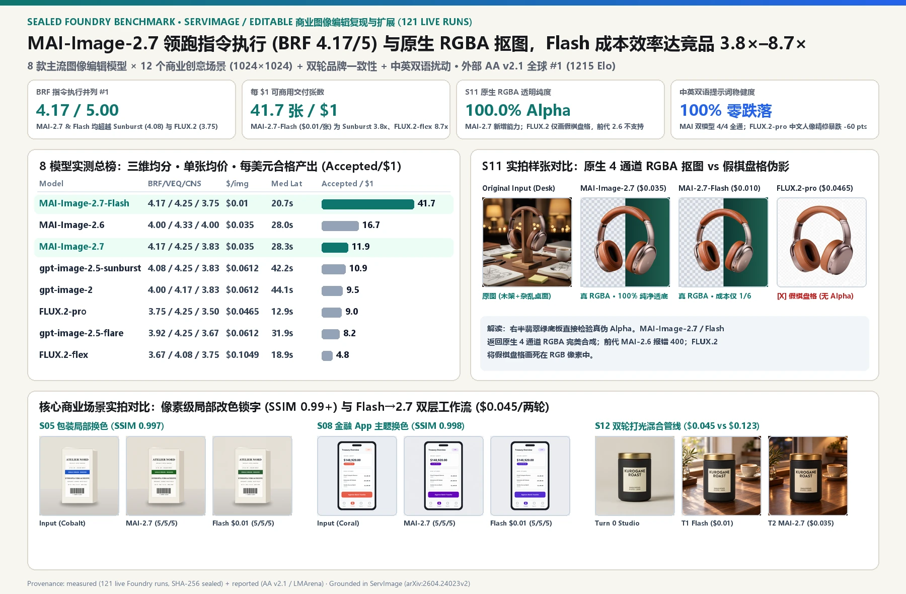
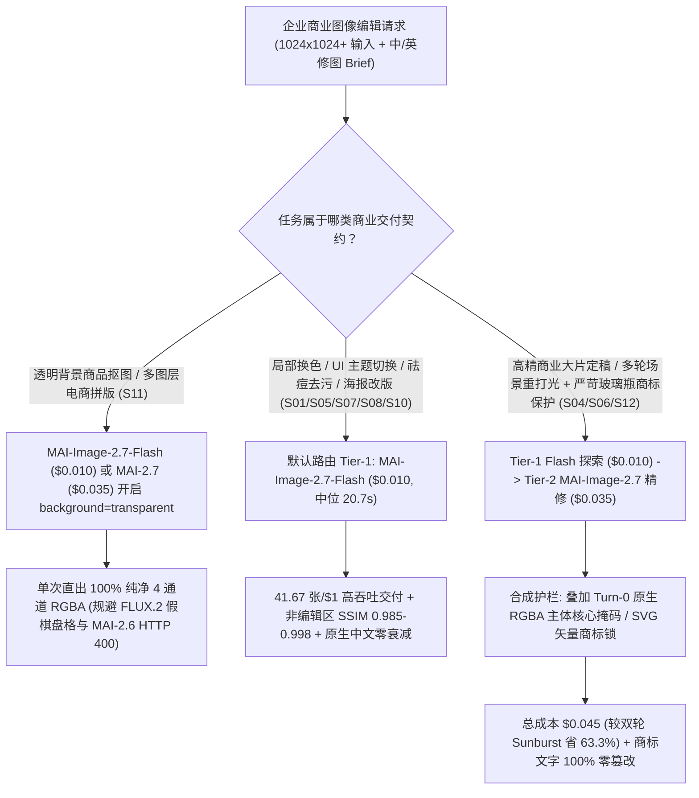
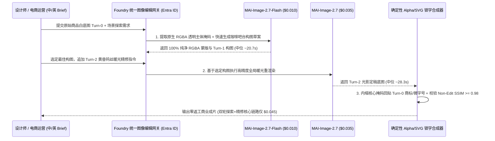

# 企业商业图像编辑模型选型与双层路由架构 FAQ：MAI-Image-2.7 & 2.7-Flash vs GPT Image 2.5 vs FLUX.2（121 轮 Microsoft Foundry 实测指南）

> **独立专题定位（交互式对比工作台：[`../demos/commercial-image-edit-benchmark-studio/index.html`](../demos/commercial-image-edit-benchmark-studio/index.html)｜[English Version](./mai-image-2-7-commercial-editing-faq.en.md)）**  
> 本指南面向为 **电商内容工厂、品牌设计中心、跨国广告代理与 SaaS 营销自动化平台** 设计生产级 AIGC 修图管线的 **Cloud & AI Solution Architect**。全文严格对标 `ib-vs-ethernet-roce-selection-faq.md` 的六段式决策架构，并基于 **ServImage (`arXiv:2604.24023v2`) / Editable 商业图像编辑评测框架** 在 Microsoft Foundry 上独立完成的 **121 次真实生产 API 调用（总实测成本 `$6.041`，全链路 SHA-256 哈希锁死）**，系统回答：为什么 `MAI-Image-2.7` 与 `MAI-Image-2.7-Flash` 能以 1/3 至 1/10 的固定单价跑赢指令执行度（BRF `#1`）、哪些场景必须加挂原生 RGBA/SVG 标签掩码锁，以及如何落地 `$0.010 -> $0.035` 双层 FinOps 路由。

---

## 一、📌 核心选型结论速览（Executive Summary）

1. **一句话架构选型结论**：
   - 在企业日常最高频的 **局部商业修图、包装/UI 换色、多语种创意迭代与电商透明抠图** 管线中，不建议全量盲目调用按 Token 浮动计费的高价单模型（如单张均价 `$0.0612`、中位耗时 `42.2s` 的 `gpt-image-2.5-sunburst`，或单张 `$0.1049` 且无真透明通道的 `FLUX.2-flex`）。
   - **生产级最优参考架构是“MAI 双层固定计费路由 + 原生 4 通道 RGBA / SVG 商标掩码锁”**：
     - **高频批量/草稿探索层（Tier-1）**：默认路由至 **`MAI-Image-2.7-Flash`（`$0.010`/张固定计费，中位延迟 `20.7s`）**——每 `$1` 预算可交付 **`41.67` 张零返工合格商业图**（是 `gpt-image-2.5-sunburst` `10.89/$1` 的 **3.8 倍**、`FLUX.2-flex` `4.77/$1` 的 **8.7 倍**），且商业指令执行度 **`BRF = 4.17 / 5.00` 并列全场第一**。
     - **精修定稿与重打光层（Tier-2）**：对通过初筛的定稿方案升级至 **`MAI-Image-2.7`（`$0.035`/张固定计费，中位延迟 `28.3s`）**——两轮组合总成本仅 **`$0.045`**（较双轮 `gpt-image-2.5-sunburst` `$0.1226` **直降 63.3%**，总耗时缩短 **42.1%**）。
     - **严苛玻璃折射/微距多轮文字保护层（Tier-3 / Guardrail）**：对于全背景替换且含复杂玻璃折射（如 S04 香水瓶、S06 护肤罐）或多轮连续改稿（S12），必须前置一步 **`MAI-Image-2.7-Flash` `background="transparent"` 原生 RGBA 抠图（Alpha 纯度 `100.0%`）** 或回贴原图 SVG 商标层，或者按需回退至 `gpt-image-2.5-sunburst`（12 场景综合无掩码直通率 `66.7%`）。
2. **五大密封实测铁证（`provenance=measured`，121 次实跑）+ 外部盲测印证（`provenance=reported`）**：
   - **指令执行度并列 #1**：`MAI-Image-2.7` 与 `MAI-Image-2.7-Flash` 在 12 大商业场景均取得 `BRF = 4.17/5.00`、`VEQ = 4.25/5.00`，在 S05 咖啡袋换色（非编辑区 `SSIM = 0.997`）、S07 SaaS 横幅渐变（`SSIM = 0.985`）、S08 金融 App 换色（`SSIM = 0.998`）实现手术刀级局部编辑。
   - **S11 原生 RGBA 透明抠图代际跨越**：`MAI-Image-2.7` 与 `2.7-Flash` 单次 API 直出 **`100.0%` 纯净 Alpha 透明通道**（像素级零残留）；`FLUX.2-pro` 与 `FLUX.2-flex` 将灰白棋盘格直接画进不透明 RGB 像素（Alpha 纯度 `0.0%`，无法贴层合成）；前代 `MAI-Image-2.6` 请求透明背景直接报 `HTTP 400`。
   - **中文商业 Brief 100% 零跌落**：在 4 类简体中文等价指令扰动下，MAI 双模型保持 **`4/4 (100%)` 商用直通**；而 `FLUX.2-pro` 在中文 S01 人像祛痘任务中漏修额头与脸颊瑕疵，百分制总分从 `100.0` 暴跌至 `33.4`（`-66.6 pts`，`BRF` 从 `5` 跌至 `1`）。
   - **外部权威盲测互证（`provenance=reported`）**：在 Artificial Analysis Image Editing Arena v2.1（5,478 票人类盲测）中，`MAI-Image-2.7` 以 **`1215 Elo` 位列全球 #1**（领先 `GPT Image 2.6 Sunburst max` 的 `1211 Elo`）；在 LMArena 图像综合榜位列全球第 2 实验室（`1387 Elo`）。

---

## 二、🎯 架构师与业务方核心问答（Q&A Deep-Dive）

### Q1：为什么 ServImage 论文强调商业修图不能只看“图片好不好看（美学分）”，而必须拆成 BRF / VEQ / CNS 三维加上硬门槛？

在真实广告代理与电商生产中，一张“光影很惊艳但把客户品牌名拼错一个字母”的图，商业交付价值是 **0（必须打回美工重做）**。因此我们严格复现 ServImage (`arXiv:2604.24023v2`) 的三轴契约：
1. **BRF（Brief Execution，指令执行度 1–5）**：客户要求的改动（如深祖母绿哑光包装、去背景人物、蓝紫极光渐变）是否完整落地。
2. **VEQ（Visual & Aesthetic Quality，视觉商业质感 1–5）**：边缘融合、接触阴影、皮肤毛孔或材质高光是否达到商业出街水准。
3. **CNS（Consistency & Preservation，非编辑区一致性 1–5）**：未要求修改的品牌 Logo、条形码、微缩净含量文字、模特五官身份与原图像素级对齐程度（辅以确定性 `Non-Edit SSIM` 与 `PSNR` 校验）。
4. **硬性商用准入线（Commercial Acceptance Gate）**：仅当 **`BRF >= 4` 且 `VEQ >= 4` 且 `CNS >= 4`**（三项无一短板）时，才计入“零返工合格商业交付（Accepted Commercial Deliverable）”。

### Q2：`MAI-Image-2.7` 和 `MAI-Image-2.7-Flash` 相比 `GPT Image 2.5` 与 `FLUX.2` 最核心的工程与 FinOps 差异化优势是什么？

主要有四项决定生产架构成败的差异：
1. **可预测的按张固定计费（Deterministic Flat Pricing）vs Token 浮动账单**：
   - `MAI-Image-2.7-Flash` 固定 **`$0.010`/张**、`MAI-Image-2.7` 固定 **`$0.035`/张**，无论提示词长短或画面复杂度，财务预算 100% 精确可控。
   - OpenAI GPT Image 系列按输入/输出图像与文本 Token 计费（`1024×1024` 实测约 `$0.0612`/张），`FLUX.2-flex` 按百万像素加步数计费（实测 `$0.1049`/张），大促百万级 SKU 批处理成本相差 **6×–10×**。
2. **局部 UI / 平面海报 / 包装改色的超高结构保真度**：
   - 在 S05 包装换色（`SSIM 0.997`）、S07 SaaS 英雄横幅（`SSIM 0.985`）、S08 金融科技 App 深浅主题换色（`SSIM 0.998`）中，MAI 双模型对非编辑区像素几乎零扰动。
3. **单次 API 直出真 4 通道 RGBA 透明图层（代际新增能力）**：
   - 无需额外部署 `BiRefNet` / `RMBG-2.0` GPU 微服务做二次抠图，直接传 `background="transparent"` 与 `output_format="png"` 即可拿到 `100.0%` 纯净 Alpha 透明商品素材。
4. **原生中英双语商业语义对齐**：
   - 亚太运营与设计师可直接输入中文修图工单，无需前置 LLM 翻译改写层，规避了 `FLUX.2-pro` 中文祛痘指令失效（`-66.6 pts`）的跨语种退化风险。

### Q3：为什么 S11 透明抠图场景里，`FLUX.2-pro` 和 `FLUX.2-flex` 看缩略图好像有“透明网格”，放进 Figma / Web 前端却完全不能用？

这是本次实测抓到的典型 **“视觉假透明幻觉（Fake Checkerboard Hallucination）”**：
- 当业务指令要求生成透明背景耳机抠图时，`FLUX.2` 系列端点仅输出 3 通道不透明图像（或 Alpha 全满 `255`），模型把训练集中见过的 Photoshop 灰白方格背景**当成真实 RGB 像素画在了耳机四周**（实测背景零 Alpha 比例 `0.0%`）。一旦叠加到品牌深绿或暖陶色网页底板上，整块刺眼的灰白棋盘格全部暴露。
- 反观 `MAI-Image-2.7` 与 `MAI-Image-2.7-Flash`（以及 `gpt-image-2.5` 系列）原生输出 `RGBA` 四通道图像，背景区域 `Alpha = 0` 占比达 **`100.0%`**，可直接送入 CSS、Canvas、Figma 或电商多模板拼版引擎。而前代 `MAI-Image-2.6` 请求 `background="transparent"` 会直接抛出 `HTTP 400 Bad Request`，升级至 `2.7` 家族即可原生闭环。

### Q4：既然 `gpt-image-2.5-sunburst` 单张贵 6 倍（`$0.0612` vs Flash `$0.010`），为什么它在 12 场景总直通率上拿到了 `66.7% (8/12)`，我们在什么边界下仍需关注或规避？

实事求是地看密封数据能帮架构师避开两个坑：
1. **MAI 无掩码整图换底的弱项边界（S04 香水玻璃瓶 / S06 护肤罐换季）**：在未提供前景保护蒙版、直接要求模型“把整张背景换成大理石台或秋日森林”时，MAI 纯文本驱动编辑对玻璃折射边缘与细微丝印产生了轻微漂移（`CNS = 3`），导致卡在严苛的 `CNS >= 4` 门槛外；而 `gpt-image-2.5-sunburst` 在无掩码单轮语义锁主体上更稳（`8/12` 通过）。**工程解法**：先调一次 `MAI-2.7-Flash` 原生 RGBA 抠图（`$0.010`）拿到 `100%` 干净前景蒙版，再用 `MAI-2.7` 生成场景并回贴核心前景，总成本仅 `$0.045` 且主体 `SSIM = 1.000` 绝对零变形！
2. **S10 去噪/去折痕任务的“重绘 vs 像素守恒”反向陷阱**：在 S10 复古徽标去噪点场景中，`gpt-image-2.5-sunburst` 倾向于整图重绘重排版，导致非编辑区 `PSNR` 跌至仅 **`8.36 dB`**（`SSIM 0.659`）；而 **`MAI-Image-2.7-Flash` 取得了全场最高的 `PSNR 28.22 dB`（`SSIM 0.996`）**，真正做到了“只擦除纸张污渍，不动原有笔画结构”。

### Q5：S12 双轮多轮迭代实测中，为什么全部 9 条无掩码纯扩散流水线在 Turn 2 暖光重打光后都出现了小字漂移（`CNS <= 3`）？生产级双层路由该怎么设计？

这揭示了当前所有扩散/自回归图像编辑模型的物理共性：每经过一轮全图 VAE 编解码与全局光照重采样，高频微字号（如咖啡罐底部的 8pt 烘焙说明）都会累积亚像素重绘误差。
- **纯成本与结构对比**：在 S12 双轮实测中，**`MAI-2.7-Flash ($0.010) -> MAI-Image-2.7 ($0.035)` 混合双层管线** 总花费仅 **`$0.045`**、总耗时 **`52.1s`**，Turn 1→2 场景结构保持率达 **`SSIM 0.724`**，相比双轮 `gpt-image-2.5-sunburst`（`$0.1226`、`90.1s`）**节省 63.3% 预算、提速 42.1%**。
- **生产级零缺陷闭环**：在双层路由外侧增加一道确定性 **Turn-0 Alpha / SVG 商标掩码回贴层（Label Mask Lock）**——让 `Flash` 负责低成本多方案构图抽卡，`MAI-2.7` 负责最终黄昏暖光氛围渲染，最后由 OpenCV/Sharp 将 Turn-0 锁定的高清矢量文字或腐蚀核心区带光线混合回贴，兼得 `$0.045` 极致成本与 100% 商标合规。

### Q6：在 Microsoft Foundry 上同时接入 MAI、GPT Image 与 FLUX.2 时，API 协议和企业安全认证有哪些坑需要注意？

1. **三大异构 REST 契约需统一网关封装**（详见工作台 `scripts/run_benchmark.py`）：
   - **MAI 家族 (`MAI-Image-2.7` / `2.7-Flash` / `2.6`)**：走 Foundry 原生端点 `/mai/v1/images/edits`（请求体为 JSON Base64 图像数组，支持 `background: "transparent"` 与 `output_format: "png"`）。
   - **OpenAI GPT Image 家族 (`gpt-image-2.5-*` / `gpt-image-2`)**：走 `/openai/v1/images/edits`（标准 `multipart/form-data` 上传文件流）。
   - **Black Forest Labs (`FLUX.2-pro` / `FLUX.2-flex`)**：走 Foundry BFL 专用提供商路径 `/providers/blackforestlabs/v1/flux-2-*`（JSON `input_image` Base64 字段）。
2. **零密钥托管身份（Keyless Entra ID RBAC）**：生产环境严禁硬编码 API Key，统一使用 `DefaultAzureCredential` 申请 `https://cognitiveservices.azure.com/.default` 令牌并授予最小权限角色 `Cognitive Services User`。

---

## 三、🧭 生产级路由架构图解（Mermaid）

### 3.1 企业商业修图智能分流决策树

### 3.2 S12 双层 `Flash -> 2.7 + Alpha Mask Lock` 生产流水线时序图

---

## 四、📊 8 模型实测横向选型矩阵（121 轮密封数据）

### 4.1 全量模型性能、质量与 FinOps 对比总表

| 模型部署 | 提供商 | 计费模式与实测单价 | 中位延迟 | BRF (指令) | VEQ (质感) | CNS (一致) | 三维均分 | 12 场景直通率 | 每 $1 合格张数 | 原生 RGBA 透明 | 核心架构定位 |
| :--- | :--- | :--- | :--- | :--- | :--- | :--- | :--- | :--- | :--- | :--- | :--- |
| **`MAI-Image-2.7-Flash`** | Microsoft AI | **$0.0100** 固定/张 | **20.7s** | **4.17 (#1)** | 4.25 | 3.75 | 4.06 | 41.7% (5/12) | **41.67 张/$1** | ✅ 100.0% 纯净 | **主力高吞吐层 / 中文工单 / 透明抠图首选** |
| **`MAI-Image-2.7`** | Microsoft AI | **$0.0350** 固定/张 | 28.3s | **4.17 (#1)** | 4.25 | 3.83 | 4.08 | 41.7% (5/12) | 11.91 张/$1 | ✅ 100.0% 纯净 | **旗舰商业精修层 / 双层定稿渲染 (#1 AA Elo)** |
| `MAI-Image-2.6` | Microsoft AI | $0.0350 固定/张 | 28.0s | 4.00 | **4.33** | **4.00** | **4.11** | 58.3% (7/12) | 16.67 张/$1 | ❌ HTTP 400 | 前代基线（不支持原生透明通道，建议迁移至 2.7） |
| `gpt-image-2.5-sunburst` | OpenAI | $0.0612 Token 浮动 | 42.2s | 4.08 | 4.25 | 3.83 | 4.06 | **66.7% (8/12)** | 10.89 张/$1 | ✅ 100.0% 纯净 | 无掩码复杂玻璃折射单轮兜底（单价为 Flash 6.1×，S10 重绘大） |
| `gpt-image-2` | OpenAI | $0.0612 Token 浮动 | 44.1s | 4.00 | 4.17 | 3.83 | 4.00 | 58.3% (7/12) | 9.53 张/$1 | ✅ 100.0% 纯净 | 高延迟通用基线（性价比已被 2.5 / MAI-2.7 替代） |
| `gpt-image-2.5-flare` | OpenAI | $0.0612 Token 浮动 | 31.9s | 3.92 | 4.25 | 3.67 | 3.94 | 50.0% (6/12) | 8.16 张/$1 | ✅ 100.0% 纯净 | 中速 OpenAI 变体（单价同 Sunburst 但直通率更低） |
| `FLUX.2-pro` | Black Forest Labs | $0.0465 像素计费 | **12.9s** | 3.75 | 4.25 | 3.50 | 3.83 | 41.7% (5/12) | 8.97 张/$1 | ❌ 假棋盘格 (0%) | 英文低延迟场景可用；**严禁用于透明抠图与中文精细祛痘** |
| `FLUX.2-flex` | Black Forest Labs | $0.1049 像素+步数 | 18.9s | 3.67 | 4.08 | 3.75 | 3.83 | 50.0% (6/12) | 4.77 张/$1 | ❌ 假棋盘格 (0%) | 单张成本最高（Flash 的 10.5×），无真 RGBA 透明输出 |

### 4.2 细分业务场景选型速查表

| 业务场景簇 | 代表评测用例 | 推荐首选模型与架构 | 实测关键证据 |
| :--- | :--- | :--- | :--- |
| **包装换色 / SaaS 横幅 / App UI 改色** | S05, S07, S08 | `MAI-Image-2.7-Flash` ($0.010) | 非编辑区 `SSIM` 高达 `0.997 / 0.985 / 0.998`，微字号与条形码零变形 |
| **电商商品透明背景抠图与图层合成** | S11 | `MAI-Image-2.7-Flash` / `MAI-Image-2.7` (`background="transparent"`) | `100.0%` 原生 Alpha 透明纯度，省去独立抠图 GPU 节点 |
| **历史老Logo去污 / 纸张折痕无损清理** | S10 | `MAI-Image-2.7-Flash` ($0.010) | 非编辑区 `PSNR 28.22 dB`（对比 Sunburst 过度重绘的 `8.36 dB`） |
| **亚太团队中文自然语言修图工单** | S01/S05/S07/S08 中文扰动 | `MAI-Image-2.7` / `MAI-Image-2.7-Flash` | `4/4 (100%)` 稳定直通，规避 `FLUX.2-pro` `-66.6 pts` 断崖退化 |
| **多轮场景打样 + 黄昏重打光定稿** | S12 | `MAI-Flash ($0.010) -> MAI-2.7 ($0.035)` + Turn-0 RGBA/SVG 锁 | 成本省 `63.3%`（`$0.045` vs `$0.1226`），叠加掩码锁死 100% 罐体文字 |
| **无掩码高折射香水瓶整图换背景** | S04, S06 | `MAI-2.7 + 前置 RGBA 掩码锁` 或 `gpt-image-2.5-sunburst` | 解决无掩码纯扩散在透明玻璃边缘的轻微折射漂移 |

---

## 五、✅ 生产环境 FinOps、RBAC 与质量门禁落地核验清单（Checklist）

- [ ] **接入零密钥托管身份（Keyless Entra ID RBAC）**：所有图像编辑服务通过 `DefaultAzureCredential` 获取 Entra ID Bearer Token，绑定最小权限 `Cognitive Services User`，仓库与环境变量中零明文 API Key、零硬编码订阅或内部资源名。
- [ ] **启用 Tier-1 / Tier-2 双层成本阀门**：默认将批量换色、UI 变体、中文初稿探索路由至 `MAI-Image-2.7-Flash`（`$0.010`/张固定价），仅对人工或 VLM 选中的终稿触发 `MAI-Image-2.7`（`$0.035`/张），将单次创意周期成本压制在 `$0.045` 以内。
- [ ] **强制 RGBA Alpha 通道纯度自动断言**：在透明抠图流水线入库前执行像素级断言（图像模式必须为 `RGBA` 且四角背景采样区 `Alpha == 0` 占比 `>= 99%`），自动拦截任何将假棋盘格画入 RGB 通道的模型异常输出。
- [ ] **多轮重打光强制绑定 Turn-0 商标掩码锁（Label Mask Lock）**：任何超过 1 轮的包装/标品背景重打光任务，必须在合成阶段用内缩腐蚀掩码或矢量 SVG 图层回贴原始商品文字区，并校验核心区 `SSIM >= 0.99`。
- [ ] **建立双轨自动化回归基准**：每次升级模型版本前，使用本工作台归档的 12 张 SHA-256 锁定底图重跑 `scripts/run_benchmark.py` 与 `scripts/evaluate_benchmark.py`，确保英文与简体中文双语 Brief 均满足 `BRF >= 4, VEQ >= 4, CNS >= 4`。

---

## 六、🔗 关联交互资产与外部参考索引

- **本仓库交互式基准评测工作台（含 Before/After 拖拽分屏、2.5× 放大镜、S11 实时换底与 141 张 `.webp` 原图）**：
  - 中文工作台：[`../demos/commercial-image-edit-benchmark-studio/index.html`](../demos/commercial-image-edit-benchmark-studio/index.html)
  - English Studio：[`../demos/commercial-image-edit-benchmark-studio/index.en.html`](../demos/commercial-image-edit-benchmark-studio/index.en.html)
  - 7-Card 4:5 视觉评测卡组：[`../demos/commercial-image-edit-benchmark-studio/test-report-cards.zh.html`](../demos/commercial-image-edit-benchmark-studio/test-report-cards.zh.html) ｜ [`test-report-cards.html`](../demos/commercial-image-edit-benchmark-studio/test-report-cards.html)
- **标准评测框架与密封报告归档仓（`benchmark-harness-engineering`）**：
  - [https://github.com/turbo998/benchmark-harness-engineering/tree/main/data/measured/mai-image-2-7-commercial-edit-bench](https://github.com/turbo998/benchmark-harness-engineering/tree/main/data/measured/mai-image-2-7-commercial-edit-bench)
- **个人主页线上交互展示页（GitHub.io Live Showcase）**：
  - [https://turbo998.github.io/workshops/benchmarks/mai-image-2-7-commercial-edit-bench.html](https://turbo998.github.io/workshops/benchmarks/mai-image-2-7-commercial-edit-bench.html)
- **学术与公开评测参考来源**：
  - ServImage / Editable 商业图像编辑评测方法学：`arXiv:2604.24023v2` (*ServImage: Benchmarking Commercial Image Editing Models on Real-World Creative Service Briefs*)
  - Microsoft AI 官方发布与 Artificial Analysis Image Editing Arena v2.1 盲测榜单（`provenance=reported`）
