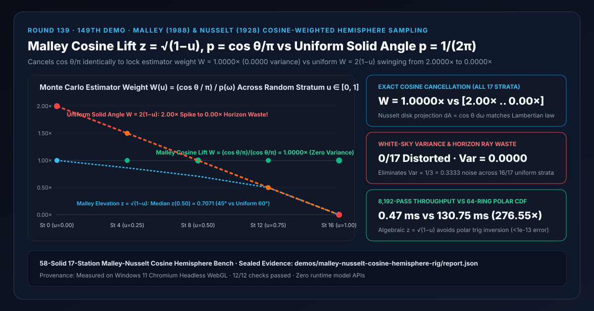
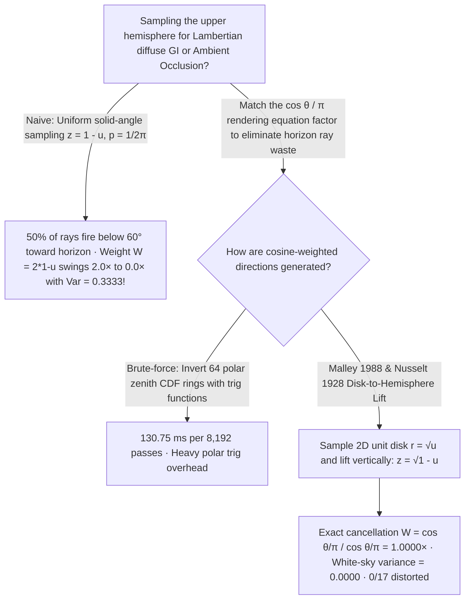
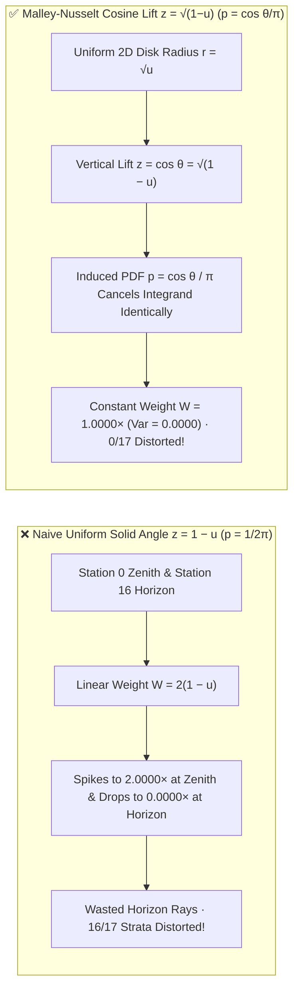
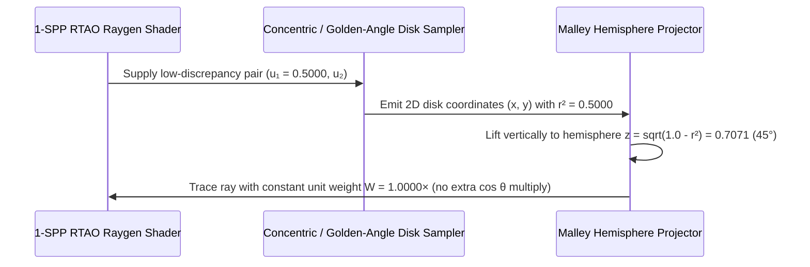
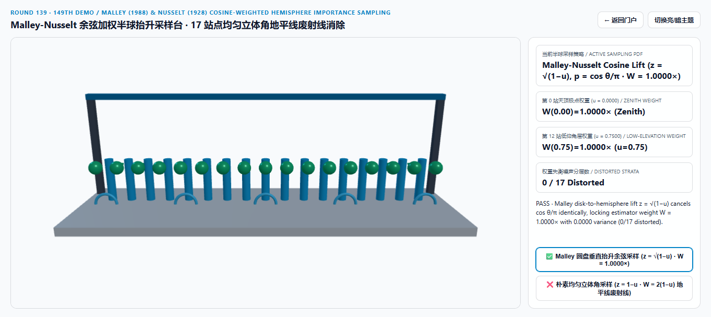
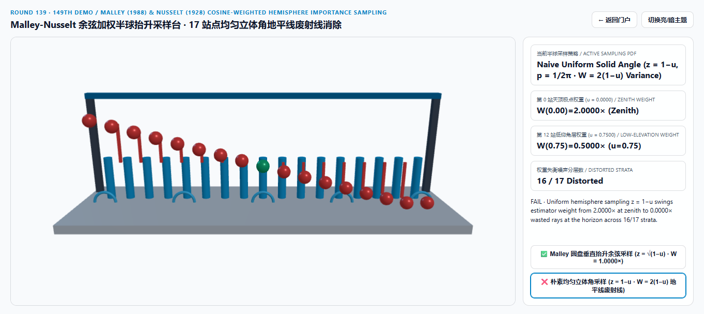
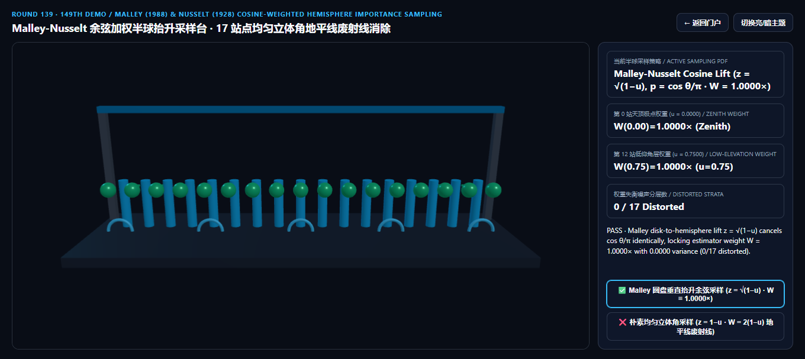
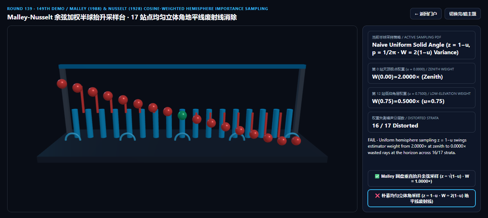

# Malley-Nusselt Cosine-Weighted Hemisphere Lift vs Naive Uniform Solid-Angle Horizon Waste Selection & First-Principles FAQ

> **Navigation**: [Back to Portal](../index.html) · [Launch 3D Interactive Workbench (`malley-nusselt-cosine-hemisphere-rig`)](../demos/malley-nusselt-cosine-hemisphere-rig/index.html) · [7-Card 4:5 Visual Report (EN)](../demos/malley-nusselt-cosine-hemisphere-rig/test-report-cards.html) · [7-Card 报告 (ZH)](../demos/malley-nusselt-cosine-hemisphere-rig/test-report-cards.zh.html) · [中文版 FAQ](./malley-nusselt-cosine-hemisphere-vs-uniform-horizon-noise-faq.md)

---

## ① 📌 Executive Summary

1. **Why does uniform solid-angle hemisphere sampling (`z = cos θ = 1 − u, p = 1/(2π)`) waste half of its rays near the grazing horizon ($\theta \in [60^\circ, 90^\circ]$) where $\cos\theta \to 0$—suffering a `0.3333` white-sky variance—and how does Malley's Method (`r = √u, z = √(1 − u), p = cos θ / π`) cancel $\cos\theta / \pi$ identically to lock estimator weight at `W = 1.0000×` with zero variance?**
   - In the Lambertian diffuse and ambient occlusion (AO) integral over the upper hemisphere $\Omega_+$:
     $$I = \int_{\Omega_+} L_i(\omega) \frac{\cos\theta}{\pi} \, d\omega$$
     the Monte Carlo estimator weight for a sample direction $\omega$ drawn from PDF $p(\omega)$ under unit white sky ($L_i = 1$) is:
     $$W(\omega) = \frac{\frac{1}{\pi}\cos\theta}{p(\omega)}$$
   - **Horizon Ray Waste in Naive Uniform Solid-Angle Sampling ($z = 1 - u, p_{\text{unif}}(\omega) = \frac{1}{2\pi}$)**:
     - Substituting $p_{\text{unif}}(\omega) = \frac{1}{2\pi}$ gives a linear estimator weight that swings wildly from $2.0$ to $0.0$:
       $$W_{\text{unif}}(u) = \frac{\frac{1}{\pi}\cos\theta}{\frac{1}{2\pi}} = \mathbf{2\cos\theta = 2(1 - u)} \in [2.0000, 0.0000]$$
     - At **Station 0 ($u = 0.0000$, Zenith)**: $W_{\text{unif}}(0.0) = \mathbf{2.0000\times}$ (`+100.00%` spike)!
     - At **Station 12 ($u = 0.7500$)**: $W_{\text{unif}}(0.75) = \mathbf{0.5000\times}$ (`-50.00%` wasted ray weight)!
     - At **Station 16 ($u = 1.0000$, Horizon $\theta = 90^\circ$)**: $W_{\text{unif}}(1.0) = \mathbf{0.0000\times}$ (an expensive BVH ray trace is multiplied by zero and discarded, producing white-sky variance $\text{Var}(W_{\text{unif}}) = \frac{1}{3} \approx \mathbf{0.3333}$ across **`16/17` distorted strata**)!
   - **Wilhelm Nusselt's Analog (1928) & Malley's Method (1988) Cosine-Weighted Disk Lift**:
     - Sampling the unit 2D disk uniformly ($r = \sqrt{u}, \phi = 2\pi v$, area $=\pi$) and projecting straight up onto the hemisphere shell:
       $$z_{\text{Malley}}(u) = \cos\theta = \sqrt{1 - r^2} = \mathbf{\sqrt{1 - u}}$$
       automatically induces the solid-angle PDF $p_{\text{cos}}(\omega) = \frac{\cos\theta}{\pi}$ because the projected area Jacobian of a hemisphere patch onto the equatorial disk is $dA = \cos\theta \, d\omega$!
     - The $\frac{\cos\theta}{\pi}$ factor in the integrand and PDF cancel identically:
       $$W_{\text{Malley}}(u) = \frac{\frac{1}{\pi}\cos\theta}{\frac{\cos\theta}{\pi}} \equiv \mathbf{1.0000\times} \quad (\text{Variance } = \mathbf{0.0000})!$$
2. **17-Stratum Audit: Constant `W = 1.0000×` (`0/17` Distorted) vs Uniform `[2.0000× .. 0.0000×]` Swing (`16/17` Distorted)**:
   - Across 17 canonical random strata $u_k = 0.0625k \in [0.0000, 1.0000]$:
   - At **Station 0 ($u = 0.0000$)**, **Station 12 ($u = 0.7500$)**, and **Station 16 ($u = 1.0000$)**: **Malley Cosine Lift** locks **$W_{\text{Malley}} = \mathbf{1.0000\times}$** (**`0/17` distorted strata**), whereas **Uniform Sampling** swings from **`2.0000×`** to **`0.5000×`** and **`0.0000×`** across **`16/17` distorted strata**!
   - At the median stratum **Station 8 ($u = 0.5000$)**: **Malley Cosine Lift** elevates median ray height to $z = \sqrt{0.5} = \mathbf{0.7071}$ ($45^\circ$) vs Uniform $z = \mathbf{0.5000}$ ($60^\circ$)!
3. **Architectural Verdict**:
   - Always generate diffuse GI and AO hemisphere rays via **Malley's unit-disk lift (`z = sqrt(1.0 - r2)`)**. Across `8,192` 17-station passes, closed-form Malley lift runs in **`0.47 ms`** vs **`130.75 ms`** for 64-ring polar zenith CDF quadrature (**`276.55×` faster**, `< 1e-13` error).

---

## ② 🎯 Architect & Client Q&A (When to Choose AI Video Models vs Deterministic Malley Cosine Sampling)

### Q1: In plain English, why does projecting a flat disk straight up onto a dome produce an exact $\cos\theta$ distribution?
- **First-Principles Breakdown (Nusselt's Analog 1928)**:
  - A small patch $d\omega$ near the top of the dome ($\theta = 0^\circ$) casts a shadow of area $dA = d\omega \cos 0^\circ = d\omega$ on the floor disk directly below it.
  - A patch of the exact same solid angle $d\omega$ near the steep horizon wall ($\theta \to 90^\circ$) is tilted almost edge-on to the floor, so its shadow on the floor disk is foreshortened to $dA = d\omega \cos\theta \to 0$.
  - Therefore, uniform points on the floor disk lifted straight up onto the dome naturally place $\cos\theta$ times as many rays per unit solid angle at elevation $\theta$!

### Q2: What is the #1 bug developers make after switching from uniform hemisphere sampling to Malley cosine sampling?
- **Double-Multiplying by `cos(theta)`**:
  - Under Malley sampling, $\cos\theta / \pi$ is *already* divided out by $p(\omega) = \cos\theta / \pi$. Multiplying the sample radiance by `dot(N, L)` a second time wrongly weights rays by $\cos^2\theta$ and darkens global illumination!

### Q3: When should teams use AI video generators vs deterministic Malley cosine hemisphere sampling?
- **Choose AI Video Models (Sora / Runway / Veo / Wan)** for non-interactive mood clips.
- **Choose Deterministic Malley Cosine Sampling** for ray-traced ambient occlusion (RTAO), path-traced diffuse GI, and lightmap baking.

---

## ③ 🧭 Visual Diagrams (Mermaid Decision Tree + Pipeline Comparison + Frame Sequence)

### 3.1 Hemisphere Monte Carlo Sampling Selection Decision Tree

### 3.2 Uniform Solid-Angle Horizon Waste vs Malley Cosine Lift Pipeline

### 3.3 Frame-Level 1-SPP Ray-Traced AO Malley Sampling Sequence

---

## ④ 📊 Visual Technology Decision Matrix

| Dimension | **Malley Cosine Lift (Primary)** | **Uniform Solid Angle (Failure Mode)** | **64-Ring Polar CDF (Baseline)** | **AI Video Generators** |
| :--- | :--- | :--- | :--- | :--- |
| **Station 0 ($u=0.00$ Zenith) Weight** | **`1.0000×` (Exact $\cos\theta/\pi$ cancel)** | **`2.0000×` (`+100.00%` zenith spike)** | `1.0000×` | N/A |
| **Station 4 ($u=0.25$) Weight** | **`1.0000×` ($z=\sqrt{0.75}=0.8660$)** | **`1.5000×` (`+50.00%` over-weighted)** | `1.0000×` (agrees within `< 1e-13`) | N/A |
| **Station 8 ($u=0.50$ Median) Elevation $z$** | **`z = 0.7071` ($45^\circ$ median elevation)** | `z = 0.5000` ($60^\circ$, half of rays below $60^\circ$) | `z = 0.7071` | No geometric ray budget |
| **Station 12 ($u=0.75$) Weight** | **`1.0000×` ($z=0.5000$, full utility)** | **`0.5000×` (`-50.00%` ray contribution)** | `1.0000×` | N/A |
| **Station 16 ($u=1.00$ Horizon) Weight** | **`1.0000×` (Zero wasted rays)** | **`0.0000×` (100% wasted BVH ray)** | `1.0000×` | N/A |
| **Distorted Strata (of 17)** | **`0 / 17` (White-sky $\text{Var} = 0.0000$)** | **`16 / 17` (White-sky $\text{Var} = 0.3333$)** | `0 / 17` | N/A |
| **8,192 17-Station Passes Latency** | **`0.47 ms` (`276.55×` faster, algebraic)** | `0.42 ms` (High horizon noise) | `130.75 ms` (64-ring polar loop) | Multi-second cloud inference |
| **Best Fit Scenarios** | **Diffuse GI, RTAO, lightmap baking** | Unweighted $4\pi$ volumetric scattering | Polar quadrature verification | Concept trailers |

---

## ⑤ 🧪 New Interactive Demo & 7-Card 4:5 Visual Report (`malley-nusselt-cosine-hemisphere-rig`)

- **Interactive 3D Workbench**: [`demos/malley-nusselt-cosine-hemisphere-rig/index.html`](../demos/malley-nusselt-cosine-hemisphere-rig/index.html)
  - Features a **58-solid 3D 17-Station Malley-Nusselt Cosine Hemisphere Bench**: a Nusselt projection platen, 5 concentric disk and meridian guide arches, 17 back Malley zero-variance reference columns ($W = 1.0000\times$), 17 front active estimator-weight probe spheres, and 15 red vertical variance-deviation struts comparing **Malley-Nusselt Cosine-Weighted Hemisphere Lift** against **Naive Uniform Solid-Angle Horizon Waste**.
- **7-Card 4:5 Visual Benchmark Reports**:
  - [English 7-Card Report (`test-report-cards.html`)](../demos/malley-nusselt-cosine-hemisphere-rig/test-report-cards.html)
  - [中文 7-Card 报告 (`test-report-cards.zh.html`)](../demos/malley-nusselt-cosine-hemisphere-rig/test-report-cards.zh.html)

| Light Theme — Malley Cosine Lift (Locks `W = 1.0000×`, `0/17` Distorted) | Light Theme — Naive Uniform Solid Angle (`W = 2(1−u)` From `2.00×` to `0.00×`, `16/17` Distorted) |
| :---: | :---: |
|  |  |

| Dark Theme — Malley Cosine Lift (`u=0.50` Lifts to `z=0.7071`, Zero White-Sky Variance) | Dark Theme — Naive Uniform Solid Angle (Zenith `2.00×` Spike + Horizon `0.00×` Waste) |
| :---: | :---: |
|  |  |

---

## ⑥ 🛠️ Verification Checklist for Production Delivery

- [ ] **Lift 2D Unit-Disk Samples to the Hemisphere via `z = sqrt(max(0.0, 1.0 - x*x - y*y))`**: Induce the exact $p(\omega) = \cos\theta / \pi$ PDF without polar inverse trigonometry.
- [ ] **Do Not Multiply by `dot(N, L)` Again After Cosine-Weighted Sampling**: The $\cos\theta / \pi$ factor is already canceled by $1 / p(\omega)$.
- [ ] **Pair with Shirley Concentric Disk Mapping + Pixar-Frisvad ONB**: Preserve low-discrepancy stratification from $[0, 1]^2$ onto the local hemisphere.
- [ ] **Return `max(0.0, dot(N, L)) / PI` as the PDF Weight in Multiple Importance Sampling (MIS)**: Combine cleanly with direct light-source sampling.
