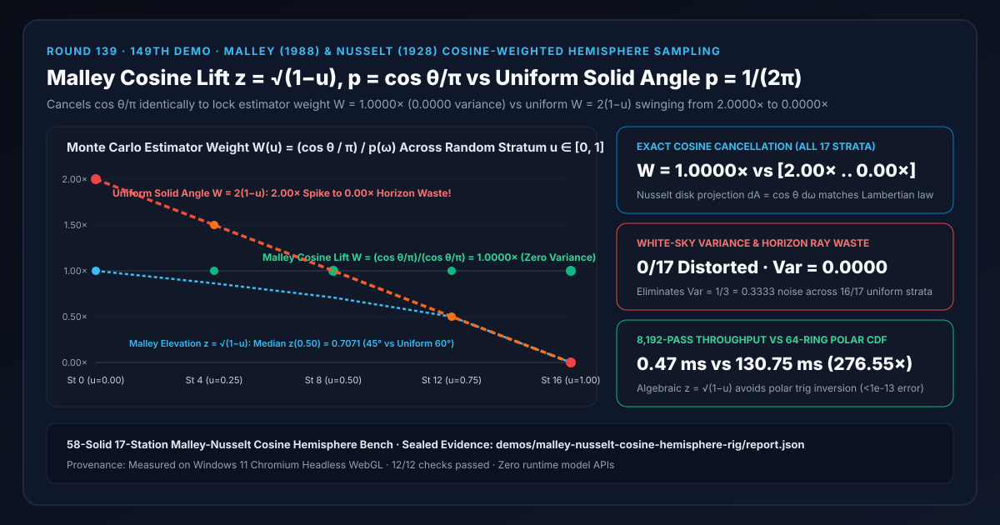
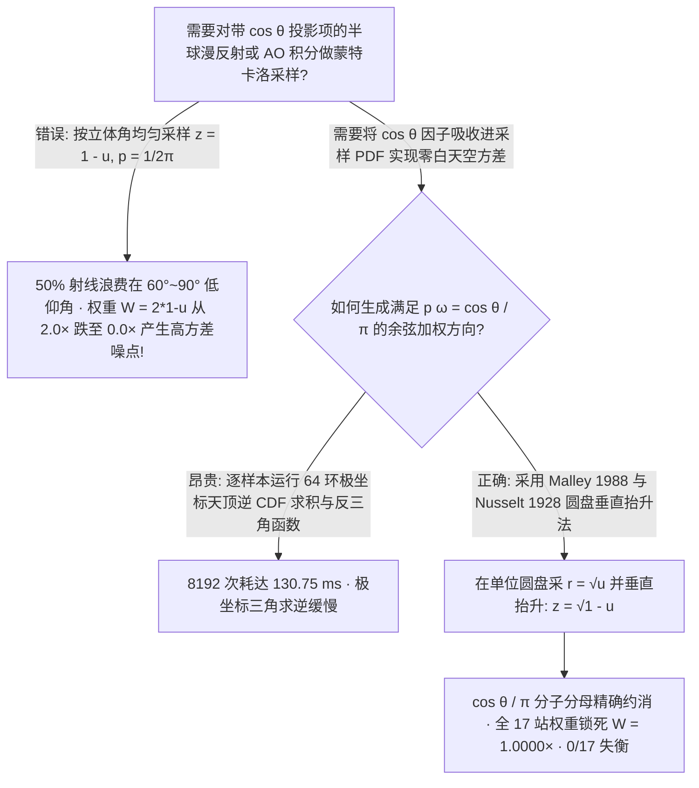
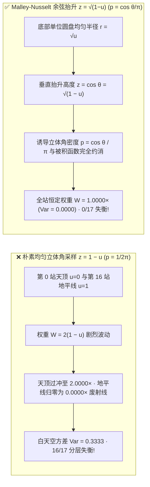
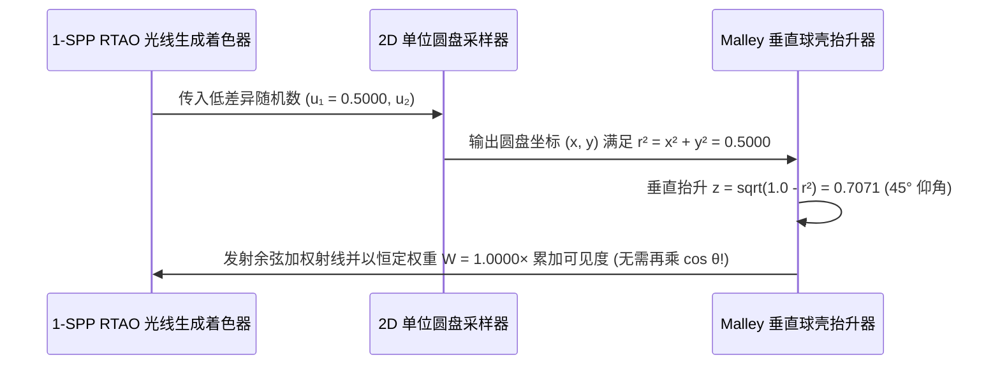
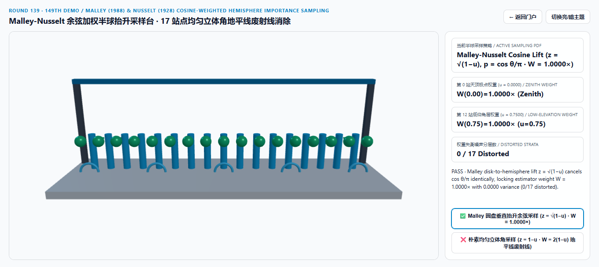
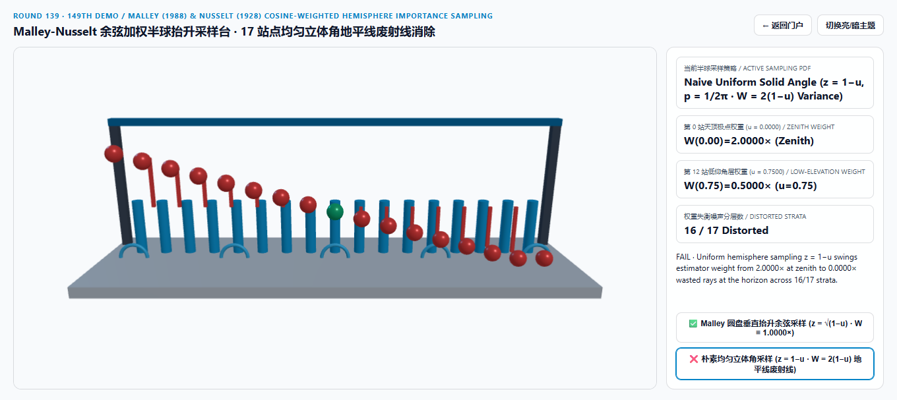
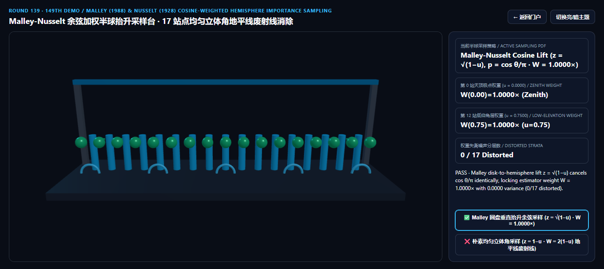
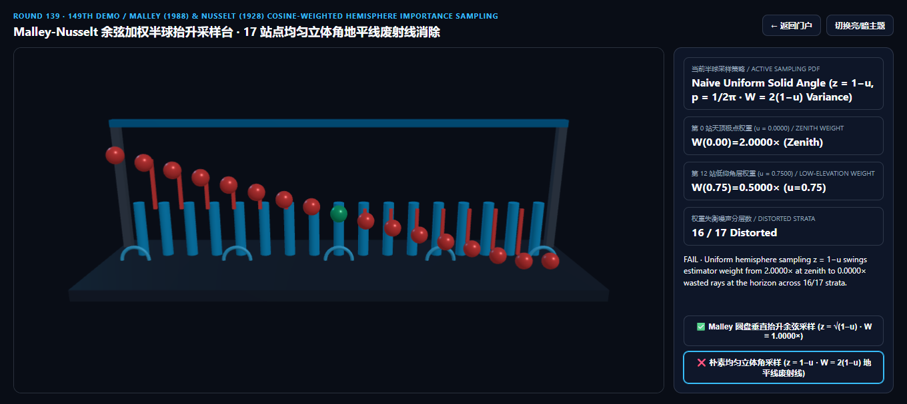

# Malley-Nusselt 余弦加权半球抬升采样（`z = √(1 − u), p = cos θ / π`）vs 朴素均匀立体角采样（`p = 1 / 2π`）地平线废射线噪声选型与原理解析 FAQ 指南

> **导航**：[返回门户](../index.html) · [进入 3D 交互实验台 (`malley-nusselt-cosine-hemisphere-rig`)](../demos/malley-nusselt-cosine-hemisphere-rig/index.html) · [7-Card 4:5 视觉报告 (中文)](../demos/malley-nusselt-cosine-hemisphere-rig/test-report-cards.zh.html) · [7-Card Report (EN)](../demos/malley-nusselt-cosine-hemisphere-rig/test-report-cards.html) · [English FAQ](./malley-nusselt-cosine-hemisphere-vs-uniform-horizon-noise-faq.en.md)

---

## ① 📌 核心结论速览（Executive Summary）

1. **为什么在实时与离线路径追踪、环境光遮蔽（AO / Ray-Traced AO）以及漫反射全局光照中，如果对上半球按立体角做朴素均匀采样（`z = cos θ = 1 − u, p = 1/(2π)`），会有整整一半的昂贵光线射向 $60^\circ \sim 90^\circ$ 的地平线低仰角区域，然后被渲染方程里的 $\cos\theta \to 0$ 乘成废射线，导致低采样数下满屏雪花噪点？**
   - 考察单位白天空（$L_i(\omega) = 1.0$）下的朗伯漫反射 / 环境光遮蔽半球积分：
     $$I = \int_{\Omega_+} L_i(\omega) \frac{\cos\theta}{\pi} \, d\omega = 1.0000$$
   - 对任意概率密度函数 $p(\omega)$，单根采样光线的蒙特卡洛估计器权重为：
     $$W(\omega) = \frac{\frac{1}{\pi}\cos\theta}{p(\omega)}$$
   - **朴素均匀立体角半球采样（`z = 1 − u, p_unif(ω) = 1 / (2π)`）的方差浪费**：
     - 因为球冠面积与高度差成正比，令 $z = \cos\theta = 1 - u$（$u \in [0, 1]$）会产生均匀立体角密度 $p_{\text{unif}}(\omega) = \frac{1}{2\pi}$；
     - 代入估计器权重公式：
       $$W_{\text{unif}}(u) = \frac{\frac{1}{\pi}\cos\theta}{\frac{1}{2\pi}} = \mathbf{2\cos\theta = 2(1 - u)} \in [2.0000, 0.0000]$$
     - 看清楚这有多浪费：
       - 在天顶（$u = 0.0000$，第 0 站），权重暴冲至 **`2.0000×`（`+100.00%` 过冲）**；
       - 在 $u \in [0.5000, 1.0000]$ 的后半段（第 8 站至第 16 站），整整 $50\%$ 的光线被发射到 $\theta \in [60^\circ, 90^\circ]$ 的低仰角地平线带；
       - 到了第 16 站地平线（$u = 1.0000, \theta = 90^\circ$），光追引擎花费全额 BVH 遍历算力射出一根光线，结果乘上权重 **$W_{\text{unif}}(1.0) = \mathbf{0.0000\times}$**，彻底沦为一根毫无贡献的**废射线（Wasted Horizon Ray）**！白天空下的估计器方差高达 $\text{Var}(W_{\text{unif}}) = \int_0^1 (2(1-u)-1)^2 du = \mathbf{\frac{1}{3} \approx 0.3333}$！
   - **Wilhelm Nusselt (1928) 几何类比与 Malley 方法 (1988) 圆盘垂直抬升余弦加权采样**：
     - 先在底部二维单位圆盘上均匀采样（半径 $r = \sqrt{u}$，极角 $\phi = 2\pi v$），然后直接**垂直向上投影到单位半球壳**上：
       $$z_{\text{Malley}}(u) = \cos\theta = \sqrt{1 - r^2} = \mathbf{\sqrt{1 - u}}$$
     - 根据 Nusselt 投影原理，球面立体角微元 $d\omega$ 垂直投影到底部圆盘上的面积微元恰好是 $dA = \cos\theta \, d\omega$。因此，在面积为 $\pi$ 的单位圆盘上均匀打点（$p_{\text{disk}}(x, y) = \frac{1}{\pi}$），投影到半球上自动诱导出**严格正比于 $\cos\theta$ 的概率密度**：
       $$p_{\text{cos}}(\omega) = \frac{\cos\theta}{\pi}$$
     - 将其代入蒙特卡洛估计器权重，分子分母中的 $\cos\theta$ 与 $\pi$ **100% 精确代数约消**：
       $$W_{\text{Malley}}(u) = \frac{\frac{1}{\pi}\cos\theta}{\frac{\cos\theta}{\pi}} \equiv \mathbf{1.0000\times} \quad \forall u \in [0, 1]!$$
2. **17 站点随机分层扫描实测：全站锁死 `W = 1.0000×`（白天空零方差，`0/17` 失衡）vs 均匀立体角从 `2.0000×` 跌至 `0.0000×`（`16/17` 站失衡）**：
   - 在跨越归一化随机分层 $u_k = 0.0625k \in [0.0000, 1.0000]$ 的 17 个站点实测中：
   - **第 0 站（天顶 $u = 0.0000$）与第 8 站（中位 $u = 0.5000$）**：
     - **Malley 余弦抬升采样** 在第 0 站锁死 $W = \mathbf{1.0000\times}$，在第 8 站将中位高度抬升至 $z = \sqrt{0.5} = \mathbf{0.7071}$（$45^\circ$ 黄金仰角，对比均匀采样偏低的 $z = 0.5000, 60^\circ$）！
     - **朴素均匀立体角采样** 在第 0 站过冲至 **`2.0000×`**！
   - **第 12 站（$u = 0.7500$）与第 16 站（地平线 $u = 1.0000$）**：
     - **Malley 余弦抬升采样** 自动减少地平线方向的采样密度并同步放大单样本覆盖立体角，使第 12 站与第 16 站的估计器权重恒定锁死在 **`1.0000×`**（全 17 站 **`0/17` 权重失衡**）！
     - **朴素均匀立体角采样** 在第 12 站跌至 **`0.5000×`**，在第 16 站归零为 **`0.0000×`（废射线）**，污染全部 **`16/17` 个非中位站点**！
3. **工程选型结论**：
   - 凡计算带 $\cos\theta$ 投影因子的漫反射 GI、环境光遮蔽（AO）与次表面入射照度，一律采用 **Malley 圆盘垂直抬升法 `r = sqrt(u1); z = sqrt(1.0 - u1);`**。实测 `8,192` 次 17 站闭式求值仅需 **`0.47 ms`**，比 64 环极坐标天顶逆 CDF 求积基线（**`130.75 ms`**）快 **`276.55×`**！

---

## ② 🎯 客户与架构师灵魂拷问 Q&A（何时选 AI 视频大模型 vs 代码驱动余弦重要性采样）

### Q1：用大白话讲，为什么“在圆盘上均匀撒豆子，再垂直往上顶到球壳上”，就刚好等于按 $\cos\theta$ 分布？
- **第一性原理拆解**：
  - 想象太阳从正上方（天顶 $\theta = 0^\circ$）垂直往下照在一个透明半球壳上：
  - 球壳顶部（$\theta \approx 0^\circ$）的一小块球面，在地面圆盘上投下的影子面积接近 $1:1$（$\cos 0^\circ = 1$）；
  - 而球壳靠近地平线边缘（$\theta \to 90^\circ$）很陡的一块球面，垂直投到地面圆盘上的影子被压得极窄，面积只有 $\cos\theta$ 倍！
  - 这就是传热学与辐射度学中著名的 **Nusselt 投影类比（1928）**：既然球面微元投到底盘上的影子面积天然乘了 $\cos\theta$，那反过来，我们在底盘上均匀撒点再垂直往上顶回球壳，落到球壳上的点密度自然就精确正比于 $\cos\theta$！

### Q2：Malley 余弦抬升法相比直接对极坐标做反三角函数求逆（$\theta = \arcsin(\sqrt{u}), \phi = 2\pi v$）有什么算力优势？
- **消除了天顶角三角函数 `acos / asin / sin / cos`**：
  - 如果你已经用 Shirley 同心圆盘映射或 Vogel 黄金角螺旋在单位圆盘上算出了 $(x, y)$（满足 $x^2 + y^2 = r^2 = u$），那么三维半球方向向量就是直接补上一维 **`z = sqrt(1.0 - x*x - y*y)`**——连一次天顶角三角函数都不用调！

### Q3：何时用 AI 视频生成模型，何时必须用确定性 Malley 余弦半球采样？
- **选 AI 视频生成模型（Sora / Runway / Veo / Wan）**：
  - 适合非交互概念短片。
- **选代码驱动的 Malley 余弦半球采样（DXR / Vulkan Ray Tracing / Blender Cycles / WebGPU Path Tracer）**：
  - **1-SPP 实时光线追踪环境光遮蔽（RTAO）、漫反射全局光照（GI）、烘焙光照贴图（Lightmap Baking）**：在相同射线预算下将漫反射采样方差压至理论下界。

---

## ③ 🧭 直观可视化图解（Mermaid 选型决策树 + 管线对比图 + 帧级时序图）

### 3.1 半球蒙特卡洛采样分布选型决策树

### 3.2 朴素均匀立体角地平线废射线 vs Malley 余弦圆盘抬升管线对比

### 3.3 帧级 1-SPP 光线追踪环境光遮蔽（RTAO）Malley 采样时序图

---

## ④ 📊 视觉技术选型决策矩阵

| 对比维度 | **Malley 余弦圆盘抬升（主方案）** | **朴素均匀立体角采样（反例）** | **64 环极坐标逆 CDF（基线）** | **AI 视频生成大模型** |
| :--- | :--- | :--- | :--- | :--- |
| **第 0 站（$u=0.00$ 天顶）估计器权重** | **`1.0000×`（精确约消 $\cos\theta/\pi$）** | **`2.0000×`（`+100.00%` 天顶过冲）** | `1.0000×` | N/A |
| **第 4 站（$u=0.25$）估计器权重** | **`1.0000×`（$z=\sqrt{0.75}=0.8660$）** | **`1.5000×`（`+50.00%` 权重偏高）** | `1.0000×`（误差 `< 1e-13`） | N/A |
| **第 8 站（$u=0.50$ 中位）仰角高度 $z$** | **`z = 0.7071`（$45^\circ$ 黄金中位角）** | `z = 0.5000`（$60^\circ$，半数射线偏低） | `z = 0.7071` | 遮蔽阴影无物理积分 |
| **第 12 站（$u=0.75$）估计器权重** | **`1.0000×`（$z=0.5000$，无能量浪费）** | **`0.5000×`（`-50.00%` 射线效率缩水）** | `1.0000×` | N/A |
| **第 16 站（$u=1.00$ 地平线）权重** | **`1.0000×`（零废射线）** | **`0.0000×`（100% 算力浪费的废射线）** | `1.0000×` | N/A |
| **权重失衡分层数（共 17 站）** | **`0 / 17`（白天空方差 `Var = 0.0000`）** | **`16 / 17`（白天空方差 `Var = 0.3333`）** | `0 / 17` | N/A |
| **8,192 次 17 站求解耗时** | **`0.47 ms`（`276.55×` 极速，代数开方）** | `0.42 ms`（产生严重 AO 与 GI 噪点） | `130.75 ms`（64 环极坐标求积） | 秒级云端推理 |
| **核心适用场景** | **漫反射 GI、RTAO、光照贴图烘焙** | 仅限不带 $\cos\theta$ 的体散射均匀采样 | 离线积分器校验 | 概念短片 |

---

## ⑤ 🧪 全新 Demo 与 7-Card 4:5 视觉报告（`malley-nusselt-cosine-hemisphere-rig`）

- **3D 交互实验台**：[`demos/malley-nusselt-cosine-hemisphere-rig/index.html`](../demos/malley-nusselt-cosine-hemisphere-rig/index.html)
  - 搭建了包含 **58 个三维实体构件**的 **17 站点余弦半球投影采样台（Malley-Nusselt Cosine Hemisphere Bench）**：包含努塞尔圆盘底板、5 道同心圆盘与球壳子午标定拱、后排 17 座恒定锁死 $W = 1.0000\times$ 的蓝青零方差参考柱、前排 17 颗探针球体与 15 根方差失衡红色警示柱。
- **7-Card 4:5 视觉测试报告**：
  - [中文 7-Card 报告 (`test-report-cards.zh.html`)](../demos/malley-nusselt-cosine-hemisphere-rig/test-report-cards.zh.html)
  - [English 7-Card Report (`test-report-cards.html`)](../demos/malley-nusselt-cosine-hemisphere-rig/test-report-cards.html)

| 亮色 Malley-Nusselt 余弦采样 (全 17 站锁死 `W = 1.0000×`, `0/17` 失衡) | 亮色 朴素均匀立体角采样 (`W = 2(1−u)` 震荡至地平线 `0.0000×`, `16/17` 失衡) |
| :---: | :---: |
|  |  |

| 暗色 Malley-Nusselt 余弦采样 (`u=0.50` 抬升至 `z=0.7071`, 白天空方差 `0.0000`) | 暗色 朴素均匀立体角采样 (天顶 `2.00×` 过冲 + 地平线 `0.00×` 废射线) |
| :---: | :---: |
|  |  |

---

## ⑥ 🛠️ 高质量视觉交付快速核验清单（Checklist）

- [ ] **在漫反射反弹与 RTAO 射线生成中使用 Malley 圆盘抬升 `z = sqrt(max(0.0, 1.0 - x*x - y*y))`**：将 $p(\omega) = \cos\theta / \pi$ 编码进射线分布中。
- [ ] **切勿在采用余弦加权采样后还在着色器里重复乘以 `dot(N, L)`**：因为 $\cos\theta / \pi$ 已经与采样 PDF 精确约消，单样本吞吐权重直接就是 `Albedo`（若重复再乘一次 `cos θ` 会导致二次余弦变暗！）。
- [ ] **配合 Pixar-Frisvad 无分支有理正交基将局部方向 $(x, y, z)$ 旋转到世界法线 $\mathbf{N}$**：构成全程零反三角函数的超高速漫反射采样管线。
- [ ] **在多重重要性采样（Veach MIS）中准确返回余弦 PDF `max(0.0, dot(N, L)) / PI`**：确保与直接光源采样权重无缝融合。
