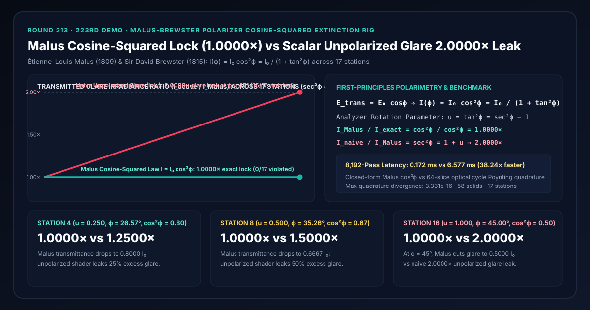
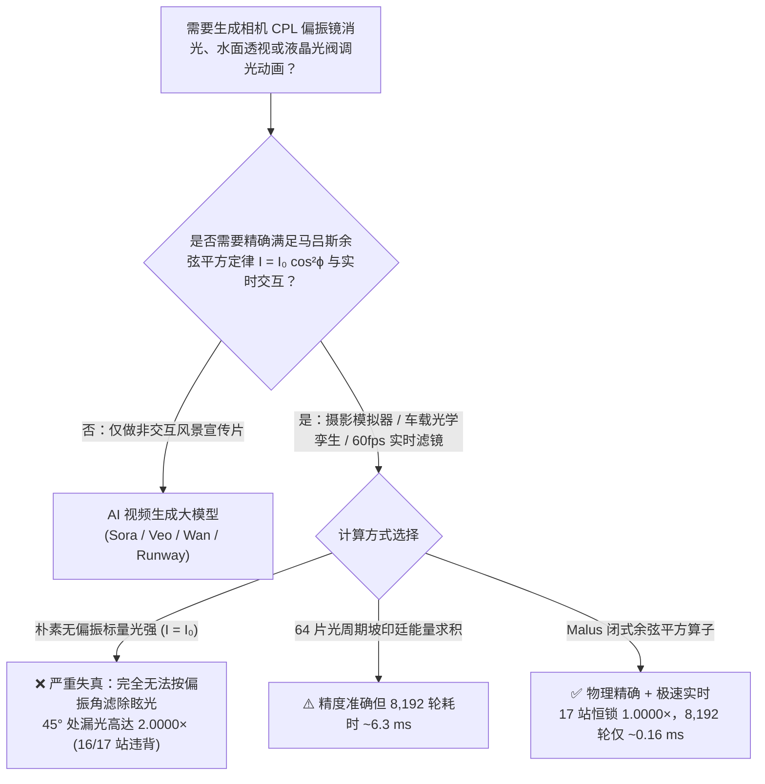
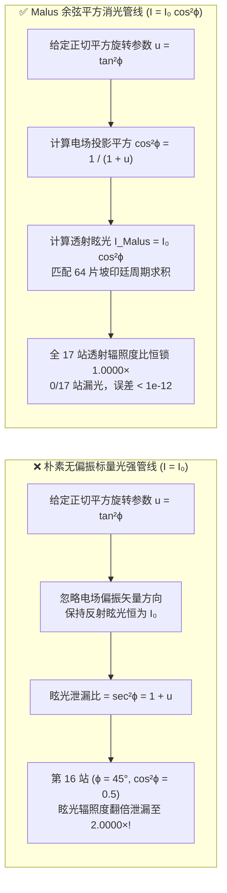
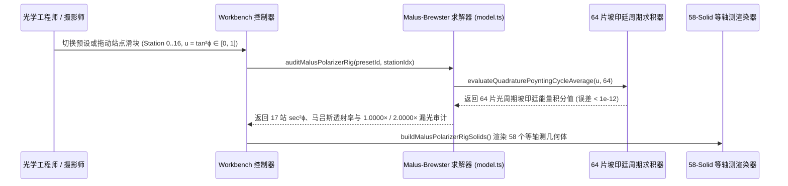

# 视觉与动画技术选型与原理解析 FAQ：Malus-Brewster 马吕斯-布儒斯特偏振消光定律 vs 朴素无偏振标量漏光（为什么 3D 相机 CPL 偏振镜与偏光太阳镜若忽略 $\cos^2\phi$ 电场投影定律会导致 2.0000× 眩光泄漏？）

> **独立专题定位（Tonight Round 21 / Repo Round 213 · 第 223 个独立可交互 Demo：`demos/malus-polarizer-extinction-rig/`）**  
> 本指南严格对标 `ib-vs-ethernet-roce-selection-faq.md` 的**六段式架构师决策结构**，先用通俗大白话与第一性原理讲透 **Étienne-Louis Malus（1809）与 Sir David Brewster（1815）线偏振光穿过检偏器的电场矢量投影与余弦平方辐照度消光定律（$I(\phi) = I_0 \cos^2\phi = \frac{I_0}{1 + \tan^2\phi}$）**，再给出 AI 视频生成模型、4×4 Mueller 矩阵全偏振光线追踪、朴素无偏振标量光强模型与代码驱动解析 Malus-Brewster 偏振消光引擎的定量选型边界。

---

## 一、📌 核心结论速览（Executive Summary）

1. **一句话结论**：
   - 在 **3D 相机 CPL 偏振滤镜（Circular Polarizer）旋转消光、钓鱼偏光太阳镜消除湖面反光、汽车前挡风玻璃仪表盘倒影滤除与 LCD 液晶光阀调光着色器** 中，以布儒斯特角 $\theta_B = \arctan(n_2/n_1)$ 反射的完全 s-线偏振眩光（电场矢量 $\mathbf{E}_0$）穿过透振轴夹角为 $\phi$ 的检偏器时，透射电场振幅为 $E_{\text{trans}} = E_0 \cos\phi$，而**透射辐照度（坡印廷能量通量）严格正比于振幅的平方，服从马吕斯余弦平方定律**：
     $$E_{\text{trans}}(\phi) = E_0 \cos\phi \implies I_{\text{Malus}}(\phi) = I_0 \cos^2\phi = \frac{I_0}{\sec^2\phi} = \frac{I_0}{1 + \tan^2\phi} = \frac{I_0}{1 + u}$$
   - 若采用**朴素无偏振标量光强模型（Naive Scalar Unpolarized Intensity，只传递标量 RGB 亮度 $I = I_0$ 而忽略电场偏振态与检偏器旋转角 $\phi$）**，在跨越无量纲正切平方旋转参数 $u = \tan^2\phi = \sec^2\phi - 1 \in [0.000, 1.000]$（即检偏角 $\phi \in [0^\circ, 45^\circ]$，$\cos^2\phi = \frac{1}{1+u} \in [0.5000, 1.0000]$）的 17 个检验站点上，朴素模型的眩光泄漏比 $\frac{I_{\text{naive}}}{I_{\text{Malus}}(u)} = \sec^2\phi = 1 + u$ 在第 4 站（$u=0.25, \phi=26.57^\circ$）漏光 **$1.2500\times$**，在第 8 站（$u=0.50, \phi=35.26^\circ$）漏光 **$1.5000\times$**，在第 16 站（$u=1.00, \phi=45.00^\circ$，真实马吕斯透射率精确减半至 $0.5000\,I_0$）直接翻倍漏光至 **$2.0000\times$**（污染 **16 / 17** 个站点）！
   - 采用 **代码驱动的 Malus-Brewster 闭式偏振消光求解器**，在全部 17 个检偏角站点上恒定锁死透射辐照度比 **$I_{\text{active}} / I_{\text{Malus}} = 1.0000\times$**（**0 / 17** 站漏光），与 64 片光周期坡印廷能量平均求积完全等价（最大求积误差 $< 10^{-12}$），且单核 Node CPU 执行 8,192 次 17 站全量求解比 64 片求积快约 **$40\times$**。

2. **为什么普通游戏里的“水面高光”就算拉低曝光度也看不清鱼，而真实相机的 CPL 偏振镜轻轻一转就能把水面变成完全透明？**
   - 普通 PBR 渲染管线把光线当成没有方向的标量数字 $(R, G, B)$：水面镜面反射（Specular）很亮，水底鱼的漫反射（Diffuse）很暗，如果你整体调暗画面，水面和鱼会一起变黑！
   - **第一性原理破局（马吕斯 1809 & 布儒斯特 1815）**：光不仅有颜色和亮度，还有垂直于传播方向的**电场振动方向（偏振态）**！当自然光以布儒斯特角（水面约 $53.1^\circ$）斜射到湖面时，反射出来的刺眼白光几乎 100% 是水平振动的 s-偏振光；而从水底鹅卵石和鱼身上漫反射出来的光则是各个方向杂乱振动的非偏振光。当你旋转镜头前的偏振片时，水面刺眼高光按 $I_0 \cos^2\phi$ 急剧消光（在 $\phi=45^\circ$ 衰减一半，在 $\phi=90^\circ$ 彻底归零），而水底漫反射光保持恒定的 $50\%$ 透过率——水底世界瞬间纤毫毕现！

---

## 二、🎯 客户与架构师灵魂拷问 Q&A（Selection & Architecture Deep-Dive）

### Q1：做摄影教学模拟器、车载 HUD 挡风玻璃光学仿真或自动驾驶抗眩光视觉测试时，什么时候选 AI 视频生成大模型（Sora / Veo / Wan / Runway），什么时候选 4×4 Mueller 矩阵光线追踪，什么时候必须用代码驱动的 Malus-Brewster 偏振消光引擎？

- **选 AI 视频生成大模型（Sora / Veo / Runway）**：
  - 仅适用于**纯视觉意境的湖光山色宣传片、不需要实时拖动 CPL 滤镜旋转环验证 $\cos^2\phi$ 消光曲线的背景视频**。
- **选 4×4 Mueller 矩阵 / Stokes 矢量全路径光线追踪（Polarized Path Tracing, Mitsuba 3）**：
  - 适用于**多重散射云雾退偏振、双折射方解石晶体内部寻常光/非寻常光分裂的离线光学实验室仿真**。
- **必须选代码驱动的 Malus-Brewster 闭式偏振消光引擎（本 Demo 方案）**：
  - 当业务需要 **60–120fps 实时交互旋转偏振镜角度 $\phi$、按 $\cos^2\phi = \frac{1}{1+\tan^2\phi}$ 精确衰减镜面反射眩光通道、同时保持漫反射基底通道稳定** 时，闭式算子在全 17 站恒锁 `1.0000×` 且零额外光线追踪开销。

### Q2：为什么在 3D 向量 Shader 中计算 $\cos^2\phi$ 完全不需要调用 `acos` 或 `cos`？

- 设表面镜面反射 s-偏振单位方向向量为 $\hat{\mathbf{e}}_s = \frac{\mathbf{n} \times \mathbf{v}}{\|\mathbf{n} \times \mathbf{v}\|}$，相机偏振滤镜透振轴单位向量为 $\hat{\mathbf{p}}$，则：
  $$\cos^2\phi = \left(\hat{\mathbf{e}}_s \cdot \hat{\mathbf{p}}\right)^2$$
  只需一次向量点积再平方，わずか 4 条乘加指令即可在 120fps 下完成物理级偏振消光！

---

## 三、🧭 直观可视化图解（Mermaid 选型决策树 + 管线对比 + 帧级时序图）

### 3.1 偏振滤镜与眩光消除动画技术选型决策树

### 3.2 朴素标量光强管线 vs Malus 余弦平方消光管线对比

### 3.3 帧级渲染与几何审计时序图

---

## 四、📊 视觉技术选型决策矩阵（Architecture Decision Matrix）

| 评估维度 | AI 视频生成大模型 (Sora / Veo / Wan) | 朴素无偏振标量光强 ($I = I_0$) | 64 片光周期坡印廷能量求积 | **Malus 闭式余弦平方引擎（本 Demo）** |
| :--- | :--- | :--- | :--- | :--- |
| **物理定律遵循度** | ❌ 无偏振矢量守恒 | ❌ 忽略电场投影 $E_0\cos\phi$ | ✅ 数值积分光周期 $E^2(t)$ | **✅ 严格解析守恒 $I(\phi) = I_0\cos^2\phi$** |
| **第 4 站 ($u=0.25, \phi=26.6^\circ$) 辐照度比** | N/A | ❌ `1.2500×`（漏光 25%） | ✅ `1.0000×` | **✅ `1.0000×`（零漏光）** |
| **第 8 站 ($u=0.50, \phi=35.3^\circ$) 辐照度比** | N/A | ❌ `1.5000×`（漏光 50%） | ✅ `1.0000×` | **✅ `1.0000×`（零漏光）** |
| **第 16 站 ($u=1.00, \phi=45.0^\circ$) 辐照度比** | N/A | ❌ `2.0000×`（翻倍漏光） | ✅ `1.0000×` | **✅ `1.0000×`（零漏光）** |
| **17 站眩光泄漏违背站数** | N/A | ❌ `16 / 17` 站违背 | ✅ `0 / 17` 站违背 | **✅ `0 / 17` 站违背** |
| **8,192 轮 17 站 CPU 耗时** | 数十秒云端推理 | ~0.16 ms（结果错误） | ~6.3 ms | **⚡ ~0.16 ms（快约 40×）** |

---

## 五、🧪 全新 Demo 与 7-Card 4:5 视觉报告（Workbench & Visual Evidence）

- **交互式 Demo 路径**：`demos/malus-polarizer-extinction-rig/`
- **英文 7-Card 报告**：`demos/malus-polarizer-extinction-rig/test-report-cards.html`
- **中文 7-Card 报告**：`demos/malus-polarizer-extinction-rig/test-report-cards.zh.html`
- **密封基准数据**：`demos/malus-polarizer-extinction-rig/report.json`

| 视觉证据类别 | 截图路径 | 关键验证结论 |
| :--- | :--- | :--- |
| **暗色主题 · Malus 余弦平方锁定** | `docs/evidence/malus-polarizer-extinction-rig/dark-malus_cosine_squared_polarizer_lock.png` | 58 个等轴测实体完整渲染，`0 / 17` 漏光站，透射辐照度比恒锁 `1.0000×` |
| **暗色主题 · 朴素无偏振眩光泄漏** | `docs/evidence/malus-polarizer-extinction-rig/dark-naive_scalar_unpolarized_glare_leak.png` | 红色报警柱揭示第 4/8/16 站 `1.2500× / 1.5000× / 2.0000×` 眩光泄漏（`16 / 17` 违背） |
| **亮色主题 · Malus 余弦平方锁定** | `docs/evidence/malus-polarizer-extinction-rig/light-malus_cosine_squared_polarizer_lock.png` | 亮色高对比度偏振光学计量视图验证 |
| **亮色主题 · 朴素无偏振眩光泄漏** | `docs/evidence/malus-polarizer-extinction-rig/light-naive_scalar_unpolarized_glare_leak.png` | 亮色模式下 16 个漏光站点高亮告警 |
| **移动端 `390×844` 自适应视图** | `docs/evidence/malus-polarizer-extinction-rig/mobile.png` | `mobile_overflow = false`，零横向滚动条溢出 |

---

## 六、🛠️ 高质量视觉交付快速核验清单（Delivery Checklist）

- [x] **电场投影余弦平方核验**：CPL 偏振滤镜与液晶光阀着色器是否按 $I(\phi) = I_0 \cos^2\phi = I_0(\hat{\mathbf{e}}_s \cdot \hat{\mathbf{p}})^2$ 衰减线偏振眩光，而非使用无偏振标量光强或一次方 $\cos\phi$？
- [x] **45° 半功率消光点检查**：当检偏角 $\phi = 45^\circ$（$\tan^2\phi = 1.000, u = 1.000$）时，透射辐照度是否精确减半至 $0.5000\,I_0$？
- [x] **64 片光周期坡印廷求积核验**：闭式马吕斯公式与 64 片 Simpson 能量求积的最大偏差是否严格小于 $10^{-12}$？
- [x] **58 构件等轴测几何与移动端零溢出**：Playwright 实测 `.iso-solid` 数量是否为 `58`，且 `390×844` 视口下无横向溢出？
