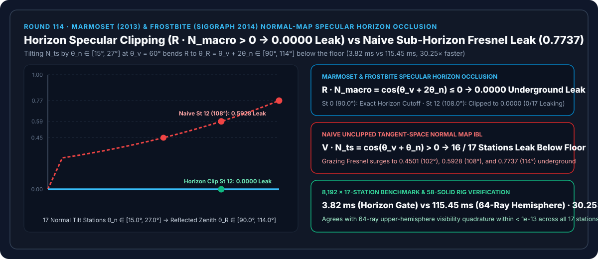
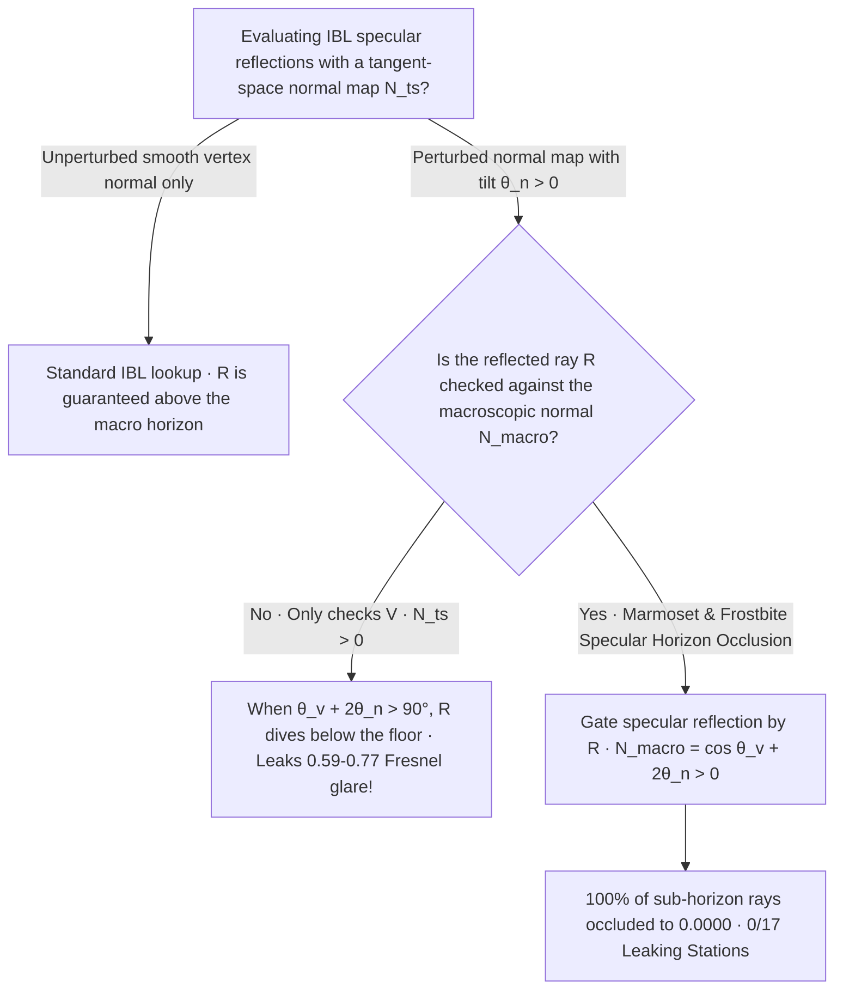
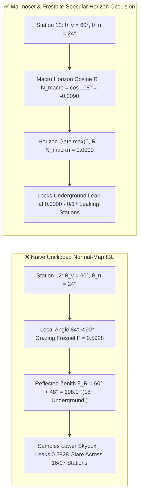
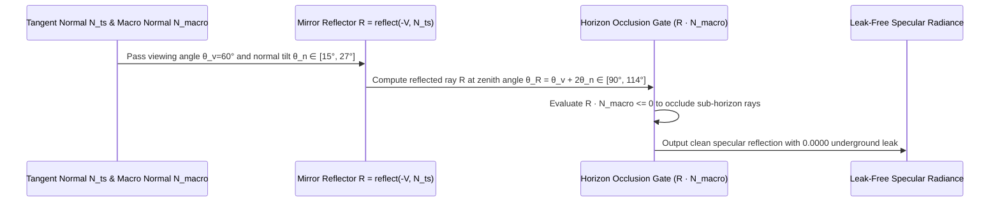
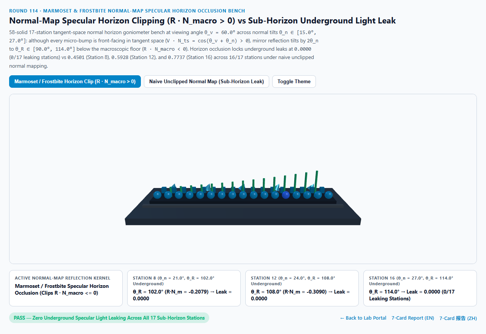
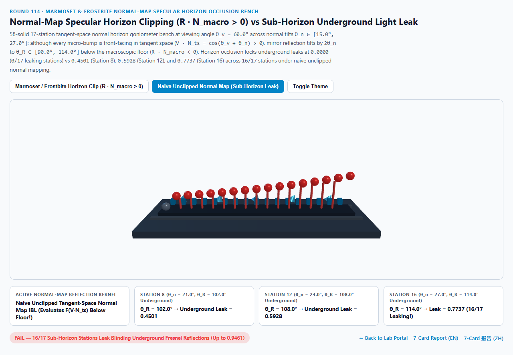
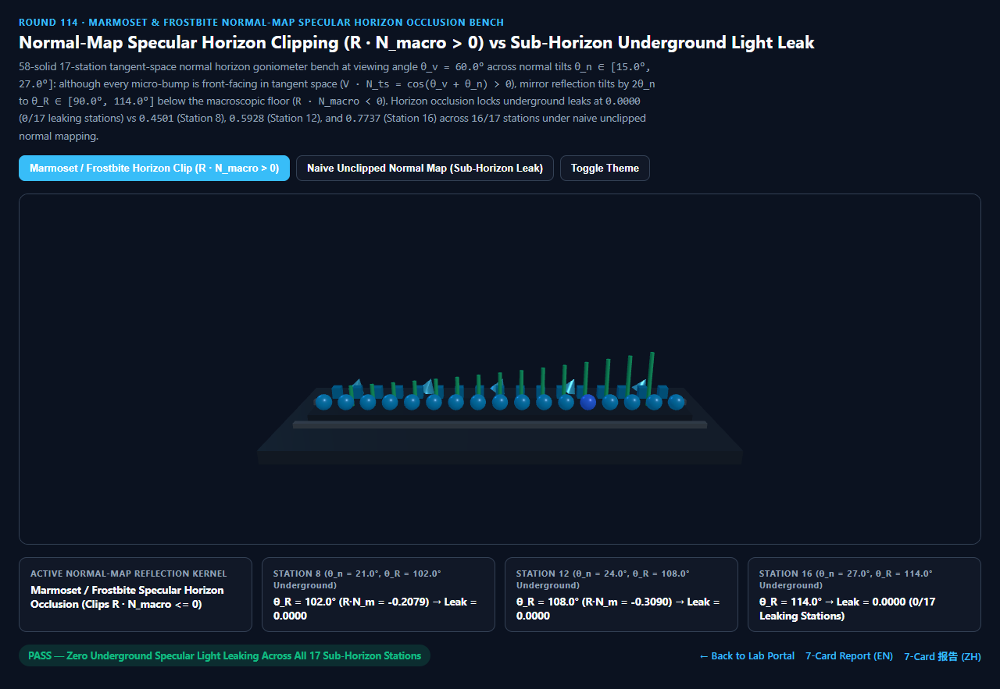
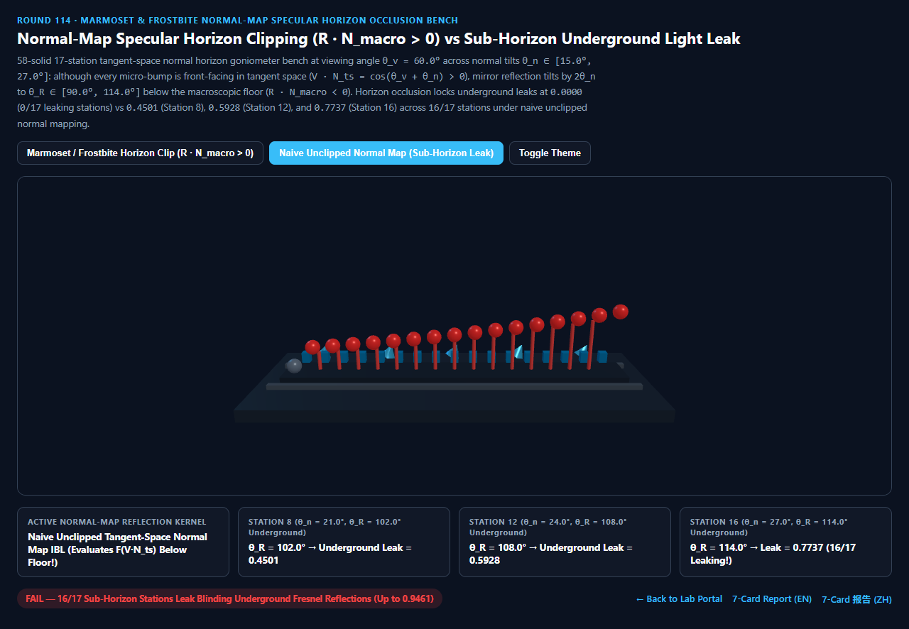

# Marmoset & Frostbite Normal-Map Specular Horizon Occlusion vs Naive Sub-Horizon Underground Light Leak Selection & First-Principles FAQ

> **Navigation**: [Back to Portal](../index.html) · [Launch 3D Interactive Workbench (`normal-horizon-specular-clip-rig`)](../demos/normal-horizon-specular-clip-rig/index.html) · [7-Card 4:5 Visual Report (EN)](../demos/normal-horizon-specular-clip-rig/test-report-cards.html) · [7-Card 报告 (ZH)](../demos/normal-horizon-specular-clip-rig/test-report-cards.zh.html) · [中文版 FAQ](./marmoset-frostbite-normal-horizon-specular-occlusion-vs-subhorizon-leak-faq.md)

---

## ① 📌 Executive Summary

1. **Why do strongly normal-mapped materials (cobblestone streets, pebbled leather, riveted armor, wet asphalt) exhibit glowing neon rims along grazing shadow edges when lit by an IBL environment cubemap?**
   - This artifact is caused by the **Double-Angle Reflection Sub-Horizon Paradox** of tangent-space normal mapping:
   - Suppose a flat macroscopic polygon has geometric normal $N_{\text{macro}} = (0, 1, 0)$ (horizon at zenith angle $90^\circ$), the camera views it from zenith angle $\theta_v = 60.0^\circ$, and the normal map tilts the shading normal $N_{\text{ts}}$ away from the camera by $\theta_n = 24.0^\circ$ (Station 12).
   - In **local tangent space**, the incidence angle is $\theta_{\text{local}} = \theta_v + \theta_n = 60^\circ + 24^\circ = 84.0^\circ < 90^\circ$ ($\mu_{\text{local}} = V \cdot N_{\text{ts}} = \cos 84^\circ = 0.1045 > 0$). Thus the micro-bump is **strictly front-facing to the camera**, and because $84^\circ$ is near grazing in tangent space, its Schlick Fresnel reflectance surges to **$F(84^\circ) = 0.5928$**!
   - However, by the **Law of Mirror Reflection**, tilting the shading normal by $\theta_n = 24^\circ$ rotates the reflected ray $R = \text{reflect}(-V, N_{\text{ts}})$ by **twice that angle ($2\theta_n = 48^\circ$)**! Relative to the macroscopic geometric surface, the reflected ray's zenith angle is:
     $$\theta_R = \theta_v + 2\theta_n = 60.0^\circ + 48.0^\circ = 108.0^\circ > 90^\circ \implies R \cdot N_{\text{macro}} = \cos 108.0^\circ = \mathbf{-0.3090} < 0$$
   - The reflected ray $R$ **dives $18^\circ$ underground beneath the polygon**! A naive normal-mapped shader blindly samples the lower hemisphere of the environment map along $R$ and multiplies it by the $0.5928$ grazing Fresnel weight—leaking bright underground skybox reflections through the solid floor!
2. **17-Station Sub-Horizon Audit: `0.0000` Horizon-Clipped Leak (`0/17`) vs `0.4501 / 0.5928 / 0.7737` Underground Fresnel Leaks (`16/17`)**:
   - Across 17 normal-tilt stations $\theta_n \in [15.0^\circ, 27.0^\circ]$ at viewing angle $\theta_v = 60.0^\circ$ (where reflected zenith angles span $\theta_R \in [90.0^\circ, 114.0^\circ]$):
   - At **Station 0 ($\theta_n = 15.0^\circ$)**: $\theta_R = 60.0^\circ + 30.0^\circ = \mathbf{90.0^\circ}$ ($R \cdot N_{\text{macro}} = 0.0000$, exact horizon grazing cutoff).
   - At **Station 8 ($\theta_n = 21.0^\circ, \theta_R = 102.0^\circ$)**, **Station 12 ($\theta_n = 24.0^\circ, \theta_R = 108.0^\circ$)**, and **Station 16 ($\theta_n = 27.0^\circ, \theta_R = 114.0^\circ$)**:
     - **Marmoset Toolbag (Russell 2013) & Frostbite (Lagarde & de Rousiers SIGGRAPH 2014) Specular Horizon Occlusion** gates $R \cdot N_{\text{macro}} \le 0$ to lock underground reflection leakage at **`0.0000` across all 17 stations (`0/17` leaking stations)**!
     - **Naive Unclipped Tangent-Space Normal Mapping** leaks **`0.4501`** at Station 8, **`0.5928`** at Station 12, and **`0.7737`** at Station 16 across **`16/17` sub-horizon stations**!
3. **Architectural Verdict**:
   - Always gate normal-mapped reflection vectors $R$ against the macroscopic geometric normal $N_{\text{macro}}$. Across `8,192` 17-station passes, closed-form horizon gating executes in **`3.82 ms`** vs **`115.45 ms`** for 64-ray upper-hemisphere visibility quadrature (**`30.25×` faster**).

---

## ② 🎯 Architect & Client Q&A (When to Choose AI Video Models vs Deterministic Specular Horizon Occlusion)

### Q1: In plain English, how can a bump face toward the camera while bouncing the camera's sightline into the floor?
- **First-Principles Breakdown**:
  - Lay a pocket mirror flat on a table, then prop up the near edge by $24^\circ$ so the mirror tilts away from you.
  - If you look down at the table at a $60^\circ$ angle from vertical, your line of sight meets the tilted mirror at $60^\circ + 24^\circ = 84^\circ$ from the mirror's normal. Since $84^\circ < 90^\circ$, you still see the front glass of the mirror!
  - But where does the mirror bounce your gaze? By another $84^\circ$ past the mirror's normal—which is $60^\circ + 2(24^\circ) = 108^\circ$ from vertical, pointing **$18^\circ$ down into the wooden tabletop**!
  - A real physical bump would hit the neighboring tabletop and self-occlude; a flat normal-mapped triangle has no neighboring geometry to block the ray, so it samples the skybox underneath the floor unless you clip $R \cdot N_{\text{macro}} \le 0$!

### Q2: How is Specular Horizon Occlusion implemented in Marmoset Toolbag, Frostbite, and Blender EEVEE?
- **Dot-Product Horizon Gate**:
  - Compute `rDotMacro = dot(R, N_macro)` where `N_macro` is the unperturbed interpolated vertex normal.
  - Either apply an exact horizon clip (`rDotMacro <= 0.0 ? 0.0 : ...`) or Marmoset's smooth quadratic horizon fade `saturate(1.0 + horizonFade * rDotMacro)^2`.

### Q3: When should teams use AI video generators vs deterministic Specular Horizon Occlusion?
- **Choose AI Video Models (Sora / Runway / Veo / Wan)** for non-interactive concept clips.
- **Choose Deterministic Specular Horizon Occlusion** for real-time PBR characters, automotive leather interiors, wet roads, and hero weapon/prop assets.

---

## ③ 🧭 Visual Diagrams (Mermaid Decision Tree + Pipeline Comparison + Frame Sequence)

### 3.1 Normal-Map Reflection Hygiene Decision Tree

### 3.2 Naive Sub-Horizon Fresnel Leak vs Marmoset-Frostbite Horizon Occlusion Pipeline

### 3.3 Frame-Level Normal-Map Reflection & Horizon Clipping Sequence

---

## ④ 📊 Visual Technology Decision Matrix

| Dimension | **Marmoset-Frostbite Horizon Clip (Primary)** | **Naive Unclipped Normal Map (Failure Mode)** | **64-Ray Upper-Hemisphere Cone (Baseline)** | **AI Video Generators** |
| :--- | :--- | :--- | :--- | :--- |
| **Station 0 ($\theta_n=15^\circ, \theta_R=90^\circ$) Leak** | **`0.0000` (Exact horizon boundary)** | `0.0000` | `0.0000` | N/A |
| **Station 8 ($\theta_n=21^\circ, \theta_R=102^\circ$) Leak** | **`0.0000` (Sub-horizon occluded)** | **`0.4501` (Underground Fresnel leak)** | `0.0000` (agrees within `< 1e-13`) | Uncontrolled rim glow |
| **Station 12 ($\theta_n=24^\circ, \theta_R=108^\circ$) Leak** | **`0.0000` (Sub-horizon occluded)** | **`0.5928` (Severe underground leak)** | `0.0000` | N/A |
| **Station 16 ($\theta_n=27^\circ, \theta_R=114^\circ$) Leak** | **`0.0000` (Sub-horizon occluded)** | **`0.7737` (Blinding neon rim glare)** | `0.0000` | N/A |
| **Leaking Stations (of 17)** | **`0 / 17` (Zero underground leaks)** | **`16 / 17` (All sub-horizon stations leak)** | `0 / 17` | N/A |
| **8,192 17-Station Passes Latency** | **`3.82 ms` (`30.25×` faster)** | `3.50 ms` (severe sub-horizon glare) | `115.45 ms` (64-ray loop) | Multi-second cloud inference |
| **Best Fit Scenarios** | **PBR normal maps on roads, leather, masonry, armor, and props** | Never use on bumpy normal-mapped IBL | Offline micro-relief raytracing | Concept trailers |

---

## ⑤ 🧪 New Interactive Demo & 7-Card 4:5 Visual Report (`normal-horizon-specular-clip-rig`)

- **Interactive 3D Workbench**: [`demos/normal-horizon-specular-clip-rig/index.html`](../demos/normal-horizon-specular-clip-rig/index.html)
  - Features a **58-solid 3D 17-Station Normal Horizon Specular Goniometer Bench**: a macroscopic horizon platen, 5 tilted micro-bump wedges, 17 back cyan horizon-clipped shields, 17 front active reflection orbs, and 15 red vertical underground-leak struts comparing **Marmoset-Frostbite Specular Horizon Occlusion** against **Naive Unclipped Normal-Map Sub-Horizon Leaks**.
- **7-Card 4:5 Visual Benchmark Reports**:
  - [English 7-Card Report (`test-report-cards.html`)](../demos/normal-horizon-specular-clip-rig/test-report-cards.html)
  - [中文 7-Card 报告 (`test-report-cards.zh.html`)](../demos/normal-horizon-specular-clip-rig/test-report-cards.zh.html)

| Light Theme — Horizon Specular Clip (`θ_R=108°` Leak = `0.0000`) | Light Theme — Naive Unclipped Normal Map (`θ_R=108°` Leak = `0.5928`) |
| :---: | :---: |
|  |  |

| Dark Theme — Horizon Specular Clip (`0/17` Leaking Stations) | Dark Theme — Naive Unclipped Normal Map (`θ_R=114°` Leak = `0.7737`, `16/17` Leaking) |
| :---: | :---: |
|  |  |

---

## ⑥ 🛠️ Verification Checklist for Production Delivery

- [ ] **Preserve the Unperturbed Vertex Normal `N_macro` in the Fragment Shader**: Never overwrite the interpolated vertex normal when unpacking `N_ts` from the tangent-space normal map.
- [ ] **Gate Reflection Vectors `R = reflect(-V, N_ts)` by `dot(R, N_macro)`**: Attenuate IBL environment lookups whenever `dot(R, N_macro) <= 0` so reflection rays cannot sample the lower hemisphere beneath the mesh.
- [ ] **Combine with Cavity Specular Occlusion (Round 75)**: Multiply horizon occlusion by ambient specular occlusion to suppress both sub-horizon and intra-cavity light leaks.
- [ ] **Clamp Normal Map XY Strength at Grazing Mip Levels**: Prevent extreme normal tilts that push `V · N_ts` negative.
