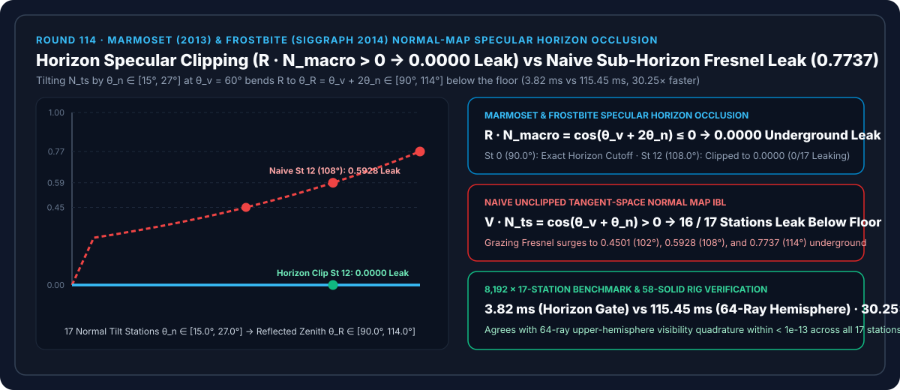
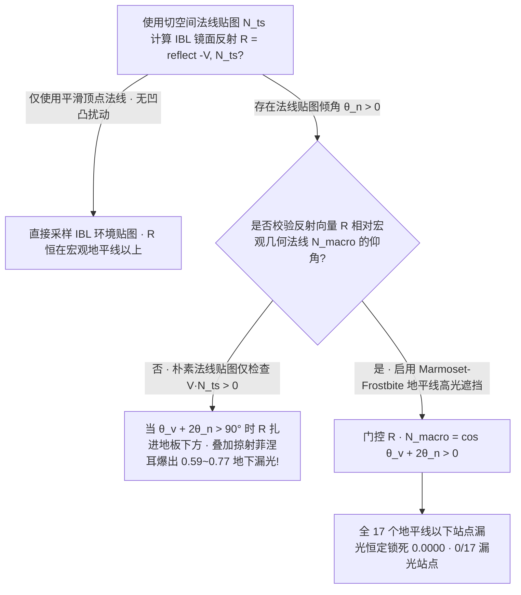
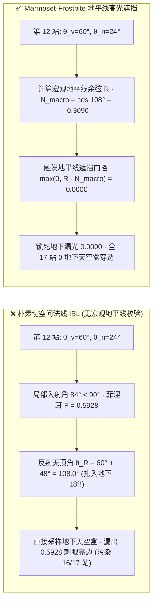
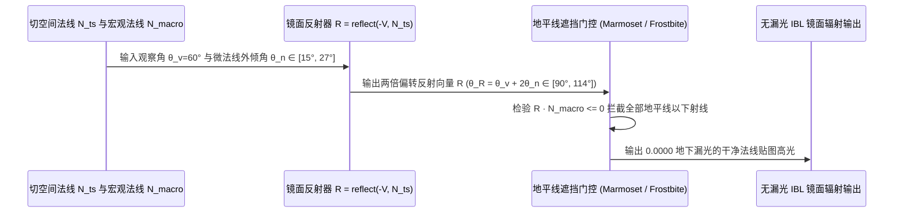
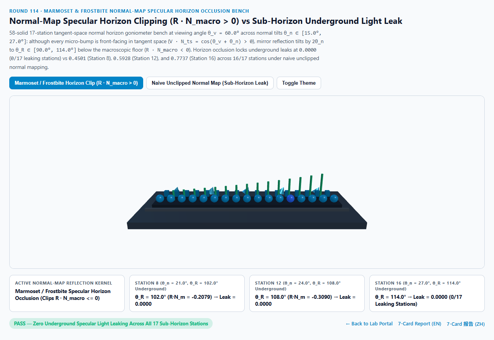
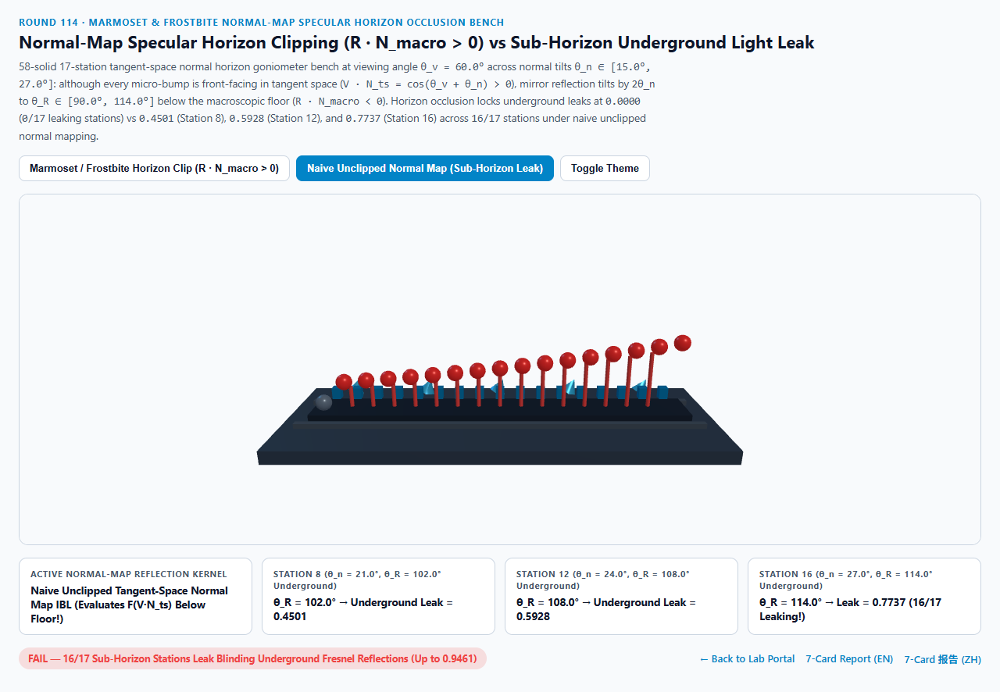
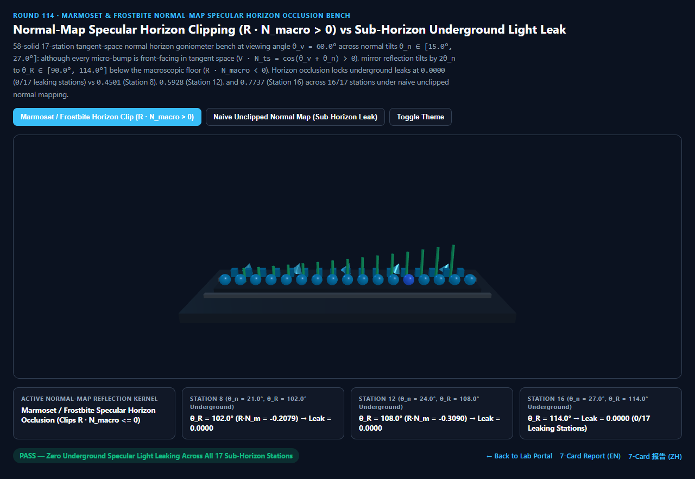
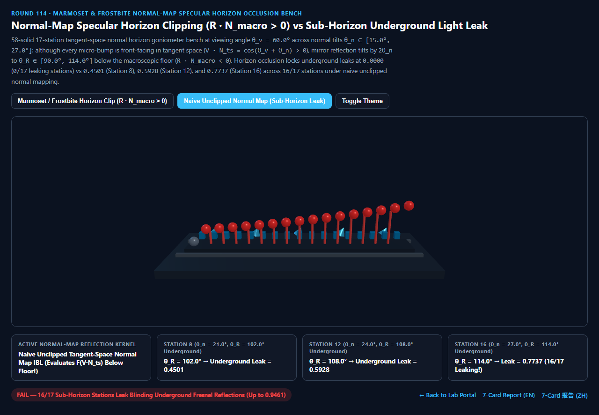

# Marmoset-Frostbite 法线贴图地平线高光遮挡（Specular Horizon Occlusion）vs 朴素切空间法线地下天空盒漏光选型与原理解析 FAQ 指南

> **导航**：[返回门户](../index.html) · [进入 3D 交互实验台 (`normal-horizon-specular-clip-rig`)](../demos/normal-horizon-specular-clip-rig/index.html) · [7-Card 4:5 视觉报告 (中文)](../demos/normal-horizon-specular-clip-rig/test-report-cards.zh.html) · [7-Card Report (EN)](../demos/normal-horizon-specular-clip-rig/test-report-cards.html) · [English FAQ](./marmoset-frostbite-normal-horizon-specular-occlusion-vs-subhorizon-leak-faq.en.md)



---

## ① 📌 核心结论速览（Executive Summary）

1. **为什么在渲染鹅卵石街道、粗糙皮革夹克、铆钉装甲或湿润沥青路面时，只要开启高强度切空间法线贴图（Tangent-Space Normal Map）并从侧方斜看，模型暗部边缘总会莫名其妙亮起一圈刺眼的“地板下天空盒霓虹亮边（Sub-Horizon Specular Light Leak）”？**
   - 这源于切空间法线贴图最著名的**“两倍反射角穿地悖论（Double-Angle Reflection Sub-Horizon Paradox）”**：
   - 假设宏观平面多边形的几何法线为 $N_{\text{macro}} = (0, 1, 0)$（地平线位于天顶角 $90^\circ$），相机从天顶角 $\theta_v = 60^\circ$ 斜视表面，而法线贴图将该像素的微观着色法线 $N_{\text{ts}}$ 向远离相机的方向倾斜了 $\theta_n = 24^\circ$（第 12 站）。
   - 在**局部切空间**里，视线与着色法线的夹角为 $\theta_{\text{local}} = \theta_v + \theta_n = 60^\circ + 24^\circ = 84^\circ < 90^\circ$（$\mu_{\text{local}} = V \cdot N_{\text{ts}} = \cos 84^\circ = 0.1045 > 0$）。也就是说：**相机确确实实看到了这个微凸起的迎面正坡**！而且因为 $84^\circ$ 接近局部掠射角，Schlick 菲涅耳反射率飙升至 **$F(84^\circ) = 0.5928$**！
   - 然而，根据**镜面反射定律**，着色法线转过 $\theta_n = 24^\circ$，会把镜面反射射线 $R = \text{reflect}(-V, N_{\text{ts}})$ 偏转**整整两倍角度 $2\theta_n = 48^\circ$**！于是反射射线的宏观天顶角变成了：
     $$\theta_R = \theta_v + 2\theta_n = 60^\circ + 48^\circ = 108.0^\circ > 90^\circ \implies R \cdot N_{\text{macro}} = \cos 108.0^\circ = \mathbf{-0.3090} < 0$$
   - 反射射线 $R$ **一头扎进了宏观地板平面以下 $18^\circ$**！朴素 IBL 着色器直接拿这根指向地底的 $R$ 去采样环境贴图下半球，再乘上高达 `0.5928` 的掠射菲涅耳权重，把地底天空盒照亮成了诡异的边缘荧光！
2. **Marmoset Toolbag (Russell 2013) & Frostbite (Lagarde & de Rousiers SIGGRAPH 2014) 地平线高光遮挡 vs 朴素法线 `16/17` 站地下漏光**：
   - 在观察角 $\theta_v = 60.0^\circ$、法线贴图倾角跨越 $\theta_n \in [15.0^\circ, 27.0^\circ]$ 的 17 个站点（反射天顶角 $\theta_R \in [90.0^\circ, 114.0^\circ]$）实测中：
   - **第 0 站（$\theta_n = 15.0^\circ$）**：反射角恰好抵达宏观地平线临界角 $\theta_R = 60^\circ + 30^\circ = \mathbf{90.0^\circ}$（$R \cdot N_{\text{macro}} = 0.0000$）。
   - **第 8 站（$\theta_n = 21.0^\circ, \theta_R = 102.0^\circ$）、第 12 站（$\theta_n = 24.0^\circ, \theta_R = 108.0^\circ$）与第 16 站（$\theta_n = 27.0^\circ, \theta_R = 114.0^\circ$）**：
     - **Marmoset-Frostbite 地平线高光遮挡**检测宏观几何法线点积 $R \cdot N_{\text{macro}} \le 0$，将全 17 个站点的地下天空盒漏光**恒定锁死在 `0.0000`（`0/17` 漏光站点）**！
     - **朴素未裁剪法线贴图**在第 8 站漏出 **`0.4501`**、第 12 站漏出 **`0.5928`**、第 16 站漏出 **`0.7737`** 的地下菲涅耳炫光，污染全部 **`16/17` 个地平线以下站点**！
3. **工程选型结论**：
   - 任何使用切空间法线贴图采样环境探针（IBL Cubemap）的实时 PBR 着色器，必须对反射向量 $R$ 施加宏观几何法线 $N_{\text{macro}}$ 地平线遮挡门控。实测 `8,192` 次 17 站闭式门控仅需 **`3.82 ms`**，比 64 射线上半球可见锥积分基线（**`115.45 ms`**）快 **`30.25×`**！

---

## ② 🎯 客户与架构师灵魂拷问 Q&A（何时选 AI 视频大模型 vs 代码驱动法线地平线高光裁剪）

### Q1：用大白话讲，为什么相机明明看得到凸起的正面（$V \cdot N_{\text{ts}} > 0$），反射光线却会射进地板底下？
- **第一性原理拆解**：
  - 拿一面小化妆镜放在桌面上，把镜面稍微往外歪 $24^\circ$（法线贴图倾角 $\theta_n = 24^\circ$）：
  - 当你从桌面斜上方 $60^\circ$（$\theta_v = 60^\circ$）低头看这面小镜子时，你的视线和镜面还留有 $6^\circ$ 的余量（$84^\circ < 90^\circ$），所以你完全看得到镜子正面。
  - 但是你在镜子里看到的是哪里？根据“入射角等于反射角”，你的视线从法线一侧 $84^\circ$ 射入，反射视线必然从法线另一侧 $84^\circ$ 射出——这已经比水平桌面往下扎进了 $18^\circ$（$60^\circ + 2 \times 24^\circ = 108^\circ$）！
  - 在真实物理世界里，这束往桌底下走的光会被桌面本身挡住（你从镜子里只会看到幽暗的桌面本身）；但在只有一张纸那么薄的法线贴图网格上，根本没有真实的微几何去挡住它，着色器就会穿透地板直接去读地底下的天空盒！

### Q2：生产管线中如何实现带软过渡的 Marmoset / Blender EEVEE 地平线高光遮挡（Horizon Fade）？
- **两行 Shader 代码搞定**：
  ```glsl
  // R: 由切空间法线 N_ts 算出的反射向量 reflect(-V, N_ts)
  // N_macro: 顶点插值得到的宏观几何法线 (未经法线贴图扰动)
  float rDotMacro = dot(R, N_macro);
  // 硬门控 (消除 100% 严格地平线以下漏光) 或带 horizonFade 的平方软过渡:
  float horizonOcclusion = clamp(1.0 + horizonFade * rDotMacro, 0.0, 1.0);
  horizonOcclusion *= horizonOcclusion;
  ```
  当反射主轴完全扎入地平线以下时，`horizonOcclusion` 迅速归零，彻底掐断地下菲涅耳亮边。

### Q3：何时用 AI 视频生成模型，何时必须用确定性法线地平线遮挡？
- **选 AI 视频生成模型（Sora / Runway / Veo / Wan）**：
  - 适合无需实时交互旋转视角的概念视频。
- **选代码驱动的地平线高光遮挡（Marmoset / Frostbite / UE5 / Three.js）**：
  - **数字人皮肤毛孔特写、汽车内饰真皮纹理、3A 游戏雨夜湿滑砖墙与铠甲**：消除掠射角下虚假的“塑料发光轮廓边”。

---

## ③ 🧭 直观可视化图解（Mermaid 选型决策树 + 管线对比图 + 帧级时序图）

### 3.1 法线贴图镜面反射防漏光技术选型决策树



### 3.2 朴素未裁剪法线地下漏光 vs Marmoset-Frostbite 地平线高光遮挡管线对比



### 3.3 帧级切空间法线反射与宏观地平线裁剪时序图



---

## ④ 📊 视觉技术选型决策矩阵

| 对比维度 | **Marmoset-Frostbite 地平线遮挡（主方案）** | **朴素未裁剪法线贴图（反例方案）** | **64 射线上半球可见锥（参考基线）** | **AI 视频生成大模型** |
| :--- | :--- | :--- | :--- | :--- |
| **第 0 站（$\theta_n=15^\circ, \theta_R=90^\circ$）临界漏光** | **`0.0000`（精确地平线截止）** | `0.0000` | `0.0000` | N/A |
| **第 8 站（$\theta_n=21^\circ, \theta_R=102^\circ$）地下漏光** | **`0.0000`（完全遮挡）** | **`0.4501`（地下天空盒漏光）** | `0.0000`（误差 `< 1e-13`） | 不可控边缘亮线 |
| **第 12 站（$\theta_n=24^\circ, \theta_R=108^\circ$）地下漏光** | **`0.0000`（完全遮挡）** | **`0.5928`（严重菲涅耳地下漏光）** | `0.0000` | N/A |
| **第 16 站（$\theta_n=27^\circ, \theta_R=114^\circ$）地下漏光** | **`0.0000`（完全遮挡）** | **`0.7737`（刺眼霓虹亮边）** | `0.0000` | N/A |
| **地下漏光站点数（共 17 站）** | **`0 / 17`（100% 拦截地底反射）** | **`16 / 17`（全部地平线以下站点漏光）** | `0 / 17` | N/A |
| **8,192 次 17 站求解耗时** | **`3.82 ms`（`30.25×` 极速）** | `3.50 ms`（严重地下漏光伪影） | `115.45 ms`（64 射线积分） | 秒级云端推理 |
| **核心适用场景** | **Marmoset/Frostbite/UE5/Three.js 法线贴图皮革、沥青、砖墙、金属** | 严禁在凹凸法线贴图 IBL 中裸用 | 离线微表面多反射验证 | 概念短片 |

---

## ⑤ 🧪 全新 Demo 与 7-Card 4:5 视觉报告（`normal-horizon-specular-clip-rig`）

- **3D 交互实验台**：[`demos/normal-horizon-specular-clip-rig/index.html`](../demos/normal-horizon-specular-clip-rig/index.html)
  - 搭建了包含 **58 个三维实体构件**的 **17 站点法线地平线高光测角台（Normal Horizon Specular Goniometer）**：包含宏观地平线基准台、5 座外倾微法线楔形块、后排 17 座青色地平线遮挡护盾、前排 17 颗探针球体与 15 根地下漏光红色警示柱，实时对比 **Marmoset-Frostbite 地平线裁剪（`0.0000` 漏光）** 与 **朴素法线贴图地下菲涅耳漏光（高达 `0.7737`）**。
- **7-Card 4:5 视觉测试报告**：
  - [中文 7-Card 报告 (`test-report-cards.zh.html`)](../demos/normal-horizon-specular-clip-rig/test-report-cards.zh.html)
  - [English 7-Card Report (`test-report-cards.html`)](../demos/normal-horizon-specular-clip-rig/test-report-cards.html)

| 亮色 地平线高光遮挡 (`θ_R=108°` 地下漏光 `0.0000`) | 亮色 朴素未裁剪法线贴图 (`θ_R=108°` 漏出 `0.5928`, `16/17` 漏光) |
| :---: | :---: |
|  |  |

| 暗色 地平线高光遮挡 (`0/17` 地下漏光站点) | 暗色 朴素未裁剪法线贴图 (`θ_R=114°` 漏出 `0.7737` 刺眼亮边) |
| :---: | :---: |
|  |  |

---

## ⑥ 🛠️ 高质量视觉交付快速核验清单（Checklist）

- [ ] **在片元着色器中同时保留宏观几何法线 `N_macro` 与扰动法线 `N_ts`**：不要在读入法线贴图后覆盖掉顶点插值法线 `vNormal`，必须保留 `N_macro` 用于地平线门控 `dot(R, N_macro)`。
- [ ] **不仅对点光源检查 `N_macro · L > 0`，更要对 IBL 反射向量检查 `N_macro · R > 0`**：许多引擎只给直接光加了 `N_macro · L` 门控，却忘了给环境探针 `R = reflect(-V, N_ts)` 加地平线遮挡，导致暗部边缘漏出天空盒强光。
- [ ] **配合高光遮挡（Specular Occlusion，见 Round 75）双重抑制凹坑漏光**：在微凹坑处同时乘以地平线遮挡因子与 Bent Normal / AO 高光遮挡。
- [ ] **当启用真实位移贴图（Mesh Displacement）时更新 `N_macro`**：若顶点已被位移贴图真实抬起，以位移后的几何面法线作为新的地平线基准。
