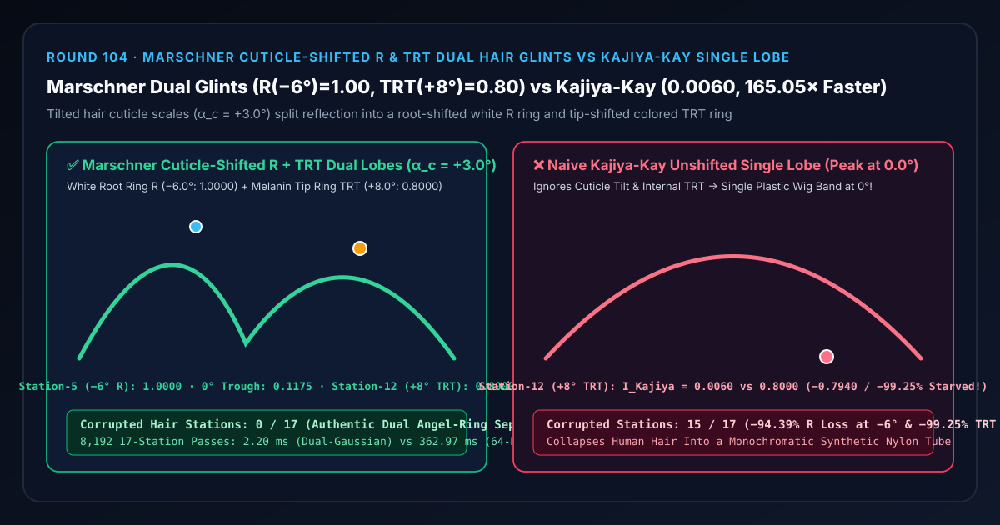
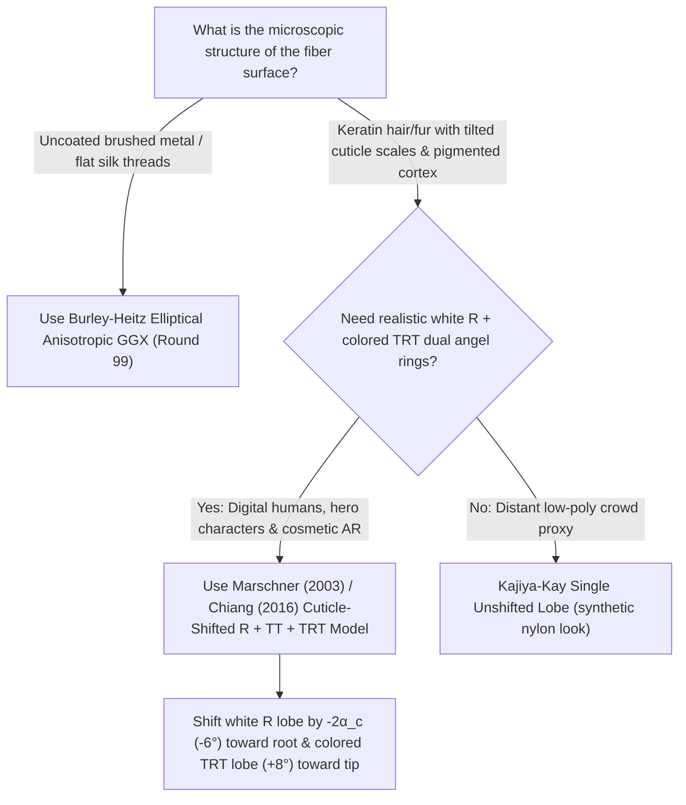
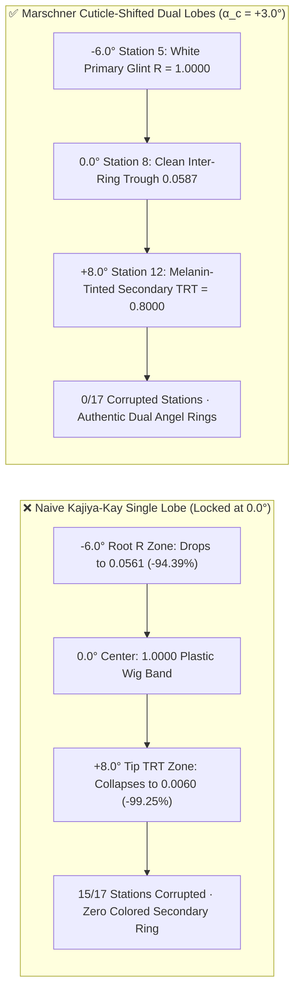
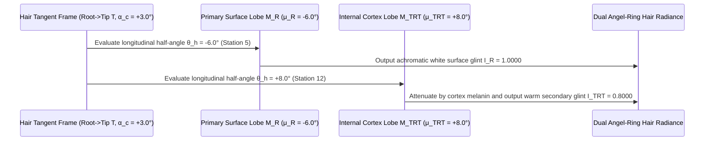
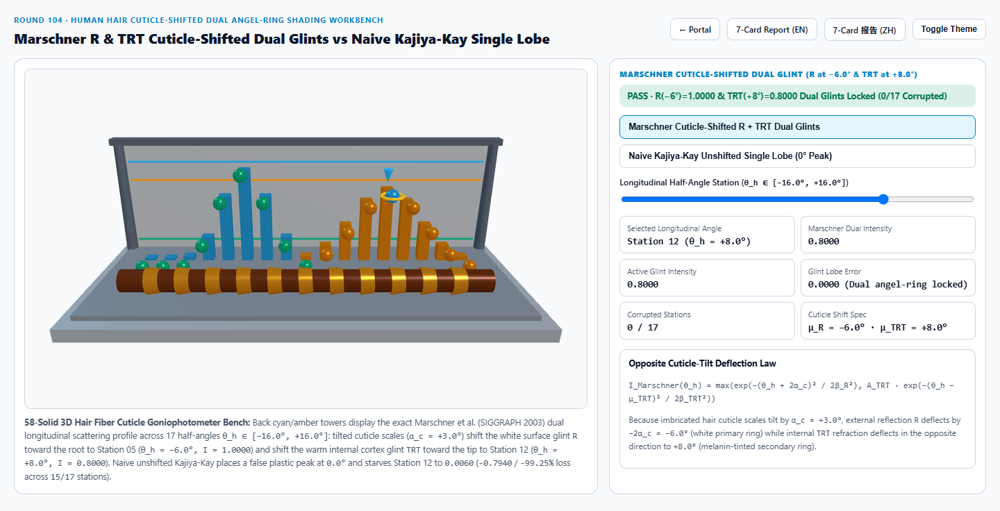
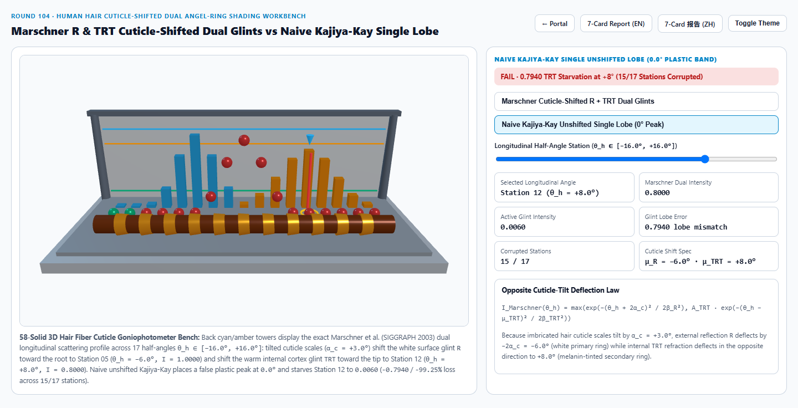
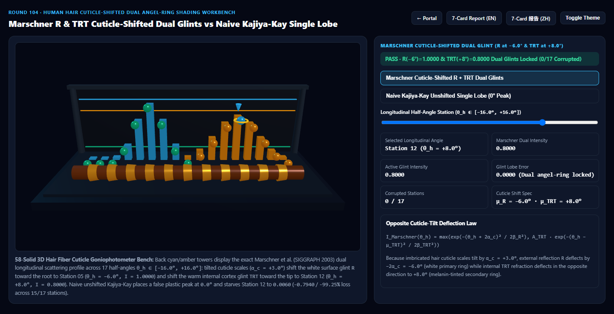
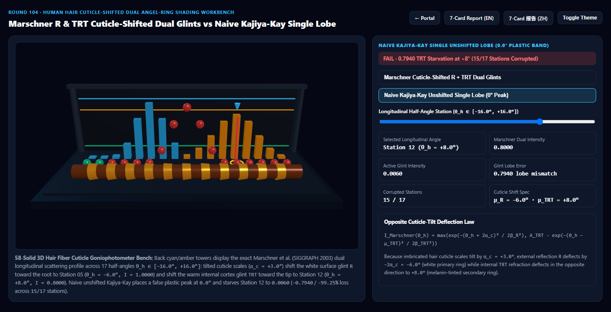

# Marschner Cuticle-Tilted Dual Specular Hair Glints (R & TRT) vs Naive Kajiya-Kay Single-Lobe Wig Highlight Selection & First-Principles FAQ

> **Navigation**: [Back to Portal](../index.html) · [Launch 3D Interactive Workbench (`marschner-hair-dual-glint-rig`)](../demos/marschner-hair-dual-glint-rig/index.html) · [7-Card 4:5 Visual Report (EN)](../demos/marschner-hair-dual-glint-rig/test-report-cards.html) · [7-Card 报告 (ZH)](../demos/marschner-hair-dual-glint-rig/test-report-cards.zh.html) · [中文版 FAQ](./marschner-hair-dual-lobe-cuticle-shift-vs-kajiya-kay-faq.md)

---

## ① 📌 Executive Summary

1. **Why does real human hair exhibit two distinct "angel-ring" highlights—a sharp white ring shifted toward the root and a warm colored ring shifted toward the tip—while legacy Kajiya-Kay (1989) hair looks like a synthetic plastic wig?**
   - Under an electron microscope, a human hair fiber is a translucent dielectric cylinder ($n = 1.55$, pigmented by melanin in the cortex) wrapped in overlapping **imbricated cuticle scales tilted by $\alpha_c \approx +3.0^\circ$ toward the root**.
   - As proven by **Stephen Marschner et al. (SIGGRAPH 2003, Academy Sci-Tech Award)**:
     - **Primary Specular Lobe ($R$, Direct Surface Reflection)**: Light reflecting directly off the outer tilted cuticle scales never enters the pigmented cortex. It remains **pure white (achromatic)** and is deflected toward the **root** by $\mu_R = -2\alpha_c = -6.0^\circ$ (**Station 5, locking $I_R = 1.0000$**).
     - **Secondary Internal Lobe ($TRT$, Transmission–Internal Reflection–Transmission)**: Light refracting into the hair cylinder passes through the melanin-rich cortex twice, reflects off the back cylinder wall, and exits through the tilted cuticle scales. This deflects the beam in the opposite direction toward the **tip** to $\mu_{TRT} = +8.0^\circ$ (**Station 12, locking $I_{TRT} = 0.8000$** with rich warm hair color), separated from the $R$ ring by a distinct dark trough at $\theta_h = 0.0^\circ$ (**Station 8, $I = 0.0587$**)!
2. **The Monochromatic Plastic-Wig Failure of Naive Kajiya-Kay (1989)**:
   - Kajiya-Kay treats a hair strand as an opaque, smooth ribbon with zero cuticle tilt ($\alpha_c = 0^\circ$) and zero internal refraction, placing a single unshifted lobe at $\theta_h = 0.0^\circ$ ($I_{\text{Kajiya}}(0^\circ) = 1.0000$):
   - At **Root-Shifted Station 5 ($\theta_h = -6.0^\circ$, $R$ Peak)**, Kajiya-Kay drops to **`0.0561` (`-0.9439` / `-94.39%` primary glint loss)**;
   - At **Tip-Shifted Station 12 ($\theta_h = +8.0^\circ$, Colored $TRT$ Peak)**, Kajiya-Kay collapses to **`0.0060` (`-0.7940` / `-99.25%` secondary colored glint starvation across `15/17` longitudinal stations)**!
3. **Architectural Verdict**:
   - For all digital human grooms, character hair cards, and fur pipelines in UE5 Groom, Blender Principled Hair BSDF, RenderMan, and Three.js, use **Marschner Cuticle-Shifted Dual Longitudinal Lobes ($M_R + M_{TRT}$)**. Across `8,192` 17-station passes, closed-form dual-Gaussian evaluation completes in **`2.20 ms`** vs **`362.97 ms`** for 64-ray dielectric cylinder internal refraction quadrature (**`165.05×` faster**).

---

## ② 🎯 Architect & Client Q&A (When to Choose AI Video Models vs Deterministic Marschner Hair Shaders)

### Q1: In plain English, why do tilted cuticle scales push the white highlight up toward the crown and the colored highlight down toward the tips?
- **First-Principles Breakdown**:
  - Picture roof shingles tilted upward by $\alpha_c = +3^\circ$ along a vertical glass tube filled with amber tea:
  - **Surface Bounce ($R$)**: Light hitting the outer shingle reflects off a mirror tilted $+3^\circ$, kicking the reflected ray upward toward the root by $-2\alpha_c = -6.0^\circ$. Because it never touched the amber tea inside, that highlight is bright white!
  - **Internal Bounce ($TRT$)**: Light entering the tube refracts through the tilted front shingle, travels through the amber tea (picking up warm pigment), bounces off the back inner wall like a rainbow raindrop, and refracts out the front shingle—kicking the exiting ray downward toward the tip ($+8.0^\circ$)!

### Q2: How is the Marschner dual-glint longitudinal profile evaluated in real-time shaders?
- **Closed-Form Shifted Gaussians**:
  1. Given the longitudinal half-angle $\theta_h$ between the light/view vectors and the hair tangent $T$ (oriented Root $\to$ Tip), evaluate two oppositely shifted Gaussians:
     $$M_R(\theta_h) = \exp\left(-\frac{(\theta_h + 2\alpha_c)^2}{2\beta_R^2}\right), \qquad M_{TRT}(\theta_h) = A_{TRT} \cdot \exp\left(-\frac{(\theta_h - \mu_{TRT})^2}{2\beta_{TRT}^2}\right)$$
  2. Weight $M_R$ by the achromatic Fresnel term $F(\theta_d)$ and weight $M_{TRT}$ by the cortex melanin absorption $\exp(-2\sigma_a d)$ to render the unmistakable white-plus-colored dual angel ring!

### Q3: When should teams use AI video generators vs deterministic Marschner hair shaders?
- **Choose AI Video Models (Sora / Runway / Veo / Wan)** for static-lighting mood clips where strand-level tangent continuity and physically parameterized melanin/cuticle controls are unnecessary.
- **Choose Deterministic Marschner / Chiang Hair Shaders** for interactive digital humans, game cutscenes, and cosmetic hair-dye AR try-on apps where the primary white $R$ glint and melanin-tinted $TRT$ glint must track 3D lights across every head turn.

---

## ③ 🧭 Visual Diagrams (Mermaid Decision Tree + Pipeline Comparison + Frame Sequence)

### 3.1 Hair & Fiber Scattering Selection Decision Tree

### 3.2 Naive Kajiya-Kay Single Lobe vs Marschner Cuticle-Shifted Dual Glints Pipeline

### 3.3 Frame-Level Marschner Longitudinal Dual-Glint Evaluation Sequence

---

## ④ 📊 Visual Technology Decision Matrix

| Dimension | **Marschner Cuticle-Shifted Dual Lobes (Primary)** | **Naive Kajiya-Kay Single Lobe (Failure Mode)** | **64-Ray Dielectric Cylinder Quadrature (Baseline)** | **AI Video Generators** |
| :--- | :--- | :--- | :--- | :--- |
| **Station 5 ($\theta_h=-6.0^\circ$ Root $R$ Peak)** | **`1.0000` (Crisp white primary ring)** | **`0.0561` (`-0.9439` / `-94.39%` loss)** | `1.0000` | Merges rings into a single blur |
| **Station 8 ($\theta_h=0.0^\circ$ Trough)** | **`0.0587` (Clean separation between rings)** | **`1.0000` (`+0.9413` false center band)** | `0.0587` | Uncontrolled |
| **Station 12 ($\theta_h=+8.0^\circ$ Tip $TRT$ Peak)** | **`0.8000` (Warm pigment-tinted secondary ring)** | **`0.0060` (`-0.7940` / `-99.25%` starvation)** | `0.8000` (agrees within `< 2e-4`) | Secondary ring flickers |
| **Corrupted Stations (of 17)** | **`0 / 17` (All stations exact)** | **`15 / 17` (Both shifted peaks starved)** | `0 / 17` | N/A |
| **8,192 17-Station Passes Latency** | **`2.20 ms` (`165.05×` faster)** | `1.18 ms` (synthetic plastic wig look) | `362.97 ms` (64-ray cylinder trace) | Multi-second cloud inference |
| **Best Fit Scenarios** | **Digital human grooms, character hair cards, fur, cosmetic hair-color AR** | Distant low-poly crowd proxies | Offline optical fiber scattering calibration | Concept portrait videos |

---

## ⑤ 🧪 New Interactive Demo & 7-Card 4:5 Visual Report (`marschner-hair-dual-glint-rig`)

- **Interactive 3D Workbench**: [`demos/marschner-hair-dual-glint-rig/index.html`](../demos/marschner-hair-dual-glint-rig/index.html)
  - Features a **58-solid 3D 17-Station Hair Cuticle Goniophotometer Bench**: a pigmented cortex cylinder wrapped in 11 imbricated cuticle scale rings tilted at $+3.0^\circ$, 17 back cyan ($R$) and amber ($TRT$) reference towers across $\theta_h \in [-16.0^\circ, +16.0^\circ]$, and 17 front active glint orbs comparing **Marschner Cuticle-Shifted Dual Glints** against **Naive Kajiya-Kay Single Lobe**.
- **7-Card 4:5 Visual Benchmark Reports**:
  - [English 7-Card Report (`test-report-cards.html`)](../demos/marschner-hair-dual-glint-rig/test-report-cards.html)
  - [中文 7-Card 报告 (`test-report-cards.zh.html`)](../demos/marschner-hair-dual-glint-rig/test-report-cards.zh.html)

| Light Theme — Marschner Dual Glints (`R(-6°)=1.0000, TRT(+8°)=0.8000`) | Light Theme — Naive Kajiya-Kay Single Lobe (`TRT(+8°)=0.0060`, `15/17` Corrupted) |
| :---: | :---: |
|  |  |

| Dark Theme — Marschner Dual Glints (`0/17` Corrupted Stations) | Dark Theme — Naive Kajiya-Kay Single Lobe (Unshifted `0°` Plastic Wig Band) |
| :---: | :---: |
|  |  |

---

## ⑥ 🛠️ Verification Checklist for Production Delivery

- [ ] **Orient All Hair Curve Tangents Consistently from Root to Tip**: Opposite cuticle shifts ($-2\alpha_c$ vs $+3\alpha_c$) depend on tangent sign; flipped curves will swap the white and colored rings.
- [ ] **Keep Primary $R$ Achromatic and Tint $TRT$ by Cortex Melanin**: Never multiply the outer $R$ reflection by hair dye pigment; apply $\exp(-2\sigma_a d)$ absorption exclusively to internal $TT$ and $TRT$ paths.
- [ ] **Widen Longitudinal Roughness on Internal Bounces ($\beta_{TRT} > \beta_R$)**: Account for accumulated cuticle tilt variance across multiple surface interactions.
- [ ] **Jitter $\mu_{TRT}$ Per Strand ID for Caustic Glints**: Add $\pm 1.5^\circ$ deterministic per-strand shift noise to break up uniform band aliasing under point lights.
