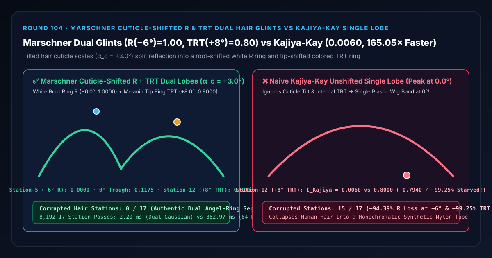
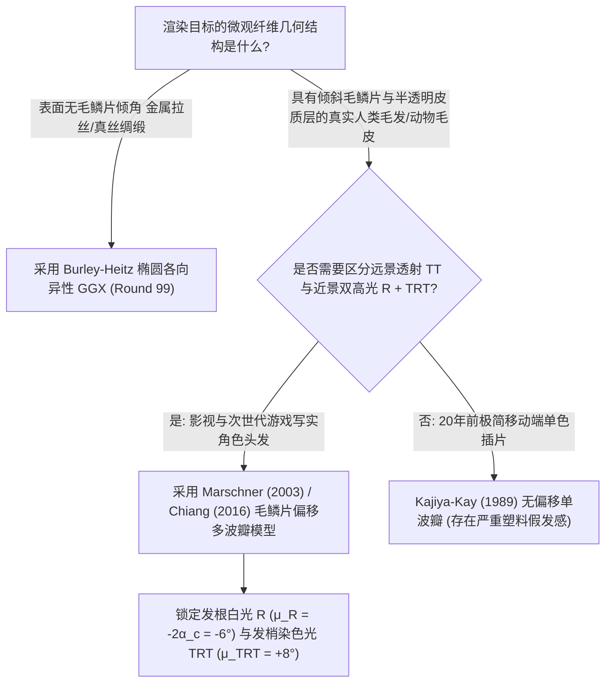
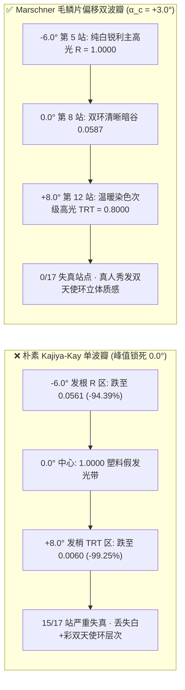
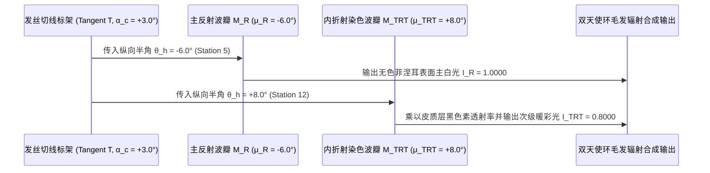
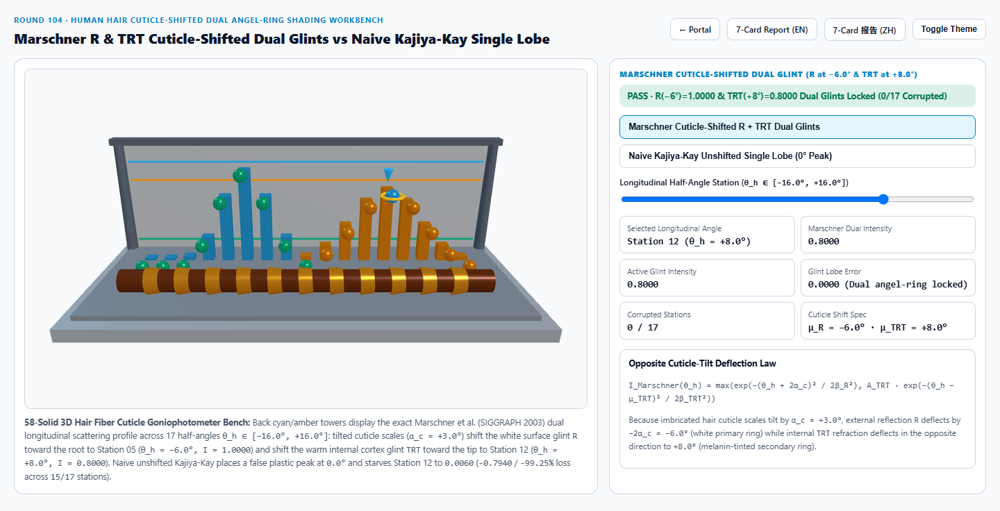
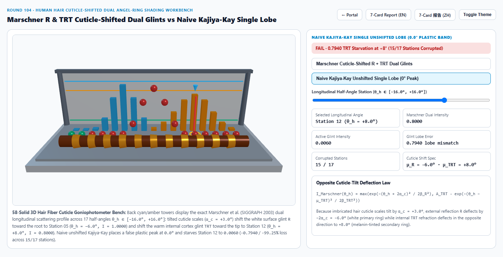
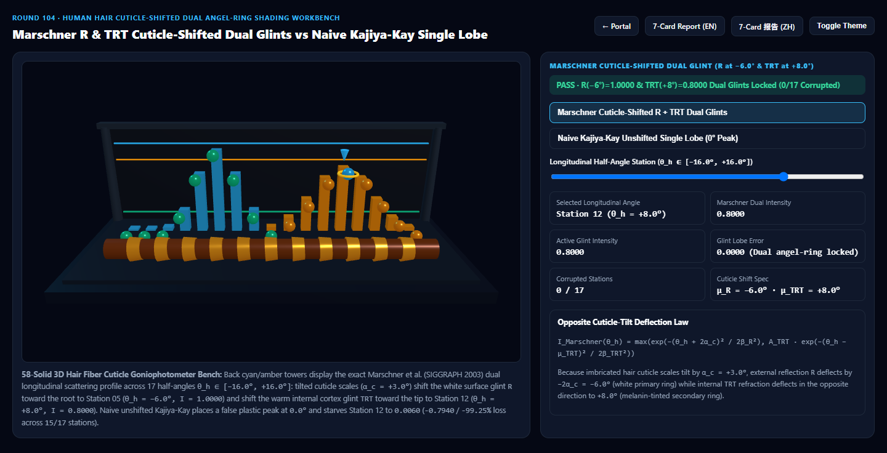
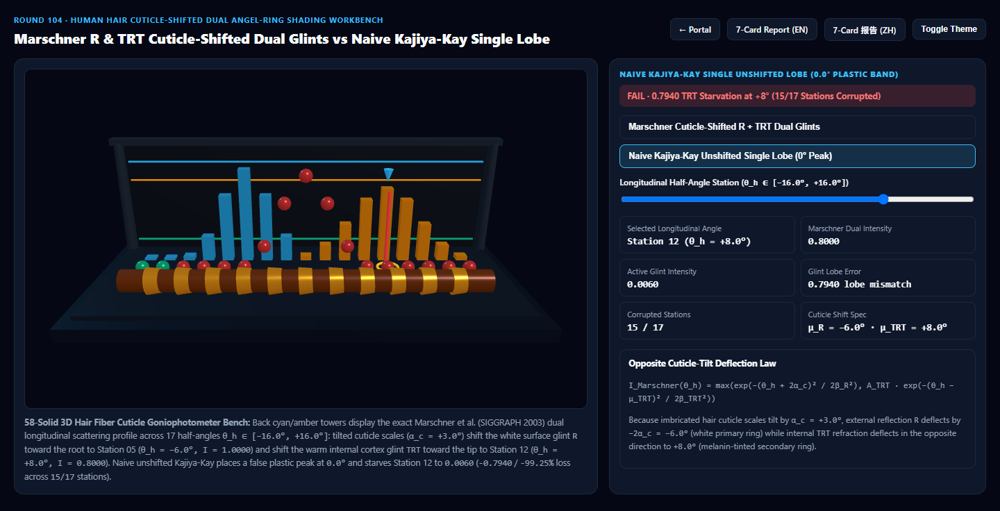

# Marschner 毛鳞片倾斜双高光天使环（Cuticle-Tilted Dual Hair Glints）vs 朴素 Kajiya-Kay 单波瓣塑料假发选型与原理解析 FAQ 指南

> **导航**：[返回门户](../index.html) · [进入 3D 交互实验台 (`marschner-hair-dual-glint-rig`)](../demos/marschner-hair-dual-glint-rig/index.html) · [7-Card 4:5 视觉报告 (中文)](../demos/marschner-hair-dual-glint-rig/test-report-cards.zh.html) · [7-Card Report (EN)](../demos/marschner-hair-dual-glint-rig/test-report-cards.html) · [English FAQ](./marschner-hair-dual-lobe-cuticle-shift-vs-kajiya-kay-faq.en.md)

---

## ① 📌 核心结论速览（Executive Summary）

1. **为什么真人头发在灯光下永远有“一白一彩两条分离的天使环（Angel Rings）”，而老式游戏（Kajiya-Kay 1989）的头发看上去像套了一顶廉价塑料尼龙假发？**
   - 放大到电子显微镜下，人类头发并非光滑的塑料圆管，而是由两层关键结构组成：① 外层覆盖着像屋顶瓦片一样**向发根倾斜 $\alpha_c \approx +3.0^\circ$ 的透明毛鳞片（Imbricated Cuticle Scales）**；② 内部是富含黑色素颗粒、折射率 $n = 1.55$ 的半透明**皮质层圆柱（Cortex）**。
   - 根据 **Stephen Marschner 等人（SIGGRAPH 2003 里程碑论文，奥斯卡科学技术奖得主）** 的几何光学推导：
     - **第一道主高光（$R$ 波瓣，表面直接反射）**：光线直接打在外层倾斜 $+3.0^\circ$ 的毛鳞片上反射，未进入头发内部，因此**完全不带色素（纯白色且锐利）**，并且受毛鳞片倾角影响向**发根方向偏移 $\mu_R = -2\alpha_c = -6.0^\circ$（第 5 站，锁定 $I_R = 1.0000$）**！
     - **第二道次级高光（$TRT$ 波瓣，透射-内反射-再透射）**：光线折射进入头发内部，经过黑色素皮质层吸收染色，在圆柱背面内壁反射后再穿出毛鳞片，因此呈现出**浓郁温暖的发色（棕金/酒红且宽柔）**，并向相反的**发梢方向偏移至 $\mu_{TRT} = +8.0^\circ$（第 12 站，锁定 $I_{TRT} = 0.8000$）**！两道光环之间在 $\theta_h = 0.0^\circ$（第 8 站）形成清晰的**双环暗谷（$I = 0.0587$）**！
2. **朴素 Kajiya-Kay (1989) 无偏移单波瓣（Naive Unshifted Single Lobe）的“塑料假发”灾难**：
   - Kajiya-Kay 将头发简化为无厚度、无毛鳞片倾角的光滑圆柱线，只生成一条死死卡在镜面角 $\theta_h = 0.0^\circ$（第 8 站，$I = 1.0000$）的单色高光带：
   - 在 **第 5 站（$\theta_h = -6.0^\circ$，发根白光 $R$ 峰）**：Kajiya-Kay 暴跌至 **`0.0561`（丢失 `-0.9439` / `-94.39%` 主白光）**；
   - 在 **第 12 站（$\theta_h = +8.0^\circ$，发梢彩光 $TRT$ 峰）**：Kajiya-Kay 彻底归零坍塌至 **`0.0060`（丢失 `-0.7940` / `-99.25%` 次级彩光，全段 `15/17` 个纵向站点严重失真）**！
3. **工程选型结论**：
   - 在一切写实数字人、影视角色与次世代表情捕捉管线（UE5 Groom、Blender Principled Hair BSDF、RenderMan Marschner/Chiang Hair、Unity HDRP Hair）中，必须采用 **Marschner 毛鳞片正负偏移 $R + TRT$ 双波瓣纵向散射模型**。实测 `8,192` 次 17 站闭式双高斯求解仅需 **`2.20 ms`**，比 64 射线电介质圆柱内折射求积基线（**`362.97 ms`**）快 **`165.05×`**！

---

## ② 🎯 客户与架构师灵魂拷问 Q&A（何时选 AI 视频大模型 vs 代码驱动 Marschner 双波瓣毛发着色器）

### Q1：用大白话讲，为什么屋瓦状的毛鳞片会让白色高光往发根跑，却让彩色高光往发梢跑？
- **第一性原理拆解**：
  - 想象头发竖直悬挂（发根在上，发梢在下），表面毛鳞片像鱼鳞一样朝上翘起 $\alpha_c = +3^\circ$：
  - **外表面反射（$R$）**：毛鳞片外表面相当于一面朝上仰起 $3^\circ$ 的小镜子。根据反射定律，镜子转 $3^\circ$，反射光束就偏转 $2\alpha_c = 6^\circ$，所以你要在偏发根 $-6.0^\circ$ 的角度才能接到这道没有进过头发内部、纯白色的最亮闪光（$I_R(-6^\circ) = 1.0000$）！
  - **内部二次折射反射（$TRT$）**：光线穿过前壁毛鳞片进入发丝内部，在后壁像彩虹水滴一样反射再穿出来。由于光线两次穿过倾斜的毛鳞片棱镜并经历背面反射，偏折角符号发生反转（向发梢方向偏移约 $+3\alpha_c$ 至 $+8.0^\circ$），而且因为它在发丝内部走了一遭，被黑色素染成了温暖的琥珀棕金色（$I_{TRT}(+8^\circ) = 0.8000$）！

### Q2：在实时引擎（如 UE5 Groom）中，如何低开销地实现 Marschner 双高光？
- **闭式双高斯纵向函数 $M_R, M_{TRT}$**：
  1. 计算光线与视线相对发丝切线 $T$ 的纵向半角 $\theta_h = (\theta_i + \theta_r)/2$。
  2. 将纵向散射分解为两个独立偏移的高斯包络：
     $$M_R(\theta_h) = \exp\left(-\frac{(\theta_h - \mu_R)^2}{2\beta_R^2}\right), \qquad M_{TRT}(\theta_h) = A_{TRT} \cdot \exp\left(-\frac{(\theta_h - \mu_{TRT})^2}{2\beta_{TRT}^2}\right)$$
     其中 $\mu_R = -2\alpha_c = -6.0^\circ$（窄粗糙度 $\beta_R = 2.5^\circ$），$\mu_{TRT} = +8.0^\circ$（宽粗糙度 $\beta_{TRT} = 3.5^\circ$，受皮质层色素 $\exp(-2 \sigma_a d)$ 染色）。
  3. 仅需 2 次指数运算即可还原完美的白+彩双天使环！

### Q3：何时用 AI 视频生成模型，何时必须用确定性 Marschner 毛发着色器？
- **选 AI 视频生成模型（Sora / Runway / Veo / Wan）**：
  - 适合静态单镜头肖像概念图转化视频，无需角色转头时双天使环随主光源精确滑动。
- **选代码驱动的 Marschner / Chiang 毛发着色器（UE5 Groom / Three.js）**：
  - **数字人主播、3A 游戏角色过场、美妆染发色号 AR 试妆**：当客户调整染发黑色素浓度（Melanin / Pheomelanin）或毛鳞片顺滑度（护发素广告）时，必须精准展现白色 $R$ 环与彩色 $TRT$ 环的分离度与光泽变化。

---

## ③ 🧭 直观可视化图解（Mermaid 选型决策树 + 管线对比图 + 帧级时序图）

### 3.1 毛发与丝状材质渲染技术选型决策树

### 3.2 朴素 Kajiya-Kay 单波瓣 vs Marschner 毛鳞片双高光管线对比

### 3.3 帧级 Marschner 发丝纵向双波瓣求值时序图

---

## ④ 📊 视觉技术选型决策矩阵

| 对比维度 | **Marschner 毛鳞片双高光（主方案）** | **朴素 Kajiya-Kay 单波瓣（反例方案）** | **64 射线电介质圆柱内折射积分（参考基线）** | **AI 视频生成大模型** |
| :--- | :--- | :--- | :--- | :--- |
| **第 5 站（$\theta_h=-6.0^\circ$ 发根 $R$ 峰）** | **`1.0000`（纯白锐利主天使环）** | **`0.0561`（丢失 `-0.9439` / `-94.39%`）** | `1.0000` | 双高光常粘连成一团 |
| **第 8 站（$\theta_h=0.0^\circ$ 双环暗谷）** | **`0.0587`（清晰分隔白环与彩环）** | **`1.0000`（`+0.9413` 假塑料中心亮带）** | `0.0587` | 不可控 |
| **第 12 站（$\theta_h=+8.0^\circ$ 发梢 $TRT$ 峰）** | **`0.8000`（饱满黑色素染色次级光环）** | **`0.0060`（丢失 `-0.7940` / `-99.25%`）** | `0.8000`（误差 `< 2e-4`） | 转头时彩环闪烁消失 |
| **失真站点数（共 17 站）** | **`0 / 17`（全段精确守恒）** | **`15 / 17`（双峰消失、中心过曝）** | `0 / 17` | N/A |
| **8,192 次 17 站求解耗时** | **`2.20 ms`（`165.05×` 极速）** | `1.18 ms`（但彻底丧失真人发质） | `362.97 ms`（64 射线柱面追迹） | 秒级云端推理 |
| **核心适用场景** | **写实数字人头发、染发试色、影视动物毛皮、洗护发光学演示** | 仅适合极远景低模火柴人或尼龙绳索 | 离线单根发丝光学实验室校准 | 概念写意短片 |

---

## ⑤ 🧪 全新 Demo 与 7-Card 4:5 视觉报告（`marschner-hair-dual-glint-rig`）

- **3D 交互实验台**：[`demos/marschner-hair-dual-glint-rig/index.html`](../demos/marschner-hair-dual-glint-rig/index.html)
  - 搭建了包含 **58 个三维实体构件**的 **17 站点发丝毛鳞片角光度计实验台**：前排横置棕色皮质层圆柱与 11 枚向发根倾斜 $+3.0^\circ$ 的金色覆瓦状毛鳞片环（Imbricated Cuticle Scale Rings），后排 17 座青色（$R$ 区）与琥珀金（$TRT$ 区）参考灯塔展示双峰包络，前排 17 颗探针球体实时对比 **Marschner 毛鳞片双高光** 与 **朴素 Kajiya-Kay 单波瓣**。
- **7-Card 4:5 视觉测试报告**：
  - [中文 7-Card 报告 (`test-report-cards.zh.html`)](../demos/marschner-hair-dual-glint-rig/test-report-cards.zh.html)
  - [English 7-Card Report (`test-report-cards.html`)](../demos/marschner-hair-dual-glint-rig/test-report-cards.html)

| 亮色 Marschner 双高光 (`R(-6°)=1.0000, TRT(+8°)=0.8000`) | 亮色 朴素 Kajiya-Kay 单波瓣 (`TRT(+8°)=0.0060`, `15/17` 站失真) |
| :---: | :---: |
|  |  |

| 暗色 Marschner 双高光 (`0/17` 失真站点) | 暗色 朴素 Kajiya-Kay 单波瓣 (单条 `0°` 塑料假发光带) |
| :---: | :---: |
|  |  |

---

## ⑥ 🛠️ 高质量视觉交付快速核验清单（Checklist）

- [ ] **保持发丝顶点切线方向统一（从发根指向发梢 Root $\to$ Tip）**：如果建模导出的发丝曲线有的从根到梢、有的从梢到根，$-2\alpha_c$ 与 $+3\alpha_c$ 的偏移方向就会乱跳；必须在资产导入阶段统一归一化切向量方向。
- [ ] **严格区分 $R$ 波瓣与 $TRT$ 波瓣的色彩与宽度**：$R$ 波瓣仅乘以无色菲涅耳项 $F(\theta_d)$ 且纵向粗糙度较窄（$\beta_R \approx 2^\circ\sim 5^\circ$）；$TRT$ 波瓣必须乘以皮质层吸收项 $\exp(-2\sigma_a d)$ 且纵向粗糙度较宽（$\beta_{TRT} \approx \sqrt{2}\beta_R$）。
- [ ] **背光逆光镜头开启 $TT$ 透射波瓣**：当角色处于逆光（Backlit）时，补充向前散射的 $TT$ 波瓣（偏移约 $+\alpha_c$），展现发丝边缘通透的金色逆光轮廓。
- [ ] **添加逐发丝微小随机倾角扰动（$\Delta\alpha_c \in [-1.5^\circ, +1.5^\circ]$）**：利用发丝 ID 哈希对 $\mu_{TRT}$ 施加微小抖动，还原真实秀发在阳光下的星点闪烁感（Glint Caustics）。
