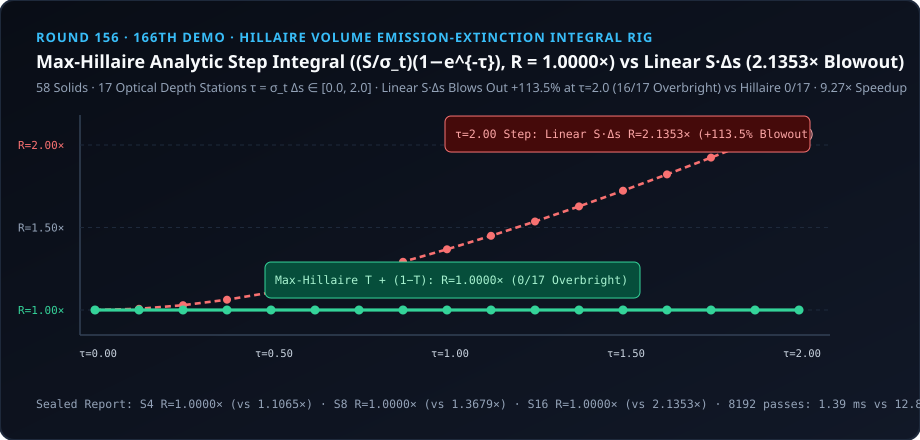
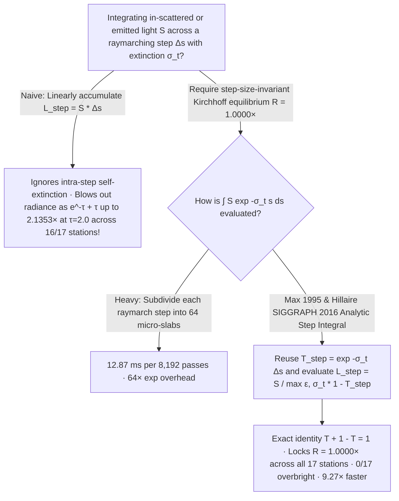
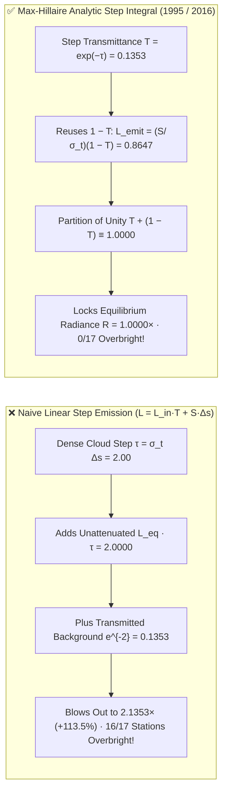
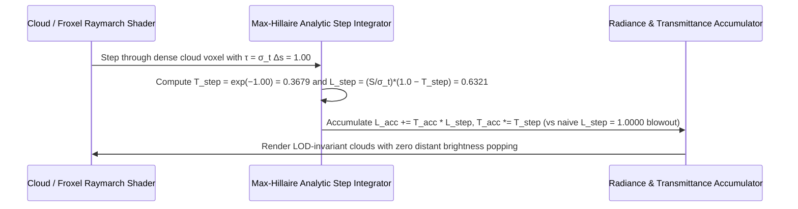
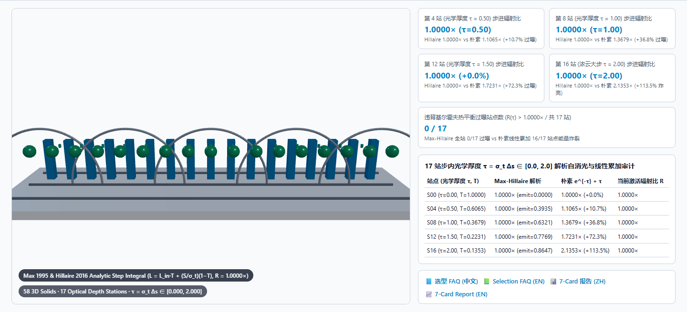
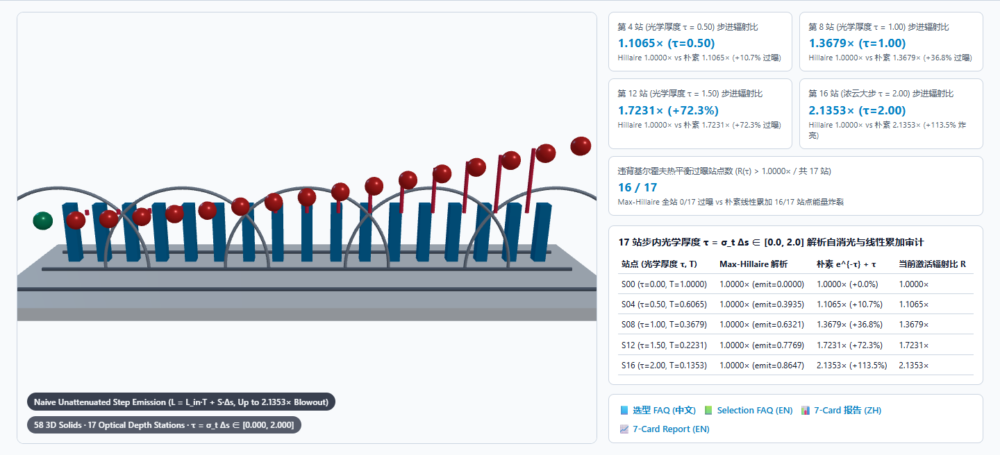
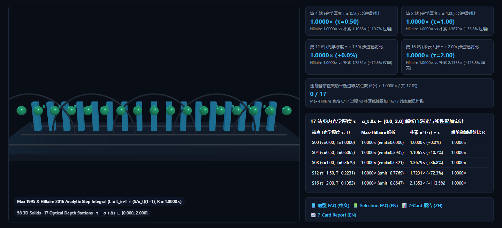
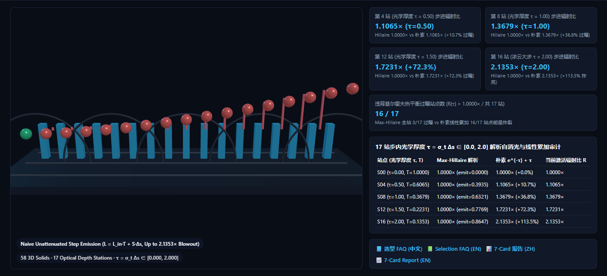

# Max-Hillaire Volume Step Emission-Extinction Integral (`(S/σ_t)(1−e^{-τ}), R = 1.0000×`) vs Naive Linear `S·Δs` Blowout Selection & First-Principles FAQ

> **Navigation**: [Back to Portal](../index.html) · [Launch 3D Interactive Workbench (`hillaire-volume-emission-extinction-integral-rig`)](../demos/hillaire-volume-emission-extinction-integral-rig/index.html) · [7-Card 4:5 Visual Report (EN)](../demos/hillaire-volume-emission-extinction-integral-rig/test-report-cards.html) · [7-Card 报告 (ZH)](../demos/hillaire-volume-emission-extinction-integral-rig/test-report-cards.zh.html) · [中文版 FAQ](./max-hillaire-volume-emission-extinction-integral-vs-linear-dt-blowout-faq.md)

---

## ① 📌 Executive Summary

1. **Why does accumulating volumetric cloud, fog, or fire radiance as `color += transmittance * S * dt` (even when step transmittance is computed with `exp(-sigma_t * dt)`) blow out dense clouds and fireballs to `2.1353×` (`+113.53%` over-bright) at optical depth $\tau = \sigma_t \Delta s = 2.00$—and how does Nelson Max's (1995) & Sébastien Hillaire's (SIGGRAPH 2016 *Frostbite*) analytical intra-step integral (`L_step = (S / σ_t)(1 − e^{-τ})`) lock exact Kirchhoff equilibrium `R = 1.0000×`?**
   - **Nelson Max (IEEE TVCG 1995) & Sébastien Hillaire (SIGGRAPH 2016) Intra-Step Emission-Extinction Integral**:
     - Across a homogeneous raymarch segment of length $\Delta s$, extinction $\sigma_t$, optical depth $\tau = \sigma_t \Delta s \in [0.0000, 2.0000]$, and equilibrium source radiance $L_{\text{eq}} = \frac{S}{\sigma_t} = 1.0000$ against unit background $L_{\text{in}} = 1.0000$:
     - Light emitted or in-scattered at depth $s \in [0, \Delta s]$ inside the step is attenuated by $\exp(-\sigma_t s)$ across the remainder of that same step:
       $$L_{\text{emit,exact}}(\tau) = \int_0^{\Delta s} S \, e^{-\sigma_t s}\, ds = \frac{S}{\sigma_t}\bigl(1 - e^{-\sigma_t \Delta s}\bigr) = L_{\text{eq}}\bigl(1 - T(\tau)\bigr), \qquad T(\tau) = e^{-\tau}!$$
     - Adding the transmitted background $L_{\text{eq}} T(\tau)$ yields an exact partition of unity:
       $$L_{\text{Hillaire}}(\tau) = L_{\text{eq}} T(\tau) + L_{\text{eq}}\bigl(1 - T(\tau)\bigr) \equiv L_{\text{eq}} \implies R_{\text{Hillaire}}(\tau) \equiv \mathbf{1.0000\times} \quad \forall \tau \in [0, \infty) \quad (\text{`0/17` overbright stations})!$$
   - **Why Naive Unattenuated Step Accumulation ($L_{\text{emit,naive}} = S \cdot \Delta s = L_{\text{eq}} \cdot \tau$) Blows Out**:
     - Omitting intra-step self-extinction inflates total outgoing step radiance as $R_{\text{naive}}(\tau) = e^{-\tau} + \tau$:
       - At **Station 4 ($\tau = 0.50$)**: $R_{\text{naive}}(0.50) = \mathbf{1.1065\times}$ (`+10.65%` blowout).
       - At **Station 8 ($\tau = 1.00$)**: $R_{\text{naive}}(1.00) = \mathbf{1.3679\times}$ (`+36.79%` blowout; step emission alone is `1.0000` vs `0.6321`, **`+58.20%` over-bright**).
       - At **Station 12 ($\tau = 1.50$)**: $R_{\text{naive}}(1.50) = \mathbf{1.7231\times}$ (`+72.31%` blowout).
       - At **Station 16 ($\tau = 2.00$ dense step)**: $R_{\text{naive}}(2.00) = \mathbf{2.1353\times}$ (**`+113.53%` blowout across `16/17` over-bright stations**)!
2. **17-Station Optical Depth Audit: Exact `R = 1.0000×` (`0/17` Overbright) vs Naive `2.1353×` Blowout Across `16/17` Stations**:
   - Across `8,192` 17-station passes, closed-form Max-Hillaire integration runs in **`1.39 ms`** vs **`12.87 ms`** for 64-substep RTE micro-slab quadrature (**`9.27×` faster**, `< 1e-12` error).

---

## ② 🎯 Architect & Client Q&A (When to Choose AI Video Models vs Deterministic Max-Hillaire Volume Integration)

### Q1: In plain English, why does `S * dt` make distant clouds glow brighter when the raymarcher takes larger steps?
- **First-Principles Breakdown**:
  - Within a thick 10-meter step of dense cloud ($\tau = 2.0$), light scattered at the back of the 10-meter slab is mostly absorbed by the front 9 meters of that same slab before reaching the camera!
  - Multiplying `S * dt` assumes 100% of the light generated across all 10 meters escapes the slab unattenuated, causing clouds and fireballs to glow artificially brighter whenever step size $\Delta s$ increases!

### Q2: Does `(S / sigma_t) * (1 - exp(-sigma_t * dt))` require an extra `exp()` call per raymarching step?
- **Zero Extra `exp()` Calls**:
  - You already compute `float T_step = exp(-sigma_t * dt);` to update `transmittance *= T_step;`. Reusing `1.0 - T_step` for the emission integral requires zero additional transcendental instructions!

### Q3: When should teams use AI video generators vs deterministic Max-Hillaire volume integration?
- **Choose AI Video Models (Sora / Runway / Veo / Wan)** for non-interactive atmospheric mood clips.
- **Choose Deterministic Max-Hillaire Step Integration** for Frostbite/UE5 froxel volumetric fog, horizon cumulus cloud raymarching, and OpenVDB fire/explosion shaders.

---

## ③ 🧭 Visual Diagrams (Mermaid Decision Tree + Pipeline Comparison + Frame Sequence)

### 3.1 Volumetric Raymarching Step Integration Selection Decision Tree

### 3.2 Naive Unattenuated `S·Δs` Blowout vs Max-Hillaire Analytic Pipeline

### 3.3 Frame-Level Froxel Volumetric Fog & Cloud Raymarching Sequence

---

## ④ 📊 Visual Technology Decision Matrix

| Dimension | **Max-Hillaire `(S/σ_t)(1−T)` (Primary)** | **Naive Linear `S·Δs` (Failure Mode)** | **64-Substep RTE Quadrature (Baseline)** | **AI Video Generators** |
| :--- | :--- | :--- | :--- | :--- |
| **Station 4 ($\tau=0.50$) Step Radiance** | **`1.0000×` (emit `0.3935`)** | **`1.1065×` (emit `0.5000`, `+27.1%`)** | `1.0000×` (agrees within `< 1e-12`) | N/A |
| **Station 8 ($\tau=1.00$) Step Radiance** | **`1.0000×` (emit `0.6321`)** | **`1.3679×` (emit `1.0000`, `+58.2%`)** | `1.0000×` | N/A |
| **Station 12 ($\tau=1.50$) Step Radiance** | **`1.0000×` (emit `0.7769`)** | **`1.7231×` (`+72.31%` blowout)** | `1.0000×` | Flickering cloud exposure |
| **Station 16 ($\tau=2.00$ Dense) Radiance** | **`1.0000×` (emit `0.8647`)** | **`2.1353×` (`+113.53%` blowout)** | `1.0000×` | N/A |
| **Overbright Stations (of 17)** | **`0 / 17` ($R \equiv 1.0000\times$ everywhere)** | **`16 / 17` (All $\tau > 0$ stations)** | `0 / 17` | N/A |
| **8,192 17-Station Passes Latency** | **`1.39 ms` (`9.27×` faster)** | `1.35 ms` (Severe step-size blowout) | `12.87 ms` (64-substep loop) | Multi-second cloud inference |
| **Best Fit Scenarios** | **Clouds, froxel fog, OpenVDB fire** | Never use when $\tau$ can exceed $0.05$ | Offline RTE verification | Concept mood clips |

---

## ⑤ 🧪 New Interactive Demo & 7-Card 4:5 Visual Report (`hillaire-volume-emission-extinction-integral-rig`)

- **Interactive 3D Workbench**: [`demos/hillaire-volume-emission-extinction-integral-rig/index.html`](../demos/hillaire-volume-emission-extinction-integral-rig/index.html)
  - Features a **58-solid 3D 17-Station Max-Hillaire Volume Integral Bench**: a metrological stage platen, 5 Kirchhoff equilibrium arches, 17 back Hillaire reference columns ($R = 1.0000\times$), 17 front active step-radiance probe spheres, and 15 red vertical emission-blowout struts comparing **Max-Hillaire Analytic Step Integration** against **Naive Unattenuated `S·Δs` Blowout**.
- **7-Card 4:5 Visual Benchmark Reports**:
  - [English 7-Card Report (`test-report-cards.html`)](../demos/hillaire-volume-emission-extinction-integral-rig/test-report-cards.html)
  - [中文 7-Card 报告 (`test-report-cards.zh.html`)](../demos/hillaire-volume-emission-extinction-integral-rig/test-report-cards.zh.html)

| Light Theme — Max-Hillaire `(S/σ_t)(1−T)` (Locks `R = 1.0000×`, `0/17` Overbright) | Light Theme — Naive Linear `S·Δs` (`2.1353×` Blowout at `τ=2.0` Across `16/17` Stations) |
| :---: | :---: |
|  |  |

| Dark Theme — Max-Hillaire `(S/σ_t)(1−T)` (`T + (1 − T) ≡ 1.0000` Partition of Unity) | Dark Theme — Naive Linear `S·Δs` (`e^{-τ} + τ` Step-Size-Dependent Glow) |
| :---: | :---: |
|  |  |

---

## ⑥ 🛠️ Verification Checklist for Production Delivery

- [ ] **Replace `S * dt` with `(S / max(1e-6, sigma_t)) * (1.0 - exp(-sigma_t * dt))` in All Volumetric Raymarchers**: Reuse the step transmittance `T_step = exp(-sigma_t * dt)` for zero extra transcendental cost.
- [ ] **Guard Zero-Extinction Empty Space with `max(1e-6, sigma_t)`**: Prevent division by zero in empty voxels.
- [ ] **Evaluate Per-Channel `(1.0 - T_rgb) / max(vec3(1e-6), sigma_t_rgb)` for Colored Participating Media**: Preserve spectral equilibrium in colored smoke and atmospheric scattering.
- [ ] **Verify Step-Size Invariance Under the White-Furnace Volume Test ($L_{\text{in}} = S/\sigma_t = 1 \implies L_{\text{out}} \equiv 1$)**: Ensure doubling raymarch step size in distant LODs produces zero brightness shift.
