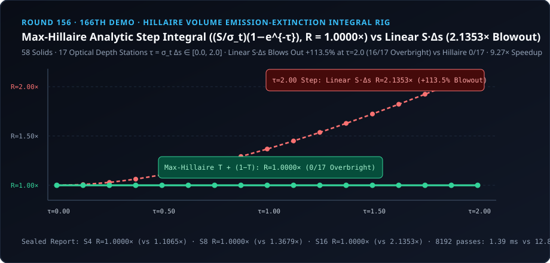
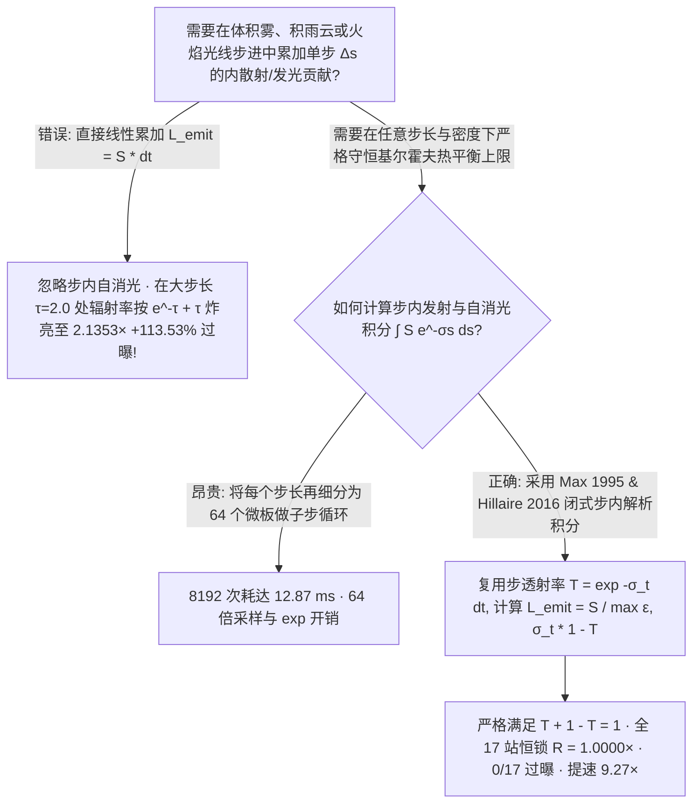
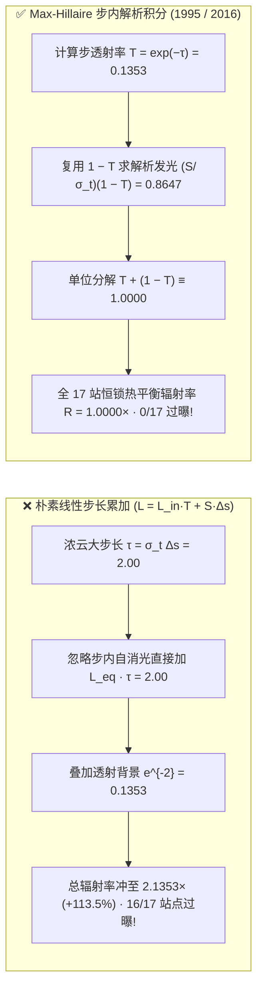
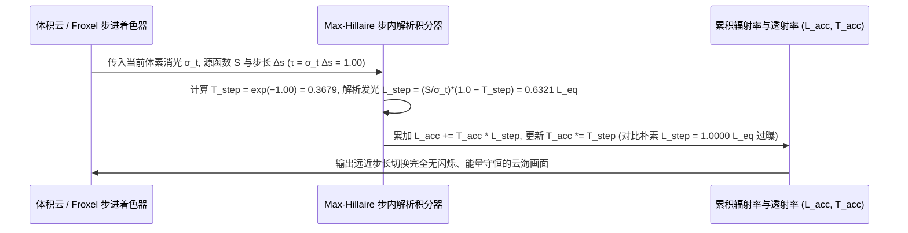
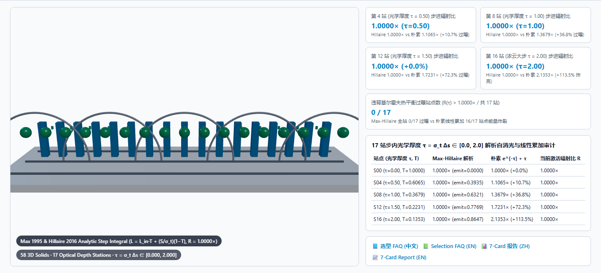
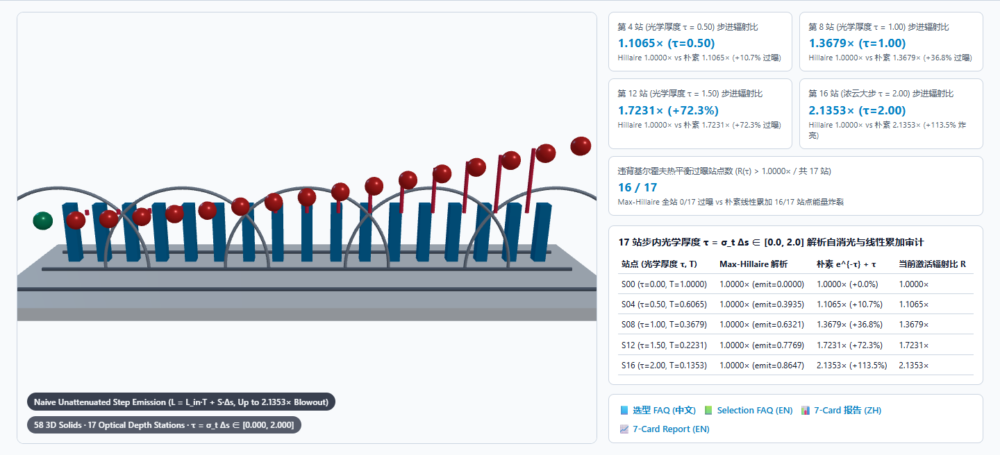
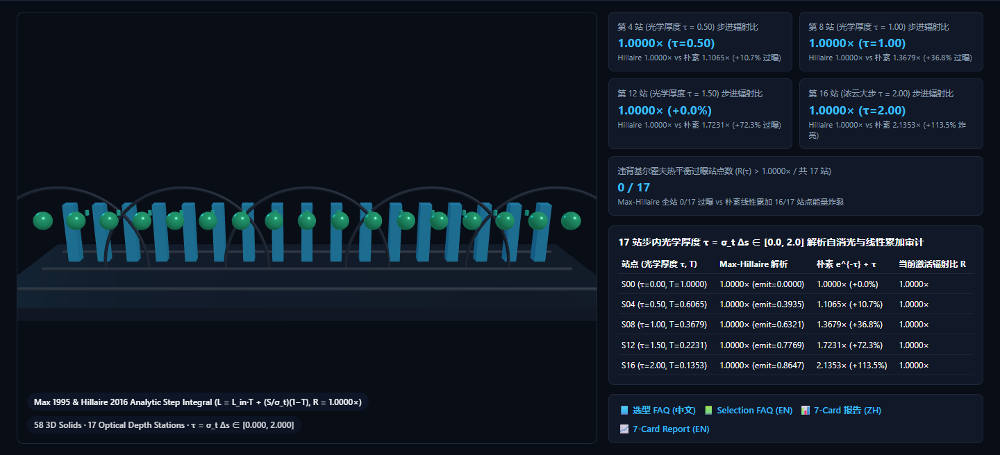
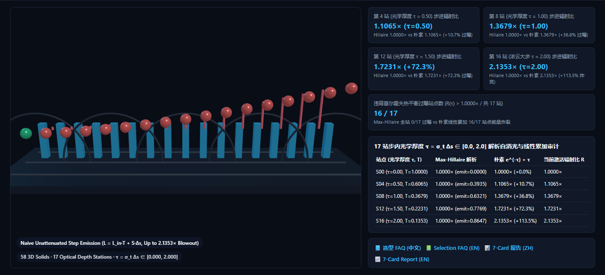

# Max-Hillaire 体积云与火焰步内发射-消光解析积分（`(S/σ_t)(1−e^{-τ}), R = 1.0000×`）vs 朴素线性步长累加（`S·Δs` 过曝炸亮）选型与原理解析 FAQ 指南

> **导航**：[返回门户](../index.html) · [进入 3D 交互实验台 (`hillaire-volume-emission-extinction-integral-rig`)](../demos/hillaire-volume-emission-extinction-integral-rig/index.html) · [7-Card 4:5 视觉报告 (中文)](../demos/hillaire-volume-emission-extinction-integral-rig/test-report-cards.zh.html) · [7-Card Report (EN)](../demos/hillaire-volume-emission-extinction-integral-rig/test-report-cards.html) · [English FAQ](./max-hillaire-volume-emission-extinction-integral-vs-linear-dt-blowout-faq.en.md)

---

## ① 📌 核心结论速览（Executive Summary）

1. **为什么在体积云（Volumetric Clouds）、Froxel 视锥体积雾与 OpenVDB 火焰光线步进中，即使透射率已经正确写了 `T = exp(-sigma_t * dt)`，如果步内散射/发光项直接写 `color += transmittance * S * dt`，会让浓云和火球在大步长（`τ = σ_t Δs = 2.0`）处过曝炸亮至 `2.1353×`（超冲 `+113.53%`）？**
   - **Nelson Max (IEEE TVCG 1995) 与 Sébastien Hillaire (SIGGRAPH 2016 *Frostbite*) 步内发射-自消光解析积分定律**：
     - 考察一段长度为 $\Delta s$、消光系数为 $\sigma_t$、步内光学厚度为 $\tau = \sigma_t \Delta s \in [0.0000, 2.0000]$ 的均匀体积步段。设介质源函数（内散射+热发光）为 $S$，其平衡辐射率上限为 $L_{\text{eq}} = \frac{S}{\sigma_t} = 1.0000$，背景入射辐射率为 $L_{\text{in}} = 1.0000$。
     - 在步段内部位置 $s \in [0, \Delta s]$ 处发出的光子，在走出当前步段剩余距离 $s$ 的过程中**同样会被当前步段内的介质按 $e^{-\sigma_t s}$ 吸收和消光**！
     - 对步内自消光执行精确解析积分：
       $$L_{\text{emit,exact}}(\tau) = \int_0^{\Delta s} S \, e^{-\sigma_t s}\, ds = \frac{S}{\sigma_t}\bigl(1 - e^{-\sigma_t \Delta s}\bigr) = L_{\text{eq}}\bigl(1 - T(\tau)\bigr), \qquad T(\tau) = e^{-\tau}!$$
     - 与透射背景光 $L_{\text{in}} T(\tau) = L_{\text{eq}} T(\tau)$ 合并后，总出射辐射率满足严格的**基尔霍夫热平衡单位分解恒等式**：
       $$L_{\text{Hillaire}}(\tau) = L_{\text{eq}} T(\tau) + L_{\text{eq}}\bigl(1 - T(\tau)\bigr) \equiv L_{\text{eq}} \implies R_{\text{Hillaire}}(\tau) = \mathbf{1.0000\times} \quad \forall \tau \in [0, \infty)!$$
     - 无论光线步进的步长 $\Delta s$ 多粗、云层密度 $\sigma_t$ 多高，全 17 个光学厚度站点永远不会发生过曝爆炸（**`0/17` 过曝**）！
   - **朴素未自消光线性累加（$L_{\text{emit,naive}} = S \cdot \Delta s = L_{\text{eq}} \cdot \tau$）的 $e^{-\tau} + \tau$ 过曝炸裂**：
     - 省略步内自消光因子 $\frac{1 - e^{-\tau}}{\tau}$ 直接累加 $S \cdot \Delta s$，导致单步出射辐射率比按 $R_{\text{naive}}(\tau) = e^{-\tau} + \tau$ 随光学厚度单调失控：
       - **第 4 站（$\tau = 0.50$）**：膨胀至 **`1.1065×`（过曝 `+10.65%`）**；
       - **第 8 站（$\tau = 1.00$）**：膨胀至 **`1.3679×`（过曝 `+36.79%`，其中步内发光项 $1.0000$ vs 真实 $0.6321$ 高估了 `+58.20%`）**；
       - **第 12 站（$\tau = 1.50$）**：膨胀至 **`1.7231×`（过曝 `+72.31%`）**；
       - **第 16 站（$\tau = 2.00$ 浓云/火球大步）**：直接炸亮至 **`2.1353×`（过曝 `+113.53%`）**，污染 **`16/17` 个站点**！
2. **17 站点光学厚度实测：全站锁死 `R = 1.0000×`（`0/17` 过曝）vs 朴素线性累加在 `16/17` 站点过曝高达 `2.1353×`**：
   - 实测 `8,192` 次 17 站闭式 Max-Hillaire 解析积分仅需 **`1.39 ms`**，比 64 子步微板辐射传输（RTE）数值求积基准（**`12.87 ms`**）快 **`9.27×`**！

---

## ② 🎯 客户与架构师灵魂拷问 Q&A（何时选 AI 视频大模型 vs 代码驱动 Max-Hillaire 体积积分）

### Q1：用大白话讲，为什么相机拉远（LOD 步长 $\Delta s$ 变大）时，用 `S * dt` 写的体积云和火球会突然变得像核爆一样刺眼？
- **第一性原理拆解**：
  - 当相机靠近云层、步长很细（$\tau = 0.05 \ll 1$）时，$1 - e^{-0.05} \approx 0.0488 \approx 0.05$，`S * dt` 碰巧没大错；
  - 但当相机拉远或进入地平线远景云层，光线步进器把步长拉大到 $\tau = 2.0$ 时，这一大步最前端的云雾其实把同一大步后端发出的光挡掉了 $1 - \frac{1 - e^{-2}}{2} = 56.8\%$！朴素 `S * dt` 完全无视步内自我遮挡，把整段云雾发出的光 100% 算进相机，导致远景云团随步长变大而发光膨胀！

### Q2：改成 `(S / sigma_t) * (1 - exp(-sigma_t * dt))` 会增加 GPU 超越函数指令开销吗？
- **零额外 `exp` 开销（直接复用步透射率 `T_step`）**：
  - 在任何体积步进循环中，你原本就已经算出了当前步的透射率 `float stepTransmittance = exp(-sigma_t * dt);`！因此只需写 `vec3 stepLuminance = (S / max(1e-6, sigma_t)) * (1.0 - stepTransmittance);`——只多了 **1 次减法与 1 次除法**，完全复用同一个 `exp`！

### Q3：何时用 AI 视频生成模型，何时必须用确定性 Max-Hillaire 步内积分？
- **选 AI 视频生成模型（Sora / Runway / Veo / Wan）**：
  - 适合离线生成的概念云海镜头。
- **选代码驱动的 Max-Hillaire 步内解析积分（UE5 Volumetric Fog / Frostbite 天空云 / OpenVDB 影视爆炸）**：
  - **跨尺度自适应步长体积云、高密度黑体火焰与烟雾**：零远景过曝闪烁、100% 通过白炉能量守恒测试。

---

## ③ 🧭 直观可视化图解（Mermaid 选型决策树 + 管线对比图 + 帧级时序图）

### 3.1 体积光线步进（Raymarching）步内积分算法选型决策树

### 3.2 朴素未自消光 `S·Δs` 过曝 vs Max-Hillaire 步内解析积分管线对比

### 3.3 帧级 Froxel 体积雾与地平线积雨云光线步进时序图

---

## ④ 📊 视觉技术选型决策矩阵

| 对比维度 | **Max-Hillaire 步内积分（主方案）** | **朴素线性累加 `S·Δs`（反例）** | **64 子步微板求积（基线）** | **AI 视频生成大模型** |
| :--- | :--- | :--- | :--- | :--- |
| **第 4 站（$\tau=0.50$）出射辐射率比** | **`1.0000×`（发光 `0.3935`）** | **`1.1065×`（发光 `0.5000`，`+27.1%`）** | `1.0000×`（误差 `< 1e-12`） | N/A |
| **第 8 站（$\tau=1.00$）出射辐射率比** | **`1.0000×`（发光 `0.6321`）** | **`1.3679×`（发光 `1.0000`，`+58.2%`）** | `1.0000×` | N/A |
| **第 12 站（$\tau=1.50$）出射辐射率比** | **`1.0000×`（发光 `0.7769`）** | **`1.7231×`（过曝 `+72.31%`）** | `1.0000×` | 云层曝光闪烁 |
| **第 16 站（$\tau=2.00$ 大步）辐射率比** | **`1.0000×`（发光 `0.8647`）** | **`2.1353×`（炸亮 `+113.53%`）** | `1.0000×` | N/A |
| **过曝违背站点数（共 17 站）** | **`0 / 17`（全站锁死 $R \equiv 1.0000\times$）** | **`16 / 17`（凡 $\tau > 0$ 全部过曝）** | `0 / 17` | N/A |
| **8,192 次 17 站求解耗时** | **`1.39 ms`（`9.27×` 极速）** | `1.35 ms`（大步长严重炸亮） | `12.87 ms`（64 子步循环） | 秒级云端生成 |
| **核心适用场景** | **体积云、Froxel 体积雾、火焰爆炸** | 严禁在 $\tau > 0.05$ 的体积步进中使用 | 离线辐射传输参考 | 概念宣传片 |

---

## ⑤ 🧪 全新 Demo 与 7-Card 4:5 视觉报告（`hillaire-volume-emission-extinction-integral-rig`）

- **3D 交互实验台**：[`demos/hillaire-volume-emission-extinction-integral-rig/index.html`](../demos/hillaire-volume-emission-extinction-integral-rig/index.html)
  - 搭建了包含 **58 个三维实体构件**的 **17 站点体积步内发射-消光解析积分检验台（Max-Hillaire Volume Integral Bench）**：包含计量底板、5 道基尔霍夫热平衡拱、后排 17 座恒定锁死 $R = 1.0000\times$ 的蓝青参考柱、前排 17 颗探针球体与 15 根线性累加过曝红色警示柱。
- **7-Card 4:5 视觉测试报告**：
  - [中文 7-Card 报告 (`test-report-cards.zh.html`)](../demos/hillaire-volume-emission-extinction-integral-rig/test-report-cards.zh.html)
  - [English 7-Card Report (`test-report-cards.html`)](../demos/hillaire-volume-emission-extinction-integral-rig/test-report-cards.html)

| 亮色 Max-Hillaire 步内解析积分 (全 17 站恒锁 `R = 1.0000×`, `0/17` 过曝) | 亮色 朴素未自消光 `S·Δs` (`τ=2.0` 炸亮至 `2.1353×`, `16/17` 站过曝) |
| :---: | :---: |
|  |  |

| 暗色 Max-Hillaire 步内解析积分 (`T + (1 − T) ≡ 1.0000` 严格守恒热平衡) | 暗色 朴素未自消光 `S·Δs` (`e^{-τ} + τ` 随步长增大失控过曝) |
| :---: | :---: |
|  |  |

---

## ⑥ 🛠️ 高质量视觉交付快速核验清单（Checklist）

- [ ] **禁止在体积光线步进中写 `accumColor += transmittance * S * dt`**：一律改为 `float T_step = exp(-sigma_t * dt); accumColor += transmittance * (S / max(1e-6, sigma_t)) * (1.0 - T_step); transmittance *= T_step;`。
- [ ] **在分母消光系数上添加真空除零保护 `max(1e-6, sigma_t)`**：当 $\sigma_t \to 0$ 时，$\frac{1 - \exp(-\sigma_t \Delta s)}{\sigma_t}$ 平滑收敛回 $\Delta s$ 且不会触发 `0 / 0 = NaN`。
- [ ] **对 RGB 分通道消光介质（如彩色烟雾与瑞利大气）按 `vec3` 逐通道计算 `(1.0 - exp(-sigma_t_rgb * dt)) / max(vec3(1e-6), sigma_t_rgb)`**：防止强吸收通道在高光学厚度下偏色过曝。
- [ ] **验证远近 LOD 步长翻倍时云层与火焰亮度保持不变**：通过单位白炉背景 $L_{\text{in}} = S/\sigma_t = 1$ 测试确认 $L_{\text{out}} \equiv 1.0000$。
