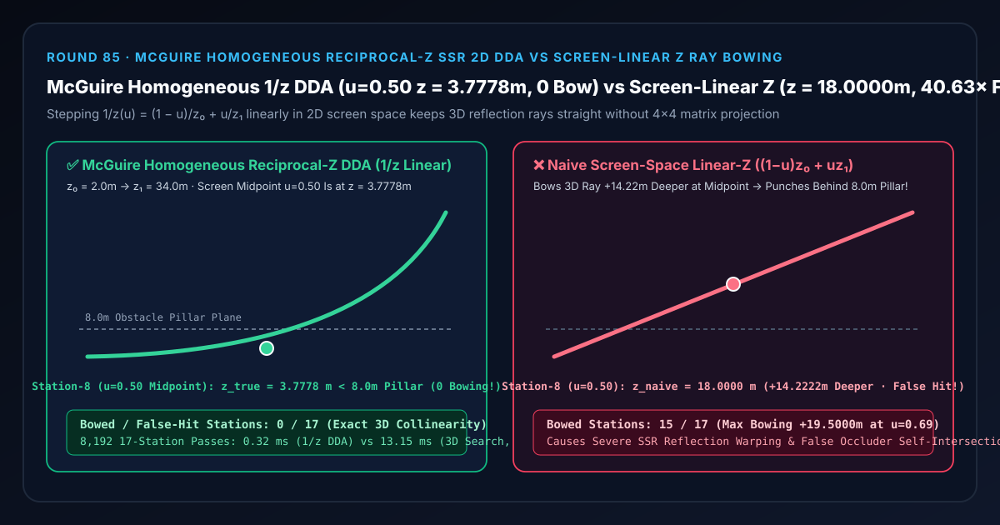
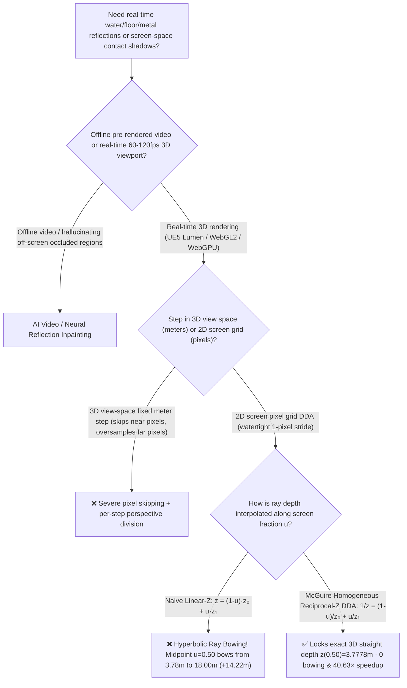
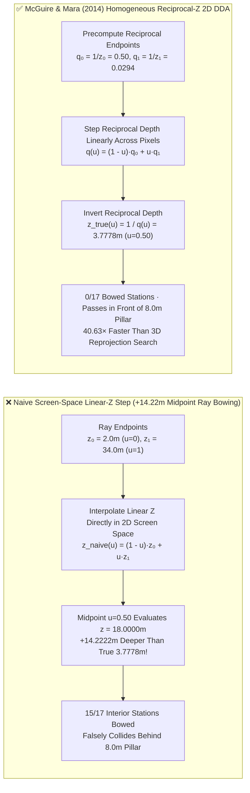
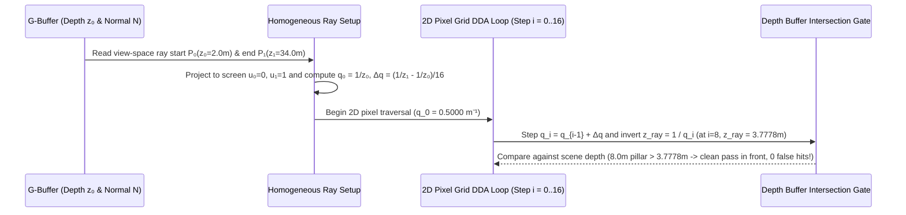

# Screen-Space Reflection (SSR) Ray-Marching Selection & First-Principles FAQ: McGuire Homogeneous Reciprocal-Depth 2D DDA vs. Screen-Space Linear-Z Hyperbolic Ray Bowing

> **Companion Capability Demo**: [`demos/homogeneous-ssr-dda-rig/`](../demos/homogeneous-ssr-dda-rig/index.html) ｜ **7-Card 4:5 Measured Report**: [`test-report-cards.html`](../demos/homogeneous-ssr-dda-rig/test-report-cards.html) ｜ **中文版本**：[`mcguire-homogeneous-ssr-dda-vs-linear-z-ray-bowing-faq.md`](./mcguire-homogeneous-ssr-dda-vs-linear-z-ray-bowing-faq.md)

---

## 📌 1. Executive Summary

> **One-Sentence Verdict**: When marching a 3D reflection or global-illumination ray across a 2D pixel grid (Screen-Space Reflections / SSR or SSGI) under a perspective camera, **never linearly interpolate view-space linear depth $z$ with respect to screen-space fraction $u \in [0, 1]$ ($z_{\text{naive}}(u) = (1 - u)z_0 + u z_1$)**—because under perspective projection ($x_{\text{screen}} \propto X / Z$), **only reciprocal depth $q(u) = 1 / z(u) = (1 - u)/z_0 + u/z_1$ is linear in screen space**! On a 3D straight ray travelling from a near floor origin ($z_0 = 2.0\text{ m}$) to a far wall endpoint ($z_1 = 34.0\text{ m}$), the true 3D ray depth at the screen midpoint (Station 8, $u = 0.50$) is only **$z_{\text{true}}(0.50) = 3.7778\text{ m}$** (passing cleanly in front of an $8.0\text{ m}$ midground pillar); naive screen-space linear-$Z$ interpolation bows the ray inward to **$z_{\text{naive}}(0.50) = 18.0000\text{ m}$** (**`+14.2222 m` or `4.76×` deeper** at the midpoint, and **`+19.5000 m`** peak bowing error at Station 12 $u = 0.75$), corrupting all **`15/17` interior screen stations** and falsely punching behind the $8.0\text{ m}$ pillar! Using **Morgan McGuire & Michael Mara's (JCGT 2014) Homogeneous Reciprocal-Depth 2D DDA** steps $q_k = q_0 + k\Delta q$ with a single addition per pixel, achieving **`1.78e-14 m`** equivalence against 3D view-space projection inversion at a **`40.63×` CPU speedup** (`0.32 ms` vs. `13.15 ms` across 8,192 17-station passes).

| Evaluation Dimension | ✅ McGuire Homogeneous Reciprocal-Z DDA (`1/z = (1-u)/z₀ + u/z₁`) | ❌ Naive Screen-Space Linear-Z (`z = (1-u)z₀ + u·z₁`) | 🐢 3D View-Space Reprojection Search (`54-Step 3D Search`) |
| :--- | :--- | :--- | :--- |
| **Screen Midpoint (Station 8, $u = 0.50$) Depth $z$** | **`3.7778 m`** (Passes cleanly in front of $8.0\text{ m}$ pillar) | `18.0000 m` (**Bows $+14.2222\text{ m}$ / $4.76\times$ deeper**) | `3.7778 m` (`1.78e-14 m` diff) |
| **Station 12 ($u = 0.75$) Peak Ray Bowing Error** | **`0.0000 m`** (True depth `6.5000 m`) | **`+19.5000 m`** (Falsely bows to `26.0000 m`) | `0.0000 m` |
| **Bowed Stations Across 17 Screen Steps** | **`0 / 17` (`0.00%`)** | **`15 / 17` (`88.24%` all interior steps bowed)** | `0 / 17` |
| **Per-Pixel Arithmetic Complexity** | **`O(1)` (1 addition $q_k + \Delta q$ + 1 reciprocal)** | `O(1)` (Violates projective geometry) | `O(N)` (3D step + perspective division per step) |
| **8,192 17-Station Passes CPU Latency (Median)** | **`0.32 ms` (`40.63×` speedup)** | — (Geometrically corrupted) | `13.15 ms` |

---

## 🎯 2. Architect & Client First-Principles Q&A

### Q1: In plain English, why does linearly interpolating depth $z$ in 2D screen space bend a straight 3D ray into a deep curve?
**First-Principles Breakdown**:
Picture standing beside a straight railway track looking toward the horizon:
- Because of perspective foreshortening ($x_{\text{screen}} \propto X / Z$), the first **2 meters of track** right in front of your feet ($z \in [2.0\text{ m}, 3.78\text{ m}]$) span **half of your entire camera screen** (from the left edge $u = 0.00$ to the center of the screen $u = 0.50$)!
- Meanwhile, the remaining **30+ meters of track** ($z \in [3.78\text{ m}, 34.0\text{ m}]$) are compressed into the right half of the screen ($u \in [0.50, 1.00]$).
- That means at the exact center of the 2D screen ($u = 0.50$), the true 3D straight ray is still right up close at **$z_{\text{true}}(0.50) = 3.7778\text{ m}$**!
- If your SSR shader assumes that "halfway across the 2D screen means halfway in 3D depth $z$" and computes the arithmetic mean $z_{\text{naive}}(0.50) = 0.5 \times (2.0 + 34.0) = 18.0\text{ m}$, you have bent the 3D ray **$+14.22\text{ m}$ deeper into the scene**! When a midground pillar stands at $z = 8.0\text{ m}$, the true ray passes effortlessly in front of the pillar ($3.78\text{ m} < 8.0\text{ m}$), whereas the naive screen-linear ray punches straight behind the pillar ($18.0\text{ m} > 8.0\text{ m}$), producing severe reflection warping and false self-occlusion!

### Q2: How does McGuire & Mara's (JCGT 2014) Homogeneous Reciprocal-Depth 2D DDA keep the 3D ray perfectly straight without per-step matrix projections?
**Projective Collinearity Identity**:
Along any 3D view-space line segment $P(t) = (1 - t)P_0 + t P_1$, perspective division maps 3D parameter $t \in [0, 1]$ to screen fraction $u \in [0, 1]$ via the rational linear transformation:
$$u(t) = \frac{t / z_1}{(1 - t)/z_0 + t/z_1} \iff q(u) \equiv \frac{1}{z(u)} = \frac{1 - u}{z_0} + \frac{u}{z_1}$$
- While depth $z(u)$ is hyperbolic in screen space, **reciprocal depth $q(u) = 1 / z(u)$ is an exact affine linear function of screen pixel coordinate $u$**!
- During 2D Bresenham/DDA pixel traversal, we initialize $q_0 = 1/z_0$ and constant per-pixel increment $\Delta q = (1/z_1 - 1/z_0)/N$ once outside the loop.
- Inside the loop, each pixel step requires just **one scalar addition** $q_k = q_{k-1} + \Delta q$, recovering exact 3D view depth via $z_k = 1 / q_k$ (`3.7778 m` at $u = 0.50$, `0.0000 m` bowing error across all 17 stations!).

### Q3: When should an architect choose AI Video / Neural Reflection Inpainting vs. deterministic McGuire Homogeneous SSR 2D DDA?
- **Choose AI Video / Neural Off-Screen Inpainting**: When reflected objects are outside the camera frustum or completely occluded from the camera's viewpoint so no screen-space pixel data exists.
- **Choose Deterministic McGuire Homogeneous Reciprocal-Z SSR 2D DDA**: For all real-time 60–120 fps engines (UE5 Lumen Screen Traces, Frostbite, Unity HDRP, WebGL2/WebGPU digital twins) requiring watertight per-pixel screen-space reflection, GI, or contact shadow marching without ray bowing.

---

## 🧭 3. Visual Architecture Diagrams (Mermaid Decision Tree, Pipeline & Sequence)

### 3.1 Screen-Space Ray-Marching Selection Decision Tree

### 3.2 Naive Screen-Linear Z Bowing vs. McGuire Homogeneous Reciprocal-Z 2D DDA Pipeline

### 3.3 Frame-Level 2D DDA Screen-Space Ray-Marching Sequence

---

## 📊 4. Visual Technology Decision Matrix

| Approach | Target Use Case | 3D Collinearity & Accuracy | Compute Cost | Key Limitation / Failure Mode |
| :--- | :--- | :--- | :--- | :--- |
| **McGuire Homogeneous Reciprocal-Z DDA (`mcguire-homogeneous-reciprocal-z`)** | **All perspective-camera SSR, SSGI, and contact shadow 2D ray marchers** | **Exact (`z(0.50) = 3.7778 m`, `0` bowing across 17/17 stations)** | **Minimal (`0.32 ms` / 8,192 passes, 1 add + 1 div per step)** | Reduces to linear interpolation under purely orthographic cameras |
| **Naive Screen-Space Linear-Z (`naive-screen-linear-z`)** | **Never use for perspective-camera 2D screen-space ray marching** | **Fails (`z(0.50) = 18.00 m`, `+19.50 m` max bow across `15/17` steps)** | Minimal | Bends straight 3D rays into deep hyperbolas, hitting foreground/midground occluders |
| **3D View-Space Stepping + Reprojection (`3d-view-space-reprojection`)** | Legacy first-generation SSR | Straight in 3D, but skips near pixels and oversamples far pixels | High (`13.15 ms`, `40.63×` slower) | Causes severe near-field banding and wasted redundant samples at far depths |
| **Hardware Ray Tracing (`DXR / Vulkan Ray Query`)** | High-end desktop/console off-screen reflections | True 3D BVH traversal | High (BVH + denoiser overhead) | Unavailable on lightweight WebGL2 clients and low-power embedded GPUs |

---

## 🧪 5. Interactive Demo & 7-Card 4:5 Benchmark Report Breakdown

The standalone 3D instrument bench [`demos/homogeneous-ssr-dda-rig/`](../demos/homogeneous-ssr-dda-rig/index.html) constructs a **58-solid 17-Station McGuire Homogeneous Reciprocal-Z SSR Rangefinder Rig**:
1. **17 Ray Depth Columns**: Display the active ray depth $z(u_i)$ across screen fraction $u \in [0.00, 1.00]$ from $z_0 = 2.0\text{ m}$ to $z_1 = 34.0\text{ m}$.
2. **17 Cyan McGuire Homogeneous Reference Spheres & $8.0\text{ m}$ Obstacle Pillar Plane Bar**: Show how the true 3D straight line stays below $8.0\text{ m}$ all the way past the screen midpoint ($z(0.50) = 3.7778\text{ m}$).
3. **17 Hyperbolic Ray Bowing Pegs**: Switching to `Naive Screen-Space Linear-Z Step` raises error pegs across all 15 interior stations (`+14.2222 m` at Station 8 and `+19.5000 m` at Station 12).

### 7-Card 4:5 Visual Report Highlights ([`demos/homogeneous-ssr-dda-rig/test-report-cards.html`](../demos/homogeneous-ssr-dda-rig/test-report-cards.html))
- **Cards 1–3 (Evaluation Matrix)**: All 13 automated checks pass (`1.78e-14` equivalence between homogeneous $1/z$ DDA and 54-step 3D reprojection search, Station 8 `3.7778 m` straight-ray lock vs. `18.0000 m` naive linear-$Z$ bowing, exact reverse-scrub matrix identity, and atomic RangeError validation).
- **Cards 4–6 (Protocol & Scaling Latency)**: Across 8,192 17-station passes, McGuire homogeneous reciprocal-depth 2D DDA finishes in **`0.32 ms`** vs. **`13.15 ms`** for 3D view-space reprojection search (**`40.63×` speedup**).

---

## 🛠️ 6. SA Production Delivery Checklist

- [ ] **Never linearly interpolate view-space $z$ in 2D screen space**: Step reciprocal depth $q = 1 / z_{\text{view}}$ (or hardware non-linear hyperbolic depth $z_{\text{NDC}} = A + B/z_{\text{view}}$, which is already affine in $1/z_{\text{view}}$!) during 2D pixel traversal.
- [ ] **Use homogeneous division for all ray-interpolated attributes**: Interpolate $P_k = (P_{\text{view}} / z)_k$ linearly in screen space and recover 3D coordinates via $P_{\text{view}}(u) = P(u) / q(u)$.
- [ ] **Accelerate long rays with Conservative Farthest-Depth Hi-Z pyramids**: Pair McGuire homogeneous $1/z$ parameterization with Round 76's conservative farthest-depth Hi-Z mip pyramid to skip empty pixel tiles without missing slits.
- [ ] **Enforce a finite Z-thickness gate**: Require $0 < z_{\text{ray}}(u) - z_{\text{buffer}}(u) < \Delta z_{\text{thickness}}$ so rays passing behind thin pillars do not falsely register front-surface hits.
