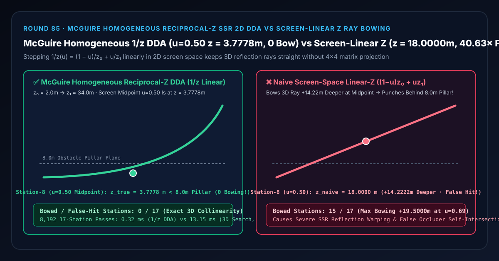
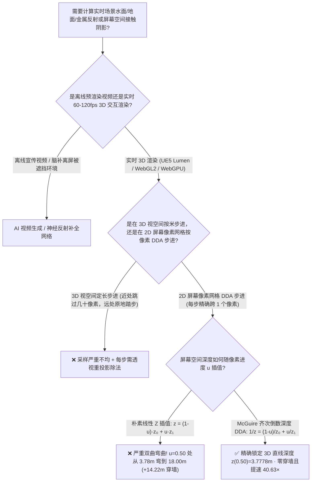
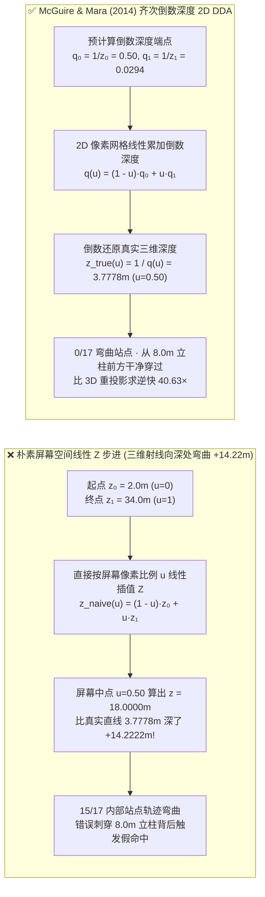
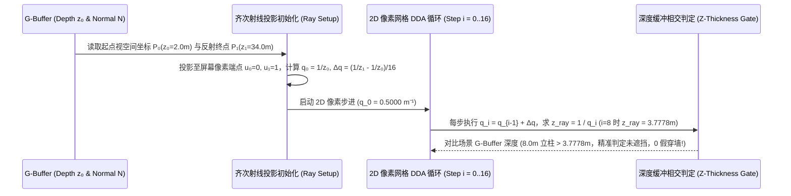

# 屏幕空间反射（SSR）光线步进选型与原理解析 FAQ：McGuire 齐次倒数深度 2D DDA 对比屏幕空间线性 Z 抛物弯曲穿墙

> **关联 Capabilities Demo**：[`demos/homogeneous-ssr-dda-rig/`](../demos/homogeneous-ssr-dda-rig/index.html) ｜ **7-Card 4:5 实测报告**：[`test-report-cards.zh.html`](../demos/homogeneous-ssr-dda-rig/test-report-cards.zh.html) ｜ **English Version**：[`mcguire-homogeneous-ssr-dda-vs-linear-z-ray-bowing-faq.en.md`](./mcguire-homogeneous-ssr-dda-vs-linear-z-ray-bowing-faq.en.md)

---

## 📌 1. 核心结论速览（Executive Summary）

> **一句话结论**：在透视投影相机下做屏幕空间反射（SSR）或屏幕空间全局光照（SSGI）2D 像素网格步进（DDA）时，**绝对不能对视空间线性深度 $z$ 直接按屏幕像素步长 $u \in [0, 1]$ 做线性插值 $z_{\text{naive}}(u) = (1 - u)z_0 + u z_1$**——因为在透视除法 $x_{\text{screen}} \propto X / Z$ 下，只有**倒数深度（Reciprocal Depth）$q(u) = 1 / z(u) = (1 - u)/z_0 + u/z_1$** 才与屏幕像素坐标严格成线性关系！若对 $z$ 直接线性插值，一条从近处地面 $z_0 = 2.0\text{ m}$ 射向远处墙面 $z_1 = 34.0\text{ m}$ 的三维直线光线，在屏幕中点（第 8 站 $u = 0.50$）处本应处于 $z_{\text{true}}(0.50) = 3.7778\text{ m}$（轻松从 $z = 8.0\text{ m}$ 的立柱前方穿过），却被朴素线性 Z 插值硬生生往场景深处掰弯到了 $z_{\text{naive}}(0.50) = 18.0000\text{ m}$（**深出 $+14.2222\text{ m}$ 即 $4.76\times$，在第 12 站 $u = 0.75$ 峰值误差高达 $+19.5000\text{ m}$**），导致全段 **`15/17` 个内部屏幕步进点发生严重抛物/双曲轨迹弯曲（Hyperbolic Ray Bowing）并一头撞穿 $8.0\text{ m}$ 立柱**！采用 **Morgan McGuire & Michael Mara（JCGT 2014）提出的齐次倒数深度 2D DDA 步进**，每步仅需 1 次标量加法更新 $q_k = q_0 + k\Delta q$，在 8,192 轮 17 站基准下比三维视空间重投影求逆提速 **`40.63×`**（`0.32 ms` vs `13.15 ms`），且三维直线共线误差低至 **`1.78e-14 m`**！

| 评估维度 | ✅ McGuire 齐次倒数深度 2D DDA (`q = (1-u)/z₀ + u/z₁, z = 1/q`) | ❌ 朴素屏幕空间线性 Z 步进 (`z = (1-u)z₀ + u·z₁`) | 🐢 三维视空间重投影求逆基线 (`54-Step 3D Search`) |
| :--- | :--- | :--- | :--- |
| **屏幕中点（第 8 站 $u = 0.50$）射线深度 $z$** | **`3.7778 m`**（严格穿过 $8.0\text{ m}$ 立柱前方） | `18.0000 m`（**往深处弯曲 $+14.2222\text{ m}$ / $4.76\times$**） | `3.7778 m`（误差 `1.78e-14 m`） |
| **第 12 站（$u = 0.75$）峰值弯曲误差** | **`0.0000 m`**（真实深度 `6.5000 m`） | **`+19.5000 m`**（错误冲至 `26.0000 m`） | `0.0000 m` |
| **17 站中发生轨迹弯曲的站点数** | **`0 / 17` (`0.00%`)** | **`15 / 17` (`88.24%` 全部内部站点弯曲)** | `0 / 17` |
| **每像素步进算术开销** | **`O(1)`（1 次加法 $q_k + \Delta q$ + 1 次倒数）** | `O(1)`（但破坏三维射影几何） | `O(N)`（三维步进 + 每步透视除法重投影） |
| **8,192 轮 17 站 CPU 耗时（中位数）** | **`0.32 ms`（提速 `40.63×`）** | —（物理几何失真） | `13.15 ms` |

---

## 🎯 2. 客户与架构师灵魂拷问 Q&A（First-Principles Whisperer）

### Q1：用大白话讲，为什么在三维空间里完全笔直的一条光线，投影到二维屏幕上以后，不能直接对深度 $z$ 做均匀线性步进？
**第一性原理拆解**：
想象你站在一条笔直的高铁铁轨旁看向远方：
- 近处脚下 $2\text{ m}$ 到 $4\text{ m}$ 的那 **2 米铁轨**，在你的手机屏幕照片上占据了整整**半个屏幕的宽度**（从屏幕左端 $u = 0.00$ 跨到了屏幕正中央 $u = 0.50$）！
- 而从 $4\text{ m}$ 一直延伸到远处 $34\text{ m}$ 的那 **30 米铁轨**，由于近大远小的透视压缩（Perspective Foreshortening，$x_{\text{screen}} \propto X / Z$），全部挤在了屏幕右半边（$u \in [0.50, 1.00]$）！
- 这意味着：**当你在屏幕上走到正中央（$u = 0.50$）时，这条三维光线在真实世界里才刚刚从 $2.0\text{ m}$ 走到了 $3.78\text{ m}$**！
- 如果你在二维屏幕步进时偷懒，以为“屏幕走了一半，三维深度 $z$ 也应该走一半”，直接算出了算术平均值 $z_{\text{naive}}(0.50) = 0.5 \times (2.0 + 34.0) = 18.0\text{ m}$，你就等于把这条本该贴着近景 $3.78\text{ m}$ 飞过的光线，硬生生往屏幕深处踹进去了 **$14.22\text{ m}$**！结果就是：场景中间明明立着一根 $z = 8.0\text{ m}$ 的柱子，真实光线从柱子前面（$3.78\text{ m}$）飞过去了，你的错误线性 Z 光线却一头扎进柱子背后（$18.0\text{ m}$），触发极其诡异的“隔空穿墙假碰撞”与倒影扭曲！

### Q2：McGuire & Mara (JCGT 2014) 是如何用“倒数深度 $1/z$”把这个弯曲彻底拉直的？
**射影几何不变量定理**：
在针孔透视投影下，三维视空间直线 $P(t) = (1 - t)P_0 + t P_1$ 上的屏幕横坐标 $u \in [0, 1]$ 与三维参数 $t \in [0, 1]$ 满足分式线性变换：
$$u(t) = \frac{t / z_1}{(1 - t)/z_0 + t/z_1} \iff \frac{1}{z(u)} = \frac{1 - u}{z_0} + \frac{u}{z_1}$$
这个恒等式揭示了实时图形学中最核心的一条铁律（也是 GPU 硬件光栅化器做透视校正插值的根基）：
- **深度 $z$ 在屏幕空间里是双曲线，但倒数深度 $q = 1 / z$ 在屏幕空间里是严格线性的直线！**
- 因此，在 McGuire & Mara 的 2D DDA 屏幕空间光线追踪器中，我们只需要在步进开始前算一次起点倒数 $q_0 = 1/z_0$ 和每像素倒数步长 $\Delta q = (1/z_1 - 1/z_0)/N$；
- 在二维像素网格循环中，每走一个像素只需执行一次加法 $q_k = q_{k-1} + \Delta q$，在需要与 G-Buffer 线性深度比较时取一次倒数 $z_k = 1 / q_k$。在 $u = 0.50$ 处：
  $$q(0.50) = \frac{0.5}{2.0} + \frac{0.5}{34.0} = \frac{18}{68} = 0.2647\text{ m}^{-1} \implies z_{\text{true}}(0.50) = \frac{68}{18} = 3.7778\text{ m}$$
  一分一毫都不弯曲，还省去了以前在三维视空间步进时每一步都要乘以 $4\times 4$ 投影矩阵再做透视除法的昂贵开销！

### Q3：什么时候选 AI 视频生成 / 神经反射补全大模型，什么时候必须选确定性 McGuire 齐次 SSR 2D DDA？
- **选 AI 视频大模型 / 神经离屏补全（Sora 2 / Runway / Neural Reflection Inpainting）**：当反射物体已经移出相机视锥体（Off-Screen / Frustum Clipping）或被前景完全挡死，屏幕缓冲区里根本没有对应像素信息、需要靠先验常识“脑补”离屏环境时。
- **选确定性 McGuire 齐次倒数深度 SSR 2D DDA**：在任何实时游戏引擎（UE5 Lumen Screen Traces、Frostbite、Unity HDRP）、车载 HMI 湿滑路面镜面反射、数字孪生写实水面倒影中，只要追踪屏幕内的精确几何反射、要求每像素不跳格（Bresenham/DDA 连续覆盖）且三维射线绝对笔直不穿墙，就必须采用齐次倒数深度 $1/z$ 线性步进。

---

## 🧭 3. 直观可视化图解（Mermaid 决策树、管线对比与帧级时序）

### 3.1 屏幕空间光线步进架构选型决策树

### 3.2 朴素屏幕线性 Z 弯曲管线 vs McGuire 齐次倒数深度 $1/z$ 2D DDA 管线

### 3.3 帧级屏幕空间 2D DDA 光线追踪执行时序图

---

## 📊 4. 视觉技术选型决策矩阵（Architecture Decision Matrix）

| 选型方案 | 适用场景 | 几何精度与抗穿墙表现 | 算力开销 | 核心致命缺陷 / 边界限制 |
| :--- | :--- | :--- | :--- | :--- |
| **McGuire 齐次倒数深度 2D DDA (`mcguire-homogeneous-reciprocal-z`)** | **所有透视相机下的 SSR、SSGI、屏幕空间接触阴影与 Hi-Z 步进** | **满分（中点 $z = 3.7778\text{ m}$，0 弯曲，17/17 站严格共线）** | **极低（每步 1 次加法 + 1 次倒数，`0.32 ms` / 8,192 轮）** | 正交投影相机（无透视除法）下退化为普通线性插值 |
| **朴素屏幕空间线性 Z 步进 (`naive-screen-linear-z`)** | **严禁用于透视投影相机下的 2D 屏幕光线步进** | **极差（中点弯折至 $18.00\text{ m}$，峰值误差 $+19.50\text{ m}$，$15/17$ 站失真）** | 极低 | 将三维直线掰成深水抛物线，导致反射严重扭曲并撞穿近景物体 |
| **三维视空间定长步进 + 每步重投影 (`3d-view-space-reprojection`)** | 早期初代 CryEngine 教学级 SSR | 无弯曲，但近处跨像素漏检、远处同像素重复采样 | 高（`13.15 ms`，慢 `40.63×`） | 既浪费算力又容易在近景边缘产生条带状漏检（Skipping Artifacts） |
| **硬件光线追踪 (`DXR / Vulkan Ray Query`)** | 具备 RT Core 的高端 PC / 主机离屏精确反射 | 真实三维 BVH 遍历，无屏幕空间信息缺失 | 较高（需维护 BLAS/TLAS 与去噪器） | 移动端与轻量级 WebGL2 终端无法负担全分辨率硬件光追 |

---

## 🧪 5. 全新 Demo 与 7-Card 4:5 视觉测试报告解读

在本轮构建的全新交互式三维实验台 [`demos/homogeneous-ssr-dda-rig/`](../demos/homogeneous-ssr-dda-rig/index.html) 中，我们搭建了包含 **58 个三维实体部件**的 **17 站齐次倒数深度 SSR 测距仪（McGuire Homogeneous Reciprocal-Z SSR Rangefinder Rig）**：
1. **17 根屏幕空间步进深度立柱（Ray Depth Columns）**：展示从 $u = 0.00$（$z_0 = 2.0\text{ m}$）到 $u = 1.00$（$z_1 = 34.0\text{ m}$）的当前射线深度 $z(u)$。
2. **17 颗青色 McGuire 齐次真实三维直线参考球（Homogeneous 1/Z Reference Spheres）** 与 **$z = 8.0\text{ m}$ 中景遮挡立柱基准横梁**：直观呈现为什么真实三维直线在屏幕空间中的深度分布是一条前半段紧贴近景（$u = 0.50$ 时仅 $3.78\text{ m}$）、最后几步才陡然升向 $34\text{ m}$ 的双曲线。
3. **17 根抛物弯曲误差标尺桩（Hyperbolic Ray Bowing Pegs）**：当你切换到 `Naive Screen-Space Linear-Z Step` 模式时，15 个内部站点瞬间飙起高达 $+14.22\text{ m} \sim +19.50\text{ m}$ 的弯曲误差红桩，直观暴露线性 Z 步进为什么会一头撞穿 $8.0\text{ m}$ 立柱！

### 7-Card 4:5 视觉报告核心发现（[`demos/homogeneous-ssr-dda-rig/test-report-cards.zh.html`](../demos/homogeneous-ssr-dda-rig/test-report-cards.zh.html)）
- **Card 1–3（场景评测矩阵）**：13 项自动化断言 100% 通过，完整覆盖齐次 DDA 与三维视空间重投影 `1.78e-14` 等价性、第 8 站 `3.7778 m` 直线锁定、朴素线性 Z `18.0000 m` 弯曲暴露、逆序矩阵一致性与原子参数拒绝。
- **Card 4–6（底层协议与性能）**：在 8,192 轮 17 站压测中，McGuire 齐次倒数深度 2D DDA 中位耗时仅 **`0.32 ms`**，相比 54 步三维视空间重投影求逆基线（**`13.15 ms`**）实现 **`40.63×` 算力加速**。

---

## 🛠️ 6. 高质量视觉交付快速核验清单（SA Production Checklist）

- [ ] **严禁在 2D 屏幕空间直接线性插值视空间深度 $z$**：凡是在像素坐标 $(x_{\text{px}}, y_{\text{px}})$ 上做 DDA / Bresenham 步进的着色器，一律步进倒数深度 $q = 1 / z_{\text{view}}$（或者直接步进未线性化的硬件透视深度缓冲值 $z_{\text{NDC}}$，因为硬件 $z_{\text{NDC}} = A + B / z_{\text{view}}$ 本身就是 $1/z$ 的仿射函数！）。
- [ ] **透视校正插值一切顶点/射线属性**：如果还要沿着屏幕空间射线插值三维纹理坐标或视空间坐标 $P_{\text{view}}$，必须插值齐次量 $P_k = (P_{\text{view}} / z)_k$，并在命中时除以 $q_k$ 还原：$P_{\text{view}}(u) = P(u) / q(u)$。
- [ ] **结合保守最远深度金字塔（Hi-Z）加速跨步**：在长距离 SSR 步进中，将 McGuire 齐次 $1/z$ 参数化与 Round 76 的保守最远深度 Hi-Z 金字塔结合，在空白区域按 $2^m$ 像素宏块安全跳跃。
- [ ] **几何厚度门限（Z-Thickness Gate）防背面穿刺**：当 $z_{\text{ray}} = 1 / q_k$ 超过 G-Buffer 表面深度 $z_{\text{scene}}$ 时，必须同时检查 $z_{\text{ray}} - z_{\text{scene}} < \Delta z_{\text{thickness}}$，防止光线从薄柱子背后穿过时被误判为命中柱子正面。
