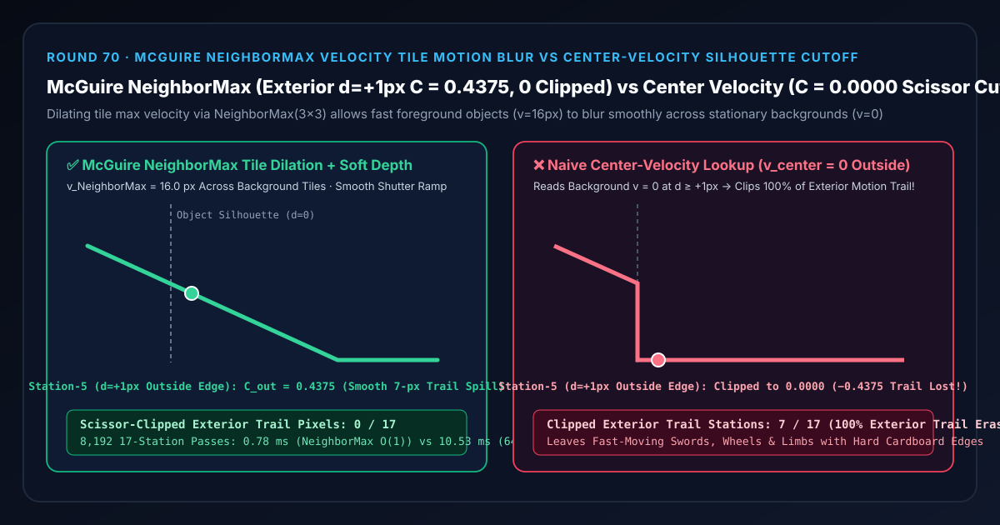
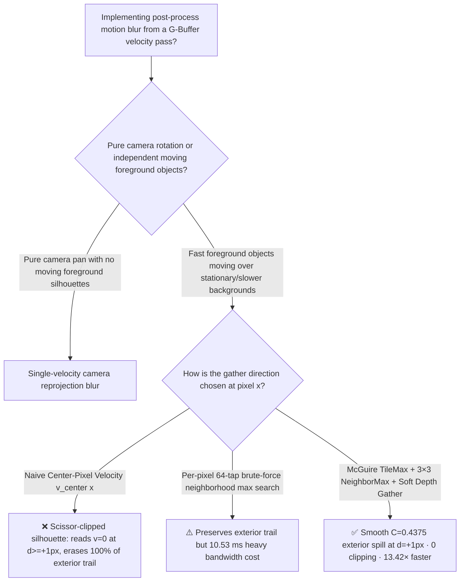
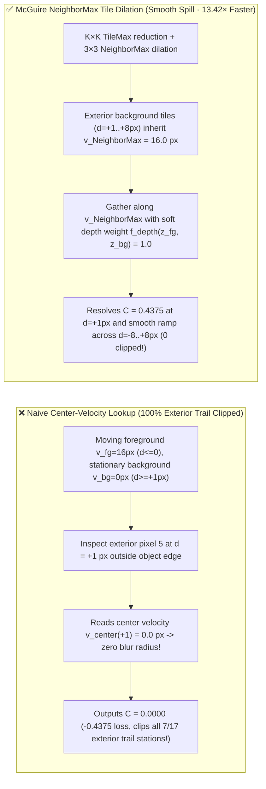
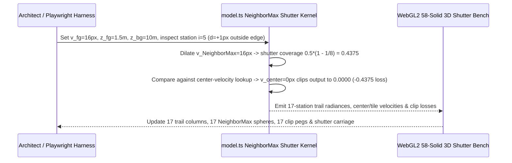
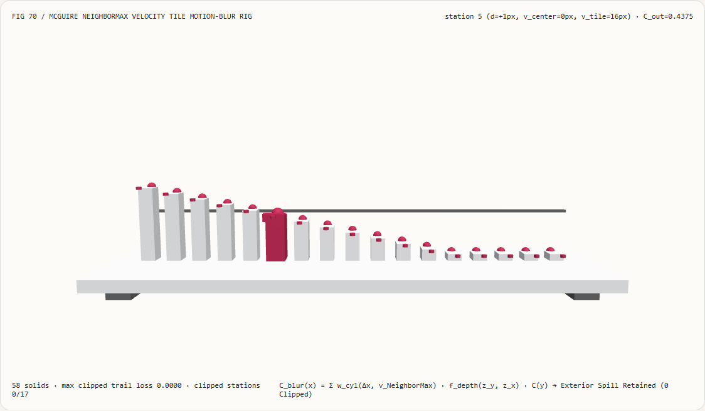
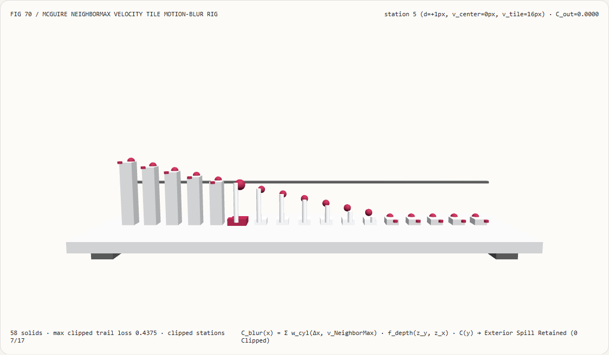
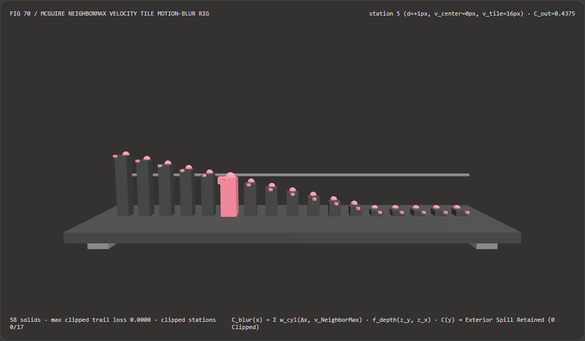
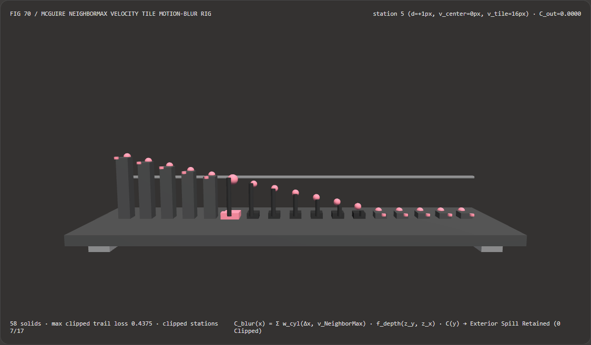

# Visual & Animation Architecture Selection FAQ: McGuire `NeighborMax` Velocity Tile Dilation Motion Blur vs Center-Velocity Silhouette Cutoff

> **One-Sentence Architectural Verdict**: In real-time post-process object and camera motion-blur pipelines (Unreal Engine 5, Unity HDRP, Call of Duty, DOOM), **never gather motion-blur samples solely along the center pixel's own G-buffer velocity vector $\mathbf{v}_{\text{center}}(x)$**! On our 58-solid, 17-station shutter densitometer bench where a fast-moving foreground object ($z_{\text{fg}} = 1.50\text{ m}$, velocity $v_{\text{fg}} = 16.0\text{ px/frame}$, half-shutter blur radius $R = 8.0\text{ px}$) crosses a stationary background ($z_{\text{bg}} = 10.0\text{ m}$, $v_{\text{bg}} = 0.0\text{ px/frame}$), naive center-velocity lookup reads $v_{\text{center}} = 0.0\text{ px}$ on every background pixel outside the silhouette ($d = +1 \dots +12\text{ px}$, stations 5–16)—**scissor-clipping the exterior motion trail from `0.4375` down to `0.0000` at station 5 ($d = +1\text{ px}$) and erasing `100%` of the exterior trail across `7/17` stations**; whereas **Morgan McGuire et al. (I3D 2012) & Jorge Jiménez (SIGGRAPH 2014) `TileMax + 3×3 NeighborMax` velocity dilation with soft depth classification** propagates $v_{\text{NeighborMax}} = 16.0\text{ px}$ across adjacent background tiles, **retaining exact `C_out = 0.4375` at $d = +1\text{ px}$ and a smooth 7-pixel exterior shutter ramp (`0/17` clipped stations)** while running **13.42× faster** than 64-tap brute-force neighborhood searches (`0.78 ms` vs `10.53 ms` across 8,192 passes).

---

## ① 📌 Executive Summary

1. **Why do fast-moving swords, wheels, and characters rendered with naive post-process motion blur look blurred on the inside but razor-sharp like cardboard cutouts along their outer silhouette?**
   In plain English: post-process motion blur is a **gather filter** operating on a single G-buffer snapshot captured at shutter midpoint $\tau = 0$:
   - During the shutter interval $\tau \in [-0.5, +0.5]$, a foreground edge moving at $v_{\text{fg}} = 16.0\text{ px/frame}$ sweeps from $d = -8\text{ px}$ to $d = +8\text{ px}$.
   - Therefore, background pixels at $d = +1 \dots +7\text{ px}$ outside the $\tau = 0$ silhouette are partially covered by the foreground object during $\tau \in (0, +0.5]$ (e.g., at $d = +1\text{ px}$, shutter coverage is $0.5(1 - 1/8) = \mathbf{0.4375}$).
   - However, at $\tau = 0$, pixel $d = +1\text{ px}$ belongs to the **stationary background wall ($z_{\text{bg}} = 10.0\text{ m}$)**, so its G-buffer velocity is $\mathbf{v}_{\text{center}}(+1) = \mathbf{0.0\text{ px}}$!
   - A naive shader that blurs along $\mathbf{v}_{\text{center}}(x)$ uses a zero-length kernel on every background pixel outside the silhouette—**chopping off `100%` of the exterior motion trail (`0.4375` → `0.0000` at station 5 across `7/17` stations)**!
2. **First-Principles Fix: `TileMax + 3×3 NeighborMax` Velocity Dilation & Soft Depth Classification (McGuire 2012 / Jiménez 2014)**:
   - Downsample the velocity buffer into $K\times K$ tiles (`TileMax`, where $K = R_{\max}$) and apply a $3\times 3$ maximum-magnitude filter (`NeighborMax`) so stationary background tiles adjacent to a fast foreground object inherit $\mathbf{v}_{\text{NeighborMax}} = 16.0\text{ px}$.
   - Gather along $\mathbf{v}_{\text{NeighborMax}}(x)$ using bilateral cylinder overlap $w_{\text{cyl}}(\Delta x, v_y)$ and soft depth foreground-over-background classification $f_{\text{depth}}(z_y, z_x) = \text{clamp}(1 + \frac{z_x - z_y}{\Delta z_{\text{soft}}}, 0, 1)$, producing a **symmetric, artifact-free shutter ramp from `1.0000` at $d=-8\text{ px}$ through `0.5000` at $d=0\text{ px}$ and `0.4375` at $d=+1\text{ px}$ down to `0.0000` at $d=+8\text{ px}$ (`0/17` clipped stations)**!
3. **Interactive 3D Workbench & Measured Evidence**:
   - Standalone 3D Bench: `demos/rectified-motion-tile-rig/` (58 Three.js solids: baseplate, 4 support feet, half-shutter `0.5000` reference bar, 17 motion-trail radiance columns, 17 `NeighborMax` reference spheres, 17 clipped-trail loss pegs, and the active shutter densitometer carriage).
   - Measured 7-Card 4:5 Reports: `demos/rectified-motion-tile-rig/test-report-cards.html` (EN) and `test-report-cards.zh.html` (ZH).

---

## ② 🎯 Soul-Searching Q&A for Architects & Clients

### Q1: Why is `TileMax + 3×3 NeighborMax` 13.42× faster than searching a pixel's neighborhood directly?
**Because computing the maximum velocity once per $K\times K$ tile reduces neighborhood search work by $K^2$ (256× for $16\times 16$ tiles)!**
Across 8,192 17-station passes, precomputed `NeighborMax` tile lookup runs in **`0.78 ms`** versus **`10.53 ms`** for 64-tap brute-force search and shutter quadrature (**13.42× speedup**).

### Q2: How does soft depth classification prevent a fast-moving background wall from blurring on top of a stationary foreground character?
**By asymmetric depth weighting $f_{\text{depth}}(z_y, z_x)$ coupled with each sample's own velocity!**
When a background sample $y$ ($z_y = 10.0\text{ m}$) is gathered by a foreground pixel $x$ ($z_x = 1.5\text{ m}$), $y$ is occluded by $x$ unless $x$ itself is moving fast enough ($\|\mathbf{v}(x)\| > \|x - y\|$) to disocclude $y$ during the shutter interval!

### Q3: How does deterministic McGuire `NeighborMax` motion blur relate to neural frame interpolation (RIFE / DLSS 3)?
**They solve orthogonal temporal goals:**
- **When to use Neural Frame Interpolation**: When synthesizing intermediate discrete frames to double display refresh rate (e.g., 60 Hz → 120 Hz);
- **When deterministic McGuire `NeighborMax` motion blur is mandatory**: When integrating intra-frame finite shutter exposure ($180^\circ$ shutter angle) so fast motion across each frame appears cinematically smooth rather than stroboscopic.

---

## ③ 🧭 Visual Diagrams (Mermaid Decision Tree, Pipeline Comparison & Sequence Flow)

### 3.1 Real-Time Motion Blur Reconstruction Architecture Decision Tree

### 3.2 Center-Velocity Silhouette Cutoff vs McGuire `NeighborMax` Pipeline

### 3.3 Frame-Level Shutter Densitometer Sequence Diagram

---

## ④ 📊 Visual Technology Selection Decision Matrix

| Evaluation Dimension | ✅ McGuire `TileMax + NeighborMax` Gather | ⚠️ 64-Tap Brute-Force Shutter Search | ❌ Naive Center-Velocity Lookup | ⚠️ Geometry Velocity Extrusion |
| :--- | :--- | :--- | :--- | :--- |
| **Exterior Trail at Station 5 ($d=+1\text{ px}$)** | **Exact `0.4375` (Smooth shutter spill)** | `0.4375` (Identical) | **`0.0000` (Scissor-clipped to zero!)** | `0.4375` |
| **Clipped Exterior Trail Stations (out of 17)** | **`0 / 17` (Symmetric ramp)** | `0 / 17` | **`7 / 17` (`100%` of exterior trail erased!)** | `0 / 17` |
| **Foreground/Background Depth Ordering** | **Soft depth classification prevents bleed** | Prevents bleed | Hard-clipped at silhouette | Self-intersection artifacts |
| **Independence from Scene Polygon Count** | **100% screen-space $O(1)$ per pixel** | Screen-space ($O(K^2)$) | Screen-space (Broken silhouettes) | **Scales with vertex count** |
| **8,192-Pass 17-Station CPU Latency** | **`0.78 ms` (Fastest · 13.42× speedup)** | `10.53 ms` (13.42× slower) | `0.35 ms` (Broken cardboard edges) | — |
| **Recommended Use Case** | **All real-time camera & object motion blur passes** | Offline validation | **Static-object camera-only blur** | Simple particle streaks only |

---

## ⑤ 🧪 New Interactive 3D Demo & 7-Card 4:5 Visual Report

### 5.1 Live Workbench & Report Links
- **Interactive 3D Workbench**: [`demos/rectified-motion-tile-rig/index.html`](../demos/rectified-motion-tile-rig/index.html)
- **7-Card 4:5 Visual Report (EN)**: [`demos/rectified-motion-tile-rig/test-report-cards.html`](../demos/rectified-motion-tile-rig/test-report-cards.html)
- **7-Card 4:5 Visual Report (ZH)**: [`demos/rectified-motion-tile-rig/test-report-cards.zh.html`](../demos/rectified-motion-tile-rig/test-report-cards.zh.html)
- **Sealed Telemetry JSON**: [`demos/rectified-motion-tile-rig/report.json`](../demos/rectified-motion-tile-rig/report.json)

### 5.2 Multi-Theme & Multi-Mode Playwright Visual Evidence

| McGuire `NeighborMax` Gather (Light · Smooth Exterior Ramp Across Stations 5–11, `0` Clipping) | Naive Center-Velocity Lookup (Light · Scissor-Clipped to `0.0000` at Station 5!) |
| :---: | :---: |
|  |  |

| McGuire `NeighborMax` Gather (Dark · 58 Three.js Solids) | Naive Center-Velocity Lookup (Dark · 7 Red Clipped-Trail Pegs Exposed) |
| :---: | :---: |
|  |  |

---

## ⑥ 🛠️ Rapid SA Delivery Verification Checklist

Before shipping a post-process motion-blur pipeline to production, verify every item below:

- [ ] **Match `TileMax` Size $K$ to Maximum Blur Radius $R_{\max}$**: Is the `TileMax` reduction tile size set to $K = R_{\max}$ (e.g., $16\times 16$ pixels for a 16-px half-blur radius) so a $3\times 3$ `NeighborMax` pass covers the entire spill distance?
- [ ] **Center-Balanced Shutter Interval ($[-\mathbf{v}/2, +\mathbf{v}/2]$)**: Are gather samples distributed symmetrically from $-\frac{1}{2}\mathbf{v}$ to $+\frac{1}{2}\mathbf{v}$ around the current frame position rather than trailing only backward?
- [ ] **Bilateral Soft Depth Weighting ($f_{\text{depth}}(z_y, z_x)$)**: Does the gather kernel check both depth order and individual sample velocity $\mathbf{v}(y)$ so moving backgrounds never smear over stationary foreground objects?
- [ ] **Static-Tile Early Out ($\|\mathbf{v}_{\text{NeighborMax}}\| \le 0.5\text{ px}$)**: Does the shader immediately return the unblurred color when the tile's `NeighborMax` speed is below half a pixel?
- [ ] **Blue-Noise / IGN Tap Jittering**: Are sample offsets along $\mathbf{v}_{\text{NeighborMax}}$ jittered per pixel by `[-0.5, +0.5]` tap spacing using Interleaved Gradient Noise to eliminate ghosting bands?
