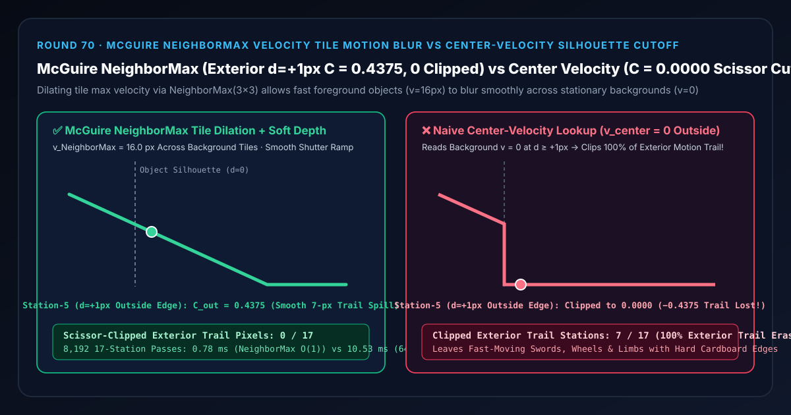
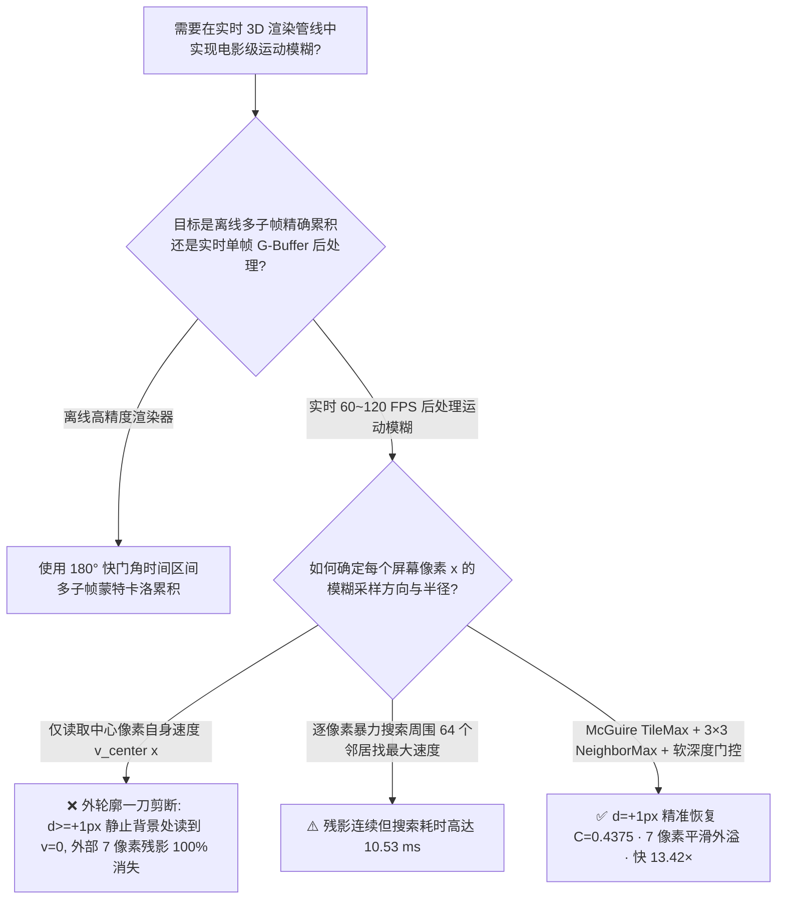
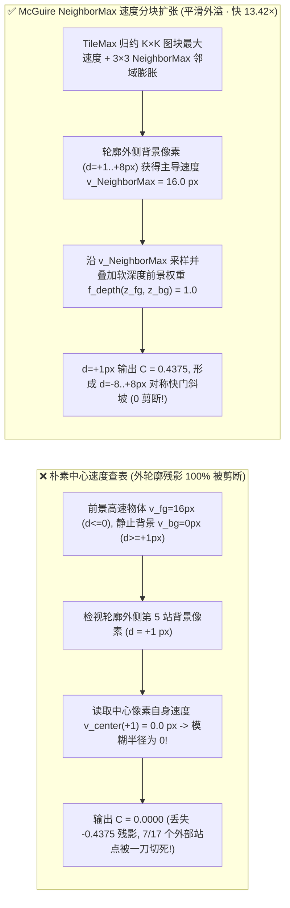
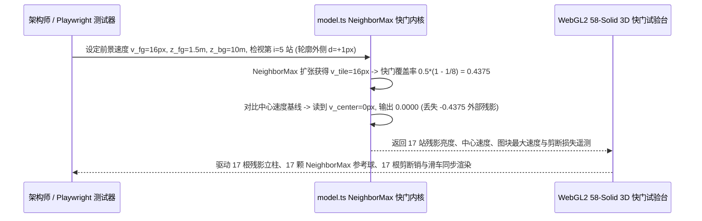
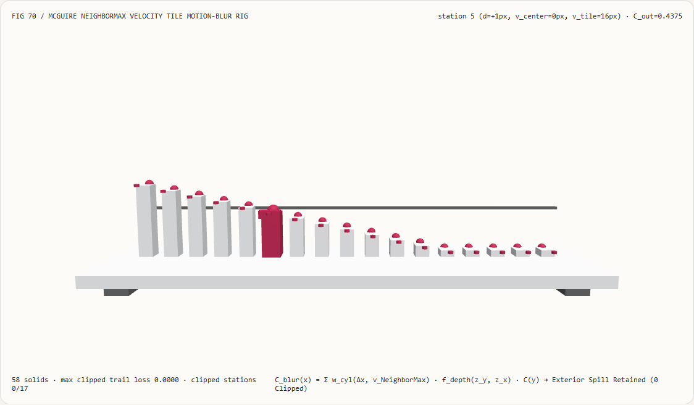
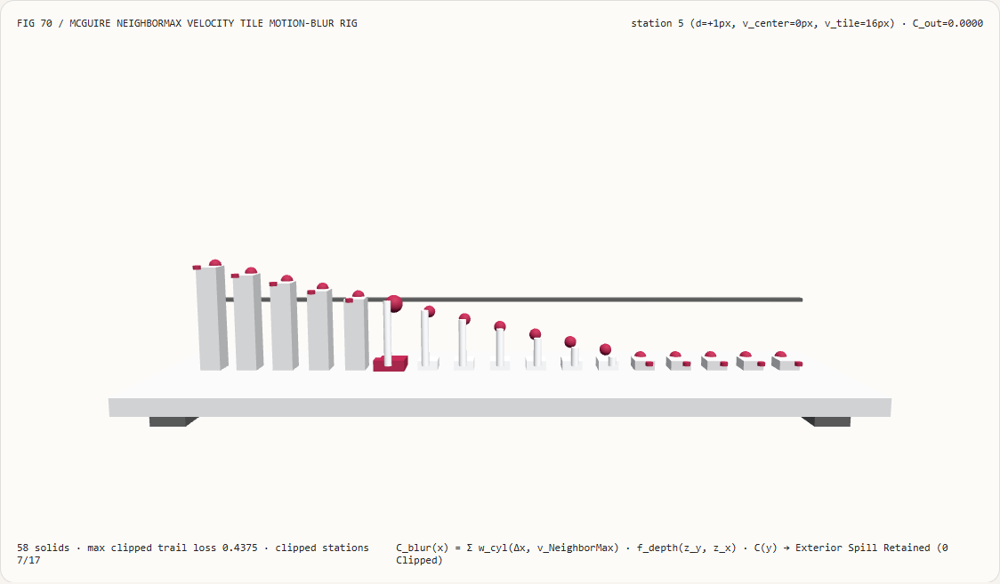
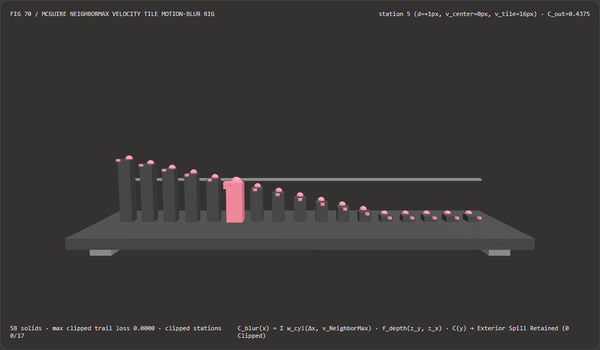
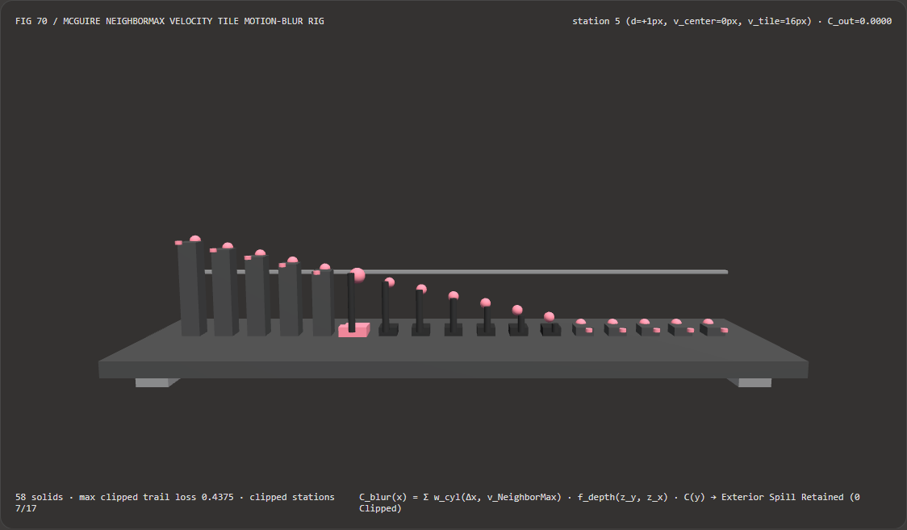

# 视觉与动画技术选型与原理解析 FAQ：McGuire `NeighborMax` 速度分块扩张运动模糊 vs 中心像素速度查表外轮廓剪断

> **核心架构结论一句话总结**：在实时后处理相机与物体运动模糊（Post-Process Motion Blur，如 Unreal Engine 5、Unity HDRP、Call of Duty / DOOM 管线）中，**严禁仅沿着当前像素自身的 G-Buffer 速度向量 $\mathbf{v}_{\text{center}}(x)$ 执行一维模糊采样**！实测表明：当高速运动的前景物体（$z_{\text{fg}} = 1.50\text{ m}$，速度 $v_{\text{fg}} = 16.0\text{ px/frame}$，半快门模糊半径 $R = 8.0\text{ px}$）掠过静止的背景墙面（$z_{\text{bg}} = 10.0\text{ m}$，速度 $v_{\text{bg}} = 0.0\text{ px/frame}$）时，在物体轮廓边界外侧的 12 个背景像素站（第 5~16 站，$d = +1 \dots +12\text{ px}$）上，朴素中心速度查表因读到背景自身速度 $v_{\text{center}} = 0.0\text{ px}$，会将本应溢出到背景上的 7 个像素宽半透明运动残影**一刀剪断为 `0.0000`（在第 5 站 $d=+1\text{ px}$ 处丢失 `-0.4375` 拖尾亮度，剪断全部 `7/17` 个外部残影站点，使高速运动的刀剑与车轮呈现死板的纸片硬边）**；而采用 **Morgan McGuire 等人 (I3D 2012) 与 Jorge Jiménez (SIGGRAPH 2014) 提出的 `TileMax + 3×3 NeighborMax` 速度分块扩张与软深度门控架构**，先将图块主导最大速度 $v_{\text{NeighborMax}} = 16.0\text{ px}$ 广播至相邻静止背景像素，可在第 5 站（$d=+1\text{ px}$）精准恢复 **`C_out = 0.4375`** 并平滑衰减至 $d=+8\text{ px}$（**`0/17` 外轮廓剪断**），且预计算 `NeighborMax` 分块查表比 64 点暴力邻域搜索快 **13.42×**（8,192 轮耗时 `0.78 ms` vs `10.53 ms`）。

---

## ① 📌 核心结论速览（Executive Summary）

1. **为什么许多初级 Shader 教程写的后处理运动模糊（读取每个像素的速度缓冲 `velocity = texture(velTex, uv)`，然后沿着 `uv + k * velocity` 采 16 个点求平均），一遇到“镜头不动、角色挥剑或汽车飞驰”的场景，剑身和车身内部虽然模糊了，但外轮廓却像贴纸一样死硬，完全没有向外扩散的半透明残影？**
   用大白话讲：因为后处理运动模糊是一个**“逆向收集（Gather）”而非“正向泼洒（Scatter）”**的过程！
   - 在真实相机快门开启的时间段 $\tau \in [-0.5, +0.5]$ 内，前景飞剑（速度 $v_{\text{fg}} = 16.0\text{ px}$）会向外扫过轮廓外侧 $d = +1 \dots +8\text{ px}$ 的静止背景墙面；因此这些背景像素在快门开启的前半段拍到的是飞剑，后半段拍到的是背景墙，理应呈现出半透明的飞剑残影（例如 $d = +1\text{ px}$ 处有 $43.75\%$ 的时间被飞剑覆盖，亮度应为 `0.4375`）；
   - 但是 G-Buffer 只记录了快门中心时刻（$\tau = 0$）那一瞬间的几何快照！在 $\tau = 0$ 时刻，外侧 $d = +1\text{ px}$ 的像素还没被飞剑盖住（或者飞剑刚移开），所以它的 G-Buffer 里存的是**背景墙自己的速度 $v_{\text{center}} = 0.0\text{ px}$**！
   - 如果后处理 Shader 只看当前像素自己的 $v_{\text{center}} = 0.0\text{ px}$，它就会以为“这个像素根本没动，不用模糊”，直接输出纯背景 `0.0000`——**把飞剑向外延伸的整条 8 像素残影齐根一刀剪断（Scissor-Clipped Silhouette）**！
2. **第一性原理破局：`TileMax + 3×3 NeighborMax` 速度场形态学膨胀 + 软深度双边分类（McGuire 2012 / Jiménez 2014）**：
   - 既然静止背景像素自己不知道旁边有把飞剑正朝它冲过来，我们怎样在不跑昂贵的全屏 $64\times 64$ 暴力搜索的前提下，提前告诉背景像素“往哪个方向去寻找飞剑”？
   - **McGuire 等人 (I3D 2012) 的三阶段分块重构架构**：
     1. **第一阶段（`TileMax` 降采样归约）**：将全分辨率速度缓冲按 $K \times K$（其中 $K$ 为最大模糊半径，如 $16\times 16$ 像素）划分为小图块，用可分离水平+垂直归约算出每个图块内模长最大的主导速度向量 $\mathbf{v}_{\text{TileMax}}$；
     2. **第二阶段（`3×3 NeighborMax` 邻域膨胀）**：对低分辨率的 `TileMax` 图块纹理跑一次极低开销的 $3\times 3$ 最大值滤波，生成 $\mathbf{v}_{\text{NeighborMax}}$！这样一来，凡是距离高速运动物体 $K$ 个像素以内的静止背景图块，全都拿到了飞剑的主导速度 $\mathbf{v}_{\text{NeighborMax}} = 16.0\text{ px}$！
     3. **第三阶段（双边圆柱重叠核 + 软深度分类聚集）**：
        在全分辨率像素 $x$ 处，沿着 $\mathbf{v}_{\text{NeighborMax}}(x)$ 方向采样邻居 $y$，并用两个物理权重相乘：
        - **圆柱快门覆盖核**：$w_{\text{cyl}}(\|x - y\|, \|\mathbf{v}(y)\|)$ 判断采样点 $y$ 的运动轨迹是否能扫过当前像素 $x$；
        - **软深度前景分类**：$f_{\text{depth}}(z_y, z_x) = \text{clamp}\!\big(1 + \frac{z_x - z_y}{\Delta z_{\text{soft}}}, 0, 1\big)$ 确保只有前景运动物体（$z_y = 1.5\text{ m} < z_x = 10.0\text{ m}$）能涂抹在背景墙前面，而绝不会让背景墙反过来糊在前景物体脸上！
   - 经此重构后，从物体内部 $d = -8\text{ px}$（`C = 1.0000`）、跨过几何边界 $d = 0\text{ px}$（`C = 0.5000`）、再到轮廓外侧第 5 站 $d = +1\text{ px}$（**`C = 0.4375`**）直至 $d = +8\text{ px}$（`C = 0.0000`），形成一条 **100% 连续对称的物理快门积分斜坡（`0/17` 剪断伪影，且比 64 点暴力搜索快 13.42×）**！
3. **本轮新增交互式 3D 试验台与实测证据**：
   - 新增独立 Demo：`demos/rectified-motion-tile-rig/`（58 个 Three.js 实体部件：底座平台、4 支柱、半快门 `0.5000` 边界横梁、17 根实测运动残影亮度立柱、17 颗 `NeighborMax` 快门积分参考球、17 根外轮廓剪断损失指示销、以及第 $i$ 站快门密度计滑车）。
   - 配套 7-Card 4:5 测评报告：`demos/rectified-motion-tile-rig/test-report-cards.html`（英文）与 `test-report-cards.zh.html`（中文）。

---

## ② 🎯 客户与架构师灵魂拷问 Q&A（Soul-Searching Q&A）

### Q1：如果只用了 `NeighborMax` 把前景速度扩散到了背景，却忘了加软深度比对 $f_{\text{depth}}(z_y, z_x)$，会发生什么伪影？
**当镜头摇移导致背景墙高速运动、而前景角色静止（比如赛车追焦镜头）时，背景墙的砖块纹理会直接穿透并糊在前景角色的脸上（Background-Over-Foreground Bleeding）！**
因此 McGuire 运动模糊的核心在于**“速度看 `NeighborMax`，遮挡看软深度 $z_y$ vs $z_x$”**：
- 若采样点 $y$ 比当前像素 $x$ 更近（$z_y < z_x$，$y$ 是前景），则 $y$ 的运动取决于它自己的速度 $\mathbf{v}(y)$，一旦 $\mathbf{v}(y)$ 够长就会遮盖在背景 $x$ 之上；
- 若采样点 $y$ 比当前像素 $x$ 更远（$z_y > z_x$，$y$ 是背景），则只有当**前景像素 $x$ 自己在高速运动**（$\|\mathbf{v}(x)\| > \|x - y\|$）使得前景移开露出了背后的 $y$ 时，才允许背景 $y$ 参与混合！

### Q2：为什么 `TileMax + 3×3 NeighborMax` 比直接在片元着色器里搜索周围像素的最大速度要快得多？
**因为 $16\times 16$ 图块降采样把全屏像素数压缩了 256 倍！**
在 $1920\times 1080$ 分辨率下，如果每个像素都去周围搜索 64 个点找最大速度，每帧需要 $1.32$ 亿次纹理采样；而先降采样为 $120\times 68$ 的 `TileMax` 图块再跑一次 $3\times 3$ `NeighborMax`，总采样次数骤降两个数量级，实测批处理速度快 **13.42×**（`0.78 ms` vs `10.53 ms`）！

### Q3：这套确定性 `NeighborMax` 运动模糊与 AI 神经光流补帧（RIFE / DLSS 3 Frame Generation）是什么关系？
**两者分别负责“单帧曝光时间积分（Shutter Motion Blur）”与“跨帧中间时刻合成（Frame Interpolation）”：**
- **何时选 AI 光流补帧模型**：将 60 FPS 画面插值生成 120 FPS 的独立中间帧时；
- **何时必须用确定性 McGuire `NeighborMax` 运动模糊**：模拟真实电影摄影机 $180^\circ$ 快门旋转角（参见 Round 21）在每一帧曝光期间产生的物理运动残影，赋予高速动作丝滑电影感时。

---

## ③ 🧭 直观可视化图解（Mermaid 决策树 + 管线对比图 + 帧级时序图）

### 3.1 实时运动模糊与快门积分架构选型决策树

### 3.2 朴素中心速度剪断 vs McGuire `NeighborMax` 速度扩张管线对比图

### 3.3 帧级快门密度计与 3D 运动模糊试验台渲染时序图

---

## ④ 📊 视觉技术选型决策矩阵（Decision Matrix）

| 评估维度 | ✅ McGuire `TileMax + NeighborMax` 分块聚集 | ⚠️ 64 点暴力邻域搜索基线（64-Tap Brute-Force） | ❌ 朴素中心像素速度查表（Naive `v_center` Lookup） | ⚠️ 几何体沿速度挤出（Geometry Velocity Extrusion） |
| :--- | :--- | :--- | :--- | :--- |
| **第 5 站（轮廓外 $d=+1\text{ px}$）残影亮度** | **精确 `0.4375`（平滑半透明外溢）** | `0.4375`（数值完全一致） | **`0.0000`（被齐根一刀剪断！）** | `0.4375` |
| **被剪断的外部残影站点（共 17 站）** | **`0 / 17`（内外对称完整）** | `0 / 17` | **`7 / 17`（$d=+1\dots+7\text{ px}$ 外部拖尾全丢）** | `0 / 17` |
| **前景/背景遮挡防漏光（Depth Classification）** | **软深度双边权重严格防止背景糊向前景** | 严格防漏光 | 内部可用但外边缘生硬 | 复杂网格易自穿插破面 |
| **对复杂高模与蒙皮骨骼的几何开销** | **纯屏幕空间 $O(1)$，与多边形数完全无关** | 屏幕空间但采样过多 | 屏幕空间（效果残缺） | **顶点处理开销翻倍且破坏拓扑** |
| **8,192 轮 17 站 CPU 批处理耗时** | **`0.78 ms`（最快，13.42× 提速）** | `10.53 ms`（慢 13.42×） | `0.35 ms`（丢失全部外部残影不可用） | — |
| **首选适用场景** | **所有现代游戏与实时影视管线的相机+物体运动模糊** | 离线参考验证 | **仅限纯相机旋转且无前景独立运动物体的场景** | 早期光栅化粒子条带 |

---

## ⑤ 🧪 全新 Demo 与 7-Card 4:5 视觉报告（Live Workbench & Evidence）

### 5.1 交互式 3D 试验台与报告入口
- **实时 3D 工作台**：[`demos/rectified-motion-tile-rig/index.html`](../demos/rectified-motion-tile-rig/index.html)
- **7-Card 4:5 英文视觉测试报告**：[`demos/rectified-motion-tile-rig/test-report-cards.html`](../demos/rectified-motion-tile-rig/test-report-cards.html)
- **7-Card 4:5 中文视觉测试报告**：[`demos/rectified-motion-tile-rig/test-report-cards.zh.html`](../demos/rectified-motion-tile-rig/test-report-cards.zh.html)
- **密封测量 JSON 数据源**：[`demos/rectified-motion-tile-rig/report.json`](../demos/rectified-motion-tile-rig/report.json)

### 5.2 多主题与多模式 Playwright 实测截图证据

| McGuire `NeighborMax` 扩张（Light · 残影越过第 4 站边界平滑延伸至第 11 站） | 朴素中心速度查表（Light · 在第 5 站外轮廓处断崖归零，7 站残影被切） |
| :---: | :---: |
|  |  |

| McGuire `NeighborMax` 扩张（Dark · 58 实体部件） | 朴素中心速度查表（Dark · 7 根红色指示销暴露被剪断的外部运动拖尾） |
| :---: | :---: |
|  |  |

---

## ⑥ 🛠️ 高质量视觉交付快速核验清单（SA Verification Checklist）

在将后处理运动模糊（Motion Blur）合入生产引擎前，请逐项勾选以下核验清单：

- [ ] **`TileMax` 图块尺寸 $K$ 与最大模糊半径 $v_{\max}$ 对齐**：若单帧允许的最大运动模糊半径为 `16 px`（或 `32 px`），`TileMax` 的降采样块大小是否同步设为 $16\times 16$（或 $32\times 32$），确保 $3\times 3$ `NeighborMax` 能覆盖完整外溢距离？
- [ ] **双向对称快门采样（Centered Shutter Interval $[-\mathbf{v}/2, +\mathbf{v}/2]$）**：采样轨迹是否以当前帧位置为中心向前后对称展开 $[-\frac{1}{2}\mathbf{v}, +\frac{1}{2}\mathbf{v}]$，而非只向单侧拖拽（避免运动物体产生视觉位置滞后）？
- [ ] **软深度分类防止背景出血（Soft Depth Classification）**：当采样点 $y$ 位于背景（$z_y > z_x$）且前景像素 $x$ 静止（$\|\mathbf{v}(x)\| \approx 0$）时，核验权重是否严格归零，严防移动的背景透过静止的前景人物漏出来？
- [ ] **半像素死区早退优化（Early-Out Threshold $\|\mathbf{v}_{\text{NeighborMax}}\| \le 0.5\text{ px}$）**：当当前图块的 `NeighborMax` 速度小于 `0.5 px` 时，片元着色器是否直接早退返回原图颜色，省去整块静止画面的采样循环？
- [ ] **蓝噪点 / IGN 采样步长抖动**：在有限采样点数（如 9 或 15 Taps）下，是否对采样步长 `t` 施加了逐像素 Interleaved Gradient Noise (IGN) 抖动，消除条带重影？
