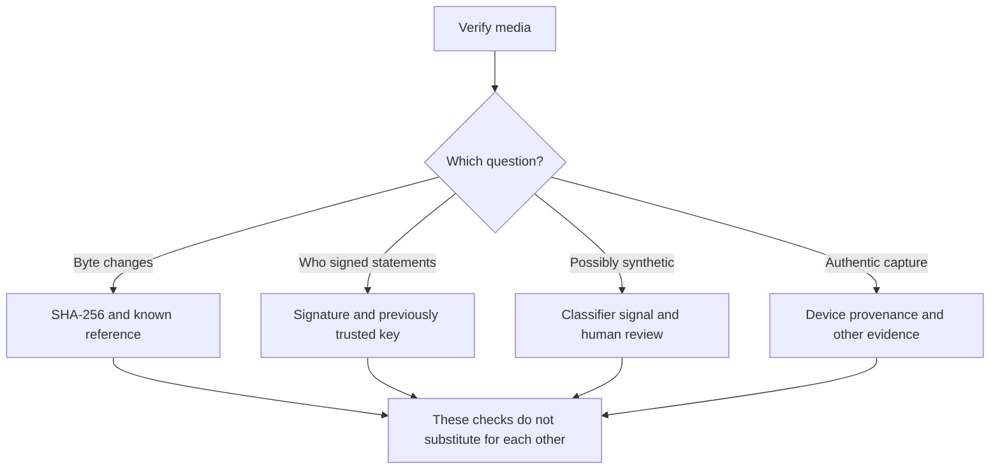
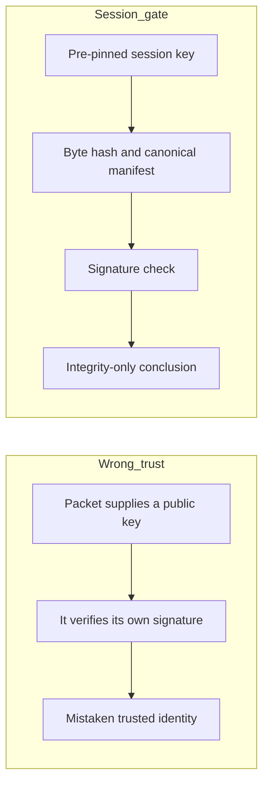
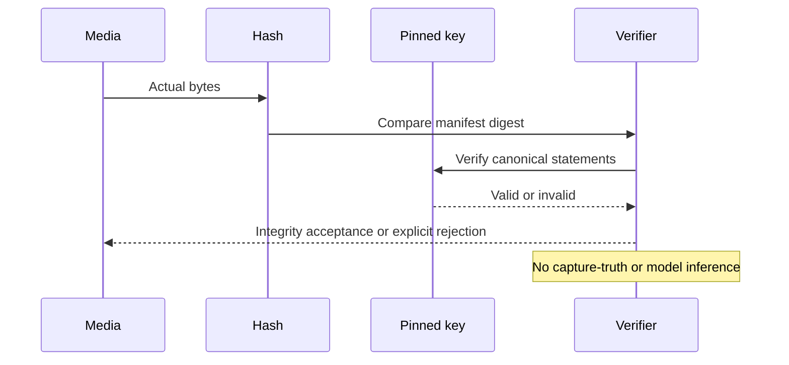

# Matching bytes do not prove authentic capture: media integrity, signatures and detection FAQ

**Three minutes for three proofs; ten minutes for a tamper-aware delivery gate.**

[中文](media-integrity-vs-synthetic-detection-faq.md) · [Interactive demo](https://turbo998.github.io/animation/demos/render-evidence-vault/) · [Measured cards](../demos/render-evidence-vault/test-report-cards.html)

## ① 📌 Executive Summary

- **A hash answers byte equality, not visual truth.** Original synthetic video can have a perfectly correct SHA-256. Hashing is not AI-video detection.
- **Signatures depend on a previously trusted key.** A replacement public key can validate its own signature while failing the pinned session key.
- **Authenticity requires other evidence.** A legitimate creator can sign synthetic or misleading media. This prototype does not certify devices, identity, time or capture truth.
- **Original 54-solid gate, twelve checks.** Input binds the actual sealed 383,787-byte Round8 WebM. Wrong MIME/header/digest is rejected instead of signing fallback HTML.
- **Private key stays non-extractable in memory.** Export public proof only. Ephemeral browser-session trust is not third-party identity certification.

**Verified daily direction:** NVIDIA's July 20, 2026 SIGGRAPH material introduced Synthetic Video Detector NIM as a frame-level classifier signal for editorial/media review, not a replacement for established verification. Checked November 9, 2026. **No NIM, model or paid detection service ran; vendor accuracy/latency are not borrowed.**

## ② 🎯 Customer and architect Q&A

### Q1 When should I choose AI video versus interactive code?

Evaluate models for creative appearance and motion. Code interaction better exposes byte fingerprints, signature trust and delivery gates.

Whether generated or captured, a clip still needs integrity/source workflows. **Generation, detection, signing and authentic capture are different tasks.** The animated gate visualizes checks; its opening does not establish truthful content.

### Q2 Which constraints give code a strict advantage?

Fixed input bytes, canonical manifests, previously trusted public keys, explicit tamper rejection and reproducible experiments are directly inspectable. Synthetic detection is a statistical task needing its own data, thresholds and false-positive/negative evaluation.

Useful for technical-video packages, render-asset acceptance and review-evidence prototypes. Forensics, trusted camera capture, timestamps, third-party identity and production key management need additional systems.

### Q3 What does the pipeline actually prove?

A hash is like a parcel seal's number: changing bytes changes the number. The number cannot establish that the parcel's story is true.

A signature resembles a controlled stamp binding canonical statements to a key. Before verification you must know which public key is trusted—not let the parcel declare its own stamp trustworthy.

The prototype first validates the sealed WebM input, computes SHA-256, records dimensions/frame count/fps/digest in a strict manifest and signs it using an ephemeral P-256 private key. It separately compares file hashes, pinned-key signatures and the deliberately simplified inline-key check.

**Dimensions/frame counts are signed claims.** They are not decoded again here, and there is no capture-authenticity inference. Round8's measured encode/decode evidence is separate, not replaced by a signature.

In key substitution the bytes remain equal and the attacker signature is valid under its own key; only the pinned-key check rejects it. Passing a rejection test is not accepting the tampered media.

### Q4 How can I reproduce it in ten minutes?

1. Run `npm run dev`, open `/demos/render-evidence-vault/` and inspect original acceptance.
2. Change file bytes: digest fails even while the original manifest signature remains valid.
3. Change manifest fields: pinned signature fails.
4. Replace the key: inline verification passes but the pinned key rejects it.
5. Export `PUBLIC_RENDER_PROOF.json`, which contains no private key. A new session has a new key, not a permanent identity.
6. Run `npx vitest run tests\render-proof.test.ts`; after build/preview at 4335 run `node scripts\benchmark-render-proof.mjs`.

## ③ 🧭 Visual explanations

## ④ 📊 Architect Decision Matrix

| Question | File hash | Pinned-key signature | Synthetic classifier | Capture/source evidence |
| --- | --- | --- | --- | --- |
| Bytes changed? | Suitable with reference | Bind the digest | Not responsible | May include it |
| Manifest changed? | File hash alone insufficient | Suitable | Not responsible | May include it |
| Trusted signer identity? | Not proven | Key trust chain needed | Not proven | Independent identity source |
| AI-generated possibility? | Not classified | Not classified | Statistical thresholded signal | Not equivalent to classification |
| Content true? | Not proven | Not proven | Insufficient alone | Multiple evidence layers |

**Count example:** four scenarios: one original should pass, three tamper/substitution cases should reject. Twelve acceptance checks include those expected rejections; they are not twelve real videos classified correctly.

## ⑤ 🧪 New demo and measured findings, including seven cards

The [sealed report](../demos/render-evidence-vault/report.json) records actual native SHA-256/ECDSA P-256 and key substitution. Twelve local checks and a 54-solid gate bind the actual 383,787-byte WebM via MIME/header/reference digest.

| Eight buffers per batch | Parallel native median | Sequential native median |
| --- | --- | --- |
| 65,536 bytes/buffer | 0.4 ms | 0.4 ms |
| 262,144 bytes/buffer | 1.4 ms | 1.4 ms |
| 1,048,576 bytes/buffer | 8.5 ms | 10.0 ms |

Seven alternating warmed browser runs per path, excluding buffer setup, signatures and drawing. Outputs match. Small tiers do not show a meaningful parallel gain; hashing throughput is not video-detector latency.

[English cards](../demos/render-evidence-vault/test-report-cards.html) · [中文七卡](../demos/render-evidence-vault/test-report-cards.zh.html). Scene: `synthetic`; native cryptography: `measured`; classifiers, devices and authentic capture: `not_measured`.

## ⑥ 🛠️ Architect Checklist

- [ ] Separate integrity, signer trust, classification and authentic capture.
- [ ] Validate MIME/container/reference digest; reject fallback HTML.
- [ ] Canonicalize strict fields; do not silently discard unknown claims.
- [ ] Establish public-key trust outside the packet.
- [ ] Never export or publish private keys.
- [ ] Test byte changes, manifest changes and key replacement separately.
- [ ] Distinguish successful rejection tests from accepted media.
- [ ] Do not turn ephemeral session keys into permanent identity claims.
- [ ] Preserve actual render/codec evidence separately from signed statements.
- [ ] Mark unexecuted models, forensics, devices and timestamps unmeasured.

**Primary source:** [NVIDIA SIGGRAPH 2026](https://blogs.nvidia.com/blog/siggraph-news-2026/), July 20, 2026 Synthetic Video Detector NIM editorial classifier signal; checked November 9, 2026. The service was not run; native hashes/signatures and model capability are different measurements.
