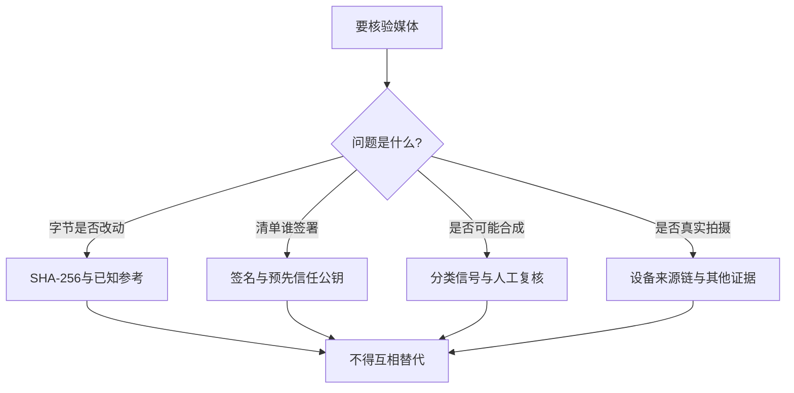
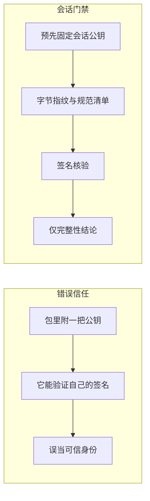
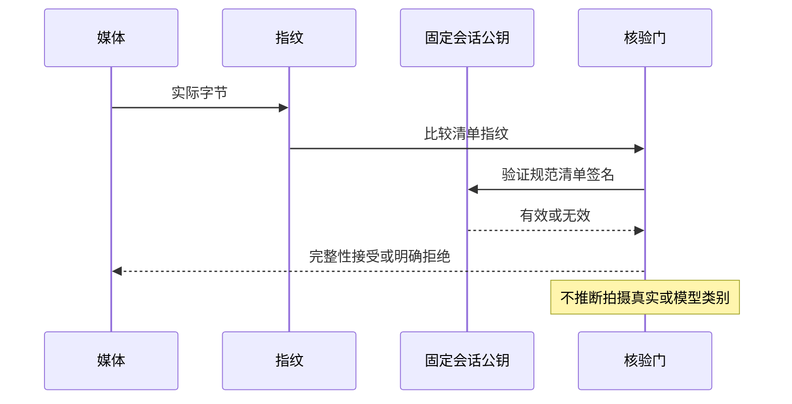

# 指纹一致不代表真实拍摄：媒体完整性、签名与合成检测选型 FAQ

**3 分钟分清三种证明，10 分钟复刻可识别篡改的媒体交付门禁。**

[English](media-integrity-vs-synthetic-detection-faq.en.md) · [交互 Demo](https://turbo998.github.io/animation/demos/render-evidence-vault/) · [中文七卡](../demos/render-evidence-vault/test-report-cards.zh.html)

## ① 📌 核心结论速览

- **指纹回答“字节是否相同”，不回答“画面是否真实”。** 原创合成视频也能拥有完全正确的 SHA-256。它不是 AI 视频检测器。
- **签名依赖预先信任的公钥。** 攻击者换一把公钥并自己签名，可以通过“信任包里公钥”的简化检查，却不能通过固定会话公钥。
- **真实性还需其他证据。** 一位真实创作者也能签署合成或误导视频；本例不证明拍摄设备、作者身份、时间或内容真实性。
- **54 实体原创检查门，12 项本机验收。** 实际输入绑定已封存的 383,787 字节 Round8 WebM；媒体 MIME、容器头和指纹不符时拒绝签署，不能把 HTML 回退页当视频。
- **私钥不出内存。** 浏览器生成不可导出的临时 P-256 私钥；只导出公开证明。这个会话的信任不等于第三方身份认证。

**每日能力方向核验：** NVIDIA 在 2026-07-20 SIGGRAPH 官方材料发布 Synthetic Video Detector NIM，把逐帧分类信号加入编辑与媒体复核流程，并强调它是额外信号，不替代既有核验。2026-11-09 核验。**本例没有调用 NIM、模型或付费检测服务，不借用厂商准确率或延迟。**

## ② 🎯 客户与架构师灵魂拷问 Q&A

### Q1 何时选 AI 视频大模型，何时选代码驱动动画？

需要生成创意外观、人物与运动时，可评估视频模型；需要解释字节指纹、签名信任和交付门禁时，代码交互更容易逐项检查。

无论视频来自模型还是人工拍摄，交付仍需完整性与来源流程。**生成、检测、签名、真实拍摄是四个不同任务。** 本例的动画门只是把核验结果可视化，不能证明门后的视频真实。

### Q2 什么约束下代码驱动严格更优？

固定输入字节、规范清单、预先信任的公钥、明确拒绝篡改与可复现实验，都是代码可直接暴露的约束。合成检测则是另一个统计任务，需要自己的数据集、阈值与误报/漏报评价。

适合 SA 的技术视频交付包、渲染资产验收、客户审片证据原型。法务取证、真实摄像机证明、可信时间戳、第三方作者身份和生产密钥管理需要额外系统。

### Q3 底层究竟证明了什么？

指纹像包裹封条上的编号：字节变了，编号就应改变。但编号不能说明包裹里的故事是真的。

签名像一枚受控印章：把规范的清单内容与签署密钥绑定。验证前必须知道信任哪把公钥；不能让包裹自己宣布“请信任我随包附的印章”。

本例先检查媒体确实匹配已封存 WebM，再计算 SHA-256，把尺寸、帧数、fps 与指纹写入严格清单，用会话临时 P-256 私钥签署。检查时分别比较文件指纹、固定公钥签名与故意简化的内嵌公钥签名。

**清单里的尺寸/帧数是签署的声明。** 此处没有再次解码来证明这些字段，更没有拍摄真实性推理。Round8 的编解码测量是另一份证据，不能被签名本身替代。

公钥替换案例中，字节仍相同，攻击者自己的签名也有效；只有固定会话公钥检查失败。测试通过意味着正确拒绝了预期篡改，不是说篡改视频“验收通过”。

### Q4 十分钟如何复刻？

1. `npm run dev` 后打开 `/demos/render-evidence-vault/`；原始样本通过当前会话完整性门。
2. 选“改动文件”：指纹失败，门拒绝，即使原清单签名仍有效。
3. 选“改动清单”：固定公钥签名失败。
4. 选“替换公钥”：内嵌公钥可以自证，固定会话公钥仍拒绝。
5. 导出 `PUBLIC_RENDER_PROOF.json`，里面没有私钥。重新开会话会换新密钥，不要把临时公钥当长期身份。
6. 运行 `npx vitest run tests\render-proof.test.ts`；构建并在 4335 预览后执行 `node scripts\benchmark-render-proof.mjs`。

## ③ 🧭 直观可视化图解

## ④ 📊 Architect Decision Matrix

| 问题 | 文件指纹 | 固定公钥签名 | 合成视频分类 | 来源链/拍摄证明 |
| --- | --- | --- | --- | --- |
| 文件字节是否变化 | 有已知参考时适合 | 需绑定指纹 | 不负责 | 可包含 |
| 清单是否改动 | 单独指纹不够 | 适合 | 不负责 | 可包含 |
| 签署者身份可信 | 不证明 | 还需公钥信任链 | 不证明 | 需要独立身份来源 |
| 视频可能由 AI 生成 | 不判断 | 不判断 | 统计信号，需要阈值 | 不自动等于分类 |
| 视频内容是否真实 | 不证明 | 不证明 | 不足以单独证明 | 多证据核验 |

**数量算例：** 本例 4 个场景，原始样本应接受，3 个篡改/替换场景应拒绝。12 项验收包含这些“正确拒绝”；它不是 12 个真实视频被模型判对。

## ⑤ 🧪 全新 Demo 与 Benchmark 核心发现（含 7-Card）

[封存数据](../demos/render-evidence-vault/report.json)记录实际原生 SHA-256、ECDSA P-256 与会话公钥替换结果。12 项本机检查、54 实体检查门；输入 MIME/容器头/已知指纹绑定真实 383,787 字节 WebM。

| 每批 8 个缓冲 | 并行原生指纹中位数 | 顺序原生指纹中位数 |
| --- | --- | --- |
| 65,536 字节/缓冲 | 0.4 ms | 0.4 ms |
| 262,144 字节/缓冲 | 1.4 ms | 1.4 ms |
| 1,048,576 字节/缓冲 | 8.5 ms | 10.0 ms |

每路径预热后交替七次浏览器原生耗时；排除缓冲构建、签名与渲染。两条路径得到同样的指纹；小档并行没有明显收益，不能泛称并行一定更快。也不把指纹吞吐当视频检测延迟。

[中文七卡](../demos/render-evidence-vault/test-report-cards.zh.html) · [English](../demos/render-evidence-vault/test-report-cards.html)。画面为 `synthetic`，本机密码操作 `measured`；分类器、设备证明与拍摄真实度为 `not_measured`。

## ⑥ 🛠️ Architect Checklist

- [ ] 先区分完整性、签署者、合成分类与拍摄真实性。
- [ ] 检查输入 MIME、实际容器与参考指纹，拒绝回退 HTML。
- [ ] 清单字段严格、规范序列化，不静默丢弃未知字段。
- [ ] 公钥信任来自包外，而不是自动信任包内公钥。
- [ ] 私钥不导出、不存入代码或公开报告。
- [ ] 改字节、改清单、公钥替换分别实测。
- [ ] 正确拒绝是测试通过，不是媒体接受。
- [ ] 临时会话密钥不当作长期作者身份。
- [ ] 原始渲染/编解码证据与签名声明分别保存。
- [ ] 模型、取证、设备与时间戳能力未执行就明确未测。

**一手来源：** [NVIDIA SIGGRAPH 2026](https://blogs.nvidia.com/blog/siggraph-news-2026/)，2026-07-20 Synthetic Video Detector NIM 为编辑工作流提供分类信号；2026-11-09 核验。本例未调用该服务，原生签名/指纹与其模型能力不是同一类测量。
