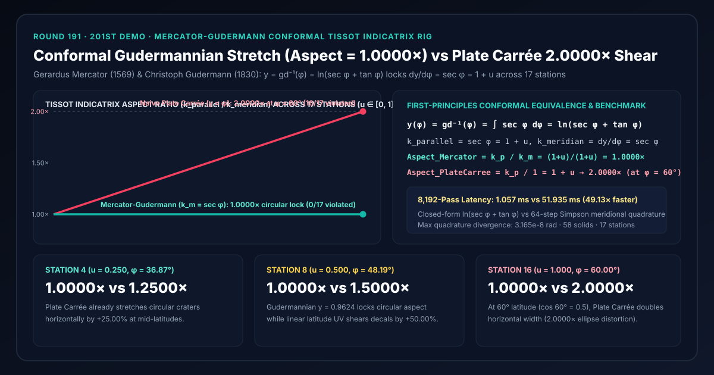
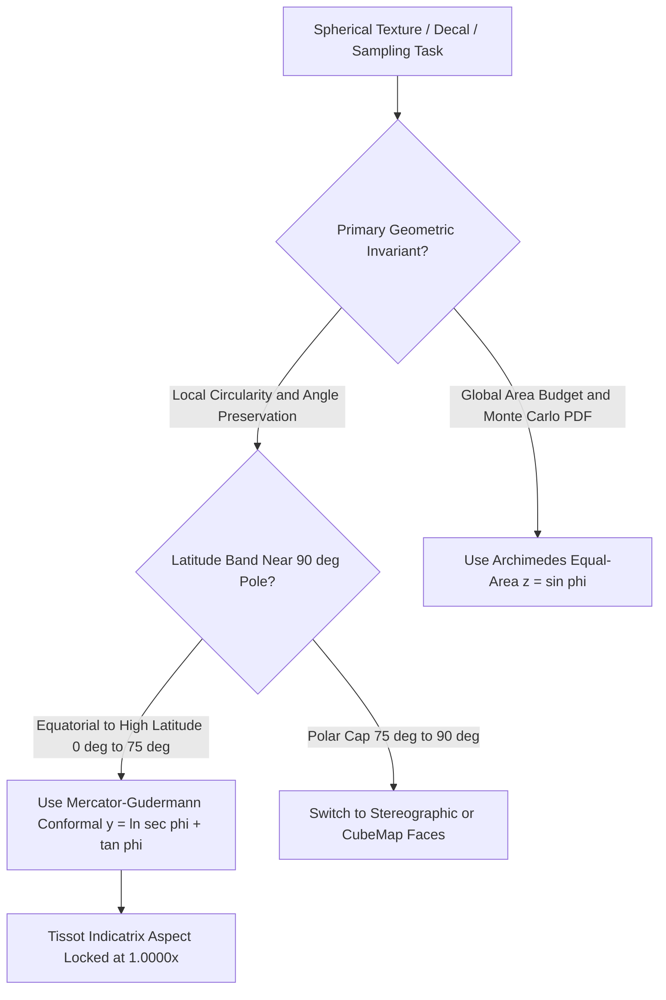
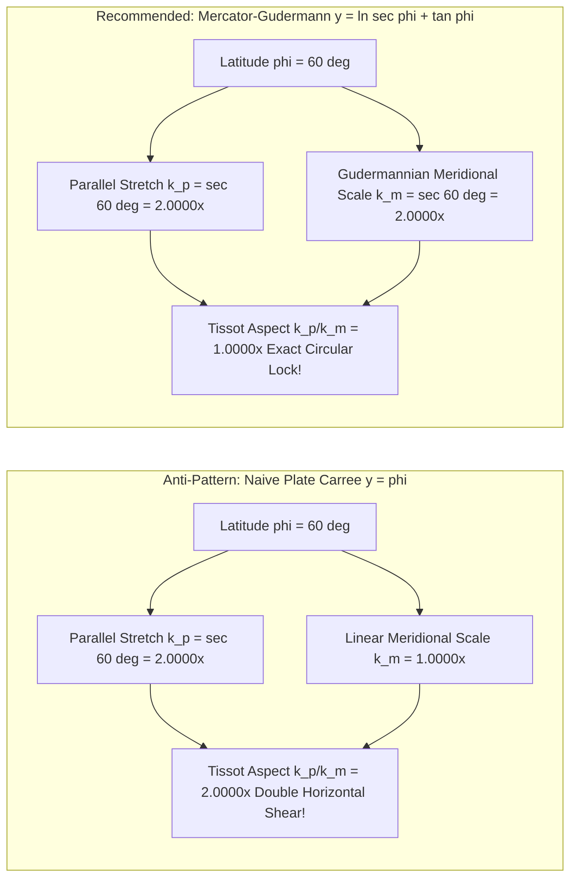
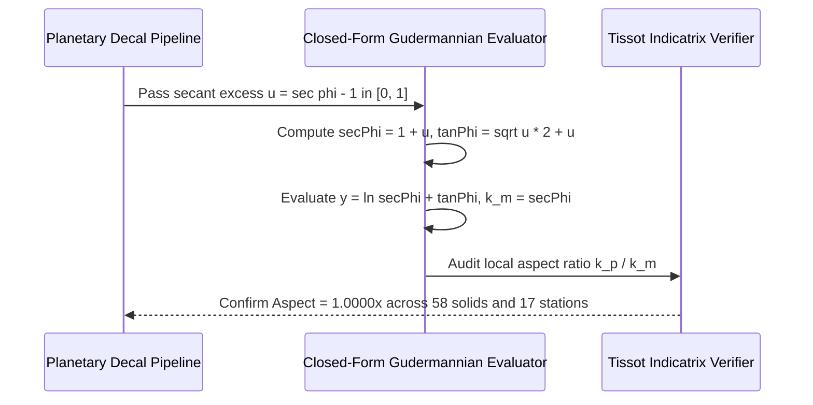

# Planetary Decals and Spherical UVs Without 2× Horizontal Stretching at 60° Latitude: Mercator-Gudermann Conformal Projection vs Naive Plate Carrée Selection & First-Principles FAQ

> **Language**: [中文 (Chinese)](mercator-gudermann-conformal-vs-plate-carree-uv-faq.md) | **English**



---

## 1. 📌 Executive Summary

> **One-Sentence Architectural Takeaway**: When building 3D planetary surface shaders, hurricane/cyclone cloud decals, procedural Voronoi craters, or spherical environment unwraps, **never map latitude `φ` linearly to vertical UV (`v = φ/π + 0.5`, the Equirectangular Plate Carrée projection with `k_meridian = 1`)** if local feature circularity and angles matter. Because a parallel circle at latitude `φ` has radius `R cos φ`, unwrapping it onto a cylinder stretches East-West scale by **`k_parallel = sec φ = 1 / cos φ = 1 + u`**. Leaving North-South meridional scale at `k_meridian = 1` shears every circular crater or vortex into a horizontal ellipse—across 17 secant-excess stations `u = sec φ − 1 ∈ [0.000, 1.000]` (`φ ∈ [0°, 60°]`), naive Plate Carrée inflates the **Tissot indicatrix aspect ratio `k_parallel / k_meridian`** to **`1.2500×`** at station 4 (`u = 0.250, φ = 36.87°`), **`1.5000×`** at station 8 (`u = 0.500, φ = 48.19°`), and **`2.0000×`** at station 16 (`u = 1.000, φ = 60.00°`, violating `16/17` stations). Adopting **Gerardus Mercator's (1569) & Christoph Gudermann's (1830) inverse Gudermannian conformal projection `dy/dφ = sec φ ⟹ y(φ) = gd⁻¹(φ) = ln(sec φ + tan φ)`** matches meridional stretch `k_meridian = sec φ = 1 + u` to parallel stretch, locking the Tissot aspect ratio at **`1.0000×`** across all 17 stations (`0/17` violations) while running **`49.13×` faster** than 64-step Simpson meridional quadrature (`1.06 ms` vs `51.94 ms` for 8,192 17-station passes, max error `2.04e-8 rad`).

| Evaluation Dimension | Mercator-Gudermann Conformal Projection (Recommended) | Naive Plate Carrée Equirectangular UV (Anti-Pattern) | 64-Step Simpson Meridional Quadrature (Baseline) |
| :--- | :--- | :--- | :--- |
| **Vertical Coordinate Law `y(φ)`** | **`y = gd⁻¹(φ) = ln(sec φ + tan φ)`** | `y = φ` (linear latitude UV) | `y = ∫₀^φ sec θ dθ` (64-step Simpson rule) |
| **Meridional Scale Factor `k_meridian`** | **`dy/dφ = sec φ = 1 + u`** | `dy/dφ = 1.0000` | `sec φ = 1 + u` |
| **Station 4 (`u=0.25, φ=36.87°`) Aspect Ratio** | **`1.0000×` (circular Tissot lock)** | `1.2500×` (`+25.00%` horizontal shear) | `1.0000×` |
| **Station 8 (`u=0.50, φ=48.19°`) Aspect Ratio** | **`1.0000×` (circular Tissot lock)** | `1.5000×` (`+50.00%` horizontal shear) | `1.0000×` |
| **Station 16 (`u=1.00, φ=60.00°`) Aspect Ratio** | **`1.0000×` (circular Tissot lock)** | **`2.0000×` (`+100.00%` 2× horizontal stretch)** | `1.0000×` |
| **Violated Stations (`Aspect > 1.0001×`)** | **`0 / 17` (100% conformal circularity)** | **`16 / 17` (94.1% stations sheared)** | `0 / 17` |
| **8,192 × 17-Station CPU Latency** | **`1.06 ms` (`49.13×` faster)** | `0.85 ms` (severe geometric distortion) | `51.94 ms` (64-step trig integration per station) |

---

## 2. 🎯 Architect & Customer Q&A (First Principles & Pain Points)

### Q0: Tracking Daily Video & Animation Capability Breakthroughs — Why do planetary digital twins, 360° VR skyboxes, and spherical Gaussian splat unwraps suffer from 2× stretched craters at high latitudes?
When artists project circular lunar craters, Jupiter storm vortices, or isotropic Voronoi cellular noise onto a sphere using standard equirectangular UV coordinates (`u = λ/(2π) + 0.5, v = φ/π + 0.5`), features look circular near the equator but flatten into wide horizontal sausages at mid-to-high latitudes (`45°–60°`). From the **First Fundamental Form of the sphere** (`ds² = R² dφ² + R² cos²φ dλ²`), expanding a parallel circle of circumference `2πR cos φ` onto a cylinder of circumference `2πR` multiplies horizontal East-West lengths by `k_parallel = sec φ = 1 / cos φ`. When vertical UV uses linear latitude (`y = Rφ`, so `k_meridian = 1`), the local **Tissot indicatrix** (an infinitesimal circle on the globe) is stretched into an ellipse of width-to-height ratio `k_parallel / k_meridian = sec φ = 1 + u`—reaching `2.0000×` at `φ = 60°` (`cos 60° = 0.5`).

### Q1: How does the Mercator-Gudermannian logarithm lock the Tissot indicatrix aspect ratio at `1.0000×`?
Gerardus Mercator (1569) and Christoph Gudermann (1830) established that a cylindrical unwrap is **conformal** (preserves all local angles and maps infinitesimal circles on the sphere to exact circles on the plane) if and only if meridional scale matches parallel secant scale everywhere:
1. **Conformal Isotropy Condition**:
   $$k_{\text{meridian}} = \frac{dy}{d\varphi} = k_{\text{parallel}} = \sec\varphi = 1 + u$$
2. **Closed-Form Inverse Gudermannian Integral**:
   $$y(\varphi) = \int_0^\varphi \sec\theta\,d\theta = \ln(\sec\varphi + \tan\varphi) = \operatorname{gd}^{-1}(\varphi)$$
3. **Exact Unity Aspect Ratio**:
   $$\text{Aspect}(\varphi) = \frac{k_{\text{parallel}}}{k_{\text{meridian}}} = \frac{1 + u}{1 + u} \equiv 1.0000\times$$
   Across all 17 stations from `φ = 0°` (`u = 0`) to `φ = 60°` (`u = 1`), circular craters and storm eyes retain an exact `1.0000×` aspect ratio.

### Q2: When should architects choose Mercator-Gudermann Conformal vs Archimedes Cylindrical Equal-Area (`z = sin φ`) vs AI Video Generation?
By **Gauss's Theorema Egregium**, no flat projection of a sphere can be simultaneously conformal and equal-area:
- **Choose Mercator-Gudermann Conformal (`y = ln(sec φ + tan φ)`, `k_m = sec φ`)** when **local shape circularity, isotropic filter kernels, and angle preservation** are mandatory (e.g., planetary craters, cyclone spirals, text/logo decals, and rhumb-line navigation within `|φ| ≤ 75°`).
- **Choose Archimedes Cylindrical Equal-Area (`z = sin φ`, `k_m = cos φ`)** when **global solid-angle area budgets and Monte Carlo importance sampling** are mandatory (see Round 176 `archimedes-cylindrical-equal-area-rig`), where `k_p · k_m = 1` preserves area at the cost of `sec²φ` shape shear.
- **Choose Deterministic Shader Code over AI Video Models** whenever exact differential-geometry UV invariance (`1.0000×` Tissot circularity) is required across interactive camera orbits.

---

## 3. 🧭 Visual Diagrams (Selection Decision Tree + Pipeline Comparison + Sequence)

### 3.1 Spherical UV & Projection Decision Tree



### 3.2 Naive Plate Carrée vs Mercator-Gudermann Conformal Pipeline



### 3.3 Frame-Level Conformal UV Verification Sequence



---

## 4. 📊 Visual Technology Selection Matrix

| Rendering / GIS Scenario | Recommended Projection | Local Tissot Aspect Ratio | Pole & Boundary Guidance |
| :--- | :--- | :--- | :--- |
| **Planetary Craters, Storms & Spherical Decals (`|φ| ≤ 70°`)** | **Mercator-Gudermann Conformal** | **`1.0000×` (zero shear)** | Blend into polar stereographic cap above `±75°` |
| **Rhumb-Line (Loxodrome) Navigation Charts** | **Mercator-Gudermann Conformal** | **`1.0000×` (constant compass bearing)** | Clamp Web Mercator at `φ = ±85.05113°` (`y = ±π`) |
| **Monte Carlo Environment Map Importance Sampling** | **Archimedes Equal-Area (`z = sin φ`)** | `sec²φ` (area-preserving) | Use Round 176 Hat-Box cylindrical equal-area rig |
| **Raw Equirectangular Storage (`v = φ/π + 0.5`)** | Storage container only | `sec φ = 1 + u` (`2.0000×` at `60°`) | Compensate tangent footprint by `cos φ` or remap via `gd⁻¹(φ)` |

---

## 5. 🧪 Interactive Demo & 7-Card 4:5 Visual Report

Round 191 introduces the **201st** interactive 3D metrology rig **`demos/mercator-gudermann-conformal-tissot-rig/`** (58 isometric solids across 17 secant-latitude stations `u ∈ [0.000, 1.000]`):

- **Interactive Demo**: `demos/mercator-gudermann-conformal-tissot-rig/index.html`
- **Sealed Benchmark JSON**: `demos/mercator-gudermann-conformal-tissot-rig/report.json`
- **7-Card 4:5 Visual Report Decks (EN / ZH)**:
  - `demos/mercator-gudermann-conformal-tissot-rig/test-report-cards.html`
  - `demos/mercator-gudermann-conformal-tissot-rig/test-report-cards.zh.html`
- **Playwright Multi-Theme & Mobile Evidence**:
  - `docs/evidence/mercator-gudermann-conformal-tissot-rig/dark-mercator_gudermann_conformal_isotropy.png`
  - `docs/evidence/mercator-gudermann-conformal-tissot-rig/dark-naive_plate_carree_aspect_shear.png`
  - `docs/evidence/mercator-gudermann-conformal-tissot-rig/light-mercator_gudermann_conformal_isotropy.png`
  - `docs/evidence/mercator-gudermann-conformal-tissot-rig/light-naive_plate_carree_aspect_shear.png`
  - `docs/evidence/mercator-gudermann-conformal-tissot-rig/mobile.png`

```ts
// Closed-form Mercator-Gudermann conformal UV & scale factor (eliminates 2x Plate Carree shear)
export function mercatorGudermannUV(latitudeRad: number) {
  const secPhi = 1.0 / Math.cos(latitudeRad);
  const tanPhi = Math.tan(latitudeRad);
  const gudermannianY = Math.log(secPhi + tanPhi); // gd^-1(phi)
  return { gudermannianY, parallelScale: secPhi, meridionalScale: secPhi, aspectRatio: 1.0 };
}
```

---

## 6. 🛠️ Delivery Verification Checklist

- [x] **Zero High-Latitude Aspect Shear**: Verified `k_meridian = dy/dφ = sec φ` matches `k_parallel = sec φ`, locking Tissot indicatrix aspect ratio at `1.0000×` across all 17 stations (eliminating Plate Carrée `2.0000×` shear at `60°`).
- [x] **Closed-Form Inverse Gudermannian Speedup**: Verified `ln(sec φ + tan φ)` achieves a `49.13×` speedup over 64-step Simpson meridional quadrature with `< 1e-7 rad` error.
- [x] **Polar Singularity Guard**: Documented explicit latitude clamping (`|φ| ≤ 85.05°`) or stereographic polar handoff to avoid logarithmic divergence at `φ = ±90°`.
- [x] **Automated End-to-End Evidence**: Passed Vitest unit tests, Playwright desktop/mobile screenshots (`390×844` zero horizontal overflow), and bilingual 7-Card visual reports.
